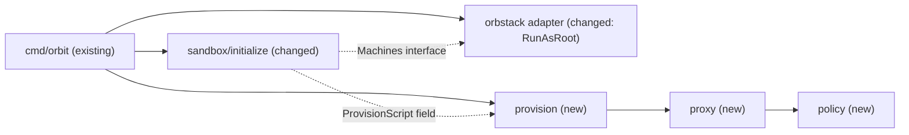

# Sandbox provisioning: agent user, firewall, egress proxy, toolchain

Issue: #16 (E01-S01-T03), story #5 (E01-S01). Depends on #15, merged in #22.

## 📝 TLDR

Today `orbit init` (not yet a registered command) creates an isolated machine and stops. That machine is not a sandbox: the default OrbStack user has passwordless sudo, and nothing limits outbound traffic. This spec proposes that the `init` slice provisions the machine as root right after it is created: an agent user without sudo, a root-owned nftables firewall for every uid from 1000 up, a root-owned tinyproxy that allows only the default allowlist (D21) and refuses private addresses, both as persistent units, and the fixed toolchain (D20). This is the step that turns a machine into a sandbox (D14, D15, D17, R03).

## 📝 Problem Statement

- The spike of 2026-11-10 showed that `--isolate-network` blocks only `host.orb.internal`. Containers on the host engine, the Mac (bridge and LAN addresses), and other machines stay reachable from inside the machine. Only an in-machine firewall keeps the agent away from them (Q09, A05). `[DATA]` `.ai/analysis/2026-11-10-orbstack-isolated-machine-spike.md`
- OrbStack creates a default user with `NOPASSWD:ALL` in `/etc/sudoers.d/orbstack`. Any process that runs as that user can become root and remove the firewall. `[DATA]` spike, finding 1 and addendum
- A firewall rule for the agent uid alone leaks through `docker run --network host --user N`. The rule must cover every uid from 1000 up. `[DATA]` spike, finding 3
- The spike created the proxy address for containers with `ip link` only, so it was gone after a restart. `[DATA]` spike, finding 3

The machine that #15 creates is therefore not safe to give to an agent, and `orbit init` stays unregistered until it is (`internal/sandbox/AGENTS.md`).

## Resolved assumptions (autonomous defaults)

The issue was picked up unattended. Each answer below is the most reversible choice that does not weaken the boundary. Correct any of them before this spec merges.

| # | Question | Applied default | Why |
|---|---|---|---|
| Q1 | Split the agent user, the firewall, the proxy, and the toolchain into separate specs? | No. One spec. | None of the first three is safe or useful without the other two: a firewall without the proxy blocks all egress, a proxy without the firewall enforces nothing, and an agent user without both is unrestricted. The toolchain is one package list (D20). The backlog already split the story into four tasks. |
| Q2 | Delete the default OrbStack user, or remove only its sudo rule? | Remove the sudo rule and the admin group memberships, lock the password, filter its traffic like the agent's, and apply this again at every boot. Keep the user. | The issue accepts either. `userdel` failed in the spike because the user has running processes, and OrbStack may expect the user (it owns the SSH agent socket). Its uid is the Mac uid (501 in the spike), below 1000, so the firewall must name it explicitly. A boot unit also covers the case that OrbStack restores `/etc/sudoers.d/orbstack` on start, which is not known. |
| Q3 | Register `orbit init` in `cmd/orbit` when this task merges? | No. The command stays unregistered until story E01-S01 closes (T04, #17, installs the agent). | Smallest surface. SSH forwarding (R08, E01-S04) and the escape suite (E01-S06) do not exist yet. |
| Q4 | What happens when provisioning fails, and what does `init` do with an existing machine? | `init` always runs provisioning; the script is idempotent. When provisioning fails on a machine that this call created, `init` deletes that machine. It never deletes a machine that existed before the call. | A machine that this call created holds nothing of the user's yet, and an unprovisioned machine must not stay behind. An existing machine can hold the agent's login and files, so it stays, and the next `init` repairs it. |
| Q5 | Where does the code live? | Three new modules from the planned layout: `internal/policy` (the D21 allowlist and host validation), `internal/proxy` (tinyproxy configuration), `internal/provision` (firewall, units, root script). `provision` imports `proxy`; `ARCHITECTURE.md` gets a Key decisions row for that dependency. The `init` slice does not import `provision` (dependency rule 2): `cmd/orbit` injects `provision.Script` as a field of the handler, as it injects `user.Current`. | It follows the Components table and the dependency rules. The `provision` → `proxy` edge is the only dependency that the table does not list. |
| Q6 | Which DNS server may the proxy reach, given that it must refuse loopback and private addresses? | Port 53 on `0.250.250.200` (OrbStack DNS, seen in the spike) only. Provisioning disables and masks systemd-resolved and writes a root-owned `/etc/resolv.conf` with that server. | Exactly what `ARCHITECTURE.md` asks ("except its DNS resolver"). systemd-resolved runs below uid 1000 and answers local clients over D-Bus and varlink, so an agent could resolve any name through it (`resolvectl query`), a DNS exfiltration channel that a port 53 rule does not see. If OrbStack DNS is not at that address, the proxy cannot resolve names and fails closed; the integration test detects that. |
| Q7 | Which ranges does the proxy refuse? | Loopback, private, and link-local, as required, plus shared address space (`100.64.0.0/10`), the benchmark range (`198.18.0.0/15`), `0.0.0.0/8`, multicast, and reserved ranges, for IPv4 and IPv6. | Stricter than required. OrbStack has used `198.19.249.0/24` for machines, so this range must be closed to keep sandboxes apart (R03). |
| Q8 | How does the adapter run the script? | A new adapter operation `RunAsRoot(ctx, name, script)`, which runs `orb -m NAME -u root bash -s` with the script on stdin. | The spike used this path. It is the narrowest operation the slice needs: one fixed user, no argument passed through. |
| Q9 | How does the agent get its proxy settings? | `/etc/environment`, owned by root. Root never writes into the home of the agent. The Docker proxy settings come with rootless Docker (E01-S05, #9). | A root script that writes into a directory the agent controls can be redirected by a symlink when it runs again. |
| Q10 | How does provisioning know the uid of the OrbStack default user, which is below 1000 and so not covered by the floor? | The handler passes the uid of the Mac user that it already reads; OrbStack gives the default user that uid (501 in the spike). The self-check fails when another account below 1000 has a home under `/home` or is in the group `orbstack`. | Keeps the firewall a pure function of known input, with no read from the machine before the script. A wrong assumption fails closed. |

## 📝 Proposed Solution

The `init` handler gets one more step after `ensureMachine`: it calls its `ProvisionScript` field (`provision.Script`, injected by `cmd/orbit`) with the uid of the user who runs Orbit, and runs the result through the adapter as root. OrbStack gives the default user of the machine the uid of the Mac user, so that uid is the one the firewall must filter besides every uid from 1000 up. The script is plain bash, generated by a pure function from constants and validated data. It installs packages, writes every configuration file from a quoted heredoc, enables the units, changes the users, checks the result, and writes a marker file as its last action.

The order inside the script keeps the machine fail-closed at each point. No agent user exists until the firewall and the proxy run. Every step is idempotent, so `init` can run the script again on a machine in use.

1. `set -euo pipefail`, `umask 022`, `cd /`. Remove `/etc/orbit/provisioned`, so that a failed run never leaves a machine that looks provisioned.
2. Install the packages as root: the toolchain of D20 (`git`, `openssh-client`, `curl`, `ca-certificates`, `jq`, `ripgrep`, `unzip`) and the infrastructure (`nftables`, `tinyproxy`). Root traffic is not filtered.
3. DNS: disable and mask `systemd-resolved`, and replace `/etc/resolv.conf` (a symlink on Ubuntu) with a root-owned file that names `0.250.250.200`.
4. Write and enable the units: `orbit-proxy-address.service` (the dummy interface `orbit0` with `172.31.255.1/32`), `nftables.service` with `/etc/nftables.conf`, a tinyproxy drop-in that requires both, and a drop-in for `systemd-user-sessions.service` that requires all of them. Start the address unit. Load the rules with `nft -f /etc/nftables.conf`, never with a restart of `nftables.service`: its `ExecStop` flushes the ruleset and opens a window while agent processes run. The file replaces only the table `inet orbit_egress`, in one transaction.
5. Write `/etc/tinyproxy/tinyproxy.conf` and `/etc/tinyproxy/allowlist`; restart tinyproxy.
6. Harden the users: write and run `orbit-harden.service`. It removes `/etc/sudoers.d/orbstack`, removes every account except root from the groups `sudo`, `admin`, and `adm`, and locks the passwords of root, of the account with the default uid, and of every account with a uid from 1000 up. It runs at every boot.
7. Create the agent user `agent` when it does not exist (`id -u agent || useradd …`): its own group, a home directory, `/bin/bash`, a locked password, and no other group. Refuse to continue when its uid is below 1000.
8. Write `/etc/environment` with `HTTP_PROXY`, `HTTPS_PROXY`, their lowercase forms (`http://127.0.0.1:3128`), and `NO_PROXY=localhost,127.0.0.1`.
9. Self-check as root: the table `inet orbit_egress` is loaded; the units are active; `systemd-resolved` is masked; every account with a home under `/home` or in the group `orbstack` has a uid from 1000 up or the default uid; `sudo -l -U` lists no rule for any account except root; `runuser -u agent -- sudo -n true` fails; `agent` is in no privileged group (`sudo`, `admin`, `adm`, `docker`, `lxd`, `disk`, `shadow`). Any failure stops the script with a non-zero exit.
10. Write `/etc/orbit/provisioned` with the provisioning version (`1`). E01-S02 (`orbit shell`) can refuse a machine without it.

Alternatives considered:

- **An IP allowlist in the firewall (ipset), as in the Claude Code reference devcontainer.** It resolves each domain once at start; CDN addresses change, and it needs a sudo rule for the agent to run the script again. The proxy filters by host name and needs no sudo. Rejected; D22 already decided this.
- **Generate the files in Go and copy them in one by one.** It needs one adapter call per file and a copy operation that writes as root. One script on stdin needs one call and keeps the order in one place. Rejected.
- **A Go CONNECT proxy instead of tinyproxy.** Rejected by D22: more unproven code in the boundary.

## 📝 Delta

### Capability: sandbox-provisioning

#### ADDED Requirement: Agent user without privileges
The system SHALL create the user `agent` with a uid from 1000 up, no sudo rule, and no privileged group (`sudo`, `admin`, `adm`, `docker`, `lxd`, `disk`, `shadow`). This task adds no group at all; E01-S04 adds `orbstack` for the forwarded SSH agent socket (R08).

##### Scenario: The agent tries to become root
- WHEN a process of `agent` runs `sudo -n true`, `su root`, or `su <default user>`
- THEN each command fails

#### ADDED Requirement: Default user without sudo
The system SHALL leave no sudo rule, no membership in `sudo`, `admin`, or `adm`, and no usable password for any account except root, also after a restart of the machine.

##### Scenario: OrbStack default user after provisioning
- WHEN root runs `sudo -l -U <default user>` and `passwd -S <default user>` after provisioning and again after `orb restart`
- THEN no rule is listed and the password is locked

#### ADDED Requirement: Firewall for every uid from 1000 up and the default user
The system SHALL reject all IPv4 and IPv6 traffic, including DNS, UDP, and ICMP, that a socket of a uid from 1000 up or of the default user sends, except TCP to the proxy at `127.0.0.1:3128` or `172.31.255.1:3128` and traffic on the loopback interface to a loopback address. The system SHALL give these uids no name resolution.

##### Scenario: Direct traffic from the agent
- WHEN `agent` connects directly to a public address, sends UDP, pings an IPv4 or IPv6 address, queries a DNS server, or runs `resolvectl query example.org`
- THEN each attempt fails

##### Scenario: Direct traffic from the default user
- WHEN a process with the uid of the default user connects directly to `192.168.139.3` or to a public address
- THEN the connection fails

#### ADDED Requirement: Proxy reachable only from inside the machine
The system SHALL drop every connection to port 3128 that does not arrive on the loopback interface.

##### Scenario: Connection from outside
- WHEN the Mac or another machine connects to port 3128 on an address of the machine
- THEN the connection fails

##### Scenario: Traffic from a container uid
- WHEN a socket of a uid from 100000 up (a rootless container user) connects to a public address
- THEN the connection fails

#### ADDED Requirement: Proxy allowlist
The system SHALL let the proxy open a `CONNECT` tunnel on port 443 only to a host of the default allowlist (D21), matched exactly and without case.

##### Scenario: Allowed and refused hosts
- WHEN `agent` asks the proxy for `CONNECT github.com:443`, `CONNECT example.org:443`, and `CONNECT github.com:22`
- THEN the first succeeds and the other two get 403

#### ADDED Requirement: Proxy refuses non-public destinations
The system SHALL reject every connection of the proxy user to a loopback, private, link-local, shared, benchmark, multicast, or reserved address, except port 53 on its DNS resolvers, and every connection of the proxy user to a port other than 443 and 53.

##### Scenario: Proxy user to a private address
- WHEN a process of the proxy user connects to `192.168.139.3`, `198.19.249.1`, `169.254.169.254`, `127.0.0.1:22`, or `fd07:b51a:cc66:f0::fe`
- THEN the connection fails

#### ADDED Requirement: Enforcement survives a restart
The system SHALL start the firewall, the proxy address, and the proxy as enabled units before `systemd-user-sessions.service`.

##### Scenario: Restart of the machine
- WHEN the machine restarts and `agent` then connects directly to a public address and through the proxy to an allowed host
- THEN the direct connection fails and the proxied one succeeds

#### ADDED Requirement: Fixed toolchain
The system SHALL install git, openssh-client, curl, ca-certificates, jq, ripgrep, and unzip as root, and the agent SHALL NOT be able to install a system package.

##### Scenario: The agent runs apt-get
- WHEN `agent` runs `apt-get install -y htop`
- THEN it fails, and `git`, `ssh`, `curl`, `jq`, `rg`, and `unzip` run

#### MODIFIED Requirement: Init of a project directory
The system SHALL create the machine of the project directory when it does not exist, and SHALL then provision it, also when it already existed. When provisioning fails on a machine that the same call created, the system SHALL delete that machine and report the failure.

##### Scenario: First init
- WHEN `init` runs in a project directory without a machine
- THEN the machine is created and provisioned, and `Created` is true

##### Scenario: Init of an existing machine
- WHEN `init` runs in a project directory whose machine exists
- THEN the machine is provisioned again and is not created or deleted, and `Created` is false

##### Scenario: Provisioning fails on a new machine
- WHEN provisioning fails on a machine that this call created
- THEN the machine is deleted and the error names the failed provisioning

Frozen by: `internal/sandbox/initialize/handler_test.go` (`TestHandleCreatesTheMachine`, `TestHandleKeepsAnExistingMachine`)

## 📝 Architecture

The slice stays the only caller, and it imports no other module: `cmd/orbit` injects the script function (dependency rules 2 and 5).

| Package | Change |
|---|---|
| `internal/policy` (new) | `DefaultAllowlist() []string` returns the hosts of D21. `ValidateHost(string) error` accepts a lowercase DNS name of at least two labels, each `[a-z0-9-]`, not starting or ending with `-`, at most 253 characters; it refuses wildcards, IP literals, ports, trailing dots, and any other byte. |
| `internal/proxy` (new) | `Config(hosts []string) (Files, error)` validates every host with `policy.ValidateHost` and renders `tinyproxy.conf` (as in the spike: `User tinyproxy`, `Group tinyproxy`, `Port 3128`, no `Listen` line (one `Listen` cannot name both addresses; `Allow` limits the clients), `Allow 127.0.0.1`, `Allow 172.31.255.1`, `ConnectPort 443`, `FilterType ere`, `FilterDefaultDeny Yes`, `FilterURLs Off`, `FilterCaseSensitive Off`, `DisableViaHeader Yes`) and the allowlist, one `^escaped\.host$` per line, sorted, without duplicates. |
| `internal/provision` (new) | `Firewall(FirewallInput) (string, error)` renders `/etc/nftables.conf`. `Units()` returns the unit files. `Script(defaultUID uint32) ([]byte, error)` composes the root script from constants, the default uid, `proxy.Config(policy.DefaultAllowlist())`, `Firewall`, and `Units`. |
| `internal/orbstack` (changed) | `RunAsRoot(ctx, name string, script []byte) error`: refuses a foreign name, runs `orb -m NAME -u root bash -s` with the script on stdin, and wraps the error with the standard error of `orb`. `runAsRootArgs(name)` is a pure function with a test. `orbstacktest.Fake` gets `RunAsRoot` and `Delete`, with recorded calls and settable errors. |
| `internal/sandbox/initialize` (changed) | `Machines` gains `RunAsRoot` and `Delete`. `Handler` gains `ProvisionScript func(defaultUID uint32) ([]byte, error)`. `Handle` passes the uid that `loadUser` already reads, provisions after `ensureMachine`, and deletes a machine that it created when provisioning fails. |
| `cmd/orbit` (changed) | Passes `provision.Script` to the handler. No registration (Q3). A new integration test. |

### Firewall rules

`Firewall` renders one table, `inet orbit_egress`, that the file replaces atomically (`table` + `delete table` + definition, as in the spike). Order matters: the rules for the proxy user come before the accept for uids below 1000, because the proxy user has a uid below 1000. "Filtered uids" below means every uid from 1000 up and the default uid.

Output chain (`type filter hook output priority filter; policy accept`):

| # | Match | Verdict |
|---|---|---|
| 1 | proxy user, `oif lo`, `tcp sport 3128` (answers to clients) | accept |
| 2 | proxy user, `{tcp, udp} dport 53`, daddr in the resolvers | accept |
| 3 | proxy user, daddr in the refused IPv4 or IPv6 ranges | reject |
| 4 | proxy user, `tcp dport 443` | accept |
| 5 | proxy user, anything else | reject |
| 6 | `meta skuid < 1000`, `meta skuid != <default uid>` | accept |
| 7 | daddr in the proxy addresses, `tcp dport 3128` | accept |
| 8 | `{tcp, udp} dport 53` | reject |
| 9 | `oif lo`, daddr `127.0.0.0/8` or `::1` | accept |
| 10 | anything else | reject |

Input chain (`type filter hook input priority filter; policy accept`): `iif != lo tcp dport 3128 drop`, so that the Mac and other machines cannot reach the proxy (tinyproxy has no `Listen` line and binds every address).

The uid floor (1000) is a constant, not an input. Rule 9 lets filtered uids reach every listener on loopback; after provisioning, the only one that is not their own is the proxy (systemd-resolved is masked), and the integration test checks that. Refused ranges: IPv4 `0.0.0.0/8`, `10.0.0.0/8`, `100.64.0.0/10`, `127.0.0.0/8`, `169.254.0.0/16`, `172.16.0.0/12`, `192.0.0.0/24`, `192.168.0.0/16`, `198.18.0.0/15`, `224.0.0.0/3`; IPv6 `::/127`, `::ffff:0:0/96`, `64:ff9b::/96`, `fc00::/7`, `fe80::/10`, `ff00::/8`.

`FirewallInput` holds `DefaultUID uint32`, `ProxyUser string`, `ProxyPort uint16`, `ProxyAddrs []netip.Addr`, and `Resolvers []netip.Addr`. `provision` passes the default uid and its constants (`tinyproxy`, `3128`, `127.0.0.1` and `172.31.255.1`, `0.250.250.200`). `Firewall` refuses:

- a default uid of 0 (it would filter root and break provisioning);

- a proxy user that is empty, `root`, or not `^[a-z_][a-z0-9_-]{0,31}$`;
- a proxy port of 0 or 53;
- no proxy address, or a proxy address that is neither loopback nor `172.31.255.1` (a public address here would let the agent reach that host directly);
- no resolver, or a resolver that is unspecified, multicast, or not valid.

### Units

- `orbit-proxy-address.service`: oneshot, `RemainAfterExit=yes`, creates `orbit0` when it is missing and sets the address; `Before=network-pre.target tinyproxy.service systemd-user-sessions.service`.
- `nftables.service` drop-in: `Before=systemd-user-sessions.service`. The Ubuntu unit already runs before `network-pre.target`. The script never restarts this unit (its `ExecStop` flushes the ruleset).
- `tinyproxy.service` drop-in: `Requires=` and `After=` both units above, `Before=systemd-user-sessions.service`, `StartLimitIntervalSec=0` (the spike hit the start limit on rapid restarts).
- `orbit-harden.service`: oneshot, runs `/usr/local/libexec/orbit-harden` (root-owned, 0755), `Before=systemd-user-sessions.service`, `StartLimitIntervalSec=0` (every run of the script restarts it; #66).
- `systemd-user-sessions.service` drop-in: `Requires=` and `After=` on `nftables.service`, `orbit-proxy-address.service`, `tinyproxy.service`, and `orbit-harden.service`, and `StartLimitIntervalSec=0` (each restart of a required unit restarts it too; #66). Ordering alone would let sessions start when one of them fails; with `Requires=`, logins stay disabled instead. The script starts this unit after the restarts, because a propagated restart does not start it again after it failed, and the self-check requires it to be active.

`orbit-proxy-address.service`, `orbit-harden.service`, `nftables.service`, and `tinyproxy.service` are enabled for `multi-user.target`.

## 📝 API Contracts

No user-visible contract changes: `orbit init` stays unregistered. Internal contracts:

- `provision.Script(defaultUID)` is deterministic: the same build and uid yield the same bytes. It returns an error when the uid is 0 or a constant fails validation; a unit test rules out the second.
- Every embedded file is written with `install -o root -g root -m <mode> /dev/stdin <path> <<'ORBIT_EOF'`. The quoted delimiter stops expansion. `Script` refuses content that holds the delimiter line.
- The script writes nothing under `/home`, and its only command that takes the agent as an argument is `useradd` with fixed arguments, plus the `runuser` probes of the self-check.
- `initialize.Output` is unchanged. `Created` keeps its meaning.

## 📝 Edge Cases & Failure Scenarios

| Case | Behavior |
|---|---|
| `apt-get` fails (no network for root, mirror down) | The script exits non-zero before any agent user exists. A new machine is deleted; an existing one stays and the next `init` retries. |
| OrbStack DNS is not at `0.250.250.200`, or OrbStack rewrites `/etc/resolv.conf` on start | tinyproxy cannot resolve names; every proxied request fails. Fail-closed. The integration test and the restart QA catch it. |
| `nftables` or `orbit-harden` fails at boot | `systemd-user-sessions.service` does not start, so logins stay disabled. Root access through `orb -u root` still works, and `init` repairs the machine. |
| `orbit0` exists from an earlier run | The unit and the script use `ip link show orbit0 || ip link add …` and `ip addr replace`. |
| The agent created files or symlinks in its home | Re-provisioning does not touch the home. |
| The agent changed `HTTPS_PROXY` in its shell | It can only reach the proxy or nothing; the firewall does not depend on it. |
| The default user (Mac uid, 501 in the spike) | Its uid is below 1000, so the firewall names it explicitly, its password is locked, and it loses sudo. When the Mac uid is 1000 or higher, `useradd` picks the next free uid for `agent`, and the floor covers both. |
| An account exists that is neither a system account, the default user, nor `agent` | The self-check fails when such an account has a home under `/home` or is in the group `orbstack` with a uid below 1000 that is not the default uid. Fail-closed. |
| OrbStack restores `/etc/sudoers.d/orbstack` on start | `orbit-harden.service` removes it again before user sessions. Unknown whether OrbStack does this; QA checks it after `orb restart`. |
| An agent process starts before the units (OrbStack runs `orb -m -u agent` outside logind) | Not known. QA runs a direct connection as `agent` right after `orb restart`. A failure here is a blocker for the story, not for this task, and is reported in the PR. |
| Deleting a failed new machine fails | `Handle` returns both errors joined; the message names the machine so that the user can delete it. |
| tinyproxy, `orbit-harden`, or user sessions restart often (rapid `init` runs) | `StartLimitIntervalSec=0` on all three keeps them from staying down; while one is down, egress or logins fail closed. |

## 📝 Risks & Impact Review

- **Root is unrestricted** (uid 0 < 1000). The whole design depends on the agent never becoming root on a shared kernel (A01, A05). The machine still has setuid `su`, `newuidmap`, and `ping`; this spec removes sudo and locks passwords but does not remove setuid binaries.
- **Host-name filtering is not data-loss prevention.** An allowed host can receive uploads, and a different TLS name behind an allowed host is not detected (spike, risk 5; accepted in D21).
- **Proxy DNS exception.** The proxy user may send DNS to one fixed address. It cannot be made to send DNS elsewhere: its resolver comes from `/etc/resolv.conf`, which only root writes.
- **systemd-resolved is masked.** This changes how the machine resolves names for root as well. If OrbStack depends on the stub, root DNS fails too; provisioning then fails and the machine is deleted, which the integration test shows.
- **Boot order is not proven for `orb -u agent`.** OrbStack may start a process of the agent outside logind, before the units. The restart QA checks it; the escape suite (E01-S06) repeats it.
- **Re-provisioning restarts tinyproxy.** Open tunnels drop when `init` runs again on a machine in use.
- **New dependency edge** `provision` → `proxy`, recorded in Key decisions.
- **Rollback:** reverting the PR leaves already provisioned machines as they are; the next `init` from the older code does not provision. Nothing persists on the host.

## 📝 Decisions in play

Relies on R01, R03, R07, R08 (no SSH forwarding added here), D12, D14, D15, D17, D20, D21, D22, N07. Supersedes none. Owner of all: Jakub Tobiasz.

## 📋 Phasing

- **Phase 1 — pure configuration.** `policy`, `proxy`, and `provision` with their unit tests. No behavior change; nothing calls them yet.
- **Phase 2 — adapter and slice.** `RunAsRoot`, the fake, and the handler change. `init` provisions.
- **Phase 3 — proof and records.** Integration test against a real OrbStack, documentation, and the archived Delta.

## 📋 Implementation Plan

### Phase 1 — pure configuration

1. **`internal/policy`.** Add `DefaultAllowlist` (D21, exactly) and `ValidateHost`. Table tests with hostile input: `*.github.com`, `GitHub.com`, `github.com.`, `github.com:443`, `1.1.1.1`, `[::1]`, `a..b`, `-a.com`, `a-.com`, an empty string, a name of 254 characters, `githüb.com`, `github.com\nexample.org`, `github.com example.org`, `localhost`. A test checks that every default host passes `ValidateHost`. → verify: `go test ./internal/policy/...`
2. **`internal/proxy`.** Add `Config`. Tests: every allowlist line is anchored and escapes every dot; `githubXcom` does not match the regex of `github.com` (check with `regexp`); duplicates and order do not change the output; one invalid host fails the whole call; the configuration holds `User` and `Group tinyproxy`, `ConnectPort 443`, `FilterDefaultDeny Yes`, `FilterCaseSensitive Off`, and no `Listen` line. → verify: `go test ./internal/proxy/...`
3. **`provision.Firewall`.** Add `FirewallInput` and `Firewall`. Hostile-input table tests for every refusal in the Firewall rules section. Structure tests: the proxy-user rules come before `meta skuid < 1000`; the accept for uids below 1000 excludes the default uid; the table is `inet`; the last output rule rejects; DNS reject comes after the proxy accept; every refused range is present; the uid floor is 1000; the input chain drops port 3128 off loopback. A golden file pins the output. → verify: `go test ./internal/provision/...`
4. **`provision.Units`.** Add the four unit files and the harden script. Tests check `Before=systemd-user-sessions.service`, `Requires=`/`After=` on the tinyproxy drop-in and on the `systemd-user-sessions.service` drop-in, and `WantedBy=multi-user.target`; the harden script locks the default uid. → verify: `go test ./internal/provision/...`
5. **`provision.Script`.** Compose the script in the order of the Proposed Solution. Tests: starts with `set -euo pipefail` and removes the marker before any other change; installs exactly the D20 packages plus `nftables` and `tinyproxy`; masks `systemd-resolved`; loads the rules with `nft -f` and never restarts `nftables.service`; writes nothing under `/home`; creates `agent` only when `id -u agent` fails, and without `-G`; never writes `NOPASSWD` or a sudoers file; checks the uid floor; refuses a default uid of 0; the marker is the last write; a file that holds `ORBIT_EOF` on a line is refused; two calls give equal bytes. → verify: `go test ./internal/provision/...`

### Phase 2 — adapter and slice

6. **Adapter `RunAsRoot`.** Add `runAsRootArgs`, `RunAsRoot` (stdin from the script), and the foreign-name refusal. Add `RunAsRoot` and `Delete` to `orbstacktest.Fake` with the same prefix rule. Unit tests for the arguments and the refusal; an integration test runs `id -u` as root in an `orbit-it-` machine and expects `0`. → verify: `go test ./internal/orbstack/...`, `go test -tags integration -run RunAsRoot ./internal/orbstack/...`
7. **Characterize `init`.** Make `TestHandleCreatesTheMachine` and `TestHandleKeepsAnExistingMachine` assert the complete list of calls on the fake (a new machine: `Exists`, `Create`; an existing one: `Exists` only). Commit that alone, green on the unchanged handler. → verify: `go test ./internal/sandbox/...`
8. **`init` provisions.** Extend `Machines`, add the `ProvisionScript` field (wired to `provision.Script` in `cmd/orbit`), call it with the uid of the current user and pass the result to `RunAsRoot` after `ensureMachine`, and delete a machine that this call created when provisioning fails. Update the test of step 7 to the scenarios of the MODIFIED requirement, and add: the script function gets the uid of the current user; provisioning fails on an existing machine (no delete, error returned); the script function fails (no `RunAsRoot`; a new machine is deleted); delete fails too (both errors); `Exists` fails (no provisioning). → verify: full validation gate.

### Phase 3 — proof and records

9. **Integration test of provisioning.** In `cmd/orbit`, behind the `integration` tag: build the real adapter and the handler, run `Handle` twice on a temporary project directory (the second run proves idempotence), then run a check script through `RunAsRoot` that uses `runuser -u agent --`, `setpriv --reuid <default uid>`, and `setpriv --reuid tinyproxy` to probe every scenario of the Delta except the restart, including `resolvectl query`. The script lists the listeners on loopback (`ss -Hlntup`) and fails on any that belongs to neither tinyproxy nor a filtered uid. From the host, the test dials port 3128 of the machine and expects a failure. Delete the machine in a cleanup that only touches the name the test computed. → verify: `go test -tags integration -run Provision ./cmd/orbit/...` on a named OrbStack version.
10. **Documentation.** `ARCHITECTURE.md`: the "code so far" sentence, a Key decisions row for `provision` → `proxy`, and a note in Provisioning requirements that rootless Docker and the agent-side Docker proxy settings come with E01-S05. Root `AGENTS.md`: the overview sentence and one Task routing row per new module. A short `AGENTS.md` in each new module with its invariants. `internal/orbstack/AGENTS.md`: `RunAsRoot`. `internal/sandbox/AGENTS.md`: `init` provisions. → verify: validation gate.
11. **Archive the Delta** into `.ai/specs/capabilities/sandbox-provisioning.md`. → verify: the file matches the Delta.

QA evidence for the PR (`risk-high`): a terminal transcript on a named OrbStack version with `orb restart <machine>` followed by the restart scenario and the default-user scenario. The adapter has no restart operation yet (E02-S01), so the restart is manual. The escape suite (E01-S06) does not exist yet; the PR states that it did not run. A probe between two sandboxes (R03) also belongs to E01-S06; here the refused ranges and the rejected direct traffic cover it.
