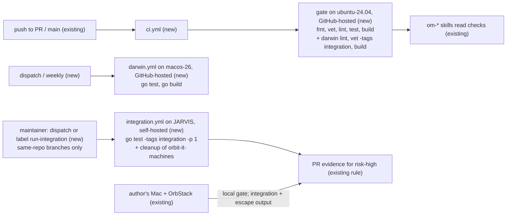

# CI pipeline: the validation gate on GitHub Actions, integration tests, and mutation testing

Issue: #99. Related: #97 / PR #98 (Homebrew distribution, merged as `.ai/specs/2026-11-11-homebrew-distribution.md`; its milestone M1, E06-S01, is "CI with the validation gate").
No prior spec covers CI. This spec owns the CI design and **replaces milestone M1 of the Homebrew spec** (Q11): #99 is the M1 work, and the Homebrew spec's macOS arm64 runner for the gate is superseded by `ubuntu-24.04` (Q1).

## 📝 TLDR

Today the five-command validation gate (`SDLC.md`, Validation gate) runs only on the machine of whoever opens a PR, and `AGENTS.md` lists CI as TODO. This spec adds three GitHub Actions workflows. `ci.yml` has one job, `gate`, on GitHub-hosted `ubuntu-24.04`: the same five commands on every PR and on every push to `main`, plus a lint, vet, and build pass for `GOOS=darwin`. `darwin.yml` runs the unit tests on a GitHub-hosted macOS runner by hand and weekly while the repository is private, and on every PR once it is public. `integration.yml` runs the integration tests and the escape suite against a real OrbStack on a self-hosted macOS runner on the owner's always-on Mac, JARVIS, only when a maintainer starts it, never for a pull request from a fork. Mutation testing is researched here and recommended later, report-only, with Gremlins; its implementation gets its own issue.

## Decisions (owner, 2026-11-12)

Jacob (owner, @jakubtobiasz) decided all twelve questions on 2026-11-12, in chat with the Orbit coordinator (13:28–13:42 Europe/Warsaw): ten as proposed, and Q2 and Q4 differently from the proposal. Each decision is a requirement of this spec; the rest of the spec follows from them. Facts marked `[DATA]` were read from the repository, `gh`, or a run on 2026-11-11; `[DOCUMENT]` facts come from the documentation listed under Evidence; `[UNVERIFIED]` facts are checked in the step that needs them; `[INFERENCE]` marks an estimate.

| # | Question | Decision and requirement | Why |
|---|---|---|---|
| Q1 | Where does the gate run? | **Decided as proposed. On GitHub-hosted `ubuntu-24.04`, as one job `gate`: the five commands in order, then `GOOS=darwin golangci-lint run`, `GOOS=darwin go vet -tags integration ./...`, and `GOOS=darwin GOARCH=arm64 go build ./...`.** Lint and unit tests run on Linux, not on the macOS arm64 runner of the Homebrew spec's M1 (Q11). | On Linux, `gofmt`, `go vet`, `go build`, and every test package passed, except one non-hermetic test (Q12) `[DATA]`; lint was not run on Linux. A Linux minute costs a tenth of a macOS minute on a private repository (Q2). The darwin passes compile, vet, and lint the darwin-only files and the integration tests without running them. |
| Q2 | Which Actions budget does CI live on? | **Decided, changed from the proposal: budget is not a concern. Actions minutes are free once the repository becomes public at the Homebrew spec's M4 (E06-T03, #145). Until then, CI runs within the minutes of the GitHub Free plan. No measurement week and no plan purchase. Jobs SHALL stay lean: one job per workflow, concurrency cancellation, no path to a per-push macOS run while private (Q3). The self-hosted runner (Q4) uses no hosted minutes `[DOCUMENT]`.** | The owner's decision. Going public is already decided (Homebrew spec Q2), and it removes the minute limit. |
| Q3 | When do the unit tests run on macOS? | **Decided as proposed. Workflow `darwin.yml` (GitHub-hosted `macos-26`): `workflow_dispatch` and weekly `schedule` while the repository is private; on every PR and on push to `main` once it is public. Not tied to the `risk-high` label.** | `realpath_darwin.go` (`F_GETPATH`) is boundary code that Linux does not test. But `main` takes about 20 merges a day `[DATA]`; one macOS run per merge would cost about 600 billed minutes a day `[INFERENCE]`. Every `risk-high` PR already passes the gate on the author's Mac (`SDLC.md`, Validation gate). A label trigger would rerun CI on every label that agents add (`in-progress`, `ci-monitoring`, `review`) and cancel runs on the same head. |
| Q4 | Do integration tests and the escape suite run in CI? | **Decided, changed from the proposal: yes, in `integration.yml`, on a self-hosted macOS runner on the owner's always-on Mac, JARVIS (Apple Silicon), with OrbStack. Requirements:** (1) the job never runs for a pull request from a fork: only for branches of this repository, and only when a maintainer starts it, by `workflow_dispatch` or by the maintainer label `run-integration`; the event is `pull_request`, never `pull_request_target`; (2) least-privilege `GITHUB_TOKEN`: `permissions: contents: read` and nothing else; (3) no secret is exposed to the job: it references no `secrets.*`, and checkout uses `persist-credentials: false`; (4) the runner labels are pinned (`[self-hosted, macOS, ARM64, orbit-integration]`), so this job lands only on JARVIS and no other job lands there; (5) concurrency 1: one global group, no cancellation of a running job; (6) cleanup: the sandboxes that the run created are deleted after the run, also when it fails or is cancelled. **Installing and registering the runner on JARVIS is a manual task for Jacob (Phase 3, step H1); no agent installs or registers it.** | GitHub-hosted macOS runners are virtual machines without nested virtualization, so OrbStack machines cannot run there `[DOCUMENT]`. The owner's decision accepts a self-hosted runner under the six requirements above; the residual risk is in Risks. |
| Q5 | Should docs-only PRs skip CI? | **Decided as proposed. No. `ci.yml` has no path filters; every PR runs `gate`.** | A workflow that a path filter skips leaves its checks pending, and a required check then blocks the merge `[DOCUMENT]`. The `om-*` skills also read a workflow that never started as pending CI (`.ai/trackers/github.md`, Conventions). |
| Q6 | How is "CI green before merge" enforced while GitHub cannot enforce it? | **Decided as proposed. By `SDLC.md`: `gate` must be green on the PR head before merge. The tracker descriptor treats an HTTP 403 from branch protection like a 404: every reported check is required. A ruleset that requires `gate` follows when the repository is public (follow-up issue, not in this plan; it lands with E06-T03, #145).** | Branch protection and rulesets answer 403 on this repository `[DATA]`, and the descriptor handles only 404 today (`.ai/trackers/github.md`, get-required-checks). |
| Q7 | How are the actions kept current and safe? | **Decided as proposed. Pin every action by full commit SHA with the version in a comment; Dependabot updates the `github-actions` ecosystem weekly. Not the Go module ecosystem.** | SHA pins stop a moved tag from changing what runs. Dependabot keeps the pins current. A Go dependency change needs Jacob's yes (`AGENTS.md`, Ask first). |
| Q8 | Which golangci-lint version runs in CI? | **Decided as proposed. v2.15.0, pinned in the workflow. Bump it by hand together with the local install. If the release binary was built with a Go older than 1.27.4 and refuses the module, use `install-mode: goinstall`.** | A local pass and a CI pass must mean the same thing. v2.15.0 is the version Jacob runs locally `[DATA]` and the latest release `[DOCUMENT]`. Which Go version built the release binary is `[UNVERIFIED]`. |
| Q9 | Add mutation testing, and how? | **Decided as proposed. Yes, later, report-only: Gremlins at a pinned version, weekly and by hand, on the pure security packages. The JSON report is an artifact. No threshold and no required check until a baseline exists.** Details are in Mutation testing below. | Gremlins is the only Go tool with coverage-guided skipping, a diff mode, JSON output, and threshold exit codes `[DOCUMENT]`. But it is pre-1.0, and its run on Go 1.27 is `[UNVERIFIED]`. A score is useful as a list of missing hostile-input tests, not as a merge gate. |
| Q10 | One spec, or split? | **Decided as proposed. This spec delivers CI (Phases 1–3). Mutation testing is research and a recommendation here; its implementation gets its own issue and a short spec when it starts. The required-check ruleset is a follow-up issue.** | Each of the three works without the others (the split test). |
| Q11 | How does this relate to the Homebrew spec, whose M1 is "CI with the validation gate" on a macOS runner? | **Decided as proposed. This spec owns CI and replaces M1 (E06-S01) of the Homebrew spec. Lint and unit tests run on GitHub-hosted `ubuntu-24.04` (Q1), not on the macOS arm64 runner that M1 named; the darwin-only code is covered by the darwin lint, vet, and build pass and by `darwin.yml`. M1's "after M4, the job is a required status check on `main`" applies to `gate`. Because PR #98 merged first, this spec merges second and Phase 2 adds a pointer from the Homebrew spec's M1 to this spec.** | One design for CI, not two. |
| Q12 | How is `TestOrbitInitRefusesAStoppedOrbStack` made hermetic? | **Decided as proposed. Keep the test in `cmd/orbit`, and narrow its assertions to the composition: exit code 1, stderr that starts with `orbit: ` and contains `(orb status: Stopped)`, and no orb command other than `orb status`. The exact advice text stays pinned where it already is, in `internal/orbstack` (`TestNoCallStartsAStoppedOrbStack` and the `statusError` tests, which stub the account).** | With `HOME` unchanged and no `$HOME/.orbstack`, the adapter correctly reports `ErrHome`, not `ErrNotRunning` `[DATA]`. Setting `HOME` to a temporary directory does not help: `homeCause` compares HOME with the account's home first (`internal/orbstack/orbstack.go:604`) and reports `ErrHome` for that too. Both messages contain `(orb status: Stopped)`. The advice text is not weakened (`AGENTS.md`: "do not weaken a test to make it pass"), because it stays pinned at the adapter; only its second copy moves out. |

**Relation to the Homebrew spec's Q14.** That decision (the Maintainer runs the integration tests by hand on the commit to be tagged and puts the transcript in the release notes) is unchanged by this spec. Its reason against a self-hosted runner, PR code on the host that holds the owner's credentials, is what Q4's six requirements answer, by the owner's decision of 2026-11-12.

## 📝 Problem Statement

- No CI exists `[DATA]`: there is no `.github/workflows/`, and `AGENTS.md` (Task routing, CI row) says TODO. The gate runs only locally, so a PR that is pushed without the gate reaches review unchecked.
- `om-auto-merge-buddy` reads CI as its third readiness signal (`SDLC.md`, `automerge-signal-3-ci`), and `om-auto-fix-pr --ci-only` exists to drive CI green. Without a workflow, both have nothing to read.
- The integration tests and the escape suite run only when an author remembers to run them on a Mac with OrbStack (`SDLC.md`, Validation gate). Nothing in GitHub shows that they passed on a given head.
- The repository is private, in an organization on the GitHub Free plan `[DATA]`. On that plan, branch protection and rulesets are not available: `gh api …/branches/main/protection` and `…/rulesets` answer 403 "Upgrade to GitHub Pro or make this repository public" `[DATA]`. GitHub cannot enforce a required check today.
- Volume is high `[DATA]`: since 2026-11-10, `main` took 31 first-parent commits, and all refs together got 188 commits, most of them from agents. Until the repository is public, Actions minutes are limited, and a macOS minute counts ten times `[DOCUMENT]`. The design must be cheap per push (Q2).
- One unit test is not hermetic `[DATA]`. `TestOrbitInitRefusesAStoppedOrbStack` (`cmd/orbit/compose_test.go:199`) goes through the real adapter. The adapter checks that `$HOME/.orbstack` is a directory (`internal/orbstack/orbstack.go:560`). On a host where OrbStack never ran, the test fails with "is not a directory: start OrbStack once as this account". This was reproduced in a `golang:1.27.4` container as a non-root user; every other package passed. A fresh CI runner is such a host.

## 📝 Proposed Solution

### Workflow `ci.yml`

- **Triggers:** `pull_request` with the default activity types (every target branch), `push` to `main`, and `workflow_dispatch`. No `labeled` type, so the labels that agents change do not start runs.
- **Permissions:** `contents: read` only.
- **Concurrency:** `group: ci-${{ github.event.pull_request.number || github.sha }}`, `cancel-in-progress: true`. A newer push to a PR cancels the older run. Each push to `main` has its own group, so no run on `main` is cancelled or replaced.
- **Path filters:** none (Q5).

The job `gate` runs on GitHub-hosted `ubuntu-24.04` with these steps:

1. `actions/checkout` with `persist-credentials: false`.
2. `actions/setup-go` with `go-version-file: go.mod` and `cache-dependency-path: go.sum`.
3. The five commands of `.ai/agentic.config.json`, in order. Each command is its own step and has the same name as in `SDLC.md`. `golangci-lint run` runs through `golangci/golangci-lint-action` with `version: v2.15.0` (Q8).
4. `GOOS=darwin golangci-lint run`, with the binary that the action installed.
5. `GOOS=darwin go vet -tags integration ./...`.
6. `GOOS=darwin GOARCH=arm64 go build ./...`.

`gate` is one job on purpose. GitHub rounds each job up to a whole billed minute `[DOCUMENT]`. The tests take about 5 s `[DATA]`, so five parallel jobs would cost five billed minutes per push and would not give faster feedback. The step names keep a failure readable.

### Workflow `darwin.yml`

One job, `darwin`, on GitHub-hosted `macos-26` (arm64, pinned; `macos-latest` points to it today `[DOCUMENT]`). It runs checkout, setup-go, `go test ./...`, and `go build ./...`. Triggers while the repository is private: `workflow_dispatch` and a weekly `schedule` on `main`. Once the repository is public, `pull_request` and `push` to `main` are added, with the same concurrency rule as `ci.yml` (Q3).

### Workflow `integration.yml`

One job, `integration`, on the self-hosted runner on JARVIS (Q4).

- **Triggers:** `workflow_dispatch` (on a branch of this repository, chosen with `--ref`), and `pull_request` with the activity type `labeled` only. Never `pull_request_target`, `push`, or `schedule`.
- **Job condition:** the job runs only when one of these holds, and is skipped otherwise:
  - the event is `workflow_dispatch`, and `github.actor` is in the maintainer allowlist written in the workflow (today: `jakubtobiasz`);
  - the event is `pull_request`, the added label is `run-integration`, `github.event.sender.login` is in the same allowlist, and `github.event.pull_request.head.repo.full_name == github.repository` (no fork).
- **Permissions:** `contents: read` only. No `secrets.*` reference anywhere in the workflow. `actions/checkout` with `persist-credentials: false`.
- **Runner:** `runs-on: [self-hosted, macOS, ARM64, orbit-integration]`. The runner is registered on this repository only, not on the organization, and carries the custom label `orbit-integration`. No other workflow uses that label.
- **Concurrency:** `group: orbit-integration`, `cancel-in-progress: false`. One run at a time; a newer pending run replaces an older pending one, and a running job is never cancelled by a new one, so it always reaches its cleanup. `timeout-minutes` bounds a hung run.
- **Steps:** checkout; setup-go from `go.mod`; record the names of the machines that start with `orbit-it-`; `go test -tags integration -p 1 -count=1 ./...` (this includes the escape suite once #10 exists); then a cleanup step with `if: always()`.
- **Cleanup:** every integration test already deletes its own machine (`internal/orbstack/AGENTS.md`, Validation). The cleanup step deletes leftovers from a failed or cancelled run: machines whose names start with `orbit-it-` and that did not exist before the run. It never touches any other machine, so Jacob's own sandboxes on JARVIS are safe. Its exit code is not hidden: a cleanup that fails turns the run red. The cleanup is a shell script, `.github/scripts/integration-cleanup.sh`, that calls `orb list` and `orb delete`; it is OrbStack-specific code outside `internal/orbstack` (`AGENTS.md`, Ask first), and Jacob's Q4 cleanup requirement is the approval for it. It stays a script and is never imported by Go code.
- **Label:** `run-integration` is a new human-only label (`automerge.humanOnlyLabels` in `.ai/agentic.config.json` and the human-only labels paragraph of `SDLC.md`). Agents never apply it. To run again on a newer head, the maintainer removes and adds the label, or uses `workflow_dispatch`. The label stays on the PR as a record.
- **Required check:** `integration` never becomes a required check while a job condition can skip it, because a skipped job reports success (Required checks below).

An agent label change (`in-progress`, `review`, …) on a PR starts a workflow run of `integration.yml` whose job is skipped at once. It takes no runner and no minutes. The `om-*` skills read a skipped job as finished, not as red.

### Why Linux for the gate

Orbit is a macOS program, but the gate is the Go toolchain, and the gate passed on Linux except for one test (Q12) `[DATA]`. The code that differs between the platforms is `internal/sandbox/internal/realpath`. `realpath_darwin.go` asks the kernel for the canonical path (`F_GETPATH`); `realpath_other.go` is the fallback that Linux tests. The darwin lint, vet, and build pass catch compile and static errors in the darwin file on every push. Its behavior is tested on the author's Mac by the local gate, in `darwin.yml`, and in `integration.yml` on JARVIS.

### Caching

- `actions/setup-go` caches the module cache and the build cache by default `[DOCUMENT]`. Its key hashes `go.mod` unless `cache-dependency-path` is set. `ci.yml` sets `cache-dependency-path: go.sum`, so a dependency change also invalidates the cache. Orbit has one direct dependency (cobra), so the module cache is small; most of the gain is from the build cache.
- `golangci-lint-action` caches its own analysis cache. The cache is invalidated every 7 days `[DOCUMENT]`.
- Caches written on `main` are readable from every PR branch. A PR's cache is readable only from that PR `[DOCUMENT]`. The push-to-`main` run therefore seeds the cache for every PR.
- `integration.yml` uses no Actions cache: the self-hosted runner keeps the Go caches of its account between runs.
- No other cache, and no artifacts.

### Supply chain

Every action is pinned by full commit SHA, with the version in a comment: `actions/checkout` v7.0.1, `actions/setup-go` v7.0.0, and `golangci/golangci-lint-action` v9.3.0 `[DOCUMENT]`. `.github/dependabot.yml` updates the `github-actions` ecosystem weekly (Q7). No job uses a secret.

### Required checks

GitHub cannot enforce a required check on this repository today (Problem Statement). Until it can, the rule lives in `SDLC.md` (Q6). Also, the tracker descriptor's **get-required-checks** treats a 403 like a 404, so the `om-*` skills treat every reported check as required.

A later ruleset requires the check `gate` (follow-up issue, with E06-T03). That ruleset must have an empty bypass list. `SDLC.md` says that `om-auto-merge-buddy` "bypasses … host merge rules". With an empty bypass list, a merge through the API with a red `gate` fails anyway.

Two GitHub rules shape this design `[DOCUMENT]`:

- A workflow that path filters never start leaves its checks pending, and the pending check blocks the merge.
- A job that is skipped by a job-level `if` reports success.

So the required check is `gate`, which always runs. `darwin` and `integration` must never become required while any trigger or condition can skip them.

### Integration tests and the escape suite

They run in `integration.yml` on JARVIS, and nowhere else in CI. They need a running OrbStack, and OrbStack needs Apple's Virtualization framework, which GitHub-hosted macOS runners cannot nest `[DOCUMENT]`. `gate` also compiles them for darwin (step 5), so a change that breaks their build fails on every push.

The `SDLC.md` rule for a `risk-high` boundary change stays: it runs the integration tests and the escape suite. A green `integration` run on the PR head, started by the maintainer, is accepted as that evidence: the PR links the run instead of pasting a transcript. A local run on the author's Mac stays accepted too.

## 📝 Mutation testing

Mutation testing changes the code (for example `<` into `<=`) and checks that a test fails. A mutant that survives points to a behavior that no test pins. For Orbit, this matters most in the pure security functions, which `AGENTS.md` requires to have hostile-input tests.

### Tools (read 2026-11-11)

| Tool | Latest release | Activity | How it works | CI fit | Verdict |
|---|---|---|---|---|---|
| [Gremlins](https://github.com/go-gremlins/gremlins) | v0.6.0, 2025-12-06; Apache-2.0; 463★ | last commit 2026-03-30 | AST mutation. A coverage pass runs first: uncovered code is reported as NOT COVERED and is not tested. Parallel workers. It runs only the tests of the mutated package. | `--threshold-efficacy` (exit 10), `--threshold-mcover` (exit 11), `--diff <ref>` (changed code only, since v0.5.0), `--output` JSON, `--tags`. Official action `gremlins-action@v1`. | **Most usable.** It calls itself 0.x: flags can change between minor versions. Its README says that it is slow on very big modules; Orbit is small. Open issue #252: generic type unions are mutated as bitwise, a mutator that is off by default, and Orbit declares no generic code `[DATA]`. Go 1.27 support `[UNVERIFIED]`: its `go.mod` says 1.25. |
| [go-mutesting (avito-tech fork)](https://github.com/avito-tech/go-mutesting) | v2.3.1, 2025-12-26; MIT; 283★ | last commit 2026-10-02; built with Go 1.27 | AST mutation. It runs the package tests for every mutant, with no coverage pre-pass. | JSON and HTML reports, and a printed score. **No** threshold exit code, no workers flag, and no diff mode. By default it skips files with build tags. | Maintained, with more mutators, but a CI gate needs a script over the JSON. Second choice. |
| [go-mutesting (zimmski)](https://github.com/zimmski/go-mutesting) | v1.2, 2021-06; MIT; 679★ | no commits since 2021 | AST mutation | — | **Unmaintained.** Do not use. |
| [ooze](https://github.com/gtramontina/ooze) | no release; last tag v0.3.1, 2023-05; MIT; 290★ | commits until 2026-08 | A library that a `//go:build mutation` test calls. It runs the whole `go test ./...` per mutant, with no coverage skip. | `WithMinimumThreshold`, `Parallel()`. Console report only. | Active but unreleased, so you must pin a commit. Slow without coverage skipping. It adds a Go dependency to `go.mod`. |
| gomu, selene, other forks | v0.x | 1–62★ | — | They claim diff and threshold modes. | **Experimental.** Not proven enough. |

### Recommendation

Add Gremlins later, in its own workflow `mutation.yml`, under its own issue (Q10). Keep it out of the merge gate.

- **Scope:** `./internal/policy`, `./internal/proxy`, `./internal/provision`, `./internal/sandbox` (mount rules and the machine name), and `./internal/sandbox/internal/hostcheck`. These are the pure security functions with hostile-input tests (`ARCHITECTURE.md`, Testing strategy). Slices and `cmd/orbit` are left out: their tests are handler tests against fakes, and survivors there are mostly noise. `realpath` is left out on Linux, because there Gremlins would mutate only the fallback `realpath_other.go`. A macOS run for `realpath_darwin.go` is an option in that issue.
- **When:** a weekly `schedule` and `workflow_dispatch`, on GitHub-hosted Linux. Not on every PR, and not on the self-hosted runner.
- **How:** one `go run github.com/go-gremlins/gremlins/cmd/gremlins@v0.6.0 unleash --output <pkg>.json <pkg>` per package, in a loop. `go.mod` gains no dependency (no `tool` directive). The reports are artifacts. The job fails only if Gremlins itself fails, never on a score. The first run records a baseline in `.ai/analysis/`. Each surviving mutant that matters gets an issue or a reason why it is equivalent.
- **Later, Jacob's choice:** a non-required PR job with `--diff origin/main` on boundary packages, or a `--threshold-efficacy` at the baseline.
- **Not chosen:** gating merges on a mutation score now. The tool is 0.x and its Go 1.27 run is unverified, so it should not block a merge. A score target also invites tests that kill mutants without stating a rule.

## 📝 Delta

### Capability: ci

#### ADDED Requirement: CI runs the validation gate on every PR

The system SHALL run the five validation commands of `.ai/agentic.config.json` in order, then the darwin lint, vet, and build pass, on every push to a PR and to `main`, on GitHub-hosted `ubuntu-24.04`, and report one check named `gate`.

- WHEN an agent pushes a commit to a PR branch
- THEN the `gate` check runs format, vet, lint, test, build, darwin lint, darwin vet with the `integration` tag, and darwin build on Linux, and it fails on the first non-zero exit
- AND a newer push to the same PR cancels the older run

- WHEN a PR adds an unformatted Go file
- THEN `gate` fails at the format step

- WHEN an agent adds or removes a label on a PR
- THEN no `gate` run starts

Frozen by: none (new capability). The deliberate-failure checks in Phase 2 prove it.

#### ADDED Requirement: unit tests do not depend on the host's OrbStack state

The system SHALL pass `go test ./...` on a host where OrbStack was never installed or started.

- WHEN `go test ./...` runs as a user whose `$HOME/.orbstack` does not exist
- THEN every test passes

Frozen by: the `gate` check after Phase 1, on a runner without OrbStack.

#### ADDED Requirement: integration tests run on a maintainer's request, never for a fork

The system SHALL run `go test -tags integration -p 1 ./...` on the self-hosted runner labelled `orbit-integration` only when a maintainer in the workflow's allowlist starts it, by `workflow_dispatch` or by adding the label `run-integration` to a PR whose head branch is in this repository, with a `GITHUB_TOKEN` limited to `contents: read`, no secrets, one run at a time, and a cleanup of the machines that the run created.

- WHEN the maintainer adds `run-integration` to a PR from a branch of this repository
- THEN `integration` runs on JARVIS against the PR head, and afterwards no `orbit-it-` machine that the run created exists

- WHEN anyone adds `run-integration` to a PR whose head is in a fork
- THEN the `integration` job is skipped, and no job reaches the self-hosted runner

- WHEN an actor outside the allowlist adds the label or dispatches the workflow
- THEN the `integration` job is skipped

- WHEN a second run is requested while one runs
- THEN it waits, and the running job is not cancelled

- WHEN a run fails or is cancelled midway
- THEN the cleanup step still runs and deletes only the `orbit-it-` machines that did not exist before the run

Frozen by: none (new capability). The checks in Phase 3 prove it.

## 📝 Architecture

No production code changes. Phase 1 changes one test. New files: `.github/workflows/ci.yml`, `.github/workflows/darwin.yml`, `.github/workflows/integration.yml`, `.github/scripts/integration-cleanup.sh`, `.github/dependabot.yml`. Changed documents:

- `AGENTS.md`: the CI row in Task routing; the Validation commands section says where the integration tests run in CI.
- `SDLC.md`: in Validation gate, CI runs the same commands, `gate` must be green before merge, and a maintainer-started `integration` run on the PR head counts as integration evidence; `run-integration` in the human-only labels.
- `ARCHITECTURE.md`: in Testing strategy, where each kind of test runs.
- `.ai/trackers/github.md`: get-required-checks treats a 403 like a 404.
- `.ai/agentic.config.json`: `run-integration` in `automerge.humanOnlyLabels` (changed together with `SDLC.md`).
- `.ai/specs/2026-11-11-homebrew-distribution.md`: M1 points to this spec (Q11).



Takeaway: GitHub-hosted runners run everything that needs no OrbStack and is cheap per push. The OrbStack tests run on JARVIS only on a maintainer's request, with no secrets and never for a fork.

## 📝 Edge Cases & Failure Scenarios

- **A fresh runner has no `$HOME/.orbstack`.** Phase 1 fixes the one test that depends on it before `ci.yml` exists. Without that fix, `gate` would be red on its first run.
- **Go version.** `go.mod` says `go 1.27.4` `[DATA]`, and `setup-go` installs that exact version from `go-version-file`. If the download is not available, the job fails visibly at setup, and a rerun fixes it.
- **golangci-lint built with an older Go than `go.mod`.** The lint refuses to load the packages. Step 2 checks this, and the fallback is in Q8. A Dependabot PR for the lint action does not change the `version:` input; Jacob bumps that by hand.
- **Minutes run out before M4.** Runs fail with a billing message. GitHub blocks no merge, because there is no protection, but the `om-*` skills see a failed check and stop. The lean design (Q2) keeps this unlikely; it ends when the repository is public.
- **The macOS image changes.** `macos-26` is pinned, so an image move is a deliberate PR.
- **Agent lock refs.** Pushes to `refs/om-locks/*` are not pushes to `main`, so they start nothing.
- **A cancelled `ci.yml` run.** A newer push cancels the older run, so the cancelled run never belongs to the head SHA. The skills read the checks of the head only.
- **JARVIS is offline, asleep, or OrbStack is stopped.** An `integration` run waits in the queue for the runner, or fails at the first test with `ErrNotRunning`. `gate` is unaffected, and `integration` is not required, so no merge is blocked; the maintainer starts it again later.
- **A local integration run on JARVIS overlaps a CI run.** Both use the same OrbStack when the runner runs under Jacob's account. The existing file lock on `/tmp/orbit-integration-init.lock` (`SDLC.md`, Validation gate) orders the `init` tests. The cleanup could see a machine of the local run as new; it therefore deletes only `orbit-it-` machines that still exist after the test process has exited and that appeared during the run. Jacob avoids overlapping runs on JARVIS, or the runner uses a separate account (H1). Whether the file lock works across two macOS accounts is `[UNVERIFIED]` (Phase 3).
- **The label stays on the PR.** A new push to a labelled PR does not start `integration` again (only `labeled` is a trigger). The maintainer removes and adds the label, or dispatches the workflow.

## 📝 Risks & Impact Review

**Cost.** Prices are `[DOCUMENT]`. Run counts are `[INFERENCE]` from the commit rate. CI timings are `[UNVERIFIED]` until Phase 2. Budget is not a concern by the owner's decision (Q2).

| Plan / visibility | Included minutes | `gate` (~2 billed Linux min per run) | `darwin` (~3 min × 10 per run) | `integration` |
|---|---|---|---|---|
| Private, Free (until M4) | 2,000 / month, macOS ×10 | ~1,000 runs / month | ~65 runs / month | self-hosted: no minutes |
| Public (from M4) | standard runners free | — | — | self-hosted: no minutes |

Concurrency cancellation lowers the `gate` count, because a cancelled run bills only the minutes it ran, and `darwin` does not run per push while the repository is private.

**Self-hosted runner (Q4).** PR code runs outside any sandbox on JARVIS, a Mac that the owner uses. GitHub says that self-hosted runners "can be persistently compromised by untrusted code in a workflow" `[DOCUMENT]`. Q4's requirements remove the untrusted sources: no fork PRs, no `pull_request_target`, only allowlisted maintainers start a run, no secrets, a read-only token, and a runner label no other job uses. The residual risk is code from a branch of this repository, which agents write, run as the runner's macOS account when the maintainer starts it. Two consequences:

- Automation that authenticates as an allowlisted maintainer counts as that maintainer. Agents never apply `run-integration` and never dispatch `integration.yml` (`SDLC.md` human-only labels).
- Recommended, Jacob's choice at registration (H1): run the runner as a dedicated standard (non-admin) macOS account on JARVIS, without the owner's SSH agent, keychain items, or tokens. Whether OrbStack serves two accounts on one Mac, and how its license covers that, is `[UNVERIFIED]`; if it does not, the runner runs as Jacob's account and the bullet above is the remaining guard.

The implementation PR of Phase 3 is `risk-high`: it decides what runs on the owner's host and with which credentials. It needs a review by a second person.

**Direction call, not a defect.** Running the gate on Linux tests a program that ships only for macOS. The darwin lint, vet, and build pass, `darwin.yml`, the local gate on the Mac, and `integration.yml` close that gap.

**Reversibility.** Every file is new and in `.github/`, except the document updates. Removing the workflows and deregistering the runner restore today's state.

**No sandbox-boundary change.** This spec does not change mounts, isolation, provisioning, network policy, or the credentials of a sandbox. The spec PR is docs-only and `risk-low`; Phase 3's implementation is `risk-high` (above).

## 📝 Decisions in play

This spec relies on:

- D02 (Go CLI): the gate is the Go toolchain.
- D13 and N06 (OrbStack only): there is no other backend to test in CI; integration tests need a real OrbStack, so they need a Mac (Q4).
- D08 (no credential handling): CI holds no secret; the integration job gets no secret (Q4).

It proposes nothing that supersedes an active row of the brief. It replaces M1 of the Homebrew spec (Q11), and it relies on that spec's Q2: the repository becomes public at M4, which ends the minute limit (Q2) and allows the required-check ruleset (Q6).

## 📋 Phasing

- **Phase 1: hermetic unit tests.** One test change, on its own PR. It ships alone and is useful without CI.
- **Phase 2: `ci.yml`, `darwin.yml`, Dependabot for actions, and the document updates.** Needs Phase 1.
- **Phase 3: `integration.yml` on JARVIS.** Needs Phase 2 and Jacob's manual runner setup (H1). Its implementation PR is `risk-high`.
- **Follow-ups, not planned here:** the required-check ruleset, with E06-T03 (#145); `darwin.yml` on every PR once public (Q3); mutation testing (Q10).

## 📋 Implementation Plan

### Phase 1: hermetic unit tests

1. Change `TestOrbitInitRefusesAStoppedOrbStack` as Q12 decides: it asserts exit code 1, the `orbit: ` prefix, `(orb status: Stopped)`, an empty stdout, and that only `orb status` ran. Then search the `*_test.go` files without the `integration` tag for any other test that goes through the real adapter without a fake account. Verify:
   - The test passes on the Mac.
   - `go test ./...` passes in `golang:1.27.4` as a non-root user without `.orbstack`, with the command in Evidence.
   - `TestNoCallStartsAStoppedOrbStack` still pins the advice "start OrbStack".

### Phase 2: the hosted workflows

2. Add `.github/workflows/ci.yml` with `gate`, as specified. Pin the actions by SHA, set `contents: read`, and set the concurrency rule. Verify:
   - The PR that adds the workflow shows a green `gate`.
   - The lint step's log shows that golangci-lint v2.15.0 loads the Go 1.27.4 module, or the fallback of Q8 is applied.
   - A throwaway commit with an unformatted file turns `gate` red at the format step. A throwaway lint error in `realpath_darwin.go` turns it red at the darwin lint step. A throwaway syntax error in an `_integration_test.go` file turns it red at the darwin vet step. All three commits are reverted.
   - Adding and removing an unrelated label on the PR starts no `gate` run.
3. Add `.github/workflows/darwin.yml` with `workflow_dispatch` and a weekly `schedule`. Verify: `gh workflow run darwin.yml --ref <branch>` gives a green run on `macos-26`.
4. Add `.github/dependabot.yml` for `github-actions`, weekly. Verify (in the GitHub UI; no CLI shows it): Insights → Dependency graph → Dependabot lists `.github/dependabot.yml` with a last check and no error, and "Check for updates" there completes.
5. Update `AGENTS.md`, `SDLC.md`, `ARCHITECTURE.md`, `.ai/trackers/github.md`, and the Homebrew spec's M1 as described in Architecture (the `integration.yml` parts land in Phase 3). Verify:
   - `SDLC.md` and `AGENTS.md` name the same five commands as `.ai/agentic.config.json`.
   - `SDLC.md` says that `gate` must be green on the PR head before merge.
   - The descriptor's get-required-checks treats a 403 like a 404.
   - The Homebrew spec's M1 links this spec and no longer names a macOS runner for the gate.

### Phase 3: integration tests on JARVIS

H1. **Human task, Jacob only; no agent does this.** On JARVIS, install the GitHub Actions runner, register it on `cultofthecode/orbit` (repository level, not organization), with the labels `self-hosted`, `macOS`, `ARM64`, and `orbit-integration`, and run it as a service that starts at boot. Choose the macOS account it runs as (Risks: a dedicated standard account is recommended), make sure OrbStack runs for that account and that `$HOME/.orbstack` exists, and keep JARVIS from sleeping. Done when `gh api repos/cultofthecode/orbit/actions/runners` lists the runner online with those labels. Steps 7 and 8 wait for H1; step 6 does not.

6. Add `.github/workflows/integration.yml` and `.github/scripts/integration-cleanup.sh` as specified, with the maintainer allowlist, the job condition, `contents: read`, no secrets, `persist-credentials: false`, the pinned runner labels, the `orbit-integration` concurrency group, `timeout-minutes`, and the `if: always()` cleanup. Create the label `run-integration`, and add it to `automerge.humanOnlyLabels` and to the human-only labels of `SDLC.md` in the same change. Update `SDLC.md` (a maintainer-started `integration` run on the PR head is accepted as integration evidence), `AGENTS.md` (Validation commands), and `ARCHITECTURE.md` (Testing strategy). The PR is `risk-high`. Verify, by reading the file in review:
   - The workflow has no `secrets.` reference, no `pull_request_target`, no `push` or `schedule` trigger, and a top-level `permissions: contents: read`.
   - The job condition checks the allowlist for both triggers and the same-repository head for the label trigger.
   - The cleanup script only matches names that start with `orbit-it-` and that were absent before the run.
7. After H1, run the workflow for real. Verify:
   - `gh workflow run integration.yml --ref <branch>` by Jacob gives a green run on the `orbit-integration` runner, and afterwards `orb list` on JARVIS shows no `orbit-it-` machine.
   - Jacob adds `run-integration` to a same-repository PR: the job runs. An agent adds and removes `review` on the same PR: the job is skipped and no job is queued on the runner.
   - A run cancelled by hand during the tests still runs its cleanup, and no `orbit-it-` machine of that run remains.
   - Two dispatches in a row: the second waits until the first ends.
8. Check the fork path without a real fork (private repositories on Free disable fork PR workflows by default `[UNVERIFIED]`): confirm in Settings → Actions that workflows from fork pull requests are off, and keep the job condition's same-repository check as the guard for when the repository is public. When it is public (E06-T03), repeat the check with a fork PR labelled by Jacob: the job is skipped. Also check whether the file lock on `/tmp/orbit-integration-init.lock` works between the runner's account and Jacob's, if they differ, and record the result in the PR.

## Evidence

Decision record, 2026-11-12: Jacob (owner, @jakubtobiasz) gave the decisions on Q1–Q12 to the Orbit coordinator in chat (13:28–13:42 Europe/Warsaw); Q2 and Q4 changed from the proposals. They were recorded in this spec and posted on PR #100 on his behalf.

`[DATA]`, read or run on 2026-11-11:

- `gh repo view cultofthecode/orbit` says private. `gh api orgs/cultofthecode` gives plan `free`. `gh api repos/cultofthecode/orbit/branches/main/protection` and `…/rulesets` give HTTP 403: "Upgrade to GitHub Pro or make this repository public to enable this feature."
- `git log --first-parent --since=2026-11-10 origin/main` lists 31 commits. `git rev-list --count --all --since=2026-11-10` gives 188.
- `go.mod` has `go 1.27.4` and one direct dependency (cobra). `golangci-lint version` reports v2.15.0. `go test ./...` on the Mac takes about 5 s. A search for generic declarations (`func Name[`, `type Name[`) found none.
- Linux run as a non-root user:

  ```sh
  docker run --rm -v "$PWD":/src:ro golang:1.27.4 sh -c 'useradd -m -u 1001 runner && cp -r /src/. /home/runner/w && chown -R runner /home/runner/w && su runner -c "export PATH=/usr/local/go/bin:\$PATH; cd ~/w && go vet ./... && go test -count=1 ./..."'
  ```

  `go vet` passed. Every package passed except `cmd/orbit`, where `TestOrbitInitRefusesAStoppedOrbStack` failed with `"/home/runner/.orbstack" is not a directory`.
- An earlier run as root also passed `gofmt` and `go build`. As root, two more tests fail: the code refuses uid 0, and root ignores file permissions. GitHub's Linux runners run as a non-root user `[UNVERIFIED]`. golangci-lint was not run on Linux.
- `homeCause` (`internal/orbstack/orbstack.go:604`) checks that HOME equals the account's home before it checks `.orbstack`.
- Integration tests name their machines `orbit-it-<random>` and delete only their own (`internal/orbstack/AGENTS.md`, Validation).
- Gremlins was not run against this repository. The tool table comes from the documentation of each tool.

`[DOCUMENT]`:

- Hosted runners: https://docs.github.com/en/actions/reference/runners/github-hosted-runners. Its arm64 macOS limitation reads: "Nested-virtualization is not supported due to the limitation of Apple's Virtualization Framework."
  - Still unsupported in 2026: https://github.com/actions/runner-images/issues/13505.
  - Intel images: https://github.com/actions/runner-images/issues/13277.
  - `orb start` hangs on Actions: https://github.com/orbstack/orbstack/issues/765.
  - Current labels are `macos-15` and `macos-26` (`macos-latest`). `macos-14` was retired on 2026-11-02.
- Self-hosted runners: https://docs.github.com/en/actions/hosting-your-own-runners. Security of self-hosted runners and of `pull_request_target`: https://docs.github.com/en/actions/reference/security/secure-use. Self-hosted runners do not use the included Actions minutes.
- Skipped workflows stay pending: https://docs.github.com/en/actions/reference/workflows-and-actions/workflow-syntax. Skipped jobs report success: https://docs.github.com/en/actions/how-tos/write-workflows/choose-when-workflows-run/control-jobs-with-conditions.
- Action versions: `actions/checkout` v7.0.1. `actions/setup-go` v7.0.0: the cache is on by default for `GOMODCACHE` and `GOCACHE`, keyed on `go.mod` unless `cache-dependency-path` is set. `golangci/golangci-lint-action` v9.3.0: its own cache, invalidated every 7 days. golangci-lint v2.15.0. Go 1.27.4 is the latest stable release.
- OrbStack headless use: https://docs.orbstack.dev/headless. Pricing and licensing: https://orbstack.dev/pricing and https://docs.orbstack.dev/licensing. They publish no CI terms.
- Actions minutes: 2,000 a month on private Free, macOS ×10, and each job rounded up to a whole minute. These come from GitHub's Actions billing documentation and PR #98's research, and were not re-read here.
- Homebrew spec: `.ai/specs/2026-11-11-homebrew-distribution.md` on `main` (merged in PR #98): M1 (CI on a macOS arm64 runner), Q2 (public at M4), Q14 (release-time integration run by hand).
- Mutation tools: the repositories linked in the table. Gremlins flags: https://github.com/go-gremlins/gremlins/blob/main/docs/docs/usage/commands/unleash/index.md. Generics issue: https://github.com/go-gremlins/gremlins/issues/252.
