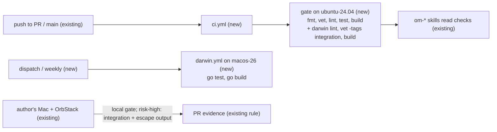

# CI pipeline: the validation gate on GitHub Actions, integration tests, and mutation testing

Issue: #99. Related: #97 / PR #98 (Homebrew distribution; its milestone M1 is "CI with the validation gate").
No prior spec covers CI. This spec owns the CI design; if it merges, PR #98's M1 points here (Q11).

## 📝 TLDR

Today the five-command validation gate (`SDLC.md`, Validation gate) runs only on the machine of whoever opens a PR, and `AGENTS.md` lists CI as TODO. This spec proposes one GitHub Actions workflow, `.github/workflows/ci.yml`, with one Linux job, `gate`, that runs the same five commands on every PR and on every push to `main`, plus a lint, vet, and build pass for `GOOS=darwin`. A second workflow runs the unit tests on a macOS runner by hand and weekly while the repository is private, and on every PR once it is public. Integration tests and the escape suite stay on a Mac with OrbStack, because GitHub-hosted runners cannot run OrbStack. Mutation testing is researched here and recommended later, report-only, with Gremlins; its implementation gets its own issue.

## Open questions for Jacob

This spec was written unattended (`om-auto-write-spec`). Every question has a proposed answer, and the rest of the spec is written under those answers. Rows marked `⚠ NEEDS HUMAN CONFIRMATION` are Jacob's decision; the PR stays a draft until Jacob answers them. Facts marked `[DATA]` were read from the repository, `gh`, or a run on 2026-11-11; `[DOCUMENT]` facts come from the documentation listed under Evidence; `[UNVERIFIED]` facts are checked in the step that needs them; `[INFERENCE]` marks an estimate.

| # | Question | Proposed answer | Why |
|---|---|---|---|
| Q1 | Where does the gate run? | **On `ubuntu-24.04`, as one job `gate`: the five commands in order, then `GOOS=darwin golangci-lint run`, `GOOS=darwin go vet -tags integration ./...`, and `GOOS=darwin GOARCH=arm64 go build ./...`.** | On Linux, `gofmt`, `go vet`, `go build`, and every test package passed, except one non-hermetic test (Q12) `[DATA]`; lint was not run on Linux. A Linux minute costs a tenth of a macOS minute on a private repository (Q2). The darwin passes compile, vet, and lint the darwin-only files and the integration tests without running them. |
| Q2 | Which Actions budget does CI live on? ⚠ NEEDS HUMAN CONFIRMATION | **Merge Phase 2 on GitHub Free, and read the Actions usage after one week. If the month would exceed the included minutes, Jacob chooses: make the repository public (PR #98, Q2: unlimited standard runners), or the GitHub Team plan for the organization. No self-hosted runner (Q4).** | It is Jacob's money and is tied to the visibility decision in PR #98. At today's rate, the Linux `gate` alone may exceed 2,000 minutes per month `[INFERENCE]` (Risks, cost table). Measuring first is reversible; buying first is not needed. |
| Q3 | When do the unit tests run on macOS? | **Workflow `darwin.yml` (`macos-26`): `workflow_dispatch` and weekly `schedule` while the repository is private; on every PR and on push to `main` once it is public. Not tied to the `risk-high` label.** | `realpath_darwin.go` (`F_GETPATH`) is boundary code that Linux does not test. But `main` takes about 20 merges a day `[DATA]`; one macOS run per merge would cost about 600 billed minutes a day `[INFERENCE]`. Every `risk-high` PR already passes the gate on the author's Mac, where agents run it (`SDLC.md`, Validation gate). A label trigger would rerun CI on every label that agents add (`in-progress`, `ci-monitoring`, `review`) and cancel runs on the same head. |
| Q4 | Do integration tests and the escape suite run in CI? ⚠ NEEDS HUMAN CONFIRMATION | **Not on GitHub-hosted runners: they cannot run OrbStack (no nested virtualization) `[DOCUMENT]`. No self-hosted runner in this spec. `gate` only compiles them (Q1). The `SDLC.md` rules stay as they are: a `risk-high` boundary change runs the integration tests, and puts the escape-suite output in the PR or states that the suite did not run.** If Jacob wants them in CI later: a separate, `risk-high` spec for a self-hosted runner on a dedicated Mac or a separate macOS account without the owner's SSH agent or credentials, started only by `workflow_dispatch` from the owner, never by `pull_request`, with an OrbStack license that covers it. | A self-hosted runner runs PR code outside any sandbox on a Mac. That is the threat Orbit exists to contain. GitHub says that self-hosted runners "can be persistently compromised by untrusted code in a workflow" `[DOCUMENT]`. OrbStack publishes no terms for CI; Pro is per user and for "business & commercial use" `[DOCUMENT]`. |
| Q5 | Should docs-only PRs skip CI? | **No. `ci.yml` has no path filters; every PR runs `gate`.** | A workflow that a path filter skips leaves its checks pending, and a required check then blocks the merge `[DOCUMENT]`. The `om-*` skills also read a workflow that never started as pending CI (`.ai/trackers/github.md`, Conventions). Revisit only if Q2's measurement forces it. |
| Q6 | How is "CI green before merge" enforced while GitHub cannot enforce it? ⚠ NEEDS HUMAN CONFIRMATION | **By `SDLC.md`: `gate` must be green on the PR head before merge. The tracker descriptor treats an HTTP 403 from branch protection like a 404: every reported check is required. A ruleset that requires `gate` follows when the repository is public or on Team (follow-up issue, not in this plan).** | Branch protection and rulesets answer 403 on this repository `[DATA]`, and the descriptor handles only 404 today (`.ai/trackers/github.md`, get-required-checks). This changes the merge gate of `SDLC.md`, which is Jacob's process. |
| Q7 | How are the actions kept current and safe? | **Pin every action by full commit SHA with the version in a comment; Dependabot updates the `github-actions` ecosystem weekly. Not the Go module ecosystem.** | SHA pins stop a moved tag from changing what runs. Dependabot keeps the pins current. A Go dependency change needs Jacob's yes (`AGENTS.md`, Ask first). |
| Q8 | Which golangci-lint version runs in CI? | **v2.15.0, pinned in the workflow. It is the version Jacob runs locally `[DATA]` and the latest release `[DOCUMENT]`. Bump it by hand together with the local install. If the release binary was built with a Go older than 1.27.4 and refuses the module, use `install-mode: goinstall`.** | A local pass and a CI pass must mean the same thing. Which Go version built the release binary is `[UNVERIFIED]`. |
| Q9 | Add mutation testing, and how? | **Yes, later, report-only: Gremlins at a pinned version, weekly and by hand, on the pure security packages. The JSON report is an artifact. No threshold and no required check until a baseline exists.** Details are in Mutation testing below. | Gremlins is the only Go tool with coverage-guided skipping, a diff mode, JSON output, and threshold exit codes `[DOCUMENT]`. But it is pre-1.0, and its run on Go 1.27 is `[UNVERIFIED]`. A score is useful as a list of missing hostile-input tests, not as a merge gate. |
| Q10 | One spec, or split? | **This spec delivers CI (Phases 1–2). Mutation testing is research and a recommendation here; its implementation gets its own issue and a short spec when it starts. The required-check ruleset is a follow-up issue.** | Each of the three works without the others (the split test). Jacob asked for the CI design and the mutation research together. Only CI is planned to the step level. |
| Q11 | How does this relate to PR #98, whose M1 is "CI with the validation gate" on a macOS runner? | **This spec owns CI. Its Linux-first answer (Q1) replaces the macOS runner of PR #98's M1. Whichever PR merges second points its CI section at the other.** | One design for CI, not two. PR #98 chose macOS because of the darwin-only `realpath` file; this spec covers that file with the darwin lint, vet, and build pass and with `darwin.yml`, at a tenth of the cost per Linux run. |
| Q12 | How is `TestOrbitInitRefusesAStoppedOrbStack` made hermetic? ⚠ NEEDS HUMAN CONFIRMATION | **Keep the test in `cmd/orbit`, and narrow its assertions to the composition: exit code 1, stderr that starts with `orbit: ` and contains `(orb status: Stopped)`, and no orb command other than `orb status`. The exact advice text stays pinned where it already is, in `internal/orbstack` (`TestNoCallStartsAStoppedOrbStack` and the `statusError` tests, which stub the account).** Alternatives: (b) CI runs `mkdir -p "$HOME/.orbstack"` before the tests, and the test is unchanged but still not hermetic; (c) export a test seam from `internal/orbstack` for the account and HOME. | With `HOME` unchanged and no `$HOME/.orbstack`, the adapter correctly reports `ErrHome`, not `ErrNotRunning` `[DATA]`. Setting `HOME` to a temporary directory does not help: `homeCause` compares HOME with the account's home first (`internal/orbstack/orbstack.go:604`) and reports `ErrHome` for that too. Both messages contain `(orb status: Stopped)`. `AGENTS.md` says "do not weaken a test to make it pass". The advice text is not weakened, because it stays pinned at the adapter; only its second copy moves out. That is Jacob's call. |

## 📝 Problem Statement

- No CI exists `[DATA]`: there is no `.github/workflows/`, and `AGENTS.md` (Task routing, CI row) says TODO. The gate runs only locally, so a PR that is pushed without the gate reaches review unchecked.
- `om-auto-merge-buddy` reads CI as its third readiness signal (`SDLC.md`, `automerge-signal-3-ci`), and `om-auto-fix-pr --ci-only` exists to drive CI green. Without a workflow, both have nothing to read.
- The repository is private, in an organization on the GitHub Free plan `[DATA]`. On that plan, branch protection and rulesets are not available: `gh api …/branches/main/protection` and `…/rulesets` answer 403 "Upgrade to GitHub Pro or make this repository public" `[DATA]`. GitHub cannot enforce a required check today.
- Volume is high `[DATA]`: since 2026-11-10, `main` took 31 first-parent commits, and all refs together got 188 commits, most of them from agents. Actions minutes for a private Free repository are limited, and a macOS minute counts ten times `[DOCUMENT]`. The design must be cheap per push.
- One unit test is not hermetic `[DATA]`. `TestOrbitInitRefusesAStoppedOrbStack` (`cmd/orbit/compose_test.go:199`) goes through the real adapter. The adapter checks that `$HOME/.orbstack` is a directory (`internal/orbstack/orbstack.go:560`). On a host where OrbStack never ran, the test fails with "is not a directory: start OrbStack once as this account". This was reproduced in a `golang:1.27.4` container as a non-root user; every other package passed. A fresh CI runner is such a host.

## 📝 Proposed Solution

### Workflow `ci.yml`

- **Triggers:** `pull_request` with the default activity types (every target branch), `push` to `main`, and `workflow_dispatch`. No `labeled` type, so the labels that agents change do not start runs.
- **Permissions:** `contents: read` only.
- **Concurrency:** `group: ci-${{ github.event.pull_request.number || github.sha }}`, `cancel-in-progress: true`. A newer push to a PR cancels the older run. Each push to `main` has its own group, so no run on `main` is cancelled or replaced.
- **Path filters:** none (Q5).

The job `gate` runs on `ubuntu-24.04` with these steps:

1. `actions/checkout` with `persist-credentials: false`.
2. `actions/setup-go` with `go-version-file: go.mod` and `cache-dependency-path: go.sum`.
3. The five commands of `.ai/agentic.config.json`, in order. Each command is its own step and has the same name as in `SDLC.md`. `golangci-lint run` runs through `golangci/golangci-lint-action` with `version: v2.15.0` (Q8).
4. `GOOS=darwin golangci-lint run`, with the binary that the action installed.
5. `GOOS=darwin go vet -tags integration ./...`.
6. `GOOS=darwin GOARCH=arm64 go build ./...`.

`gate` is one job on purpose. GitHub rounds each job up to a whole billed minute `[DOCUMENT]`. The tests take about 5 s `[DATA]`, so five parallel jobs would cost five billed minutes per push and would not give faster feedback. The step names keep a failure readable.

### Workflow `darwin.yml`

One job, `darwin`, on `macos-26` (arm64, pinned; `macos-latest` points to it today `[DOCUMENT]`). It runs checkout, setup-go, `go test ./...`, and `go build ./...`. Triggers while the repository is private: `workflow_dispatch` and a weekly `schedule` on `main`. Once the repository is public, `pull_request` and `push` to `main` are added, with the same concurrency rule as `ci.yml` (Q3).

### Why Linux for the gate

Orbit is a macOS program, but the gate is the Go toolchain, and the gate passed on Linux except for one test (Q12) `[DATA]`. The code that differs between the platforms is `internal/sandbox/internal/realpath`. `realpath_darwin.go` asks the kernel for the canonical path (`F_GETPATH`); `realpath_other.go` is the fallback that Linux tests. The darwin lint, vet, and build pass catch compile and static errors in the darwin file on every push. Its behavior is tested on the author's Mac by the local gate, and in `darwin.yml`.

### Caching

- `actions/setup-go` caches the module cache and the build cache by default `[DOCUMENT]`. Its key hashes `go.mod` unless `cache-dependency-path` is set. `ci.yml` sets `cache-dependency-path: go.sum`, so a dependency change also invalidates the cache. Orbit has one direct dependency (cobra), so the module cache is small; most of the gain is from the build cache.
- `golangci-lint-action` caches its own analysis cache. The cache is invalidated every 7 days `[DOCUMENT]`.
- Caches written on `main` are readable from every PR branch. A PR's cache is readable only from that PR `[DOCUMENT]`. The push-to-`main` run therefore seeds the cache for every PR.
- No other cache, and no artifacts.

### Supply chain

Every action is pinned by full commit SHA, with the version in a comment: `actions/checkout` v7.0.1, `actions/setup-go` v7.0.0, and `golangci/golangci-lint-action` v9.3.0 `[DOCUMENT]`. `.github/dependabot.yml` updates the `github-actions` ecosystem weekly (Q7). No job uses a secret.

### Required checks

GitHub cannot enforce a required check on this repository today (Problem Statement). Until it can, the rule lives in `SDLC.md` (Q6). Also, the tracker descriptor's **get-required-checks** treats a 403 like a 404, so the `om-*` skills treat every reported check as required.

A later ruleset requires the check `gate` (follow-up issue). That ruleset must have an empty bypass list. `SDLC.md` says that `om-auto-merge-buddy` "bypasses … host merge rules". With an empty bypass list, a merge through the API with a red `gate` fails anyway.

Two GitHub rules shape this design `[DOCUMENT]`:

- A workflow that path filters never start leaves its checks pending, and the pending check blocks the merge.
- A job that is skipped by a job-level `if` reports success.

So the required check is `gate`, which always runs. `darwin` must never become required while any trigger can skip it.

### Integration tests and the escape suite

They stay out of GitHub-hosted CI. They need a running OrbStack, and OrbStack needs Apple's Virtualization framework, which GitHub-hosted macOS runners cannot nest `[DOCUMENT]`. The `SDLC.md` rules do not change (Q4). `gate` compiles the integration tests for darwin (step 5), so a change that breaks their build fails on the push.

## 📝 Mutation testing

Mutation testing changes the code (for example `<` into `<=`) and checks that a test fails. A mutant that survives points to a behavior that no test pins. For Orbit, this matters most in the pure security functions, which `AGENTS.md` requires to have hostile-input tests.

### Tools (read 2026-11-11)

| Tool | Latest release | Activity | How it works | CI fit | Verdict |
|---|---|---|---|---|---|
| [Gremlins](https://github.com/go-gremlins/gremlins) | v0.6.0, 2025-12-06; Apache-2.0; 463★ | last commit 2026-03-30 | AST mutation. A coverage pass runs first: uncovered code is reported as NOT COVERED and is not tested. Parallel workers. It runs only the tests of the mutated package. | `--threshold-efficacy` (exit 10), `--threshold-mcover` (exit 11), `--diff <ref>` (changed code only, since v0.5.0), `--output` JSON, `--tags`. Official action `gremlins-action@v1`. | **Most usable.** It calls itself 0.x: flags can change between minor versions. Its README says that it is slow on very big modules; Orbit is small. Open issue #252: generic type unions are mutated as bitwise, a mutator that is off by default, and Orbit declares no generic code `[DATA]`. Go 1.27 support `[UNVERIFIED]`: its `go.mod` says 1.25. |
| [go-mutesting (avito-tech fork)](https://github.com/avito-tech/go-mutesting) | v2.3.1, 2025-12-26; MIT; 283★ | last commit 2026-10-02; built with Go 1.27 | AST mutation. It runs the package tests for every mutant, with no coverage pre-pass. | JSON and HTML reports, and a printed score. **No** threshold exit code, no workers flag, and no diff mode. By default it skips files with build tags. | Maintained, with more mutators, but a CI gate needs a script over the JSON. Second choice. |
| [go-mutesting (zimmski)](https://github.com/zimmski/go-mutesting) | v1.2, 2021-06; MIT; 679★ | no commits since 2021 | AST mutation | — | **Unmaintained.** Do not use. |
| [ooze](https://github.com/gtramontina/ooze) | no release; last tag v0.3.1, 2023-05; MIT; 290★ | commits until 2026-08 | A library that a `//go:build mutation` test calls. It runs the whole `go test ./...` per mutant, with no coverage skip. | `WithMinimumThreshold`, `Parallel()`. Console report only. | Active but unreleased, so you must pin a commit. Slow without coverage skipping. It adds a Go dependency to `go.mod`. |
| gomu, selene, other forks | v0.x | 1–62★ | — | They claim diff and threshold modes. | **Experimental.** Not proven enough. |

### Recommendation

Add Gremlins later, in its own workflow `mutation.yml`, under its own issue (Q10). Keep it out of the merge gate.

- **Scope:** `./internal/policy`, `./internal/proxy`, `./internal/provision`, `./internal/sandbox` (mount rules and the machine name), and `./internal/sandbox/internal/hostcheck`. These are the pure security functions with hostile-input tests (`ARCHITECTURE.md`, Testing strategy). Slices and `cmd/orbit` are left out: their tests are handler tests against fakes, and survivors there are mostly noise. `realpath` is left out on Linux, because there Gremlins would mutate only the fallback `realpath_other.go`. A macOS run for `realpath_darwin.go` is an option in that issue.
- **When:** a weekly `schedule` and `workflow_dispatch`, on Linux. Not on every PR.
- **How:** one `go run github.com/go-gremlins/gremlins/cmd/gremlins@v0.6.0 unleash --output <pkg>.json <pkg>` per package, in a loop. `go.mod` gains no dependency (no `tool` directive). The reports are artifacts. The job fails only if Gremlins itself fails, never on a score. The first run records a baseline in `.ai/analysis/`. Each surviving mutant that matters gets an issue or a reason why it is equivalent.
- **Later, Jacob's choice:** a non-required PR job with `--diff origin/main` on boundary packages, or a `--threshold-efficacy` at the baseline.
- **Not chosen:** gating merges on a mutation score now. The tool is 0.x and its Go 1.27 run is unverified, so it should not block a merge. A score target also invites tests that kill mutants without stating a rule.

## 📝 Delta

### Capability: ci

#### ADDED Requirement: CI runs the validation gate on every PR

The system SHALL run the five validation commands of `.ai/agentic.config.json` in order, then the darwin lint, vet, and build pass, on every push to a PR and to `main`, and report one check named `gate`.

- WHEN an agent pushes a commit to a PR branch
- THEN the `gate` check runs format, vet, lint, test, build, darwin lint, darwin vet with the `integration` tag, and darwin build on Linux, and it fails on the first non-zero exit
- AND a newer push to the same PR cancels the older run

- WHEN a PR adds an unformatted Go file
- THEN `gate` fails at the format step

- WHEN an agent adds or removes a label on a PR
- THEN no CI run starts

Frozen by: none (new capability). The deliberate-failure checks in Phase 2 prove it.

#### ADDED Requirement: unit tests do not depend on the host's OrbStack state

The system SHALL pass `go test ./...` on a host where OrbStack was never installed or started.

- WHEN `go test ./...` runs as a user whose `$HOME/.orbstack` does not exist
- THEN every test passes

Frozen by: the `gate` check after Phase 1, on a runner without OrbStack.

## 📝 Architecture

No production code changes. Phase 1 changes one test. New files: `.github/workflows/ci.yml`, `.github/workflows/darwin.yml`, `.github/dependabot.yml`. Changed documents:

- `AGENTS.md`: the CI row in Task routing.
- `SDLC.md`: in Validation gate, CI runs the same commands and `gate` must be green before merge.
- `ARCHITECTURE.md`: in Testing strategy, where each kind of test runs.
- `.ai/trackers/github.md`: get-required-checks treats a 403 like a 404.



Takeaway: GitHub runs everything that needs no OrbStack and is cheap per push. Everything that needs OrbStack or macOS behavior stays on the Mac, under the existing PR-evidence rules.

## 📝 Edge Cases & Failure Scenarios

- **A fresh runner has no `$HOME/.orbstack`.** Phase 1 fixes the one test that depends on it before `ci.yml` exists. Without that fix, `gate` would be red on its first run.
- **Go version.** `go.mod` says `go 1.27.4` `[DATA]`, and `setup-go` installs that exact version from `go-version-file`. If the download is not available, the job fails visibly at setup, and a rerun fixes it.
- **golangci-lint built with an older Go than `go.mod`.** The lint refuses to load the packages. Step 2 checks this, and the fallback is in Q8. A Dependabot PR for the lint action does not change the `version:` input; Jacob bumps that by hand.
- **Minutes run out.** Runs fail with a billing message. GitHub blocks no merge, because there is no protection, but the `om-*` skills see a failed check and stop. Q2 measures the margin before this happens.
- **The macOS image changes.** `macos-26` is pinned, so an image move is a deliberate PR.
- **Agent lock refs.** Pushes to `refs/om-locks/*` are not pushes to `main`, so they start nothing.
- **A cancelled run.** A newer push cancels the older run, so the cancelled run never belongs to the head SHA. The skills read the checks of the head only.

## 📝 Risks & Impact Review

**Cost.** Prices are `[DOCUMENT]`. Run counts are `[INFERENCE]` from the commit rate. CI timings are `[UNVERIFIED]` until Phase 2.

| Plan / visibility | Included minutes | `gate` (~2 billed Linux min per run) | `darwin` (~3 min × 10 per run) |
|---|---|---|---|
| Private, Free (today) | 2,000 / month, macOS ×10 | ~1,000 runs / month | ~65 runs / month |
| Private, Team | 3,000 / month, macOS ×10 | ~1,500 runs | ~100 runs |
| Public | standard runners free | — | — |

Since 2026-11-10, all refs got 188 commits. If even a third of them start a run, `gate` uses about 2,500 minutes a month, more than Free includes. Concurrency cancellation lowers this, because a cancelled run bills only the minutes it ran. This is why Q2 measures before anything is bought, and why `darwin` does not run per push while the repository is private.

**Direction call, not a defect.** Running the gate on Linux tests a program that ships only for macOS. The darwin lint, vet, and build pass, `darwin.yml`, and the local gate on the Mac close most of that gap. The integration tests close the rest.

**Reversibility.** Every file is new and in `.github/`, except the document updates. Removing the workflows restores today's state.

**No sandbox-boundary change.** This spec does not change mounts, isolation, provisioning, network policy, or credentials, so it is `risk-low` by `SDLC.md`. A self-hosted runner (Q4) would be a separate `risk-high` decision.

## 📝 Decisions in play

This spec relies on:

- D02 (Go CLI): the gate is the Go toolchain.
- D13 and N06 (OrbStack only): there is no other backend to test in CI.
- D08 (no credential handling): CI holds no secret.

It proposes nothing that supersedes an active row. It touches brief Q03 (distribution) through PR #98: the repository's visibility decides the required check and the macOS budget.

## 📋 Phasing

- **Phase 1: hermetic unit tests.** One test change, on its own PR. It ships alone and is useful without CI.
- **Phase 2: `ci.yml`, `darwin.yml`, Dependabot for actions, and the document updates.** Needs Phase 1.
- **Follow-ups, not planned here:** the required-check ruleset, when the repository is public or on Team; mutation testing (Q10).

## 📋 Implementation Plan

### Phase 1: hermetic unit tests

1. Change `TestOrbitInitRefusesAStoppedOrbStack` as Q12 decides. With the proposed answer, it asserts exit code 1, the `orbit: ` prefix, `(orb status: Stopped)`, an empty stdout, and that only `orb status` ran. Then search the `*_test.go` files without the `integration` tag for any other test that goes through the real adapter without a fake account. Verify:
   - The test passes on the Mac.
   - `go test ./...` passes in `golang:1.27.4` as a non-root user without `.orbstack`, with the command in Evidence.
   - `TestNoCallStartsAStoppedOrbStack` still pins the advice "start OrbStack".

### Phase 2: the workflows

2. Add `.github/workflows/ci.yml` with `gate`, as specified. Pin the actions by SHA, set `contents: read`, and set the concurrency rule. Verify:
   - The PR that adds the workflow shows a green `gate`.
   - The lint step's log shows that golangci-lint v2.15.0 loads the Go 1.27.4 module, or the fallback of Q8 is applied.
   - A throwaway commit with an unformatted file turns `gate` red at the format step. A throwaway lint error in `realpath_darwin.go` turns it red at the darwin lint step. A throwaway syntax error in an `_integration_test.go` file turns it red at the darwin vet step. All three commits are reverted.
   - Adding and removing an unrelated label on the PR starts no run.
3. Add `.github/workflows/darwin.yml` with `workflow_dispatch` and a weekly `schedule`. Verify: `gh workflow run darwin.yml --ref <branch>` gives a green run on `macos-26`.
4. Add `.github/dependabot.yml` for `github-actions`, weekly. Verify (in the GitHub UI; no CLI shows it): Insights → Dependency graph → Dependabot lists `.github/dependabot.yml` with a last check and no error, and "Check for updates" there completes.
5. Update `AGENTS.md`, `SDLC.md`, `ARCHITECTURE.md`, and `.ai/trackers/github.md` as described in Architecture. Verify:
   - `SDLC.md` and `AGENTS.md` name the same five commands as `.ai/agentic.config.json`.
   - The descriptor's get-required-checks treats a 403 like a 404.

## Evidence

`[DATA]`, read or run on 2026-11-11:

- `gh repo view cultofthecode/orbit` says private. `gh api orgs/cultofthecode` gives plan `free`. `gh api repos/cultofthecode/orbit/branches/main/protection` and `…/rulesets` give HTTP 403: "Upgrade to GitHub Pro or make this repository public to enable this feature."
- `git log --first-parent --since=2026-11-10 origin/main` lists 31 commits. `git rev-list --count --all --since=2026-11-10` gives 188.
- `go.mod` has `go 1.27.4` and one direct dependency (cobra). `golangci-lint version` reports v2.15.0. `go test ./...` on the Mac takes about 5 s. A search for generic declarations (`func Name[`, `type Name[`) found none.
- Linux run as a non-root user:

  ```sh
  docker run --rm -v "$PWD":/src:ro golang:1.27.4 sh -c 'useradd -m -u 1001 runner && cp -r /src/. /home/runner/w && chown -R runner /home/runner/w && su runner -c "export PATH=/usr/local/go/bin:\$PATH; cd ~/w && go vet ./... && go test -count=1 ./..."'
  ```

  `go vet` passed. Every package passed except `cmd/orbit`, where `TestOrbitInitRefusesAStoppedOrbStack` failed with `"/home/runner/.orbstack" is not a directory`.
- An earlier run as root also passed `gofmt` and `go build`. As root, two more tests fail: the code refuses uid 0, and root ignores file permissions. GitHub's Linux runners run as a non-root user `[UNVERIFIED]`. golangci-lint was not run on Linux.
- `homeCause` (`internal/orbstack/orbstack.go:604`) checks that HOME equals the account's home before it checks `.orbstack`.
- Gremlins was not run against this repository. The tool table comes from the documentation of each tool.

`[DOCUMENT]`:

- Hosted runners: https://docs.github.com/en/actions/reference/runners/github-hosted-runners. Its arm64 macOS limitation reads: "Nested-virtualization is not supported due to the limitation of Apple's Virtualization Framework."
  - Still unsupported in 2026: https://github.com/actions/runner-images/issues/13505.
  - Intel images: https://github.com/actions/runner-images/issues/13277.
  - `orb start` hangs on Actions: https://github.com/orbstack/orbstack/issues/765.
  - Current labels are `macos-15` and `macos-26` (`macos-latest`). `macos-14` was retired on 2026-11-02.
- Self-hosted runner security: https://docs.github.com/en/actions/reference/security/secure-use.
- Skipped workflows stay pending: https://docs.github.com/en/actions/reference/workflows-and-actions/workflow-syntax. Skipped jobs report success: https://docs.github.com/en/actions/how-tos/write-workflows/choose-when-workflows-run/control-jobs-with-conditions.
- Action versions: `actions/checkout` v7.0.1. `actions/setup-go` v7.0.0: the cache is on by default for `GOMODCACHE` and `GOCACHE`, keyed on `go.mod` unless `cache-dependency-path` is set. `golangci/golangci-lint-action` v9.3.0: its own cache, invalidated every 7 days. golangci-lint v2.15.0. Go 1.27.4 is the latest stable release.
- OrbStack headless use: https://docs.orbstack.dev/headless. Pricing and licensing: https://orbstack.dev/pricing and https://docs.orbstack.dev/licensing. They publish no CI terms.
- Actions minutes: 2,000 a month on private Free, macOS ×10, and each job rounded up to a whole minute. These come from GitHub's Actions billing documentation and PR #98's research, and were not re-read here. Phase 2 checks them against the Actions usage page (Q2).
- Mutation tools: the repositories linked in the table. Gremlins flags: https://github.com/go-gremlins/gremlins/blob/main/docs/docs/usage/commands/unleash/index.md. Generics issue: https://github.com/go-gremlins/gremlins/issues/252.
