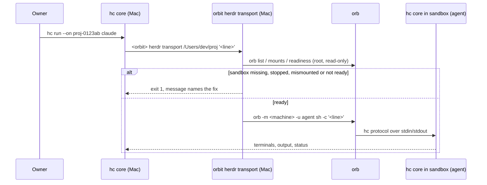
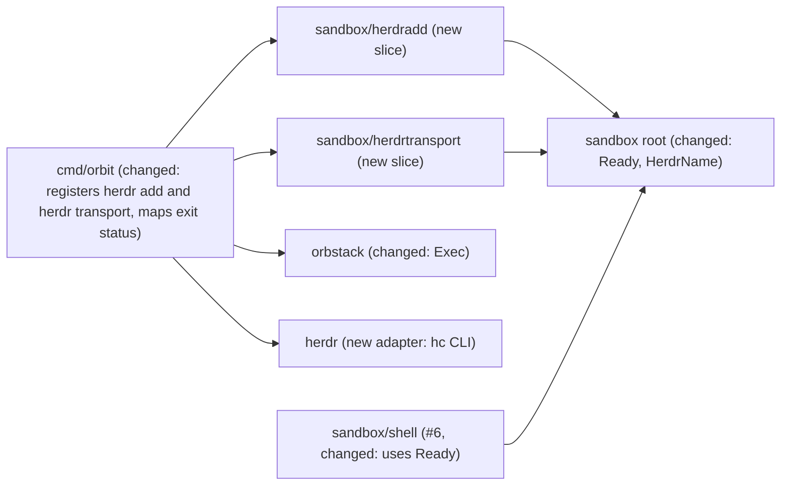

# herdr core support: run and manage agent terminals in the project sandbox from `hc` on the Mac

Issue: #78 (backlog id E05, decided in Q1; not filed by `om-backlog` yet).
Gate: #84 (E05-T01, the hostile-`hc` spike of Q5).
Depends on: #6 (E01-S02 `orbit shell`, spec PR #72; done), #11 (E02-S01 `orbit stop` and `orbit start`; done), #75 (every `orb -m` starts a stopped machine; the implementation, Phase 1, waits for it, Q12).
Extends: .ai/specs/2026-11-11-orbit-shell.md (PR #72, merged; capability `.ai/specs/capabilities/sandbox-shell.md`)
Extends: .ai/specs/2026-11-10-sandbox-provisioning.md

## 📝 TLDR

The owner runs coding agents in persistent terminals with herdr core (`hc`) on the Mac. herdr already treats other computers as machines: `hc machine add` dials one over SSH, or over any command given with `--via`, runs `hc` there, and from then on `hc run --on <machine>`, `hc attach`, `hc read`, `hc send`, `hc exec --on`, and `hc file --on` work against terminals on that machine. With this spec, an Orbit sandbox becomes such a machine. herdr's `--via` command is an Orbit command, `orbit herdr transport <dir>`, that applies every check of `orbit shell` (#6) and then runs herdr's line as `agent` through `orb`. A new command, `orbit herdr add`, registers the sandbox of the current directory in herdr once. Nothing listens in the sandbox, no host credential and no egress host is added, and the feature ships only after a spike shows that nothing in the sandbox can make the host core act on the host or on another sandbox (Q5).

## Decisions (owner-confirmed)

This spec was written unattended (`om-auto-write-spec`). Every question below had a proposed answer, and the rest of the spec is written under those answers. The owner, Jakub Tobiasz, accepted every answer Q1–Q10 on 2026-11-11 11:49 Europe/Warsaw (PR #79), and decided Q11 and Q12 on 2026-11-12 08:09 Europe/Warsaw (findings 2 and 5 of the review of PR #79), so each row below is decided. The feature is gated on the hostile-`hc` spike of Q5, filed as #84, which #78 depends on. Facts marked `[DATA]` come from `hc` 0.1.20 on the owner's Mac on 2026-11-11 (`hc --help`, `hc <command> --help`, `hc --skill`, `hc schema`; read-only) and from the probes of spec PR #72 (see Evidence). Facts marked `[UNVERIFIED]` are what the spike (Phase 0) must establish.

| # | Question | Decision | Why |
|---|---|---|---|
| Q1 | Does herdr support enter the product brief, and where in the backlog? | Decided (owner, 2026-11-11). **Yes, a new decision row D27 (the next free D row; D26 is the default-allowlist row on `main`) moves "herdr core support" into Scope → Now as epic E05**, after E01-S02 (#6) and E02-S01 (#11). E05 has three items: E05-T01 spike (Phase 0), E05-S01 `orbit herdr add` and the transport (Phase 1), E05-S02 the herdr cases of the escape suite (Phase 2, extends #10). This issue (#78) becomes the epic, or E05-S01 if the owner prefers to file the epic separately. `om-backlog` files the tree now that the owner has answered; this PR does not edit `backlog.md` or the brief. | The brief lists nothing about herdr in Now or Later, so it needs a row (Active rows are a protected contract). The owner asked for it directly, as with E04 (#46). It depends on #6 because it reuses the checks of `shell`, and on #11 because a refused stopped sandbox must have a command that starts it. |
| Q2 | How does herdr reach the sandbox? | Decided (owner, 2026-11-11). **herdr's `--via` is `<orbit> herdr transport <canonical project dir>`.** herdr appends its remote line as the last argument `[DATA]`. Orbit resolves the directory, refuses any sandbox that `orbit shell` would refuse (no sandbox, not running, mount mismatch, not ready), then runs `orb -m <name> -u agent sh -c <line>` with the three streams attached unbuffered, no PTY, and `orb` given only the variables of the adapter's allowlist (`allowedVariables` in `internal/orbstack`, #76), and exits with the status of `orb`. Rejected: raw `orb -m <name> -u agent sh -c` as the `--via`, and OrbStack's SSH (`ssh <machine>@orb`). | Raw `orb` starts a stopped machine and a stopped OrbStack `[DATA]` (PR #72 Q4, #62); herdr redials on its own, so it would wake a sandbox the owner stopped, without the nesting refusal that `start` owns. `orb -u agent` ignores the boot gate `/run/nologin` `[DATA]` (PR #72 Q3), so only Orbit's readiness check proves that this boot passed the boundary. `ORBENV` and `WSLENV` make `orb` copy every host variable they name into the machine, and `orb` copies some other host variables on its own `[DATA]` (#76, R08). OrbStack's SSH puts an SSH server path and `ssh -A` in reach, which #6 keeps out of scope. With an Orbit command, OrbStack-specific code stays in `internal/orbstack` (R07), and herdr's configuration names a project directory, not a machine internal. |
| Q3 | Does Orbit run `hc machine add` itself, or print the command? | Decided (owner, 2026-11-11). **`orbit herdr add [--name N]` runs it itself**: `hc machine add --via '<orbit> herdr transport <dir>' --name <N>`, with the three streams attached so that herdr can ask its own questions (for example whether to install `hc` there). It does not pass `--temp` (a project sandbox outlives a task) and not `--install` (the owner answers herdr's prompt). It finds `hc` on `PATH` and refuses with the command to run by hand when it is missing or older than 0.1.20. There is no `orbit herdr rm`: `hc machine rm <N>` is one command. | One step, and the `--via` string holds an absolute path that must be quoted for `sh`, which is easy to get wrong by hand. `hc` is a host program, not a Go module dependency (no "Ask first" item). The version floor is the one this spec was checked against; the protocol is herdr's, and an older `hc` may behave differently. |
| Q4 | Where does `hc` come from inside the sandbox, and does that need egress? | Decided (owner, 2026-11-11). **herdr installs it through its own line, into the home of `agent` (user space, D17); Orbit installs nothing and the allowlist (D24) does not change.** `hc machine add` offers to copy `hc` when the machine has none `[DATA]`, and `hc machine update` copies a newer one later `[DATA]`. If the spike shows that the copy is a download inside the sandbox, the answer stays "no new egress host": Orbit then refuses to register and the owner decides on a separate row. | D17 and D20 keep the root toolchain fixed and minimal; `hc` is a user tool of the agent, like Claude Code in `~/.local/bin`. A copy over the line needs no network in the sandbox. A new default host needs the owner's yes (D24, `internal/policy/AGENTS.md`). Where the copy comes from is `[UNVERIFIED]`: herdr's manual says that "root remotes receive the standalone release" `[DATA]`, which does not say how a non-root Linux remote receives it. |
| Q5 | herdr's line is two-way. Code in the sandbox owns the in-sandbox `hc` (it is a file in the agent's home). What may it make the host core do, and what gate applies before the feature ships? | Decided (owner, 2026-11-11). **Gate: E05-S01 merges only after the spike shows, with a hostile `hc` in the sandbox, that the host core performs no action that the sandbox starts on the host or on another machine: no command, no file read or write, no input typed into a host terminal, no message routed to another machine. If herdr does any of these, Orbit waits for a per-machine "untrusted" mode in herdr (a herdr feature request) and passes it in `orbit herdr add`; until then the feature does not ship.** The accepted residual risk is terminal output: escape sequences printed in the sandbox reach the host terminal emulator when the owner attaches, exactly as with `orbit shell` today. | herdr documents "reverse sends": a terminal can report to its parent terminal, and a parent can be on another machine `[DATA]` (`hc --skill`: "Reverse sends allow at least the default 60-second hold"; a child's report is typed into the parent as a `<hc from=…>` message). A sandbox terminal started from a host terminal gets that host terminal as its parent by default (`hc run --parent`, default "the terminal it is started from") `[DATA]`. So a sandboxed agent may be able to type text and Enter into a host shell, or a prompt into an unsandboxed host agent: host code execution outside the boundary, against the Vision and N07. The protocol also has `doc.set`, `events.subscribe`, and `file.write` `[DATA]`; which of them a remote core can call on the host is `[UNVERIFIED]`. This cannot be fixed in Orbit, because Orbit does not see the protocol; it can only decline to connect. |
| Q6 | What happens when herdr dials a stopped sandbox? | Decided (owner, 2026-11-11). **The transport refuses, exits 1, names `orbit start`, and never starts the machine or OrbStack.** herdr then shows the machine as `unreachable` `[DATA]` (states `connecting`, `connected`, `needs_login`, `unreachable`). After `orbit start`, herdr reconnects at its next retry, or at once with `hc machine connect <N>`. | Same rule as `orbit shell` (PR #72 Q4): starting is the job of `start` (#11), which re-runs the nesting refusal of `internal/sandbox/AGENTS.md`. A transport that starts machines would make every herdr retry a start path. |
| Q7 | Do `orbit stop`, `orbit start`, and `orbit destroy` talk to herdr? | Decided (owner, 2026-11-11). **No.** They stay herdr-agnostic; only the `herdr` slices call `hc`. `orbit stop` ends the in-sandbox `hc` core and every terminal in it (herdr's `--keep` terminals come back as shells at the next core start `[DATA]`); `orbit destroy` leaves a herdr entry that stays `unreachable` until the owner runs `hc machine rm <N>`. The help text of `orbit herdr add` and the spec say so. | Coupling every lifecycle slice to an optional host program adds a failure mode to commands that must always work. Orbit stores no state of its own (OrbStack is the state store), so it cannot know the herdr name without asking `hc`. Reversible: a hint can be added to `destroy` later. |
| Q8 | What is the default herdr name of a sandbox? | Decided (owner, 2026-11-11). **`<slug>-<first 6 hex of the path hash>`, at most 32 characters, slug cut to 25.** For `/Users/dev/proj` that is `proj-0123ab`. `--name` overrides it; herdr's own name rules apply. | The machine name `orbit-<slug>-<16 hex>` can be 53 characters; herdr shortens names to 32 `[DATA]`. The hash suffix keeps two projects with the same directory name apart. The name appears in every address (`proj-0123ab/t3`), so it should be short. |
| Q9 | Where do the herdr cases of the escape suite live, and what happens when `hc` is not installed? | Decided (owner, 2026-11-11). **In the escape suite of #10, in their own file, behind the `integration` tag. They need `hc` on the host and an `HC_SESSION` of their own (never the owner's core); without `hc` they are reported as skipped, never as passed.** | The suite is the single place that `risk-high` PRs run (`SDLC.md`). herdr's manual says that tests need their own `HC_SESSION` and scratch XDG paths and must never restart the user's core `[DATA]`. A skip that reads as a pass would hide a missing check. |
| Q10 | Does a herdr terminal get anything that `orbit shell` does not? | Decided (owner, 2026-11-11). **No. It is the same user, the same checks, and the same credential exposure: the forwarded SSH agent socket only when the sandbox was created without `--no-ssh-forwarding` (#8, R08). There is no herdr-specific flag.** `hc run --env K=V` and `hc file write` are explicit actions of the owner, like typing a value in `orbit shell`. | R08: no host credential enters unless the user opts in to it. The transport inherits the adapter's allowlist (#76): `orb` receives only `HOME`, `PATH`, `TMPDIR`, `TERM`, `COLORTERM`, `LANG`, `LC_ALL`, `LC_COLLATE`, `LC_CTYPE`, `LC_MESSAGES`, `LC_MONETARY`, `LC_NUMERIC`, `LC_TIME`, so `ORBENV`, `WSLENV`, and every other host variable stay on the host, and of the allowed names `orb` copies only the terminal and locale variables into the machine `[DATA]`. herdr says that "the caller's identity is not forwarded" to new terminals `[DATA]`; that no other host variable crosses is `[UNVERIFIED]` and is a spike check. |
| Q11 | Which host `hc` versions may dial a sandbox? (review finding 2) | Decided (owner, 2026-11-12). **Only versions in the tested range. `orbit herdr add`, and the transport on every dial, refuse a host `hc` whose version is outside the range on which the spike (Phase 0) and the herdr cases of the escape suite (Phase 2) passed, and an `hc` whose version they cannot read. A new `hc` version is admitted only after those escape cases pass on it: the PR that raises the top of the range carries the suite output on that version.** The range is two constants in the sandbox root (`HerdrMinVersion`, `HerdrMaxVersion`), checked by a pure function. It starts at the version the spike passed on, at least the floor of Q3 (0.1.20). How the transport learns the version of the core that dials it (the environment of the `--via` child, `hc server status`, or `hc --version` on `PATH`) is `[UNVERIFIED]` and a Phase 0 item. | The Q5 gate holds only for the `hc` versions that the spike tested. The owner can upgrade `hc` on the Mac at any time, and a newer `hc` may add a reverse method that the host core acts on. A floor rejects only older versions, `orbit herdr add` runs once, and the escape suite runs on Orbit PRs, not on `hc` upgrades. A check on every dial is the only place that sees an upgrade. Rejected: recording the gap as an accepted residual risk. |
| Q12 | What happens when `orbit stop` runs while herdr is connected, and herdr redials at once? (review finding 5) | Decided (owner, 2026-11-12). **The machine stays stopped. The transport never starts a stopped machine, also when the machine stops between its checks and its `orb` command. The root-cause fix is #75 (every `orb -m` silently starts a stopped machine), so the herdr implementation (Phase 1, E05-S01) depends on #75. "`orbit stop` while connected; the machine stays stopped" is a requirement with tests: in the spike (Phase 0 step 5), in the integration test (Phase 1), and in escape case 4 (Phase 2).** | On `main`, the `shell` checks run `State` (never starts a machine), then `ActiveMounts` and `RunAsRoot` (each starts a stopped machine), then the command. For `orbit shell`, the window needs a person to stop the sandbox mid-command. For herdr, it is the normal sequence: `orbit stop` ends the line and herdr redials at once. A redial whose `State` still read `running` would start the machine through the next `orb -m`, without the nesting refusal of `start`, against Q6. #75 makes the adapter refuse every machine-scoped command unless the machine is running, which removes the cause for every slice. Rejected: narrowing the claim of Q6, or recording the window as accepted. |

## 📝 Problem Statement

- The owner works with agents in herdr terminals on the Mac and wants the same workflow for agents that run inside an Orbit sandbox: start them, watch them, attach, send them a task, and read their output, from the host. `[DOCUMENT]` owner request, 2026-11-11.
- The only way in today is `orb` by hand, or `orbit shell` (#6). `orbit shell` is one interactive terminal; it has no persistent terminals, no detach and reattach, and no way for a host agent to drive an agent in the sandbox.
- Pointing herdr at `orb` directly bypasses every check of `orbit shell`: it starts stopped machines and OrbStack, ignores a failed boot gate, and copies the host variables that `ORBENV` and `WSLENV` name `[DATA]` (PR #72, #76).

## 📝 Prior spec drift

- `.ai/specs/2026-11-11-orbit-shell.md` (PR #72, merged; #6 implemented; capability `.ai/specs/capabilities/sandbox-shell.md`): this spec reuses its checks (Q1–Q5 of that spec) as `internal/sandbox/shell` implements them on `main`, and the adapter as it is on `main` (`State`; since #76, every `orb` command gets only the variables of `allowedVariables`). Phase 1 refactors that frozen capability (see Frozen by).
- `.ai/specs/2026-11-11-orbit-stop-start.md` (#11, implemented): `orbit start` is the command that a refusal of the transport names (Q6).
- `.ai/specs/2026-11-10-sandbox-provisioning.md`: no drift that matters here. The boot-gate finding of PR #72 (`orb` ignores `/run/nologin`) applies to the transport too, and Q2 closes it in the same way.

## 📝 Proposed Solution

1. **Registration (once per sandbox).** In the project directory, `orbit herdr add` runs the checks of `orbit shell` (so it never registers a sandbox that is missing, stopped, or not ready), then `hc machine add --via '<orbit> herdr transport <dir>' --name <N>` (Q3, Q8). `<orbit>` is the absolute path of the running `orbit` binary (`os.Executable`, symlinks resolved), and `<dir>` is the canonical project directory, both quoted for `sh`. herdr dials, offers to install `hc` in the sandbox (Q4), and keeps the machine.
2. **Every connection.** herdr runs the `--via` line. `orbit herdr transport <dir> <line>` repeats the checks on every dial and then becomes the byte pipe between herdr and `orb` (Q2). It writes nothing to standard output before `orb` starts, because standard output is the protocol.
3. **Inside the machine.** `hc` (in the home of `agent`) starts herdr's core as `agent` if none runs and speaks the protocol on the line `[UNVERIFIED]`. Terminals are child processes of that core, as `agent`, with the agent's environment: the proxy settings of `/etc/environment`, `~/.local/bin` on `PATH`, no sudo. Nothing listens on a network port `[UNVERIFIED]`, and nothing runs as root.
4. **Use.** All of herdr works against the machine name: `hc run --bg --on proj-0123ab --cwd /Users/dev/proj claude`, `hc attach proj-0123ab/t3`, `hc exec --on proj-0123ab git status`. Inside `orbit shell`, the `hc` of the sandbox talks to the same core, so the owner can list or attach the same terminals from there, and an agent in the sandbox can start helper terminals in the sandbox (D18).

Alternatives considered:

- **Raw `orb` as `--via`.** Rejected (Q2): it wakes stopped sandboxes and OrbStack, skips the readiness check, and hands `orb` every host variable, `ORBENV` and `WSLENV` included.
- **An SSH server in the sandbox, or OrbStack's SSH.** Rejected: a listening service or `ssh -A` in reach, a host SSH configuration, and #6 keeps SSH out of scope.
- **`orbit init --herdr`.** Rejected: registration needs a running, ready sandbox and is optional; a separate command keeps `init` unchanged and is reversible with `hc machine rm`.
- **Print the `hc machine add` line only.** Kept as the fallback message when `hc` is missing (Q3).
- **Provision `hc` as root into `/usr/local/bin`.** Rejected (Q4): it changes the fixed toolchain (D20) and gives no security, because the agent can run its own `hc` from `~/.local/bin` anyway.

## 📝 Security model

The sandbox boundary is the one of D12 and D14: the agent is `agent`, without sudo, behind root's firewall and proxy. This feature adds one path into the sandbox and one protocol channel out of it. Each row says what the feature adds and what keeps the boundary.

| Concern | What this feature adds | What holds the boundary | Proof |
|---|---|---|---|
| Path into the machine | `orb -m <name> -u agent sh -c <line>`, started from the Mac by herdr through Orbit. | Fixed user `agent` (constant, as `RunAsAgent`); the checks of `orbit shell` on every dial; no port, no SSH server, no root path. | Unit tests on the argument list; integration test (Phase 1); escape suite (Phase 2). |
| Stopped sandbox or OrbStack | herdr redials by itself. | The transport never starts a stopped machine (Q6, Q12): the adapter refuses every machine-scoped `orb` command unless the machine is `running` (#75), so a machine stopped between the checks and the line stays stopped, and the adapter's `orb status` check never starts OrbStack (#62). | Handler tests; integration test with a stopped sandbox and with `orbit stop` while connected; escape case 4. |
| Host credentials (R08) | None. | `orb` receives only the adapter's allowlist (`allowedVariables`, #76), so `ORBENV`, `WSLENV`, and every other host variable stay on the host; of the allowed names, `orb` copies only `TERM`, `COLORTERM`, and the locale variables into the machine `[DATA]`; herdr forwards no caller environment `[DATA]`, to be confirmed with a canary `[UNVERIFIED]`. SSH agent socket exactly as for `orbit shell` (#8). | Canary variable test; `--no-ssh-forwarding` test (`ssh-add -l` fails). |
| Egress (R03, D24) | None. The in-sandbox core needs no network. An update check of `hc` inside the sandbox is blocked by the proxy, like any other host. | Allowlist unchanged; `hc` is installed and updated over the line (Q4). | Spike: `hc` works with the default allowlist; proxy log shows no new host is needed. |
| Reverse channel (new) | The host core reads the protocol that the sandbox writes. Code in the sandbox can replace `~/.local/bin/hc`, kill the core, and write any message. | Gate of Q5: no sandbox-started action on the host or on another machine, shown by a hostile `hc` in the spike and kept by the escape suite. Only a host `hc` in the tested range may dial, checked on every dial (Q11). Fallback: herdr's untrusted mode, or no feature. | Spike report; escape suite cases 5–7 (Phase 2). |
| Sandbox to sandbox (R03) | The host core holds lines to several sandboxes at once. | Same gate: a message from sandbox A never reaches a terminal or file of sandbox B. | Escape suite case 7. |
| Terminal output | Output of sandbox programs is rendered on the Mac when the owner attaches. | Not new: `orbit shell` has the same exposure. Accepted residual risk (Q5). | — |
| Files | `hc file`, `hc put`, and `hc exec --on` act in the sandbox as `agent`. | They run as `agent`; the only shared host path is the project directory (R08), which the agent can already write. | Covered by the user check. |

## 📝 Delta

### Capability: sandbox-herdr

#### ADDED Requirement: Register the sandbox as a herdr machine
The system SHALL, for `orbit herdr add` in a project directory with a running, provisioned sandbox, register that sandbox in herdr with a `--via` command that names the absolute path of `orbit` and the canonical project directory, under the default name of Q8 or the `--name` given.

##### Scenario: Register
- WHEN the owner runs `orbit herdr add` in a project where `orbit init --agent claude-code` ran, and accepts herdr's install prompt
- THEN `hc machine ls` lists the name as `connected`, and `hc exec --on <name> id -un` prints `agent`

##### Scenario: No `hc` on the host
- WHEN `hc` is not on `PATH`, or its version is outside the tested range (Q3, Q11) or cannot be read
- THEN Orbit exits 1, registers nothing, and prints the `hc machine add` command that the owner can run after installing `hc`

##### Scenario: Not ready
- WHEN the sandbox of the directory is missing, stopped, mounted wrongly, or fails the readiness check
- THEN Orbit exits 1 with the same message as `orbit shell` and does not run `hc`

#### ADDED Requirement: The transport enters only a ready sandbox, only as `agent`
The system SHALL, for `orbit herdr transport <dir> <line>`, run `<line>` with `sh -c` as `agent` in the sandbox of `<dir>` only after the checks of `orbit shell` pass, with standard input, output, and error passed through unchanged and with `orb` given only the variables of the adapter's allowlist (`HOME`, `PATH`, `TMPDIR`, `TERM`, `COLORTERM`, `LANG`, `LC_ALL`, `LC_COLLATE`, `LC_CTYPE`, `LC_MESSAGES`, `LC_MONETARY`, `LC_NUMERIC`, `LC_TIME`; `allowedVariables` in `internal/orbstack`, #76), and SHALL exit with the status of that command. It SHALL never start a stopped machine or OrbStack, also when the machine stops after its checks (Q6, Q12).

##### Scenario: Ready sandbox
- WHEN herdr dials a registered, running, provisioned sandbox
- THEN the line runs as `agent`, and herdr's terminals in it run as `agent` with `id -u` at least 1000 and no working `sudo` or `su`

##### Scenario: Stopped sandbox
- WHEN herdr dials a registered sandbox that is stopped
- THEN the transport exits 1 naming `orbit start`, the machine stays stopped, and herdr shows the machine as unreachable

##### Scenario: `orbit stop` while connected
- WHEN the owner runs `orbit stop` while herdr is connected to the sandbox, and herdr redials at once
- THEN every redial is refused naming `orbit start`, and the machine stays stopped until `orbit start`

##### Scenario: Boot gate failed
- WHEN a boundary unit is not active or the provisioning marker does not match
- THEN the transport exits 1 naming `orbit init`, and the line never runs

##### Scenario: Nothing before the protocol
- WHEN the transport succeeds
- THEN it writes no byte of its own to standard output

#### ADDED Requirement: Only a tested herdr core dials the sandbox
The system SHALL, in `orbit herdr add` and on every dial of `orbit herdr transport`, refuse a host `hc` whose version is outside the tested range (`HerdrMinVersion` to `HerdrMaxVersion`) or cannot be read, before any `orb` command. The tested range SHALL include a version only after the herdr cases of the escape suite passed on that version (Q11).

##### Scenario: Untested newer `hc`
- WHEN the host `hc` that dials is newer than `HerdrMaxVersion`
- THEN the transport exits 1 naming the version and the tested range, runs no `orb` command, and herdr shows the machine as unreachable

##### Scenario: Unreadable version
- WHEN the transport cannot read the version of the host `hc`
- THEN it exits 1 and runs no `orb` command

##### Scenario: Tested `hc`
- WHEN the host `hc` that dials is in the tested range
- THEN the transport goes on with the checks of `orbit shell`

#### ADDED Requirement: No new host exposure
The system SHALL give a herdr terminal no host credential, environment variable, file, or network destination that `orbit shell` does not give.

##### Scenario: Host variables
- WHEN a canary variable is set in the environment of the host `hc` core and named in `ORBENV` and in `WSLENV`
- THEN it is absent in a terminal that herdr starts in the sandbox

##### Scenario: SSH agent opt-out
- WHEN the sandbox was created with `--no-ssh-forwarding`
- THEN `hc exec --on <name> ssh-add -l` fails

#### ADDED Requirement: The sandbox cannot drive the host through herdr
The system SHALL NOT let a program in the sandbox, including a replaced `hc`, cause the host to run a command, read or write a host file, type into a host terminal, or reach another sandbox through the host `hc` core.

##### Scenario: Hostile `hc`
- WHEN `~/.local/bin/hc` in the sandbox is replaced with a program that sends every request and report that herdr's protocol allows towards the host
- THEN no command runs on the Mac, no host file outside the project directory changes, no host terminal receives input, and no terminal or file of a second sandbox is touched

Frozen by: `sandbox-shell` (`.ai/specs/capabilities/sandbox-shell.md`). The requirements above are new, but Phase 1 step 1 moves the checks of `orbit shell` into `sandbox.Ready`, which refactors that frozen capability: every scenario of `sandbox-shell` must keep passing unchanged.

## 📝 Architecture

- **Shared checks.** Steps 1–4 of the `shell` handler (resolve, `State`, mounts, readiness) move into the sandbox root as `Ready(ctx, machines, readinessScript, dir) (name string, err error)`, with the narrow interface it needs. `shell`, `herdr add`, and `herdr transport` call it. A slice never imports another slice (dependency rule 2); shared invariants live in the module root (D03). This lands in Phase 1; #6 is implemented and frozen by `sandbox-shell`.
- **Adapter `internal/orbstack`.** New `Exec(ctx, name, line string, in io.Reader, out, errOut io.Writer) (int, error)`: prefix rule, `orb status` check, then `orb -m <name> -u agent sh -c <line>`, streams attached directly, no PTY allocation requested, run through `executeStreams`, so `orb` gets only the variables of `allowedVariables` (as every command of the adapter since #76). The user is the constant `AgentUser`. `line` is passed as one argument and never parsed by Orbit; it reaches only `sh` as `agent`, so it adds no privilege. Fake: `OpExec`.
- **Adapter `internal/herdr` (new).** The only package that runs `hc`: `Version(ctx)` and `AddMachine(ctx, via, name string, in, out, errOut)`. Only `cmd/orbit` imports it (depguard rule extended). It has no herdr-specific logic beyond building the argument list. New module: needs a Key decisions row in `ARCHITECTURE.md` (Phase 1).
- **Slices.** `internal/sandbox/herdradd` and `internal/sandbox/herdrtransport`, each with `contract.go`, `handler.go`, `command.go`, `handler_test.go`. The commands are `orbit herdr add` and `orbit herdr transport`; `transport` is hidden from help, because only herdr calls it.
- **Tested `hc` range** (Q11). The constants `sandbox.HerdrMinVersion` and `sandbox.HerdrMaxVersion` and the pure function `sandbox.CheckHerdrVersion(version string) error` (`ErrUntestedHerdr`, which names the version and the range) in the sandbox root, because both slices use them. The transport checks the version first, before `Ready`; `herdr add` checks it before `AddMachine`. The adapter `internal/herdr` only reads the version; it decides nothing.
- **Pure functions** (rule 5): `sandbox.HerdrName(dir)` (Q8), `sandbox.CheckHerdrVersion` (Q11, hostile versions: empty, `v`-prefixed, prerelease, build metadata, extra fields, one above the top of the range, one below the floor), `herdradd.ViaCommand(orbitPath, dir)` (quoting for `sh`), each with hostile-input tests: spaces, quotes, `$`, backticks, newlines, a leading `-`, a non-canonical path.
- **Exit status.** The transport returns `sandbox.ExitStatus` (in `internal/sandbox` since #6) so that herdr sees the status of `orb`.

## 📝 UI/UX

A terminal command, no screens.

- `orbit herdr add [--name N]`: on success, herdr's own output, then one line: `orbit: proj-0123ab is a herdr machine; try: hc run --on proj-0123ab --cwd /Users/dev/proj claude`.
- Errors name the fix: the messages of `orbit shell` for the sandbox; `orbit: hc not found on PATH; install herdr core, then run: hc machine add --via '<orbit> herdr transport /Users/dev/proj' --name proj-0123ab`.
- An untested `hc`: `orbit: hc 0.1.22 is not tested with Orbit (tested: 0.1.20 to 0.1.21); herdr cannot reach this sandbox until an Orbit release admits that version`.
- `orbit herdr transport` is hidden. Its errors go to standard error, where herdr shows them in `why` of `hc machine ls` `[UNVERIFIED]`.
- Help of `orbit herdr add` says: stopping the sandbox ends its herdr terminals; after `orbit destroy`, run `hc machine rm <name>`.

## 📝 Edge Cases & Failure Scenarios

| Case | Behavior |
|---|---|
| Sandbox stopped while herdr is connected | The line ends; herdr marks the machine unreachable and redials at once; every redial is refused until `orbit start`, and the machine stays stopped: no check of the transport and no `orb -m` starts it (Q6, Q12, #75). Terminals in the sandbox end; `--keep` terminals return as shells at the next core start `[DATA]`. |
| `orbit init` again (re-provisioning) on a connected sandbox | Root restarts boundary units; the core and its terminals keep running as `agent`. Readiness during re-provisioning may fail one redial; herdr retries. |
| `orbit destroy` | The machine is gone; every dial fails with "no sandbox"; the herdr entry stays until `hc machine rm` (Q7). |
| Project directory moved or replaced by a symlink on the host | The canonical path changes → another machine name → "no sandbox"; never a line into another sandbox. |
| `orbit` binary moved or upgraded to another path | The stored `--via` path breaks; herdr shows unreachable. Fix: `hc machine rm` and `orbit herdr add` again. Documented in help. |
| herdr's core on the Mac runs under launchd with a small `PATH` and environment | `--via` uses the absolute path of `orbit`; the `orb` lookup and `HOME` follow the adapter's rules (#70). The integration test runs the transport with a minimal environment. |
| Two sandboxes with the same directory name | Different hash suffix in the default name (Q8). |
| Name already taken in herdr | herdr refuses; Orbit passes its error through and suggests `--name`. |
| Owner upgrades `hc` on the Mac past the tested range | Every dial is refused with the untested-version message; herdr shows the machine as unreachable until an Orbit release raises `HerdrMaxVersion` after the escape suite passed on that version, or the owner goes back to a tested `hc` (Q11). |
| `hc` in the sandbox is missing or too old | herdr's own install or update prompt over the line (Q4). Orbit does not handle it. |
| Agent replaces or kills the in-sandbox core | Its own terminals are affected only; the host must not act on anything it sends (Q5 gate). |
| `sh` missing in the machine (Alpine, E04) | Alpine has `sh` (busybox). The line uses `sh -c`, not `bash`. |

## 📝 Risks & Impact Review

- **`risk-high` (implementation).** A new path into the sandbox and a protocol channel out of it: the sandbox boundary (`AGENTS.md`, `SDLC.md`). Every implementation PR carries hostile-input unit tests, the integration test, the escape suite with the herdr cases, and a review by a second person.
- **The reverse channel is outside Orbit's control.** Orbit cannot filter herdr's protocol. The Q5 gate is a release condition, not a code check, and a newer `hc` may add methods. Mitigation (Q11): the transport refuses, on every dial, a host `hc` outside the tested range, and the top of the range is raised only in a PR that carries the herdr cases of the escape suite passing on the new version. The escape suite's hostile-`hc` case also runs on every `risk-high` PR.
- **Dependency on #75 (Q12).** Without #75, a herdr redial right after `orbit stop` can start the machine through the `orb -m` of a check that runs after `State`. Phase 1 merges only after #75.
- **Dependency on a host program.** herdr core is not part of Orbit. If herdr changes `--via` semantics, registration breaks, not the boundary: the transport still refuses unready sandboxes.
- **Shared checks refactor.** Moving the `shell` checks into the sandbox root touches the `shell` slice of #6, which the `sandbox-shell` capability freezes. Its tests and the scenarios of `sandbox-shell` must pass unchanged.
- **Not proven here:** kernel escapes and setuid paths (A01, #10).
- **Rollback:** revert the PRs; `hc machine rm <name>` removes the entry; the in-sandbox `hc` stays as a file in the agent's home and `orbit destroy` removes it with the machine. No host state is written by Orbit.

## 📝 Decisions in play

D03, D12, D14, D17, D18, D19, D20, D24, R01, R03, R04, R07, R08, N05, N06, N07. Q1 adds a new row D27, the next free D row (approved by the owner on 2026-11-11 as "D26", renumbered because D26 is now the default-allowlist row; the brief is edited when `om-backlog` files E05). No active row changes. Q2 extends the "OrbStack only" rule (R07) with a second adapter for a host program (`internal/herdr`), which needs a Key decisions row in `ARCHITECTURE.md`.

## 📝 Evidence

From `hc` 0.1.20 on the owner's Mac, 2026-11-11, read-only commands only (no machine was added, no herdr state changed):

- `hc machine add --help`: "Reach it with this command instead of ssh: it is given a shell line to run there as its last argument, like ssh … It must pass bytes both ways untouched and ask nothing. Needs --name." Also `--temp` ("Mark it short-lived (a sandbox for a task)"), `--install` ("Copy this hc there when it has none or one too old, without asking"), `--session`.
- `hc machine --help`: `add`, `ls`, `login`, `update` ("Copy this hc there and restart hc there (its terminals keep running)"), `rename`, `rm` ("Forget a machine (its terminals keep running there)").
- `hc connect --help`: "Speak the protocol over stdin/stdout (`ssh box hc connect`)".
- `hc run --help`: `--on <MACHINE>` ("its address is `machine/t7`"), `--parent` ("default: the terminal it is started from"), `--no-parent`, `--no-notify`, `--keep`.
- `hc schema` methods: `hello`, `server.*`, `terminal.run|list|get|kill|rm|keep|label|read|attach|send|wait|keys|interrupt|put`, `machine.exec|add|list|connect|rename|rm`, `file.read|write|edit`, `doc.get|set`, `events.subscribe`, `templates.list`, `rpc.discover`. `MachineView.state`: "connecting, connected, needs_login or unreachable".
- `hc --skill`: "Reverse sends allow at least the default 60-second hold"; child reports arrive as `<hc from="t7 review">…</hc>`; "Sends to an added machine keep waiting while its line is alive"; "Programs get the login session's environment … The caller's identity is not forwarded"; "Never `hc server stop` or restart the user's core unless asked … Tests need their own `HC_SESSION` and scratch XDG paths"; "Root remotes receive the standalone release".
- From spec PR #72 (OrbStack 2.2.5): any `orb -m` on a stopped machine starts it; `orb -u agent` ignores `/run/nologin`; `ORBENV` copies named host variables; `orb` forwards a fixed set of terminal variables; without a terminal on standard input, `orb` allocates no PTY and passes the exit status through.
- From #76 (`internal/orbstack/AGENTS.md`, OrbStack 2.2.5): `WSLENV`, like `ORBENV`, makes `orb` copy every host variable it names into the machine, and `orb` copies some host variables on its own (the proxy variables, `DOCKER_*`, terminal and locale values, among others). On `main`, `executeStreams` therefore gives every `orb` command only the 13 names of `allowedVariables`.

Not checked (the spike's job): how `hc machine add` installs on a non-root Linux arm64 remote; which messages a remote core can send that the host core acts on; whether the in-sandbox core outlives the `orb` session that started it; whether it opens a network port; whether any host variable crosses.

## 📋 Phasing

| Phase | Backlog item (proposed) | Delivers | Gate |
|---|---|---|---|
| 0 | E05-T01 spike (#84) | A report in `.ai/analysis/` answering every `[UNVERIFIED]` item, on a throwaway `orbit-herdrprobe-*` sandbox and a scratch `HC_SESSION`. No code. | Owner reads the report; Q5 gate decided. |
| 1 | E05-S01 | `orbit herdr add`, `orbit herdr transport`, shared `sandbox.Ready`, adapters. | #6 and #11 are done; merges after #75 (Q12) and the Q5 gate. |
| 2 | E05-S02 (extends #10) | Herdr cases of the escape suite. | Runs on every later `risk-high` PR. |

## 📋 Implementation Plan

### Phase 0 — spike (E05-T01, #84)

1. Provision a throwaway sandbox with `orbit init --agent claude-code`; on the Mac, use `HC_SESSION=orbit-spike` and scratch XDG paths so the owner's core is never touched. → verify: `hc server status` of the owner's session is unchanged before and after.
2. Register it with a hand-written `--via` that mirrors the planned transport: a wrapper script that runs `env -i` with only the allowlisted variables of `allowedVariables` copied from the host (`HOME`, `PATH`, `TMPDIR`, `TERM`, `COLORTERM`, `LANG`, `LC_ALL`, `LC_COLLATE`, `LC_CTYPE`, `LC_MESSAGES`, `LC_MONETARY`, `LC_NUMERIC`, `LC_TIME`; unset ones omitted), then `orb -m <name> -u agent sh -c "$1"`. Unsetting `ORBENV` alone does not mirror the transport: `WSLENV` and every other host variable would still reach `orb`. Record: the line herdr runs, how `hc` arrives (copy or download; proxy log), where it lands, the user of the core, whether the core outlives the `orb` session, open sockets (`ss -lxnpt`). → verify: answers written in the report.
3. Environment: set a canary variable in the spike core's environment and name it in `ORBENV` and in `WSLENV`; read it from a herdr terminal in the sandbox. With `--no-ssh-forwarding`, `ssh-add -l` in a herdr terminal. → verify: report.
4. Reverse channel: replace `~/.local/bin/hc` in the sandbox with a recording proxy, then with a hostile one that sends every request in `hc schema`, plus parent reports, towards the host; start a sandbox terminal with a host shell and a host agent as its parent; register a second sandbox and try to address it. → verify: the report lists every message the host acted on. Any action on the host or on the second sandbox fails the Q5 gate.
5. Stop and start: with the hand-written `--via`, confirm that herdr's redial starts a stopped machine (expected, PR #72), which motivates Q6. Then extend the wrapper with the check of Q6 (refuse unless `orb list --format json` reports `running`), run `orbit stop` while herdr is connected, and let herdr redial (Q12). Record the redial interval and the state after a minute of redials. → verify: the machine stays stopped; if a redial started it, the report records the window that #75 closes.
6. Version of the dialing core (Q11): find how the transport can learn the version of the host core that dials it: the environment of the `--via` child, `hc server status`, or `hc --version` on `PATH`, and whether the last can differ from the running core (an upgrade while the core runs). Record the `hc` version the spike passed on; it starts the tested range. → verify: report.

### Phase 1 — `orbit herdr add` and the transport (E05-S01)

1. **Sandbox root `Ready` and `HerdrName`.** Move the checks from the `shell` handler; `shell` calls `Ready`; its tests pass unchanged. `HerdrName` with hostile-input table. → verify: `go test ./internal/sandbox/...`
2. **Adapter `Exec`.** `execArgs(name, line)` is exactly `-m name -u agent sh -c line`; prefix refusal before any command; streams unbuffered; status returned; fake `OpExec`. Update `internal/orbstack/AGENTS.md`. → verify: `go test ./internal/orbstack/...`
3. **Adapter `internal/herdr` and the tested range.** `versionArgs` (or the source Phase 0 step 6 chose), `addArgs(via, name)`, version parser; `sandbox.HerdrMinVersion`, `sandbox.HerdrMaxVersion`, and `sandbox.CheckHerdrVersion` with its hostile-input table (Q11); `AGENTS.md` of the package; depguard rule; `ARCHITECTURE.md` Components and Key decisions row. → verify: `golangci-lint run`, `go test ./internal/herdr/...`
4. **Slice `herdrtransport`.** Handler: version check (Q11), then `Ready`, then `Exec`; no output of its own on success; `ExitStatus` on non-zero. Tests: every refusal records no `Exec`; an untested or unreadable version records no `orb` call at all; a fake that reports `running` to `State` and `stopped` after it refuses the later calls with the not-running error of #75 and records no start (Q12); status passthrough; adapter errors. Hidden cobra command, `cobra.ExactArgs(2)`. → verify: `go test ./internal/sandbox/...`
5. **Slice `herdradd`.** `ViaCommand` with hostile-input tests (quoting); handler: `Ready`, `CheckHerdrVersion` (Q3, Q11), `AddMachine`; tests for missing `hc`, an `hc` below or above the tested range, an unreadable version, name clash passthrough. → verify: `go test ./internal/sandbox/...`
6. **`cmd/orbit`.** Register both commands under `orbit herdr`; root `AGENTS.md` overview and task routing row for `internal/herdr`. → verify: full validation gate.
7. **Integration test** (`integration` tag, `-p 1`, own `HC_SESSION`): `orbit init --agent claude-code`; `orbit herdr add`; `hc exec --on` checks `id -un`, `sudo -n true` fails, `pwd` with `--cwd`; `hc run --on … --rm sh -c 'exit 3'` returns 3; `orb stop` → `hc machine connect` fails and the state stays `stopped`; `orbit stop` while `hc` is connected → herdr's redials fail and the state stays `stopped` for a minute of redials (Q12); a stub `hc` that reports a version above `HerdrMaxVersion` → the transport refuses and runs no `orb` command (Q11); transport run with a minimal environment (launchd-like `PATH`). Cleanup: `hc machine rm`, delete only the computed machine. → verify: `go test -tags integration -p 1 -run Herdr ./cmd/orbit/...` on named OrbStack and `hc` versions.
8. **Archive the Delta** into `.ai/specs/capabilities/sandbox-herdr.md`. → verify: the file matches the Delta.

### Phase 2 — escape suite cases (E05-S02, extends #10)

1. Cases, each a separate test in its own file, skipped (and reported as skipped) without `hc`: (1) herdr terminal runs as `agent`, no sudo or `su`, `CapEff` 0; (2) canary host variable absent; (3) `--no-ssh-forwarding` → `ssh-add -l` fails; (4) stopped sandbox stays stopped after a dial, and after `orbit stop` while herdr is connected and redials at once (Q12); (5) hostile `hc`: no host command, no host file write outside the project; (6) hostile `hc`: no input in a host parent terminal; (7) hostile `hc` in sandbox A cannot reach a terminal or file in sandbox B. → verify: suite output in the PR, with the `hc` version it ran on; a deliberately weakened transport (raw `orb` as `--via`) makes case 4 fail.
2. Admission of a new `hc` version (Q11): the PR that raises `HerdrMaxVersion` runs cases 1–7 on that version and carries the output. Phase 1's unit test pins the refusal of a version one above the top of the range. → verify: no PR raises the constant without that output.
