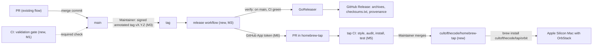

# Homebrew distribution: from a private checkout to `brew install cultofthecode/tap/orbit`

Issue: #97 (proposed backlog id E06; not filed by `om-backlog` yet).
Answers: brief question Q03 ("How is Orbit distributed?") and, through the owner's answer to Q4 below, brief question Q11 (public release and the Claude Code terms).
Depends on: E01 (#2) reaching a usable first version for the first tag; nothing for the CI and version milestones.

## 📝 TLDR

Today Orbit exists only as a private, unlicensed Go module that the owner builds by hand: no version, no tag, no CI, no release. This spec lays out the path to `brew install cultofthecode/tap/orbit` in eight milestones: decisions and a license (M0), CI with the validation gate (M1), `orbit --version` (M2), a tagged GitHub Release built by GoReleaser for Apple Silicon (darwin arm64) with SHA-256 checksums and build provenance (M3), going public (M4), a `cultofthecode/homebrew-tap` with a source-built formula and its own CI (M5), automatic tap updates on release (M6), and, later and under its own spec, signed and notarized prebuilt binaries (M7). Orbit supports only Macs with Apple Silicon, and OrbStack is a required dependency. homebrew-core is out of reach today (notability, and the proprietary OrbStack dependency); a tap is the only path. The owner decided every question below on 2026-11-12.

## Decisions (owner, 2026-11-12)

The owner decided all sixteen questions on 2026-11-12: fourteen as proposed (including the five that gated the merge: Q2, Q3, Q4, Q10, and Q13), and Q11 and Q12 differently from the proposal. Each decision is a requirement of this spec; the milestones and the Delta below follow from them. Facts marked `[DATA]` were read from the repository, `gh`, or the owner's Mac on 2026-11-11; `[DOCUMENT]` facts come from the Homebrew and GoReleaser documentation read the same day (see Evidence); `[UNVERIFIED]` facts are checked in the milestone that needs them.

| # | Question | Decision and requirement | Why |
|---|---|---|---|
| Q1 | Where does distribution enter the brief and the backlog? | **Decided as proposed. E06-T01 adds the next free decision row of the brief (D27; D26 has landed), which answers Q03: "Orbit is distributed through a Homebrew tap, `cultofthecode/homebrew-tap`, from tagged GitHub Releases, for Macs with Apple Silicon." The same task records the owner's answer to brief Q11 (Q4 below), closes Q03 and Q11, and moves epic E06 to Scope → Now, ordered after E01.** M1 and M2 may start at once; M3 waits for a usable E01 (see Q8). This PR edits neither the brief nor `backlog.md`. | Active rows of the brief are a protected contract (`AGENTS.md`); the owner's decisions of 2026-11-12 are the approval that E06-T01 records. CI and `--version` help today's work and do not depend on any other decision. |
| Q2 | Is `cultofthecode/orbit` made public, and when? | **Decided as proposed. The repository SHALL become public at M4, and only after M0–M3 are green.** (Q4 is answered.) Until then, everything runs privately. | Homebrew downloads the source or a binary without credentials; Homebrew removed its private-repository download strategy, so a private repository needs every user to set a token `[DOCUMENT]`. On GitHub Free, a private repository has no branch protection or rulesets (`gh api …/branches/main/protection` answers 403 `[DATA]`), no artifact attestations, and macOS Actions minutes count ten times against 2,000 per month. A public repository gets all of these free. |
| Q3 | Which license? | **Decided as proposed: Apache-2.0.** `LICENSE` at the root holds the Apache License 2.0, and the formula declares `license "Apache-2.0"`. | The repository has no license `[DATA]`; without one, nobody else may use the code, and homebrew-core requires an open-source license `[DOCUMENT]`. Apache-2.0 has an explicit patent grant and is common for Go CLIs. |
| Q4 | Does a public tap make Orbit "a product that runs Claude Code" (brief Q11), and what must hold first? | **Decided: the owner accepts the spec's position, and M4 may proceed. Requirements that hold at M4 and after: Orbit installs the unmodified official client from the official installer; it never asks for, stores, or forwards the subscription credential (D08, R04); the name Orbit and its formula, tap, and README contain no Claude Code name or logo; the README says that Orbit is not affiliated with Anthropic and that each user signs in with their own account.** | Q11 says "yes before a public release" `[DOCUMENT]` brief. A tap is a public release. The answer is legal, not technical, so it was the owner's. |
| Q5 | Tap or homebrew-core / official homebrew-cask? | **Decided as proposed: a tap, `cultofthecode/homebrew-tap`, so that the install name is `cultofthecode/tap/orbit`. E06 submits nothing to homebrew-core or homebrew-cask.** Revisit when the repository passes the notability rule. | Self-submitted software needs at least 90 forks, 90 watchers, or 225 stars, and the repository must be 30 days old `[DOCUMENT]`; it has 0 `[DATA]`. A core formula also must not depend on a cask or on proprietary software `[DOCUMENT]`; Orbit requires OrbStack, which is proprietary (Q12), so core would likely refuse it even later. |
| Q6 | Formula or cask, and built from source or prebuilt? | **Decided as proposed: a formula in the tap that builds from the tag's source tarball** (`depends_on "go" => :build`, `depends_on :macos`, `depends_on arch: :arm64`), with `orbit --version` as `brew test`. GoReleaser still builds the darwin arm64 archive of each GitHub Release (M3), for direct download and for M7. | It needs no Apple Developer account and no signing secret: Homebrew does not quarantine what it builds, so Gatekeeper never sees an unsigned binary. `brew test` and `brew audit --strict` apply to formulae, not to casks. It has the shape homebrew-core would want later. Cost: the first install pulls Homebrew's `go` as a build dependency and compiles for a few seconds. GoReleaser's generated formula (`brews`) is deprecated since v2.10 `[DOCUMENT]`. |
| Q7 | Signing and notarization of the binary? | **Decided as proposed: not in the first release. The release notes SHALL label the archive unsigned, and the documented install is Homebrew.** M7, under its own spec, adds either Developer ID signing and notarization through GoReleaser's cross-platform notarize (quill, Linux runner) or tap bottles built by `brew test-bot`. | Q6 makes signing unnecessary for the Homebrew path. Notarization costs a paid Apple Developer Program membership and adds four signing secrets to CI `[DOCUMENT]`. It matters for a browser download of a release archive (quarantined, so Gatekeeper blocks it) and for a cask (Homebrew disables casks that fail Gatekeeper in the official taps from September 2026 `[DOCUMENT]`). A bare Mach-O binary cannot carry a stapled ticket; Gatekeeper checks it online `[UNVERIFIED]`. |
| Q8 | Version scheme, first version, and how `orbit` reports it? | **Decided as proposed. Tags are SemVer `vMAJOR.MINOR.PATCH[-PRERELEASE]` on `main`. Orbit stays at 0.x until the Now scope of the brief works end to end and the escape suite (#10) passes; then 1.0.0. The first tag is `v0.1.0`, cut when `orbit init --agent claude-code` and `orbit shell` (#5, #6) work. `orbit --version` prints `orbit version 0.1.0` and, when known, the commit: `orbit version 0.1.0 (commit 0402908)`.** The value comes from `-X main.version` and `-X main.commit` at link time; without them, from `debug.ReadBuildInfo` (so that `go install …@v0.1.0` reports the tag, and a `go build` in a checkout reports Go's VCS pseudo-version); otherwise `dev`. A leading `v` is stripped, so every path prints the same format. | Homebrew needs a stable, immutable tag `[DOCUMENT]`. cobra already provides `--version` through the root command's `Version` field, so no new command is needed (D19 lists no `orbit version`). A source build from a tarball has no Git metadata, so the formula passes the version and the commit is omitted. |
| Q9 | Who tags, and how is a tag protected? | **Decided as proposed. The Maintainer (release manager, `SDLC.md` Roles) creates an annotated tag, signed with their SSH key (`gpg.format=ssh`), on a merge commit of `main`, and pushes it over SSH. The release workflow verifies the signature with `git verify-tag` against `.github/allowed_signers`, a committed file that lists the Maintainer's public signing key. Tags are never moved, deleted, or force-pushed after the push; a bad release is fixed with the next patch version. After M4, a tag ruleset limits `v*` creation to the Maintainer and blocks update and deletion; GitHub's immutable releases are turned on.** | A release is a deliberate act, not a merge side effect. Homebrew and every downloaded checksum depend on an immutable tag. Rulesets need a public repository or GitHub Pro (Q2). Merge commits only (owner's rule) means the tagged commit is the merge commit that `main` already has. |
| Q10 | How does a release reach the tap, and with which credential? | **Decided as proposed. The release workflow opens a PR in `cultofthecode/homebrew-tap` that sets the formula's `url`, `sha256`, and nothing else. The tap CI tests the PR; the Maintainer merges it with a merge commit. The credential is a token of a GitHub App installed only on the tap repository, with `contents: write` and `pull_requests: write`, whose private key is a secret of a `release` environment in `orbit`.** Pre-release tags do not update the tap. Nothing merges a tap PR automatically. | The default `GITHUB_TOKEN` cannot write to another repository `[DOCUMENT]`. A GitHub App token is short-lived and scoped to one repository. A PR instead of a direct push means a broken formula never reaches users untested. A manual merge keeps a human on the last step of a supply chain for a security tool. |
| Q11 | Intel Macs? | **Decided, changed from the proposal: Orbit supports Apple Silicon (darwin arm64) only. M3 builds and publishes only the darwin arm64 archive; no amd64 binary is built anywhere. The formula declares `depends_on arch: :arm64`, so Homebrew refuses to install it on an Intel Mac. The README lists a Mac with Apple Silicon as a requirement.** | The owner's decision. It also removes an untested platform: no CI could run on Intel, and Homebrew moved Intel macOS to Tier 3 in September 2026 and drops it in September 2027 `[DOCUMENT]`. |
| Q12 | How is the OrbStack dependency expressed? | **Decided, changed from the proposal: OrbStack is a required dependency, because Orbit is built on it. The README lists OrbStack as a requirement, and the formula's `caveats` state that Orbit requires OrbStack and how to install it (`brew install --cask orbstack` or https://orbstack.dev). The run-time check stays hard: `orbit init` fails with OrbStack as the cause when it is missing or stopped (#62). It is not a Homebrew dependency, because a formula cannot depend on a cask.** Future direction, out of scope for this spec: a Docker backend with OrbStack-like features, such as domains. It would need its own spec and owner-approved rows that supersede R07 and N06. | A formula cannot depend on a cask; only a cask can (`depends_on cask:`) `[DOCUMENT]`. The run-time check already exists and names the cause. |
| Q13 | Where is the release process written down, and how does it relate to `SDLC.md`? | **Decided as proposed. A new `RELEASING.md` at the root holds the release process; one sentence in the "After the merge" paragraph of `SDLC.md` points to it; one row in the task routing of `AGENTS.md` routes release work to it.** `.ai/agentic.config.json` does not change. | `SDLC.md` ends at the merge and leaves releases to the Maintainer `[DOCUMENT]`. A separate file keeps the ticket flow unchanged. |
| Q14 | Does a release run the integration tests and the escape suite? | **Decided as proposed: yes, by hand. CI runs only the five-command gate. `RELEASING.md` requires the Maintainer to run `go test -tags integration -p 1 ./...` (and the escape suite, once #10 exists) on the exact commit to be tagged, on their Mac, and to put the transcript, with the OrbStack version, into the release notes.** | Hosted macOS runners are virtual machines without nested virtualization, so OrbStack's Linux VM cannot start there `[UNVERIFIED]`. A self-hosted runner on the owner's Mac would run untrusted PR code on the host that holds the owner's SSH agent and credentials, which is the opposite of what Orbit is for. |
| Q15 | One spec or several? | **Decided as proposed: one spec, and one issue per milestone.** M1 (CI) and M2 (`--version`) are independently deployable, are useful without any release, and can ship before anything else. M7 is only named here; it gets its own spec when the owner chooses between notarization and bottles. | Splitting the design would scatter the cross-cutting decisions (visibility, license, credentials) across documents. The issues give independent delivery. |
| Q16 | Release notes? | **Decided as proposed. `om-auto-update-changelog` writes the `CHANGELOG.md` entry on a docs PR before each tag; that PR also adds the integration transcript of Q14 under `.ai/qa/releases/vX.Y.Z.md`, and the entry links it. GoReleaser's own changelog is turned off; the release workflow extracts the entry for the tag from `CHANGELOG.md` into a file and passes it with `--release-notes`.** | One changelog, written by the skill that `SDLC.md` already names for release time. |

## 📝 Problem Statement

- Orbit can only be used by building it from a checkout. Nobody else can install it, and nothing tells the owner which build a Mac runs. `[DATA]` no tags, no releases (`gh api …/releases` returns 0), no version in `cmd/orbit/main.go`.
- No CI exists: the validation gate runs only on the machine of whoever opens a PR. `[DATA]` no `.github/workflows/`; `AGENTS.md` lists CI as TODO.
- `main` has no branch protection, and on GitHub Free it cannot have any while the repository is private. `[DATA]` 403 from the protection and rulesets APIs.
- The repository has no license, so even a public repository would not let others use Orbit. `[DATA]`
- The brief leaves distribution open (Q03) and flags the legal question of a public release (Q11); the owner answered both for this spec on 2026-11-12 (Q1, Q4). `[DOCUMENT]` `.ai/specs/product-brief.md`.

## 📝 Proposed Solution



Takeaway: the existing PR flow is unchanged; a release starts with a human tag on `main`, and the only cross-repository write is a PR on the tap, which a human merges.

**Versioning (M2).** `cmd/orbit` gains two package variables, `version` and `commit`, set by the linker, and passes them to the root command's `Version` field with a version template. A small function resolves the version in this order: linker value, `debug.ReadBuildInfo().Main.Version` (unless empty or `(devel)`), `dev`, and strips a leading `v`. No other package changes.

**CI (M1).** One workflow, `.github/workflows/ci.yml`, on `pull_request` and on `push` to `main`, on a macOS arm64 runner (Orbit is macOS only, and `internal/sandbox/internal/realpath` has a darwin-specific file). It runs the five commands of `.ai/agentic.config.json` in order, with Go from `go.mod` and golangci-lint at a pinned version. Every third-party action is pinned by commit SHA. Permissions: `contents: read` only. After M4, the job is a required status check on `main`, together with "require a PR" and "block force pushes".

**Release builds (M3).** `.goreleaser.yaml` (GoReleaser v2, pinned version):

- `builds`: `./cmd/orbit`, `goos: [darwin]`, `goarch: [arm64]` (Apple Silicon only, Q11), `CGO_ENABLED=0`, `-trimpath`, `ldflags: -s -w -X main.version={{.Version}} -X main.commit={{.ShortCommit}}`, `mod_timestamp: {{.CommitTimestamp}}` for reproducible output.
- `archives`: one `tar.gz`, named `orbit_{{.Version}}_darwin_arm64`, with `LICENSE` and `README.md`.
- `checksum`: `checksums.txt`, SHA-256.
- `changelog.disable: true`; `release.prerelease: auto`; the release body comes from `CHANGELOG.md` through `--release-notes` (Q16).

`.github/workflows/release.yml` runs on `push` of tags `v*`, in the `release` environment. Before GoReleaser, a script (`.github/scripts/check-release-tag.sh`, testable locally) checks that the tag is annotated, that `git verify-tag` accepts its signature against `.github/allowed_signers`, that it matches the SemVer pattern, that it points to a commit that is an ancestor of `origin/main`, and that the CI workflow concluded `success` for that commit; any failure stops the job before anything is published. Then GoReleaser builds and publishes, and `actions/attest-build-provenance` attests the archive (needs `id-token: write` and `attestations: write`). Users verify with `gh attestation verify <archive> --repo cultofthecode/orbit`.

On GitHub Free, a private repository has neither deployment environments nor artifact attestations `[DOCUMENT]`. So M3 is built and checked privately without a real tag (snapshot builds and the pre-check script), and the first real run of `release.yml`, with its `release` environment and attestations, happens after M4.

**Tap (M5).** A new public repository, `cultofthecode/homebrew-tap`, created with `brew tap-new cultofthecode/tap`, holds `Formula/orbit.rb`:

```ruby
class Orbit < Formula
  desc "Run coding agents in sandboxes on OrbStack"
  homepage "https://github.com/cultofthecode/orbit"
  url "https://github.com/cultofthecode/orbit/archive/refs/tags/v0.1.0.tar.gz"
  sha256 "<sha256 of the tag tarball>"
  license "Apache-2.0"
  head "https://github.com/cultofthecode/orbit.git", branch: "main"

  depends_on "go" => :build
  depends_on arch: :arm64
  depends_on :macos

  def install
    system "go", "build", *std_go_args(ldflags: "-s -w -X main.version=#{version}"), "./cmd/orbit"
    generate_completions_from_executable(bin/"orbit", "completion")
  end

  def caveats
    <<~EOS
      Orbit requires OrbStack, and does nothing without it. Install it with:
        brew install --cask orbstack
      or download it from https://orbstack.dev.
    EOS
  end

  test do
    assert_match "orbit version #{version}", shell_output("#{bin}/orbit --version")
  end
end
```

OrbStack is not a `depends_on`, because a formula cannot depend on a cask (Q12); the caveats and the README state the requirement, and `orbit init` enforces it at run time (#62). The test must not call OrbStack: `brew test` runs in a sandbox, and the test must hold on a Mac without OrbStack. The tap CI (`.github/workflows/tests.yml` from `brew tap-new`, adapted) runs on every PR to the tap: `brew test-bot --only-tap-syntax` (style and audit), then `brew install --build-from-source`, `brew test`, `brew audit --strict --online`, and `brew uninstall`. Bottles are not published (Q7 keeps them as an M7 option).

**Tap updates (M6).** A last job in `release.yml`, skipped for pre-release tags, gets a token from the tap's GitHub App (`actions/create-github-app-token`), computes the SHA-256 of `https://github.com/cultofthecode/orbit/archive/refs/tags/vX.Y.Z.tar.gz`, and opens a PR on the tap that changes `url` and `sha256` only (the same edit that `brew bump-formula-pr` makes). The Maintainer merges it after the tap CI passes.

**Signing (M7, later).** When the owner has a Developer ID: GoReleaser `notarize.macos` (cross-platform, quill) signs and notarizes the arm64 binary on the Linux runner, with the certificate and the App Store Connect API key as `release` environment secrets. Only then can a prebuilt cask be considered.

**Install for a user (after M5).** Requirements, as the README lists them: a Mac with Apple Silicon, Homebrew, and OrbStack.

```sh
brew tap cultofthecode/tap
brew trust --formula cultofthecode/tap/orbit   # Homebrew 6+ asks to trust third-party code
brew install cultofthecode/tap/orbit
```

`brew install cultofthecode/tap/orbit` alone also works: installing a fully qualified name trusts only that item `[DOCUMENT]`.

**Alternatives considered.**

- *GoReleaser cask with prebuilt binaries now.* Faster installs, but needs the Apple Developer Program and four signing secrets before the first public release, or the `xattr -dr com.apple.quarantine` hook that GoReleaser itself calls a Gatekeeper bypass `[DOCUMENT]`. Rejected for now; it is M7.
- *GoReleaser `brews` (formula with prebuilt binary).* Deprecated since v2.10 `[DOCUMENT]`; building on it means a forced migration.
- *`go install github.com/cultofthecode/orbit/cmd/orbit@latest` only.* Works for free after M4 and is documented as the secondary channel, but needs Go and has no upgrade path or caveats.
- *Private repository with a token for every user.* Serves only the owner; rejected by Q2.
- *A universal or amd64 build for Intel Macs.* Rejected by Q11: Apple Silicon only.

**Future direction (out of scope).** A Docker backend with OrbStack-like features, such as domains, so that Orbit no longer requires OrbStack (Q12). It is not part of E06; it needs its own spec and owner-approved rows that supersede R07 and N06.

## 📝 Delta

### Capability: release-distribution

#### ADDED Requirement: Orbit reports its version
The system SHALL print `orbit version <version>` for `orbit --version`, followed by ` (commit <short sha>)` when the build knows its commit, and exit 0.

##### Scenario: Release build
- WHEN `orbit --version` runs from the archive of release `vX.Y.Z`, built from commit `abc1234`
- THEN it prints `orbit version X.Y.Z (commit abc1234)` and exits 0

##### Scenario: Homebrew source build
- WHEN `orbit --version` runs after `brew install cultofthecode/tap/orbit` at version X.Y.Z
- THEN it prints `orbit version X.Y.Z` and exits 0

##### Scenario: `go install`
- WHEN `orbit --version` runs after `go install github.com/cultofthecode/orbit/cmd/orbit@vX.Y.Z`
- THEN it prints `orbit version X.Y.Z` and exits 0

##### Scenario: Plain `go build`
- WHEN `orbit --version` runs from a binary built with `go build ./cmd/orbit` in a Git checkout
- THEN it prints Go's VCS pseudo-version without the leading `v` (for example `orbit version 0.0.0-20261111152512-0402908abcde+dirty`) and exits 0

##### Scenario: No version information
- WHEN `orbit --version` runs from a binary built with `go build -buildvcs=false ./cmd/orbit`
- THEN it prints `orbit version dev` and exits 0

#### ADDED Requirement: A tag on `main` produces a checksummed release
The system SHALL publish, for a SemVer tag on a commit of `main` whose CI passed, a GitHub Release with one darwin arm64 archive, a `checksums.txt` with its SHA-256, and a build provenance attestation for the archive. The system SHALL NOT build or publish an amd64 binary.

##### Scenario: Release
- WHEN the Maintainer pushes a signed annotated tag `vX.Y.Z` on a merge commit of `main` with a green CI run, after M4
- THEN the release `vX.Y.Z` holds `orbit_X.Y.Z_darwin_arm64.tar.gz` and `checksums.txt` and no other archive, and `gh attestation verify` succeeds for the archive

##### Scenario: Unsigned or unknown signer
- WHEN a tag is lightweight, unsigned, or signed by a key that is not in `.github/allowed_signers`
- THEN the release workflow fails before GoReleaser runs, and no release exists

##### Scenario: Tag off `main`
- WHEN a tag `vX.Y.Z` points to a commit that is not an ancestor of `main`
- THEN the release workflow fails before GoReleaser runs, and no release exists

##### Scenario: Red CI
- WHEN a tag points to a commit of `main` whose CI run failed or did not finish
- THEN the release workflow fails before GoReleaser runs, and no release exists

##### Scenario: Not SemVer
- WHEN a tag `v1.2` or `release-1` is pushed
- THEN the release workflow does not publish anything

#### ADDED Requirement: Homebrew installs the latest stable release
The system SHALL let a Mac with Apple Silicon and Homebrew install and upgrade Orbit with `brew install cultofthecode/tap/orbit` and `brew upgrade`, at the latest stable tag, without any manual edit of the tap.

##### Scenario: Install
- WHEN a user on a Mac with Apple Silicon and Homebrew runs `brew install cultofthecode/tap/orbit`
- THEN `orbit --version` prints the latest stable version, and the caveats state that Orbit requires OrbStack

##### Scenario: Upgrade
- WHEN a newer release is published and its tap PR is merged
- THEN `brew upgrade orbit` installs it

##### Scenario: Pre-release
- WHEN a pre-release tag such as `vX.Y.Z-rc.1` is released
- THEN the GitHub Release is marked pre-release and no tap PR is opened

##### Scenario: Intel Mac
- WHEN a user on an Intel Mac runs `brew install cultofthecode/tap/orbit`
- THEN Homebrew refuses the install because the formula requires arm64, and nothing is installed

#### ADDED Requirement: OrbStack is a documented, enforced requirement
The system SHALL state in the README and in the formula's caveats that Orbit requires OrbStack, and SHALL refuse to create a sandbox when OrbStack is missing or stopped. Homebrew does not install OrbStack for the user.

##### Scenario: No OrbStack
- WHEN Orbit is installed on a Mac without OrbStack and the user runs `orbit init`
- THEN the install has succeeded, and `orbit init` fails with a message that names OrbStack as the cause and creates no machine (#62)

##### Scenario: README
- WHEN a user reads the README of `cultofthecode/orbit`
- THEN its requirements name a Mac with Apple Silicon and OrbStack, and it says that Orbit is not affiliated with Anthropic

## 📝 Architecture

- **Code:** only `cmd/orbit` changes (M2): the composition root gains the version variables and sets `Version` on the root command. No module under `internal/` changes, no dependency is added, and no dependency rule is touched (`ARCHITECTURE.md`). `cobra` already provides `--version` and the `completion` command.
- **New repository files:** `LICENSE`, `.github/workflows/ci.yml`, `.github/workflows/release.yml`, `.github/scripts/check-release-tag.sh`, `.github/allowed_signers`, `.goreleaser.yaml`, `RELEASING.md`, `CHANGELOG.md`; edits to `README.md` (requirements, install section, and the not-affiliated line; there is no README yet `[DATA]`, so M3 adds one), `AGENTS.md` (CI row and a Releases row), and `SDLC.md` (one pointer sentence, Q13).
- **New repository:** `cultofthecode/homebrew-tap`, public, with `Formula/orbit.rb`, `.github/workflows/tests.yml`, and a README. Merge commits only, branch protection on `main` with the tap CI as a required check.
- **New credentials:** the private key of the tap's GitHub App (M6) and, in M7, the Developer ID certificate and the notary API key. All live as secrets of the `release` environment of `orbit`, which only tag pushes of `v*` may use. No credential touches a sandbox, and nothing here changes what a sandbox receives (R08 is untouched).
- **Tooling, not Go modules:** GoReleaser and golangci-lint run in CI as pinned binaries. They do not enter `go.mod`, so the "ask first before a Go module dependency" rule does not apply; the GitHub Actions used are listed in the PRs of M1 and M3 for review.

## 📝 Edge Cases & Failure Scenarios

| Case | What happens | What the user or Maintainer sees |
|---|---|---|
| Homebrew's `go` is older than the `go` line of `go.mod` (today `go 1.27.4`) | The formula build fails, or Go tries to download a toolchain, which Homebrew's build sandbox may block `[UNVERIFIED]`. | The tap CI fails on the bump PR, so the PR is not merged. Rule in `RELEASING.md`: raise the `go` line of `go.mod` only to a version that Homebrew's `go` already ships. |
| A tag is pushed on the wrong commit | The release workflow refuses (not on `main`, or CI not green). | A failed release run naming the check; no release. The refused tag stays, because tags are never deleted (Q9); the Maintainer tags the right commit with the next patch version. |
| A release is broken after publication | The tag and release stay (immutable). | A patch release `vX.Y.Z+1`; the tap PR updates the formula. Never move or force-push a tag. |
| GoReleaser publishes the release, but the tap PR job fails | The release exists; the tap stays at the old version. | A failed job in the release run. The Maintainer re-runs that job, or runs `brew bump-formula-pr --url … cultofthecode/tap/orbit` by hand. |
| The tap CI fails on the bump PR | The PR is not merged; users stay on the previous version. | A red PR on the tap with the `brew` output. |
| The GitHub App key leaks | Someone can push to the tap, not to `orbit`. | Revoke the key in the App settings and rotate the secret; review the tap's history; branch protection on the tap blocks direct pushes to `main`. |
| A user lacks OrbStack | Install succeeds; the caveats state that OrbStack is required (Homebrew cannot install a cask for a formula). | `orbit init` fails with OrbStack as the cause and creates no machine (#62). |
| A user downloads an archive in a browser before M7 | macOS quarantines the binary, and Gatekeeper blocks the unsigned binary. | The release notes say the archives are unsigned and point to Homebrew or `go install`. |
| A user has not trusted the tap (Homebrew 6+) | `brew install orbit` by short name fails until the item is trusted `[DOCUMENT]`. | The README shows the fully qualified install and `brew trust --formula`. |
| An Intel Mac | Homebrew refuses the formula (`depends_on arch: :arm64`); the release has no amd64 archive. | Homebrew's architecture error; the README lists Apple Silicon as a requirement (Q11). A `go install` on Intel is unsupported. |

## 📝 Risks & Impact Review

- **Supply chain.** Orbit is a security tool whose users trust it with their project directory and SSH agent; a compromised release reaches every user. Mitigations: tags only from `main` with green CI, signed tags, a `release` environment limited to tags, pinned actions and tools, build provenance, a PR plus human merge on the tap, and a least-privilege App token. The M3 and M6 issues are `risk-high` for this reason, with a review by a second person, even though no sandbox boundary changes.
- **Hard to reverse:** making the repository public (Q2) and the license (Q3) cannot be undone in practice: copies stay out there. The install name `cultofthecode/tap/orbit` and the binary name `orbit` become a contract with users; renaming later needs a formula rename (`formula_renames.json`). A published tag is permanent.
- **Product direction, not defects:** a formula instead of a cask (Q6), no notarization in the first release (Q7), a human merge on the tap (Q10), and Apple Silicon only (Q11) are the owner's choices; none violates a repository rule.
- **Legal (Q4 / brief Q11):** the owner accepted the position of Q4 on 2026-11-12, and M4 may proceed. The README's not-affiliated line and the absence of the Claude Code name are requirements of M3 and M4.
- **Cost:** GitHub Actions on a private repository uses macOS minutes at ten times the rate; public removes that. M7 costs the Apple Developer Program membership.

## 📝 Decisions in play

- Q03 (brief) — answered by Q1 through a new D row (D27), which E06-T01 adds; owner: Jakub Tobiasz, decided 2026-11-12.
- Q11 (brief) — answered by Q4 (accepted 2026-11-12); E06-T01 records it; owner: Jakub Tobiasz.
- D08, R04 — Orbit never intermediates the subscription credential and installs the unmodified client; the public README states this (Q4). Unchanged.
- R07, N05, N06 — macOS and OrbStack only; the formula says `depends_on :macos` and `depends_on arch: :arm64`, and OrbStack is a required dependency (Q12). Unchanged. The Docker backend of Q12 is a future direction that would need rows superseding R07 and N06.
- R08 — no host credential enters a sandbox; the new release credentials never touch a sandbox. Unchanged.
- `SDLC.md` — merge commits only, the process ends at the merge, the Maintainer is the release manager; Q13 adds a pointer to `RELEASING.md` (owner approved 2026-11-12).

## 📝 Evidence

- `[DOCUMENT]` 2026-11-12: the owner's decisions on Q1–Q16, recorded on PR #98; Q11 and Q12 changed from the proposals.
- `[DATA]` 2026-11-11, read-only: `git tag` (empty); `gh repo view cultofthecode/orbit` (`PRIVATE`, no license, 0 stars, forks, and watchers; merge commits only); `gh api repos/cultofthecode/orbit/branches/main/protection` and `…/rulesets` (403, "Upgrade to GitHub Pro or make this repository public"); `gh api …/actions/workflows` (0); `gh api …/releases` (0); `gh repo view cultofthecode/homebrew-tap` (does not exist); `go.mod` (`go 1.27.4`, only `cobra`); no `import "C"` in the module; Homebrew 7.0.12 and OrbStack cask 2.2.5 on the owner's Mac.
- `[DOCUMENT]` https://docs.brew.sh/Acceptable-Formulae — open-source license, stable immutable tag, SHA-256, no dependency on a cask or proprietary software, binary-only software belongs in a cask.
- `[DOCUMENT]` https://docs.brew.sh/Package-Acceptance-Policy — 30 forks / 30 watchers / 75 stars; self-submitted 90 / 90 / 225; repositories younger than 30 days are normally not eligible.
- `[DOCUMENT]` https://docs.brew.sh/Tap-Trust — `brew trust`, fully qualified installs trust only that item.
- `[DOCUMENT]` https://brew.sh/2026/06/11/homebrew-6.0.0/ — tap trust; casks that fail Gatekeeper disabled from September 2026; Intel Tier 3 in September 2026, unsupported in September 2027.
- `[DOCUMENT]` https://goreleaser.com/customization/homebrew_formulas/ — `brews` deprecated in v2.10; a separate token is needed to write to a tap.
- `[DOCUMENT]` https://goreleaser.com/customization/homebrew_casks/ — casks "are supposed to be signed"; the `xattr` hook bypasses Gatekeeper.
- `[DOCUMENT]` https://docs.github.com/en/actions/how-tos/deploy/configure-and-manage-deployments/manage-environments — environments in private repositories need GitHub Pro, Team, or Enterprise; https://docs.github.com/en/actions/concepts/security/artifact-attestations — attestations in private repositories need GitHub Enterprise Cloud.
- `[DOCUMENT]` https://goreleaser.com/customization/notarize/ — cross-platform signing and notarization with quill on any OS; secrets: `.p12`, its password, and the App Store Connect key, issuer, and key id.

## 📋 Phasing

| Milestone | Issue to file | Delivers | Depends on | Labels |
|---|---|---|---|---|
| M0 | E06-T01 — Record the distribution decision (Q03) and the answers of this spec in the brief and the backlog | D27 (answers Q03), Q11 answer recorded, E06 in Scope → Now, backlog rows | — (owner decided 2026-11-12) | `documentation`, `risk-low` |
| M0 | E06-T02 — Add the license | `LICENSE` (Apache-2.0) | — (Q3 decided) | `documentation`, `risk-low` |
| M1 | E06-S01 — Every PR and every push to `main` run the validation gate in GitHub Actions | `ci.yml`, `AGENTS.md` CI row | — | `feature`, `risk-medium` |
| M2 | E06-S02 — The owner can run `orbit --version` and sees the version and commit of the build | `cmd/orbit` version wiring and tests | — | `feature`, `risk-low` |
| M3 | E06-S03 — A signed tag on `main` produces a GitHub Release with the darwin arm64 archive, checksums, and provenance | `.goreleaser.yaml` (darwin arm64 only), `release.yml`, tag check, `RELEASING.md`, `CHANGELOG.md`, `README.md` (requirements: Apple Silicon and OrbStack; not-affiliated line), `SDLC.md` pointer, `AGENTS.md` Releases row; first real run after M4 | M1, M2, M0-T01 (Q13), M0-T02 | `feature`, `risk-high` (supply chain) |
| M4 | E06-T03 — Make the repository public and protect `main` and the `v*` tags | visibility, branch protection, tag ruleset, immutable releases | M0–M3 green | `security`, `risk-high` |
| M5 | E06-S04 — The owner can run `brew install cultofthecode/tap/orbit` | the tap repository, formula, tap CI, first tag `v0.1.0` | M4, #5 and #6 merged (Q8) | `feature`, `risk-medium` |
| M6 | E06-S05 — A release opens a tested formula bump PR on the tap | GitHub App, release job | M5 | `feature`, `risk-high` (write token) |
| M7 | not filed in E06 — a follow-up spec: signed and notarized release binaries, or tap bottles | its own spec | owner's choice (Q7) | — |

M1 and M2 can ship now and in parallel. M3 is built and dry-run privately (`goreleaser release --snapshot --clean`, the tag-check script) before M4; its first real release runs after M4. Nothing is installable by anyone else before M4 and M5.

## 📋 Implementation Plan

### Phase 0 — decisions (M0)

1. E06-T01: add D27, which answers Q03 with the owner's decision of 2026-11-12 (Q1); record the owner's answer to Q11 (Q4); mark Q03 and Q11 closed; move E06 into Scope → Now; and add E06 to `backlog.md`; file the milestone issues with `om-backlog`. Check: the brief's tables render, and every E06 issue links the epic.
2. E06-T02: add `LICENSE` with the Apache License 2.0 (Q3). Check: `gh repo view --json licenseInfo` names the license.

### Phase 1 — CI (M1)

1. Add `.github/workflows/ci.yml`: macOS arm64 runner, Go from `go.mod`, pinned golangci-lint, the five gate commands in the order of `.ai/agentic.config.json`, `permissions: contents: read`, actions pinned by SHA. Check: the PR that adds it shows the job green; a throwaway commit with a `gofmt` error on a scratch branch shows it red.
2. Update the CI row of the task routing in `AGENTS.md`. Check: the row names the workflow file.

### Phase 2 — version (M2)

1. Characterize: a test in `cmd/orbit/main_test.go` that `orbit --version` today fails with an unknown-flag error. Commit it alone.
2. Add `version` and `commit` variables, the resolve function (linker value, then build info, then `dev`), and `Version` with a template on the root command; update the test to the five scenarios of "Orbit reports its version" (release build and Homebrew build: linker values set through the test; `go install` and plain `go build`: build info faked through a function field; no version information: `dev`). Check: `go test ./cmd/orbit/`, and `go build -ldflags "-X main.version=0.0.0-test -X main.commit=abc1234" ./cmd/orbit && ./orbit --version`.

### Phase 3 — release builds (M3)

1. Add `.goreleaser.yaml` as specified. Check: `goreleaser check` and `goreleaser release --snapshot --clean` locally produce only the darwin arm64 archive and `checksums.txt`; `file dist/*/orbit` reports an arm64 Mach-O and no x86_64 binary exists; the snapshot binary prints its version.
2. Add `.github/allowed_signers`, `.github/scripts/check-release-tag.sh` (annotated, signature, SemVer, ancestry, CI conclusion), and `release.yml` with the check, GoReleaser with `--release-notes`, and provenance, in the `release` environment. Check: locally, in a scratch clone, the script refuses a lightweight tag, an unsigned tag, a tag signed by a key not in the file, `v1.2`, and a tag off `main`, and accepts a signed tag on `main`; the workflow itself first runs for real after M4 (environments and attestations need a public repository on GitHub Free).
3. Add `RELEASING.md` (the checklist: changelog PR merged, integration transcript on the commit to tag, signed annotated tag over SSH, watch the release run, merge the tap PR, never move a tag), `CHANGELOG.md` through `om-auto-update-changelog`, `README.md` with the requirements (a Mac with Apple Silicon, OrbStack), the install section, and the not-affiliated line (Q4), the `SDLC.md` pointer, and the `AGENTS.md` Releases row (Q13). Check: a review by a second person (risk-high).

### Phase 4 — go public (M4)

1. When M0–M3 are green (Q2; Q4 is answered): make the repository public; protect `main` (require a PR, require the CI check, block force pushes and deletions, merge commits only); add the `v*` tag ruleset; turn on immutable releases. Check: `gh api …/branches/main/protection` returns the settings; a force push to `main` from a scratch clone is refused; the `release` environment accepts only `v*` tags.

### Phase 5 — tap and first release (M5)

1. Create `cultofthecode/homebrew-tap` with `brew tap-new`, the formula of this spec, the tap CI, and a README; protect its `main` the same way. Check: tap CI is green on a PR that adds the formula against a test tag.
2. When #5 and #6 are merged: tag `v0.1.0` per `RELEASING.md`, then set the formula to it through a PR. Check: on a clean macOS user account on an Apple Silicon Mac, the transcript of `brew tap`, `brew trust --formula`, `brew install`, `orbit --version`, `orbit init --agent claude-code` on a named OrbStack version, and `brew uninstall`. This transcript is the QA evidence (`SDLC.md`, Orbit QA).

### Phase 6 — automatic tap updates (M6)

1. Create the GitHub App, install it on the tap only, and store its id and key in the `release` environment. Add the tap job to `release.yml`, skipped for pre-releases. Check: first, a `workflow_dispatch` dry run of the job against the existing `v0.1.0` prints the formula diff without opening a PR; then the next real release (a permanent tag) opens a PR on the tap that changes only `url` and `sha256`, and the tap CI passes on it; the next real pre-release opens none. Review by a second person (risk-high).

M7 (signed binaries or tap bottles) is not part of this plan; it gets its own spec when the owner chooses (Q7, Q15).

### Archive the Delta

On the PR of the last milestone that implements a scenario of `release-distribution` (M6), copy the Delta into `.ai/specs/capabilities/release-distribution.md` in the capability file shape. This spec file is not edited.
