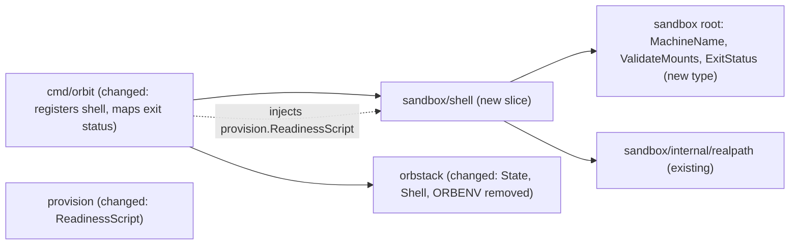

# `orbit shell`: a shell as the agent user in the project sandbox

Issue: #6 (E01-S02), epic #2. Depends on #5 (E01-S01, done: `init` provisions and installs the agent).
Extends: .ai/specs/2026-11-10-sandbox-provisioning.md
Extends: .ai/specs/2026-11-11-claude-code-agent-definition.md

## 📝 TLDR

Today a sandbox exists after `orbit init`, but Orbit gives no way into it. The owner can only run `orb` by hand, and `orb -m <machine>` without `-u` enters as the default OrbStack user, not as `agent`. This spec proposes the `shell` slice: in the project directory, `orbit shell` finds the sandbox of that directory, checks that the machine runs, mounts exactly that directory, and is provisioned, and then opens an interactive login shell as `agent` in the project directory. The owner starts `claude` there (D19). Orbit starts no agent and sets no agent flag.

## Resolved assumptions

This spec was written unattended. The owner, Jakub Tobiasz, accepted the answers to Q1–Q6 as written on 2026-11-11 ([PR #72](https://github.com/cultofthecode/orbit/pull/72), [#6](https://github.com/cultofthecode/orbit/issues/6)). No question is open. The rest of the spec is written under these decisions. Facts marked `[DATA]` come from probes on OrbStack 2.2.5 on 2026-11-11 (see Evidence).

| # | Question | Decision | Why |
|---|---|---|---|
| Q1 | Does `orbit shell` find the sandbox from a subdirectory of the project? | **Owner decision, 2026-11-11.** **No.** `shell` acts on the sandbox of the current directory only: it computes `sandbox.MachineName` of the canonical current directory, as `init` does. In a subdirectory it finds no sandbox and fails with `ErrNoSandbox`. The message names both ways out: run `orbit init` to create a sandbox here, or run `orbit shell` in the directory where you ran `orbit init`. | D19 says the commands act on "the sandbox of the current project directory", and `init`, `stop`, `start`, and `destroy` will use the same lookup. A search upward is a second lookup rule that `destroy` must not share, so the slices would differ. An exact match is the smallest rule and the most reversible one: a later search upward adds behavior and breaks no one. The cost is convenience: the owner must `cd` to the project root. |
| Q2 | Does Orbit set a default such as `claude --dangerously-skip-permissions`? | **Owner decision, 2026-11-11.** **No.** `orbit shell` opens a plain login shell and runs nothing in it. Orbit writes no alias, no wrapper, no environment variable, and no Claude Code settings file. The owner types `claude` or `claude --dangerously-skip-permissions`. | D19: "Orbit does not start the agent". The owner already dropped `Start` from `Definition` (Q1 of `.ai/specs/2026-11-11-claude-code-agent-definition.md`), so no field could carry the flag. R04: Orbit runs the client unmodified; a settings file in `~/.claude` would be Orbit writing client configuration. `sbx` makes the flag its default start command, but `sbx` starts the agent; Orbit does not. The open question in `ARCHITECTURE.md` (Agent definitions, `Start`) is already closed by that owner decision. |
| Q3 | What does `shell` do when `/etc/orbit/provisioned` is missing? | **Owner decision, 2026-11-11.** **Refuse, exit 1, change nothing.** Before it opens the shell, the handler runs a readiness script as root. The script fails unless `/etc/orbit/provisioned` holds exactly the provisioning version that this build writes (`provision.Version`), every boundary unit (`nftables.service`, `orbit-proxy-address.service`, `tinyproxy.service`, `orbit-harden.service`) is active, and `systemd-user-sessions.service` is active. On failure: `ErrNotProvisioned`, message `sandbox <name> is not ready: <reason>; run "orbit init" in <dir> to provision it again`. `shell` never provisions, repairs, or deletes. | The provisioning spec planned this refusal ("E01-S02 can refuse a machine without it"). A new finding makes it necessary, not optional: `orb -u agent` does not honor `/run/nologin` `[DATA]`, so the `systemd-user-sessions.service` gate of the provisioning spec does not stop an `orb` session. The marker alone proves only that provisioning once finished; the unit checks prove that this boot passed the boundary. `init` provisions again on an existing machine (provisioning Q4), so naming `orbit init` gives a repair path. |
| Q4 | Stopped machine: start it, or exit non-zero and name `orbit start` (#11)? | **Owner decision, 2026-11-11.** **Exit 1 and name `orbit start`.** `shell` reads the state of the machine first. For any state other than `running` it fails with `ErrNotRunning`, message `sandbox <name> is <state>; run "orbit start" in <dir>`. It never runs an `orb` command against the machine before it has seen `running`. The implementation of #6 merges after #11, so that the command it names exists. | Every `orb -m <machine> …` silently starts a stopped machine `[DATA]`. `internal/sandbox/AGENTS.md` requires a slice that starts a machine to re-run the nesting refusal before every start, because a host-side move after `init` can point the stored mount path into another sandbox. Starting is the job of `start` (#11), which owns that check. A `shell` that starts the machine would duplicate it or skip it. Before #11 exists, `orbit init` is also a safe start path, but it rebuilds the allowlist from its own `--agent` (D24): `orbit init` without `--agent` drops the Claude Code hosts. So the message must not suggest it, and #6 waits for #11. |
| Q5 | How does `shell` run as the agent user (orb user, login shell, cwd, TTY, exit code), and what is the adapter surface? | **Owner decision, 2026-11-11.** A new adapter method `Shell(ctx, name, dir, in, out, errOut)` runs `orb -m <name> -u agent -w <dir>` with no command. OrbStack then starts the login shell of `agent` from `/etc/passwd` (`-bash`, set by provisioning), in `<dir>`, with a PTY when standard input is a terminal `[DATA]`. The user is the constant `orbstack.AgentUser`. `dir` is the canonical project directory, checked absolute and free of `:` and `,`; it is the only caller value besides the machine name that reaches the command line. The adapter connects the three streams of the command directly (no buffering) and removes `ORBENV` from the environment of `orb` `[DATA]`. It returns the exit status of the shell, which `orb` passes through `[DATA]`; `orbit` exits with that status. A second new method `State(ctx, name)` reads the state from `orb list --format json`. | `-u` with the fixed constant keeps the invariant of `RunAsAgent`: no caller chooses the user. Without `-w`, an isolated machine starts in `/home/agent`, not in the project `[DATA]`. Without a command, `orb` starts a login shell, which reads `~/.profile`; Ubuntu's `~/.profile` puts `~/.local/bin`, where Claude Code installs, on `PATH` `[DATA]`. Passing the exit status through matches `ssh` and `docker exec`; it changes the rule "0 on success and 1 for any error" in `ARCHITECTURE.md` (Cross-cutting concerns), so the implementation PR updates that rule and adds a Key decisions row. `ORBENV` would copy any host variable that it names into the sandbox (R08). |
| Q6 | What proves "cannot become root" before the escape suite (#10) exists? | **Owner decision, 2026-11-11.** Three layers, and the implementation PR states that the escape suite did not run (`SDLC.md`). (1) Unit tests: the argument list of `Shell` is exactly `-m <name> -u agent -w <dir>`, with no `root`, no `sudo`, and no other caller value; the handler never calls `Shell` before the readiness check passed. (2) An integration test (`integration` tag) that drives the real `shell` handler on a sandbox from `orbit init --agent claude-code`, with a script on standard input instead of a terminal, so it uses the same `orb` arguments as the interactive shell. Inside it asserts: `id -un` is `agent` and `id -u` is at least 1000; `sudo -n true`, `/usr/bin/sudo.ws -n true`, and `/usr/lib/cargo/bin/sudo -n true` fail; `su -c id root </dev/null` fails; `CapEff` in `/proc/self/status` is 0; `agent` is in none of the groups `sudo`, `admin`, `adm`, `docker`, `lxd`, `disk`, and `shadow` (the list `privilegedGroups` that the provisioning self-check uses, `internal/provision/script.go`); `pwd` is the project directory; `command -v claude` is `/home/agent/.local/bin/claude`. (3) A terminal transcript of `orbit shell` on a named OrbStack version as QA evidence. | This proves that the shell is the unprivileged `agent` with no sudo and no `su` path, which is what the acceptance criterion and D14 ask. It does not prove that no escalation exists: setuid binaries stay (the provisioning spec, Risks), and a kernel exploit is accepted untested (A01). Those are the job of #10. Ubuntu 26.04 ships two sudo implementations (`sudo.ws` and sudo-rs in `/usr/lib/cargo/bin`) `[DATA]`, so the test calls both by path, not only the `sudo` on `PATH`. |

## 📝 Implementation notes

The implementation PR of #6 records these points from the review of #72. Where they differ from the text below, they win.

1. **Overlap with #75 and #76.** `State` (Implementation Plan step 1) shipped with `orbit start` (#11); the slice reuses it. The removal of `ORBENV` (step 2, and every statement about `ORBENV` below) moved to #76 (PR #88), which removes it and other variables in the exec path of the adapter. `Shell` starts `orb` through `executeStreams`, not through `execute`, so a filter that sits only in `execute` does not cover `orbit shell`. Whichever of #88 and #94 merges second puts the filter into `executeStreams`, the one place that builds the command of `orb`; `TestEveryCommandRunsOrbWithTheSameEnvironment` enforces it, because it fails when `Shell` gets another environment than the other commands. Until #88 merges, the `ORBENV` route stays open for `orbit shell` as for every other `orb` command. #75 (every `-m` command starts a stopped machine) does not change the slice: it reads `State` first, and `ErrNotRunning` still names `orbit start`.
2. **Dependency on #11.** E02-S01 (#11) is a dependency of E01-S02 in `.ai/specs/backlog.md` and in `Depends on:` of #6 (Q4).
3. **Ctrl-C without a PTY.** The adapter catches `SIGINT` and `SIGQUIT` while `orb` runs (`holdingSignals`, with a unit test). See the Edge cases row.
4. **A readiness failure and an adapter failure.** `ErrNotProvisioned` wraps the error of `RunAsRoot`, so `errors.Is` finds both. The message has one form for both cases: `sandbox <name> is not ready: <error of RunAsRoot>; run "orbit init" in <dir> to provision it again`. When the check fails, the error of `RunAsRoot` ends with the one line that the readiness script printed to standard error, for example `run a script as root in machine <name>: orb -m: exit status 1: /etc/orbit/provisioned does not hold provisioning version 1`. When the adapter fails, it is the error of the adapter, for example that OrbStack is not running.
5. **No sandbox.** The slice reports `sandbox.ErrNoSandbox` of the root package, which `stop` and `start` (#11) also report, not an error of its own.

## 📝 Problem Statement

- The owner wants to work with an agent that cannot escape to the host. `[DOCUMENT]` owner request, 2026-11-10. There is no `orbit run` (D19), so the owner needs a way into the sandbox to start `claude` (issue #6).
- `orb -m <machine>` without `-u` enters as the default OrbStack user (the Mac user). Provisioning removes its sudo, but its traffic and its files are not the agent's, and it is not the user that D14 designs for. The owner must not have to remember `-u agent -w <dir>` and the machine name.
- A shell into a machine that is stopped, not provisioned, or mounted wrongly would put the owner and the agent outside the boundary without notice.

## 📝 Prior spec drift

- `.ai/specs/2026-11-10-sandbox-provisioning.md`, Units and Edge cases: "with `Requires=`, logins stay disabled instead" when a boundary unit fails at boot. The code does what the spec says (`internal/provision/units.go`, `userSessionsDropIn`). The premise does not hold for `orb`: with `/run/nologin` in place, `orb -m <machine> -u agent id -un` still prints `agent`, and the session has no login uid (`/proc/self/loginuid` is `4294967295`); its parent is `orbstack-agent`, not a PAM login `[DATA]`. So the boot gate stops PAM logins, not `orb` sessions. This spec closes the gap for `orbit shell` (Q3). It does not change provisioning. The escape suite (#10) should test an `orb -u agent` session during a failed boot; #74 tracks the finding for #10.

## 📝 Proposed Solution

One slice, `internal/sandbox/shell`, and two adapter methods.

The handler, in order:

1. Resolve the current directory with `realpath.Resolve` and compute `sandbox.MachineName` (Q1). No OrbStack call yet.
2. `State(name)`: no machine → `ErrNoSandbox` (names `orbit init`); any state but `running` → `ErrNotRunning` (names `orbit start`) (Q4).
3. Check the mounts as `init` does: `Mounts` (configuration) and `ActiveMounts` (kernel), both through `sandbox.ValidateMounts`. A mismatch → `sandbox.ErrMountMismatch`. This also guarantees that the project directory exists in the machine: `orb -w` on a missing directory silently starts in `/` and exits 0 `[DATA]`.
4. `RunAsRoot(readiness script)` (Q3). Failure → `ErrNotProvisioned`.
5. `Shell(name, dir, in, out, err)` (Q5). Return its exit status.

Alternatives considered:

- **`orb -m <name> -u agent bash --login` with `cd` in a script.** Needs a command line that the shell then reads from, so the shell is not interactive in a clean way, and the script would be a second place that decides the directory. `-w` does it. Rejected.
- **`orb ssh` / `orbctl ssh`.** Issue #6 puts SSH access out of scope, and it needs an SSH configuration on the host. Rejected.
- **Start a stopped machine from `shell`.** See Q4. Rejected.
- **Search upward for the sandbox.** See Q1. Deferred; adding it later is not a breaking change.
- **Read the marker only.** Misses a boot where a boundary unit failed, which `orb` does not gate (Prior spec drift). Rejected.

## 📝 Delta

### Capability: sandbox-shell

#### ADDED Requirement: Shell as the agent user in the project directory
The system SHALL open, for `orbit shell` in a project directory with a running, provisioned sandbox, an interactive login shell as the user `agent` in that sandbox, with the project directory as its working directory and `~/.local/bin` on `PATH` when it exists.

##### Scenario: Shell in an initialized project
- WHEN the owner runs `orbit shell` in a directory where `orbit init --agent claude-code` ran
- THEN a login shell runs as `agent`, `pwd` prints the project directory, and `command -v claude` prints `/home/agent/.local/bin/claude`

##### Scenario: Worktree at the same path
- WHEN the agent runs `git worktree add wt-a` in the shell
- THEN `<project>/wt-a` exists on the host, and `git worktree list` prints the same absolute path on the host and in the sandbox (D18)

##### Scenario: Exit status
- WHEN the shell exits with status 3
- THEN `orbit shell` exits with status 3 and prints nothing more

#### ADDED Requirement: The shell is not root
The system SHALL run the shell as `agent` only, with no sudo rule, no working `su`, no capability, and no privileged group.

##### Scenario: Escalation attempts
- WHEN the shell runs `sudo -n true`, `/usr/bin/sudo.ws -n true`, `/usr/lib/cargo/bin/sudo -n true`, and `su -c id root </dev/null`
- THEN each fails, `id -u` is at least 1000, and `CapEff` is 0

#### ADDED Requirement: Refuse a sandbox that is missing, stopped, mismounted, or not ready
The system SHALL refuse to open the shell, exit non-zero, and change no machine when the sandbox of the current directory does not exist, is not running, does not mount exactly the project directory, or fails the readiness check.

##### Scenario: No sandbox
- WHEN the owner runs `orbit shell` in a directory with no sandbox, or in a subdirectory of a project (Q1)
- THEN Orbit exits 1, names `orbit init`, and runs no `orb` command against any machine

##### Scenario: Stopped sandbox
- WHEN the sandbox of the directory is stopped
- THEN Orbit exits 1, names `orbit start`, and the machine stays stopped

##### Scenario: Not provisioned
- WHEN `/etc/orbit/provisioned` is missing, holds another version, or a boundary unit is not active
- THEN Orbit exits 1, names `orbit init`, and opens no shell

##### Scenario: Mount mismatch
- WHEN the machine mounts another directory than the project directory
- THEN Orbit exits 1 with `ErrMountMismatch` and opens no shell

Frozen by: none — all requirements are new. Two existing behaviors change: removing `ORBENV` changes the environment of every `orb` command, including those of `init` (Q5, Risks), and passing the exit status of the shell through changes the rule "0 on success and 1 for any error" of `ARCHITECTURE.md` (Q5, Exit status).

## 📝 Architecture

The slice imports only the root package and `internal/` of its own module (dependency rule 2). `cmd/orbit` injects the readiness script as `ReadinessScript func() []byte`, built by `provision.ReadinessScript()` from `MarkerPath`, `Version`, and the boundary unit names that `provision` already owns; the slice does not import `provision`. No new module dependency. The adapter stays the only OrbStack code.

### Contract (`internal/sandbox/shell`)

- `Input{Dir string; In io.Reader; Out, Err io.Writer}`. The command passes `cmd.InOrStdin()`, `cmd.OutOrStdout()`, and `cmd.ErrOrStderr()`, which are the real `*os.File` values in `orbit`: `orb` allocates a PTY only when its standard input is a terminal, so a wrapped reader loses the TTY. Plain `io` types, because the adapter imports no package of this repository and must satisfy the slice interface as it is.
- `Output{Name, Dir string; Status int}`.
- Errors: `ErrNoSandbox`, `ErrNotRunning`, `ErrNotProvisioned`; mount errors of `sandbox.ValidateMounts`.
- `Machines` interface: `State`, `Mounts`, `ActiveMounts`, `RunAsRoot`, `Shell(ctx, name, dir string, in io.Reader, out, errOut io.Writer) (int, error)`.

### Exit status

The command returns `sandbox.ExitStatus{Code int}` when the shell exits non-zero. `cmd/orbit` `run` maps it with `errors.As` to that exit code and prints nothing; every other error keeps "print and exit 1". `Status` 0 is success. An `orb` failure after the shell started (for example the machine stopped under it) also arrives as a status; Orbit cannot tell the two apart and does not try.

### Adapter (`internal/orbstack`)

- `State(ctx, name) (string, error)`: the `state` field of the entry `name` in `orb list --format json` (`running`, `stopped`, …), or `""` when no machine has that name. It runs only `orb status` and `orb list`, so it never starts a machine. It does not need the prefix rule, because it changes nothing, but it applies it anyway, so that every method that names a machine refuses a foreign one.
- `Shell(ctx, name, dir, in, out, errOut) (int, error)`: prefix rule (`ErrForeignMachine`), `checkMountable(dir)` (`ErrMountPath`), then `orb status` as for every command, then `orb -m <name> -u agent -w <dir>` with the three streams attached directly. Returns the exit status of `orb` and a nil error when `orb` ran; an error only when it could not run.
- Every `orb` command (not only `Shell`) gets the host environment without `ORBENV`. `ORBENV=SECRET orb … printenv SECRET` prints the host value in the machine `[DATA]`. Other host variables do not pass; `orb` forwards a fixed set (`TERM`, `LANG`, `COLORTERM`, `TERM_PROGRAM`, and macOS `__CF*` values) `[DATA]`.
- `orbstacktest`: `OpState` and `OpShell`, with the same prefix and mount-path rules; `Shell` returns a status that the test sets and records the arguments.

## 📝 UI/UX

A terminal command, no screens.

- `orbit shell` takes no argument and no flag. Success prints nothing before the shell; the shell's own prompt is the feedback.
- Error messages name the directory, the machine, and the one command that fixes it:
  - `orbit: no sandbox for /Users/dev/proj: run "orbit init" here, or run "orbit shell" in the directory where you ran "orbit init"`
  - `orbit: sandbox orbit-proj-0123456789abcdef is stopped: run "orbit start" in /Users/dev/proj`
  - `orbit: sandbox orbit-proj-0123456789abcdef is not ready: <reason>; run "orbit init" in /Users/dev/proj to provision it again`
- Inside the shell, `open`/`xdg-open` fail (spike), so `/login` uses the paste-code path (#7). Not this slice's job.

## 📝 Edge Cases & Failure Scenarios

| Case | Behavior |
|---|---|
| OrbStack stopped | `orb status` check of the adapter: `ErrNotRunning` of the adapter, no `orb` command that starts OrbStack (#62). |
| Machine stopped between `State` and the next call | `ActiveMounts` or `Shell` would start it. Residual race of a few hundred milliseconds that only the owner can cause (by `orbit stop` or `orb stop` in another terminal). Accepted; documented here. |
| Project directory removed or replaced by a symlink on the host | `realpath.Resolve` gives another canonical path → another machine name → `ErrNoSandbox`, or the mount check fails. Never a shell in another sandbox. |
| Standard input is not a terminal (pipe, CI) | `orb` runs the login shell without a PTY and reads commands from standard input `[DATA]`. Allowed; the integration test uses it. |
| `claude` not installed (`init` without `--agent`) | The shell opens; `claude` is not on `PATH`. Not an error of `shell`. |
| Marker from a newer provisioning version | Readiness fails (exact version match); message names `orbit init`. An older `orbit` never enters a sandbox it does not know. |
| Ctrl-C in the shell | With a PTY it is a byte to the remote shell, not a signal to `orbit`. Without a PTY, `SIGINT` reaches the process group. `orbit` catches `SIGINT` and `SIGQUIT` while `orb` runs, so the signal ends `orb`, not `orbit`, and `orbit` returns the status of `orb` (128 plus the signal number when the signal ended it). `orb` gets the signals with their default action. |
| `ORBENV` set on the host | Removed for every `orb` command by #76 (PR #88), not by this slice. The filter covers `Shell` only when it sits in `executeStreams`; whichever of #88 and #94 merges second puts it there, and `TestEveryCommandRunsOrbWithTheSameEnvironment` enforces it. |
| SSH agent | Not forwarded today (`init` passes no `--forward-ssh-agent`); E01-S04 (#8) adds it. `shell` changes nothing about it. |

## 📝 Risks & Impact Review

- **`risk-high` (implementation).** It decides which user an interactive command runs as in the machine: the sandbox boundary (`AGENTS.md` task routing, `SDLC.md`). The implementation PR carries a unit test with hostile input (foreign machine name, a `dir` that is relative, holds `:` or `,`, or starts with `-`; a state string that is not `running`), the integration test of Q6, a statement that the escape suite did not run, a review by a second person, and a terminal transcript on a named OrbStack version.
- **Exit status rule.** `ARCHITECTURE.md` says `orbit` exits 0 or 1. Q5 adds one exception. Reversible: drop the mapping and exit 1.
- **`ORBENV` removal changes every adapter command.** No current caller sets `ORBENV` on purpose; removing it narrows what reaches a machine. Reversible.
- **Boot gate finding.** The provisioning design assumed the `systemd-user-sessions` gate covers agent sessions; for `orb` it does not. `shell` checks for itself; other paths into the machine (the owner's own `orb -u agent`) are outside Orbit. #10 should cover it.
- **Not proven here:** escalation through setuid binaries or the kernel (A01, #10).
- **Rollback:** revert the PR; the command disappears. No state is written on the host or in the machine.

## 📝 Decisions in play

D08, D14, D18, D19, R01, R04, R07, R08. No active row changes. Q2 relies on the owner's decision Q1 of PR #34 (no `Start` field). Q4 adds a dependency of #6 on #11 in the backlog. Q5 changes a cross-cutting rule of `ARCHITECTURE.md` (exit code) in the implementation PR, with a Key decisions row. The owner, Jakub Tobiasz, accepted Q1–Q6 on 2026-11-11.

## 📝 Evidence

Probes on OrbStack 2.2.5 on 2026-11-11, on throwaway machines `orbit-gh6probe-*` created with `--isolated --isolate-network --mount DIR:DIR ubuntu:26.04` and a plain `agent` user (not provisioned), deleted afterwards:

- `orb -m M -u agent pwd` prints `/home/agent` from any host directory; with `-w DIR` it prints `DIR`; with `-w /nonexistent` it prints `/` and exits 0.
- `orb -m M -u agent -w DIR` with no command runs `-bash` as a login shell in `DIR`; with `~/.local/bin/claude` present, `command -v claude` finds it.
- Exit status passes through: `bash -c 'exit 7'` → 7; a login shell that runs `exit 5` → 5; under a PTY (`script`) `exit 4` → 4, and `test -t 0` is true.
- `orb … tty` without a terminal prints `not a tty`; under `script` it prints `/dev/pts/1`.
- `touch /run/nologin` as root, then `orb -m M -u agent id -un` prints `agent`. `/proc/self/loginuid` is `4294967295`; the parent process is `orbstack-agent`.
- `orb stop M`; `orb list --format json` shows `"state":"stopped"`; `orb -m M -u agent id -un` prints `agent` and the state is `running` again.
- `ORBENV=SECRETX SECRETX=leaked orb -m M -u agent printenv SECRETX` prints `leaked`. Without `ORBENV`, a host variable (`FOOLEAK`) does not pass.
- In the session: `CapEff` 0, `NoNewPrivs` 0, `Seccomp` 2; setuid binaries include `/usr/bin/su`, `/usr/bin/sudo.ws`, `/usr/lib/cargo/bin/sudo`, `/usr/lib/cargo/bin/su`.
- On the mount, files appear owned by `agent` (1000) in the machine and by the Mac user (501) on the host; `git status` and `git worktree add wt-a` work as `agent` without `safe.directory`, and `git worktree list` prints the same absolute paths on both sides.

## 📋 Phasing

One phase, one PR, after #11 is merged (Q4). The adapter methods have no other reader yet, and the command is useless without the checks.

## 📋 Implementation Plan

1. **Adapter `State`.** `stateArgs`/parser over `orb list --format json`, prefix rule, `""` for absent. Unit tests: running, stopped, absent, duplicate name (`ErrMountTable`-style refusal: never guess), malformed JSON. `orbstacktest`: `OpState`, settable state. → verify: `go test ./internal/orbstack/...`
2. **Adapter environment.** One function returns the host environment without `ORBENV`; `execute` uses it. Unit test of the function; integration test: `ORBENV` set in the test process, a variable it names is absent in `RunAsAgent`. → verify: `go test ./internal/orbstack/...`, then `go test -tags integration -p 1 ./internal/orbstack/...`
3. **Adapter `Shell`.** `shellArgs(name, dir)` returns exactly `-m name -u agent -w dir`; prefix and `checkMountable` refusals before any command; streams attached unbuffered; exit status returned. Hostile-input table: foreign name, empty prefix, relative `dir`, `dir` with `:`/`,`, `dir` starting with `-`. `orbstacktest`: `OpShell` with the same rules. `internal/orbstack/AGENTS.md`: Layout and the invariants (fixed user, `-w` is the only other caller value, `ORBENV` removed, `State` never starts a machine). → verify: `go test ./internal/orbstack/...`
4. **`provision.ReadinessScript`.** Bash, `set -euo pipefail`; checks the marker content equals `Version`, every boundary unit and `systemd-user-sessions.service` is active, and `nft list table inet orbit_egress` succeeds (as `selfCheck` in `internal/provision/script.go` does: an active `nftables.service` alone does not prove that the table is loaded); prints one reason on failure. Tests: names `MarkerPath`, `Version`, every unit of `boundaryUnits()`, and the table `inet orbit_egress`; deterministic bytes. → verify: `go test ./internal/provision/...`
5. **Sandbox root.** `ExitStatus` (with `Error()`) and its doc comment. → verify: `go test ./internal/sandbox/...`
6. **Slice `shell`.** `contract.go`, `handler.go` (order of the Proposed Solution), `command.go` (`cobra.NoArgs`, current directory, real streams, returns `ExitStatus` for a non-zero status), `handler_test.go`: no sandbox (only `State` recorded), stopped and other states (no call after `State`), mount mismatch in configuration and in kernel (no `RunAsRoot`, no `Shell`), readiness fails (no `Shell`), happy path (call order `State`, `Mounts`, `ActiveMounts`, `RunAsRoot`, `Shell`; `Shell` gets the canonical dir), status passed through, adapter error on each step. `internal/sandbox/AGENTS.md`: the slice and its invariants. → verify: `go test ./internal/sandbox/...`
7. **`cmd/orbit`.** Register `shell`; `run` maps `sandbox.ExitStatus` to its code and prints nothing; unit test of the mapping. `ARCHITECTURE.md`: Cross-cutting concerns (exit code), Key decisions row (exit status of `orbit shell`; `ReadinessScript` injected), Components/OrbStack adapter (`State`, `Shell`). Root `AGENTS.md`: project overview. → verify: full validation gate.
8. **Integration test (Q6).** In `cmd/orbit`, `integration` tag, run with `-p 1`: `orbit init --agent claude-code` on a temporary project with `git init`; the `shell` handler with a script on standard input that asserts every probe of Q6 and the worktree scenario, then exits 3; the test checks the status 3 and, on the host, `wt-a` and `git worktree list`. Negative: `orb stop` the machine → `ErrNotRunning` and the state stays `stopped`; `RunAsRoot` removes the marker → `ErrNotProvisioned`. Cleanup deletes only the machine name the test computed. → verify: `go test -tags integration -p 1 -run Shell ./cmd/orbit/...` on a named OrbStack version.
9. **Archive the Delta** into `.ai/specs/capabilities/sandbox-shell.md`. → verify: the file matches the Delta.
