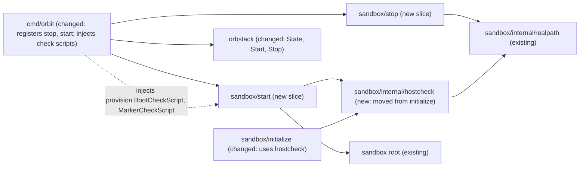

# `orbit stop` and `orbit start`: pause and resume the project sandbox

Issue: #11 (E02-S01), epic #3. Depends on #5 (E01-S01, done). Related: #75 (Orbit never starts a machine implicitly), #6 / PR #72 (`orbit shell`, merges after #11), #62 (Orbit never starts OrbStack).
Extends: .ai/specs/2026-11-10-sandbox-provisioning.md
Extends: .ai/specs/2026-11-11-orbit-shell.md (PR #72; not yet merged)

## 📝 TLDR

Today a sandbox runs from `orbit init` until the owner stops it by hand with `orb stop <machine>`, and holds about 400 MB of memory while idle. Nothing in Orbit starts it again safely: every `orb -m` command starts a stopped machine silently (#75), and `orbit init` on a stopped sandbox will refuse and name `orbit start` (owner decision, 2026-11-11). This spec proposes two slices. `orbit stop` stops the sandbox of the current directory. `orbit start` starts it, and it is the only Orbit path that starts a machine: before the start it runs the same host-side checks as `init` (the project directory rules and the nesting refusal that `internal/sandbox/AGENTS.md` requires before every start); after the start it waits for the boot, checks the mounts in the kernel, and checks that the firewall, the proxy, and the hardening are active. A sandbox that fails a boundary check after the start is stopped again.

## Resolved assumptions (autonomous defaults)

This spec was written unattended. Every answer below is a proposal. **Each one needs owner confirmation** before the implementation starts. The rest of the spec is written under these answers. Facts marked `[DATA]` come from a probe on OrbStack 2.2.5 on 2026-11-11 (see Evidence).

| # | Question | Proposed answer | Why |
|---|---|---|---|
| Q1 | One spec for both commands, or two? | ⚠ **Needs owner confirmation.** One spec, two phases: `stop` (phase 1) and `start` (phase 2). Each phase can ship as its own PR; `stop` can merge first. | Each command works without the other, so the split is raised. The issue bundles them, they share the adapter method `State` and one Delta, and `stop` without `start` leaves a sandbox that only `orb` can start again (`init` refuses a stopped sandbox, #75). Two phases keep the review small without a second spec. |
| Q2 | `orbit stop` on a stopped sandbox, `orbit start` on a running one? | ⚠ **Needs owner confirmation.** Success, exit 0, print `Sandbox <name> is already stopped` / `… already running`. Orbit runs no `orb start` or `orb stop`. `start` on a running sandbox runs no check: it starts nothing. | Matches `orb` itself: `orb stop` and `orb start` on a machine in that state exit 0 `[DATA]`. A script can call `orbit stop` without first asking. `start` on a running sandbox does not vouch for it; `orbit shell` checks a running sandbox itself (#6, Q3). |
| Q3 | A state other than `running` or `stopped` (for example `starting`, `stopping`, `creating`)? | ⚠ **Needs owner confirmation.** Refuse: exit 1, `ErrUnexpectedState`, message `sandbox <name> is <state>; wait and try again`. No `orb start` or `orb stop`. | Orbit knows only the two states it acts on. A guess could start a machine whose checks did not run. The smallest rule; a later version can wait. |
| Q4 | Which checks does `start` run before `orb start`? | ⚠ **Needs owner confirmation.** All host-side checks of `init`, in the same order and with the same code: (1) `ValidateProjectDir` with freshly loaded facts (protected paths, ownership, hard links, relocated locations); (2) the configured mounts of this machine are exactly the project directory (`ValidateMounts` on `Mounts`); (3) the nesting refusal against every other machine (`ValidateNotNested`, `ErrPathNotClean`); (4) no stored mount path of any machine, **this one included**, passes through a symlink (`ErrLinkedSandboxDir`). The own machine is excluded from the nesting comparison (3), as in `init`; it is included only in the symlink walk (4). Check (2) reads the configuration only and cannot see a path that was swapped for a symlink; check (4) is the real defense. The fact loading and the nesting refusal move from `initialize/handler.go` into a module-private package `internal/sandbox/internal/hostcheck` without a change of behavior, so both slices run one implementation. | `internal/sandbox/AGENTS.md`: a slice that starts a machine is required to re-run the nesting refusal before every start, because OrbStack resolves the stored path again at each start and follows a symlink that a host-side move put there. The protected set and the environment can change after `init` (a new `CLAUDE_CONFIG_DIR`, a hard link to `~/.claude.json`), and a start mounts the directory again, so the directory rules apply too. `init` skips its own machine in check (4) because it may create it; `start` checks its own stored path, which is the path OrbStack is about to resolve. Copying the code into a second slice would let the two drift (dependency rule 2 forbids importing `initialize`). |
| Q5 | What does `start` check after `orb start`, and what happens on a failure? | ⚠ **Needs owner confirmation.** (a) Wait for the boot: a root script runs `timeout 120 systemctl is-system-running --wait` (`running` and `degraded` both end the wait). (b) Kernel mounts: `ActiveMounts` through `ValidateMounts`. (c) Boundary: as root, `nftables.service`, `orbit-proxy-address.service`, `tinyproxy.service`, `orbit-harden.service`, and `systemd-user-sessions.service` are all active. (d) Marker: `/etc/orbit/provisioned` holds `provision.Version`. A failure of (a), (b), or (c) stops the machine again (`orb stop <name>`, with a context that cancellation does not stop) and exits 1 with the reason. A failure of (d) leaves the machine running, because the boundary is up, and exits 1 with `run "orbit init" in <dir> to provision it again`. | `orb start` returns while systemd still reports `starting` `[DATA]`, so a check right after it can see units that have not started yet. A running machine without its firewall is the state that D14 and R03 forbid; stopping it is the fail-closed choice, and it never deletes the agent's data. An outdated marker after an Orbit upgrade is not a boundary failure; stopping would leave no repair path, because `init` refuses a stopped sandbox (#75) while it repairs a running one. |
| Q6 | Does `start` probe the network (a blocked and an allowed destination) every time? | ⚠ **Needs owner confirmation.** No. `start` checks the units (Q5). The egress probe is part of the integration test and of the QA transcript, not of the command. | An egress probe needs a public destination and the network at every start; it would make `orbit start` fail offline. The units are the mechanism that the provisioning spec tests; the acceptance criterion is proven by the test (Implementation Plan, step 8). |
| Q7 | Where does `State` come from, given that #6 and #75 also need it? | ⚠ **Needs owner confirmation.** #11 adds `State(ctx, name)` exactly as the shell spec designs it (PR #72, Q5): the `state` field of `orb list --format json`, `""` for no machine, prefix rule, never starts a machine. Whichever of #11 and #75 lands first adds it; the other reuses it. #11 also adds `Start` and `Stop`. #75 keeps its scope: the guard before every `-m` command and `init` refusing a stopped sandbox. | One method, one shape, three readers. `Start` and `Stop` run `orb start NAME` and `orb stop NAME`, which are not `-m` commands, so the #75 guard does not apply to them; `start` itself runs `ActiveMounts` and `RunAsRoot` only after it has seen `running`. |
| Q8 | Which readiness script does `start` use, given that #6 plans `provision.ReadinessScript`? | ⚠ **Needs owner confirmation.** #11 adds two pure functions in `provision`: `BootCheckScript()` (Q5 a and c) and `MarkerCheckScript()` (Q5 d). Whether the `shell` implementation (#6, which merges after #11) composes them instead of its planned `ReadinessScript` is decided in #6, not here; `shell` keeps its own readiness check either way, so a sandbox left running with an outdated marker (Q5 d) is still refused by `shell`. | `start` must tell a boundary failure (stop again) from an outdated marker (leave running); one script with one exit status cannot. `cmd/orbit` injects both, as it injects `provision.Script` into `init`; the slices do not import `provision`. |

## 📝 Problem Statement

- An idle sandbox holds about 400 MB of memory (`ARCHITECTURE.md`, measured footprint) `[DATA]` spike of 2026-11-10. The owner wants to pause it and resume it later with the login and history of the agent intact (D19, issue #11).
- Today the only way is `orb stop` / `orb start` by hand. `orb start <machine>` re-resolves the stored mount path and follows a symlink in it; no check runs. Any `orb -m` command also starts a stopped machine `[DATA]` (#75, PR #72 Evidence).
- `init` will refuse a stopped sandbox and name `orbit start` (#75, owner decision 2026-11-11), and `shell` will refuse one and name `orbit start` (#6, Q4). Both need the command to exist.

## 📝 Proposed Solution

Two slices in the sandbox module, three adapter methods, two provisioning scripts, and one module-private package that `init` and `start` share.

`orbit stop`, in order:

1. Resolve the current directory with `realpath.Resolve`; `sandbox.MachineName`. No OrbStack call yet.
2. `State(name)`: `""` → `ErrNoSandbox` (names `orbit init`); `stopped` → `AlreadyStopped`, done; any state but `running` → `ErrUnexpectedState`.
3. `Stop(name)`. Then `State(name)` must be `stopped`, else an error that names the state. `orb stop <name>` returns after the machine stopped `[DATA]`, so no wait is needed.

`orbit start`, in order:

1. Load the facts of the current directory and run `ValidateProjectDir` (`hostcheck`). No OrbStack call yet.
2. `State(name)`: `""` → `ErrNoSandbox`; `running` → `AlreadyRunning`, done; any state but `stopped` → `ErrUnexpectedState`.
3. `Mounts()`: the configured mounts of this machine are exactly the project directory; the nesting refusal against every other machine; no stored path of any machine, this one included, passes through a symlink (Q4).
4. `Start(name)`. From here on, a failure stops the machine again (Q5). This includes an error or a cancellation of `Start` itself: the machine may run although `orb start` did not return success.
5. `RunAsRoot(BootCheckScript)`: waits for the boot and checks the boundary units.
6. `ActiveMounts(name)` through `ValidateMounts`.
7. `RunAsRoot(MarkerCheckScript)`: on failure, the machine stays running and the error names `orbit init`.

Step 1 runs for every state, so a project directory that the rules refuse is refused also when its sandbox already runs. Steps 3–7 run only for a `stopped` sandbox; `start` on a running sandbox vouches for nothing beyond step 1. Step 5 runs before step 6 on purpose: both are `-m` commands on a running machine, and the boundary check answers first whether the boot finished at all.

Alternatives considered:

- **Start provisions again (`init` without the create).** `init` rebuilds the allowlist from its own `--agent` (D24) and Orbit stores no record of the installed agent, so a `start` without `--agent` would drop the agent's hosts. It also restarts tinyproxy and drops open tunnels. Rejected.
- **Start checks only the nesting refusal.** That is the minimum of `internal/sandbox/AGENTS.md`. The directory rules can change after `init` as well (Q4). Rejected as the default; it is the fallback if the owner rejects Q4.
- **`orb restart` for a running sandbox.** Not asked for; `stop` then `start` does it with every check. Deferred.
- **Stop with `--force`.** `orb stop -f` applies only to OrbStack as a whole and "may cause data loss" (`orb stop --help`) `[DATA]`. Rejected.
- **Search upward for the sandbox.** Same rule as `shell` (PR #72, Q1): exact directory only. Deferred.

## 📝 Delta

### Capability: sandbox-lifecycle

#### ADDED Requirement: Stop the sandbox of the project directory
The system SHALL stop, for `orbit stop` in a project directory with a running sandbox, the machine of that directory and no other machine, and keep the disk of the machine.

##### Scenario: Stop a running sandbox
- WHEN the owner runs `orbit stop` in a directory where `orbit init --agent claude-code` ran and the sandbox runs
- THEN the state of the machine is `stopped`, Orbit prints `Stopped sandbox <name> for <dir>`, and exits 0

##### Scenario: State survives
- WHEN a file exists in `/home/agent` (for example `~/.claude.json` after `/login`), and the owner runs `orbit stop` and then `orbit start`
- THEN the file exists with the same content (D08)

##### Scenario: Already stopped
- WHEN the sandbox of the directory is stopped
- THEN Orbit prints `Sandbox <name> is already stopped`, exits 0, and runs no `orb stop`

#### ADDED Requirement: Start the sandbox only after the host-side checks
The system SHALL run, for `orbit start`, the project directory rules, the check of the configured mounts, the nesting refusal, and the symlink check of every stored mount path before it starts the machine, and SHALL start nothing when one of them fails.

##### Scenario: Start a stopped sandbox
- WHEN the owner runs `orbit start` in a project directory whose sandbox is stopped and passes every check
- THEN the machine runs, Orbit prints `Started sandbox <name> for <dir>`, and exits 0

##### Scenario: Stored path became a symlink
- WHEN, after `orbit stop`, the host directory of another sandbox is replaced by a symlink (`mv ~/b ~/w/b && ln -s w/b ~/b`), and the owner runs `orbit start` in the project directory
- THEN Orbit exits 1 with `ErrLinkedSandboxDir` naming that sandbox, and the machine stays stopped

##### Scenario: Protected file appeared
- WHEN, after `orbit stop`, `~/.claude.json` gets a second hard link, and the owner runs `orbit start`
- THEN Orbit exits 1 with `ErrHardLinkedFile` and the machine stays stopped

##### Scenario: Already running
- WHEN the sandbox of the directory runs
- THEN Orbit prints `Sandbox <name> is already running`, exits 0, and runs no `orb start`

#### ADDED Requirement: The boundary is up after a start
The system SHALL report success for `orbit start` only when the boot finished, the kernel mounts exactly the project directory, and the firewall, the proxy address, the proxy, the hardening unit, and user sessions are active; on a failure of one of these the system SHALL stop the machine again.

##### Scenario: Egress after a start
- WHEN `orbit start` succeeded, and `agent` connects directly to a public address, through the proxy to a host with no allow rule, and through the proxy to an allowed host
- THEN the first two fail and the third succeeds (R03, D14)

##### Scenario: Units before agent processes
- WHEN `orbit start` succeeded
- THEN every boundary unit entered `active` before the start time of every process with a uid from 1000 up

##### Scenario: Boundary unit fails at boot
- WHEN `nftables.service` is not active after the boot
- THEN Orbit stops the machine again, exits 1, and the message names the unit

##### Scenario: Outdated marker
- WHEN the boundary units are active and `/etc/orbit/provisioned` is missing or holds another version
- THEN the machine stays running, and Orbit exits 1 and names `orbit init`

#### ADDED Requirement: No sandbox, no action
The system SHALL exit non-zero and SHALL NOT stop or start any machine when the current directory has no sandbox or its sandbox is in a state other than `running` or `stopped`.

##### Scenario: No sandbox
- WHEN the owner runs `orbit stop` or `orbit start` in a directory with no sandbox, or in a subdirectory of a project
- THEN Orbit exits 1, names `orbit init`, and the state of every machine is unchanged

##### Scenario: Unexpected state
- WHEN the sandbox of the directory is `starting`
- THEN Orbit exits 1, names the state, and runs no `orb start` or `orb stop`

Frozen by: none — all requirements are new. The move of the `init` checks into `hostcheck` changes no behavior; the existing `initialize` handler tests freeze it (Implementation Plan, step 4).

## 📝 Architecture

Takeaway: `start` and `init` share one implementation of the host-side checks; only `cmd/orbit` touches the adapter and `provision`. No new module dependency and no new third-party dependency.

### `internal/sandbox/internal/hostcheck` (moved code)

From `initialize/handler.go`, unchanged in behavior: `loadFacts` and everything it calls, `mountableDir`, `unnestedMachines`, `validateNotNested`, `validateUnlinked`, `checkUnlinked`, and their helpers. Exported for the module only (the Go `internal/` rule):

- `ProjectDir(path string) (sandbox.ProjectDir, error)` — loads the facts and runs `ValidateProjectDir`.
- `Unnested(machines map[string]map[string]string, name, dir string, includeOwn bool) error` — the nesting refusal and the symlink check. The nesting comparison always excludes the machine `name`; `includeOwn` adds its stored path only to the symlink walk. `init` passes `false`, `start` passes `true`.

The user lookup that `initialize.Handler` holds as a field moves with it as a parameter, so handler tests can still fake it.

### Contracts

`internal/sandbox/stop`:

- `Input{Dir string}`, `Output{Name, Dir string; AlreadyStopped bool}`.
- Errors: `ErrNoSandbox`, `ErrUnexpectedState`.
- `Machines`: `State`, `Stop`.

`internal/sandbox/start`:

- `Input{Dir string}`, `Output{Name, Dir string; AlreadyRunning bool}`.
- Errors: `ErrNoSandbox`, `ErrUnexpectedState`, `ErrBoundaryDown` (machine stopped again), `ErrNotProvisioned` (machine left running); errors of `ValidateProjectDir`, `ValidateNotNested`, `ValidateMounts`.
- `Machines`: `State`, `Mounts`, `Start`, `Stop`, `ActiveMounts`, `RunAsRoot`.
- Handler fields: `BootCheckScript func() []byte`, `MarkerCheckScript func() []byte`.

`ErrNoSandbox` and `ErrUnexpectedState` are declared once in the root package `sandbox.go`, so that `stop`, `start`, `shell`, and `destroy` report them alike; `shell` (#6) reuses `ErrNoSandbox` from there.

### Adapter (`internal/orbstack`)

- `State(ctx, name) (string, error)` — as in the shell spec (PR #72, Q5).
- `Start(ctx, name) error` — `orb start <name>`.
- `Stop(ctx, name) error` — `orb stop <name>`.
- Both refuse a name without the prefix (`ErrForeignMachine`) before any command, and both run behind the `orb status` check (#62). The argument list is exactly two elements. Hostile-input tests are mandatory: `orb stop` with no machine stops OrbStack with every machine, and `orb start` with no machine starts every machine that ran when OrbStack last stopped `[DATA]` (`orb stop --help`, `orb start --help`). A name that is empty, only the prefix, starts with `-`, or holds a space never reaches `orb`. The prefix rule already refuses all of them; the tests prove it for these two methods.
- `orbstacktest`: `OpState`, `OpStart`, `OpStop`, with a state per machine that `Start` and `Stop` change, and the same prefix rule. `ActiveMounts`, `RunAsRoot`, `RunAsAgent` of the fake fail for a machine that is not `running`, so that a handler test catches an implicit start (#75 adds the same rule to the adapter).

### Provisioning (`internal/provision`)

- `BootCheckScript() []byte` — `set -euo pipefail`; `timeout 120 systemctl is-system-running --wait || true` (the state is checked next, not trusted); then `systemctl is-active --quiet` for each unit of `boundaryUnits()` and `systemd-user-sessions.service`, printing the first one that is not active and exiting 1.
- `MarkerCheckScript() []byte` — fails unless `MarkerPath` holds exactly `Version`.
- Pure, deterministic bytes, tested like `Script`.

## 📝 UI/UX

Terminal commands with no argument and no flag (`cobra.NoArgs`), like `init`.

- stdout: `Stopped sandbox <name> for <dir>`, `Sandbox <name> is already stopped`, `Started sandbox <name> for <dir>`, `Sandbox <name> is already running`.
- stderr, exit 1:
  - `orbit: no sandbox for /Users/dev/proj: run "orbit init" here, or run this command in the directory where you ran "orbit init"`
  - `orbit: sandbox orbit-proj-0123456789abcdef is stopping; wait and try again`
  - `orbit: sandbox orbit-proj-0123456789abcdef did not start safely: tinyproxy.service is not active; the sandbox was stopped again`
  - `orbit: sandbox orbit-proj-0123456789abcdef runs, but it is not provisioned by this version of orbit; run "orbit init" in /Users/dev/proj to provision it again`
  - the existing messages of the `init` checks (`ErrLinkedSandboxDir`, `ErrHardLinkedFile`, …), unchanged.

## 📝 Edge Cases & Failure Scenarios

| Case | Behavior |
|---|---|
| OrbStack stopped | The `orb status` check of the adapter fails with its `ErrNotRunning` (#62). `start` does not start OrbStack; `stop` has nothing to stop. Exit 1. |
| State changes between `State` and `orb start` / `orb stop` (another terminal) | Residual race; `orb` exits 0 on a machine already in the target state `[DATA]`, and `start` still runs every post-start check. Accepted, as in #62 and #75. |
| Host layout changes between the checks and `orb start` | Residual race of milliseconds that only a host process can cause; the kernel mount check after the start is defense in depth, not proof (`internal/sandbox/AGENTS.md`). Accepted; documented. |
| Project directory removed while the sandbox is stopped | `realpath.Resolve` fails in that directory, so `orbit start` cannot run there. On OrbStack 2.2.5 `orb start` on a machine whose mount source is gone exits 0 `[DATA]`; Orbit never reaches it because of step 1. |
| Ctrl-C or a timeout after `orb start` | The post-start checks are cut short; `start` stops the machine again with a context that cancellation does not stop (as `init`'s `discard`), then reports both errors. |
| `orb stop` of the machine fails after a failed boundary check | Both errors are reported; the message says that the sandbox may still run and names `orbit stop`. Exit 1. |
| Boot takes longer than 120 s | The unit checks run on whatever state there is; a unit not yet active fails closed (stop again, exit 1). The owner retries. |
| Agent processes at boot | Today none: rootless Docker comes with E01-S05, and `user@.service` is ordered after `systemd-user-sessions.service`, which requires the boundary units. An `orb -m … -u agent` that the owner runs by hand during the boot is outside Orbit; `orb` does not honor `/run/nologin` (PR #72, Prior spec drift). The escape suite (#10) covers it. |
| `stop` while an `orbit shell` session is open | The session ends; `orb` returns a status, `shell` passes it through (#6). Not an error of `stop`. |
| Two sandboxes | `stop` and `start` pass only the computed name of the current directory; no command without a machine name reaches `orb`. The integration test checks that the second machine's state is unchanged. |

## 📝 Risks & Impact Review

- **`risk-high` (implementation).** `start` is the one place where Orbit starts a machine, and so where the nesting refusal must run (`internal/sandbox/AGENTS.md`). The implementation PR carries the hostile-input tests of the adapter and of `hostcheck`, the integration test, a statement that the escape suite (#10) did not run, a review by a second person, and a terminal transcript on a named OrbStack version.
- **Moving the `init` checks.** A pure move with the existing `initialize` tests as the freeze; a behavior change hidden in the move would weaken `init`. The PR shows the move as a separate commit with no test change.
- **Stop-again on a boundary failure** turns a broken boot into a stopped sandbox. The owner's data stays; the repair is `orbit start` again, or `orbit destroy` (#12) and `orbit init` for a broken provisioning. `init` cannot repair a stopped sandbox (#75); a repair path for a sandbox whose boundary units never come up is not designed here and waits for a real case.
- **Not proven here:** escalation inside the machine (A01, #10); an `orb -u agent` session during the boot.
- **Rollback:** revert the PR(s); the commands disappear. Nothing is written on the host; in the machine, `start` and `stop` write nothing.

## 📝 Decisions in play

D08 (state on the disk of the sandbox), D14 (root owns the firewall and the proxy), D19 (`stop`/`start` act on the sandbox of the current directory), D24 (allowlist from `init`'s `--agent`; the reason `start` does not provision), R03, R07 (adapter only in `internal/orbstack`), R08. The owner decisions of 2026-11-11 on #62 and #75 (Orbit never starts anything implicitly; `init` on a stopped sandbox refuses and names `orbit start`). No active row of the product brief changes. Q7 shares `State` with #75 and #6; Q8 offers #6 the two check scripts without deciding for it. The owner confirms Q1–Q8.

## 📝 Evidence

Probe on OrbStack 2.2.5 (2020500), 2026-11-11, on one throwaway machine `orbit-gh11probe-1c457f` created with `--isolated --isolate-network --mount DIR:DIR ubuntu:26.04` and a plain `agent` user (not provisioned), deleted afterwards:

- `orb stop M` and `orb start M` each exit 0 in under 1 s; `orb list --format json` shows `"state":"stopped"` / `"running"`.
- `orb stop M` on a stopped machine and `orb start M` on a running one both exit 0 and change nothing.
- `orb stop` / `orb start` on a missing name exit 1: `[-32098] machine not found`.
- A file in `/root` and in `/home/agent` survives `stop` and `start`.
- Right after `orb start M` returns, `systemctl is-system-running` prints `starting`, and `orb -m M -u agent id -un` already prints `agent`.
- With the mount source moved away on the host, `orb start M` exits 0 and the machine runs.
- `orb stop --help`: with no machine, it stops OrbStack with Docker and every machine. `orb start --help`: with no machine, it starts every machine that ran when OrbStack was last stopped.
- Entries of `orb list --format json` have the keys `builtin, config, id, image, name, os_release, state`.

## 📋 Phasing

- **Phase 1 — `orbit stop`.** Adapter `State` and `Stop`, the fake, the `stop` slice, registration. Shippable alone: it changes nothing that exists.
- **Phase 2 — `orbit start`.** The `hostcheck` move, adapter `Start`, the two check scripts, the `start` slice, registration, the integration test. After it, #75's `init` refusal and #6's `shell` can name `orbit start`.

## 📋 Implementation Plan

### Phase 1 — `orbit stop`

1. **Adapter `State`** (skip when #75 or #6 already added it). `orb list --format json` parser, `""` for absent, refusal of a duplicate name and of malformed JSON, prefix rule. `orbstacktest`: `OpState`, a state per machine. → verify: `go test ./internal/orbstack/...`
2. **Adapter `Stop`.** `stopArgs(name)` is exactly `["stop", name]`; hostile-input table (empty, prefix only, `-a`, `--all`, `orbit-x --all`, foreign name, empty client prefix): no command runs. Fake: `OpStop` sets `stopped`; fake `ActiveMounts`/`RunAsRoot`/`RunAsAgent` fail on a machine that is not running. `internal/orbstack/AGENTS.md`: layout and the invariant "never `stop` or `start` without a machine name". → verify: `go test ./internal/orbstack/...`
3. **Slice `stop`.** `ErrNoSandbox`, `ErrUnexpectedState` in `sandbox.go`; `contract.go`, `handler.go`, `command.go`, `handler_test.go`: no sandbox (only `State`), already stopped (no `Stop`), other states (no `Stop`), running (`State`, `Stop`, `State`), state not `stopped` afterwards, adapter errors. Register in `cmd/orbit`. `internal/sandbox/AGENTS.md`: the slice. → verify: full validation gate.

### Phase 2 — `orbit start`

4. **Move the host-side checks into `internal/sandbox/internal/hostcheck`.** Behavior unchanged; `initialize` calls it; the existing `initialize` handler tests pass unchanged (characterization). Move the tests of the moved functions with them. `init` passes `includeOwn=false`; new table tests for `true`: a symlink in the own stored path refuses, and the own machine never counts as nested in itself. This step can ship as its own PR before step 7. → verify: `go test ./internal/sandbox/...`, and `git diff --stat origin/main -- internal/sandbox/initialize/handler_test.go` shows only removed tests that moved to `hostcheck`, no changed expectation.
5. **Adapter `Start`.** `startArgs(name)` is exactly `["start", name]`; the same hostile-input table as `Stop`. Fake: `OpStart` sets `running`. → verify: `go test ./internal/orbstack/...`
6. **`provision.BootCheckScript` and `MarkerCheckScript`.** Tests: `set -euo pipefail`; the boot wait is bounded; every unit of `boundaryUnits()` and `systemd-user-sessions.service` is checked; the marker check names `MarkerPath` and `Version`; deterministic bytes. → verify: `go test ./internal/provision/...`
7. **Slice `start`.** Handler in the order of the Proposed Solution. `handler_test.go`: no sandbox; already running (only `State`); unexpected states; each pre-start check failing (no `Start`); `Start` fails or its context is cancelled (`Stop` called); running sandbox with a refused project directory (no `Start`, no `Mounts`); boot check fails (`Stop` called, `ErrBoundaryDown`); mount mismatch in the kernel (`Stop` called); marker fails (no `Stop`, `ErrNotProvisioned`); cancelled context after `Start` (`Stop` still called); `Stop` fails after a failed check (both errors); happy path call order `State, Mounts, Start, RunAsRoot(boot), ActiveMounts, RunAsRoot(marker)`; no `-m` call before `Start`. Register in `cmd/orbit` with the two scripts. `internal/sandbox/AGENTS.md`: the slice, and the invariant "only `start` starts a machine, after the host-side checks". `ARCHITECTURE.md`: Components (adapter `State`, `Start`, `Stop`), the layout line for `hostcheck`, a Key decisions row (start re-runs the `init` checks; check scripts injected). Root `AGENTS.md`: project overview. → verify: full validation gate.
8. **Integration test** (`cmd/orbit`, `integration` tag, `-p 1`; unique machine names `orbit-it-<random>`, cleanup deletes only the names the test computed). `orbit init --agent claude-code` on a temporary project; write a file in `/home/agent`; a second machine from a second `init`. `stop` → state `stopped`, the second machine unchanged; `stop` again → `AlreadyStopped`. `start` → state `running`; the file is intact; as `agent`: a direct connection to a public address fails, a proxied request to a host with no allow rule fails, a proxied request to an allowed host succeeds; as root: every boundary unit's `ActiveEnterTimestampMonotonic` is earlier than the start time of every process with a uid from 1000 up. Negative: `stop`, then make a component of the second machine's stored path a symlink → `start` fails with `ErrLinkedSandboxDir` and the state stays `stopped` (a machine with a linked stored path makes every concurrent `init` refuse, so this case uses the cross-run serialization of the symlink-swap test, #71, and restores the path before it deletes the machine); `stop`/`start` in a directory without a sandbox → `ErrNoSandbox` and both machines unchanged. → verify: `go test -tags integration -p 1 -run 'Stop|Start' ./cmd/orbit/...` on a named OrbStack version.
9. **Archive the Delta** into `.ai/specs/capabilities/sandbox-lifecycle.md`. → verify: the file matches the Delta.
