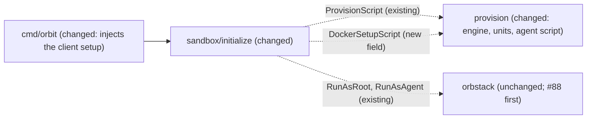

# Rootless Docker for the agent: build and run containers inside the sandbox

Issue: #9 (E01-S05), epic #2. Depends on #5 (E01-S01, done) and on PR #88 (#76, open: `orb` gets only an allowlist of host variables).
Extends: .ai/specs/2026-11-10-sandbox-provisioning.md
Extends: .ai/specs/2026-11-11-orbit-stop-start.md

## 📝 TLDR

Today a sandbox has no container engine: the agent cannot run `docker`, and provisioning only prepared the proxy address `172.31.255.1` that containers would use. This spec proposes that provisioning installs a rootless Docker Engine that belongs to `agent`, starts it at every boot after the firewall and the proxy, and points the daemon, builds, and containers at the egress proxy. The host engine stays out of reach: no socket, no `DOCKER_*` from the host, and the firewall rejects every direct packet of the agent and its sub-uids (D12, D14, R01, R03). The owner decided every open question on 2026-11-11: the proposals as written, except that the default allowlist also gets GitHub Container Registry (`ghcr.io`, `pkg-containers.githubusercontent.com`) beside Docker Hub (Q2).

## Resolved assumptions (autonomous defaults)

Every answer below is decided by the owner, Jakub Tobiasz, on 2026-11-11. Q1 and Q3–Q12 are the proposals of the authoring agent, which the owner accepted exactly as written. Q2 is accepted with a change: GitHub Container Registry joins Docker Hub in the default allowlist. Q1–Q6 change the default allowlist, the package sources of root, the boot gate, a business rule, or the permissions and kernel features that the agent can use; `AGENTS.md` and `SDLC.md` give those to the owner. The rest of this spec is written under the **Decided answer** of each row. `[DATA]` marks a probe on OrbStack 2.2.5 on 2026-11-11 (machine `orbit-p9spec-755b60c3`, deleted; see Evidence), or, for GHCR, a registry API probe from the host on 2026-11-11 (see Evidence).

| # | Question | Decided answer | Options and why | Status |
|---|---|---|---|---|
| Q1 | Which engine, and from which package source? | **Ubuntu archive:** `docker.io` 29.1.3, `docker-buildx`, `rootlesskit` 2.0.2, `uidmap`, `slirp4netns`, `dbus-user-session` `[DATA]`. | (a) Ubuntu archive: no new apt source and no third-party signing key for root, Ubuntu security updates, and the same "distribution package" path that the Alpine epic (E04, #56) needs. It works rootless as `agent` and builds with BuildKit `[DATA]`. Cost: the spike's container results ran on Docker CE with rootlesskit 3.3, so every container scenario must be shown again on this stack (Phase 3 does that). (b) Docker CE from `download.docker.com`: proven in the spike, newer, but a new apt source and key that root trusts, and Docker CE has no Alpine build. (c) Podman with a Docker-compatible CLI: D14 says "rootless Docker"; it needs a superseding row. | ✅ OWNER DECISION (2026-11-11) |
| Q2 | Which registry hosts are in the default allowlist? | **Docker Hub and GitHub Container Registry.** D24 already holds Docker Hub (`registry-1.docker.io`, `auth.docker.io`, `production.cloudflare.docker.com`, `production.cloudfront.docker.com`) and `dl-cdn.alpinelinux.org`. The owner adds GHCR to the base list: `ghcr.io` (the `/v2/` API, the token endpoint `https://ghcr.io/token`, manifests) and `pkg-containers.githubusercontent.com` (every blob: `ghcr.io` answers a blob request with 307 to that host, which serves it with 200, no further redirect) `[DATA]`. Both pass `policy.ValidateHost`. Port 80 stays closed. A new base host supersedes D24 with a new row in the product brief (`internal/policy/AGENTS.md`). | (a) Docker Hub only: the proposal. (b) Docker Hub plus GHCR: the owner's choice. Not added, each a separate owner yes later (`AGENTS.md`, Ask first): (c) Quay: `quay.io`, `cdn01.quay.io`, `cdn02.quay.io`, `cdn03.quay.io`; (d) `public.ecr.aws` and `mcr.microsoft.com`, whose blobs come from regional or CDN hosts that need a wildcard, which `policy.ValidateHost` refuses. Known gap: an image from any other registry (Quay, ECR, MCR, `registry.k8s.io`, a private registry) fails to pull with 403 from the proxy, and `RUN apt-get` in a Debian or Ubuntu based image fails, because their package mirrors (`deb.debian.org`, `ports.ubuntu.com`, …) are not allowed and use port 80 by default. Alpine-based builds work (spike). | ✅ OWNER DECISION (2026-11-11) |
| Q3 | How does the daemon run? | **A root-owned systemd user unit** `/etc/systemd/user/docker.service` with `ConditionUser=agent`, enabled with `systemctl --global enable`, plus `loginctl enable-linger agent`. | (a) Root-owned unit: provisioning repairs it on every `init`, root writes nothing into the home of `agent` (provisioning Q9), and the unit carries the daemon proxy settings. (b) Upstream `dockerd-rootless-setuptool.sh install` as `agent`: writes an agent-owned unit; Ubuntu's copy needs `/usr/share/docker.io/contrib` on `PATH` and then fails its own last check before it creates the CLI context `[DATA]`. (c) A system unit with `User=agent`: no linger, but not a mode that Docker supports for rootless, and it needs its own runtime directory and bus. With (a) and (b), linger starts the user manager of `agent` at every boot, and with it every user unit that the agent writes and every container with a restart policy. They run as `agent` and its sub-uids, behind the firewall. `orb -u agent` sessions have no user manager without linger `[DATA]`. | ✅ OWNER DECISION (2026-11-11) |
| Q4 | May the user manager of `agent` start when a boundary unit failed at boot? | **No.** A new root oneshot unit `orbit-boundary-gate.service` (`RemainAfterExit=yes`, `After=` the four boundary units) runs the existing boundary check: the table `inet orbit_egress` is loaded and `nftables.service`, `orbit-proxy-address.service`, `tinyproxy.service`, and `orbit-harden.service` are active. A root-owned drop-in for `user@.service` adds `Requires=` and `After=` on the gate only. | `user@.service` is ordered `After=systemd-user-sessions.service` but does not require it `[DATA]`. With ordering only, a failed `nftables.service` still lets linger start the agent's daemon and its restart-policy containers with no firewall. `orbit start` stops such a machine again (stop-start spec), but only after the fact, and a machine that OrbStack starts by itself never passes that check. The gate, not a direct `Requires=` on the boundary units, because `init` restarts `tinyproxy.service` and `orbit-harden.service` on every run, and `Requires=` would pass each restart on to the user manager and stop every container of the agent. (b) Ordering only, as today. Cost of (a): when a boundary unit fails at boot, the agent has no user manager and no Docker until `orbit init` repairs the machine; `orb -u agent` sessions still open (orbit-shell spec, Prior spec drift). | ✅ OWNER DECISION (2026-11-11) |
| Q5 | The issue asks that `docker run --privileged` fails (R01). How is that guaranteed? | **Assert it as a test and document the real boundary.** The integration test requires that `--privileged` fails; it failed on OrbStack 2.2.5 for every image (spike). | Rootless Docker supports `--privileged`: it gives every capability inside the user namespace of `agent`, none outside it. The failure on OrbStack is a property of the platform (`/dev/null` cannot be reopened), not a rule of Orbit. The agent owns its daemon, so it can restart it with any flag: no daemon setting can refuse `--privileged` (an authorization plugin would be bypassed the same way). So (a) keep the test, which fails loudly if a later OrbStack lets it start, and the owner then decides; (b) reword R01 to "no privileged mode outside the user namespace of the agent" with a superseding row. Recommended: (a) now, and the owner considers (b). | ✅ OWNER DECISION (2026-11-11) |
| Q6 | Accept the setuid helpers `newuidmap`/`newgidmap` and the sub-uid range of `agent`? | **Yes.** `uidmap` provides both helpers; `useradd` already gave `agent` `100000:65536` in `/etc/subuid` and `/etc/subgid` `[DATA]`. | Rootless Docker needs them to map more than one uid into a container; without them, images that use a non-root user or `chown` break, and Docker does not support that mode. The agent can already create user namespaces (`unshare -rn` worked in the spike; `user.max_user_namespaces` is 2147483647 `[DATA]`), so the new kernel surface is the two setuid helpers, overlayfs in a user namespace, and cgroup delegation of `cpu memory pids`. All run on the one shared kernel that the owner accepted (A01). The firewall already matches every uid from 1000 up, so the sub-uids are covered. | ✅ OWNER DECISION (2026-11-11) |
| Q7 | Network driver of rootlesskit? | `slirp4netns`, the default of Ubuntu's `dockerd-rootless.sh` `[DATA]`. | Proven in the spike; `pasta` is untested. Reversible. | ✅ OWNER DECISION (2026-11-11) |
| Q8 | Where do the CLI endpoint and the container proxy settings go? | An **agent-side setup script**, run with `RunAsAgent` on every `init` after provisioning and before the agent install, merges `proxies.default` (`http://172.31.255.1:3128`, `noProxy` `localhost,127.0.0.1`) and the context `orbit-rootless` (`unix:///run/user/<uid>/docker.sock`) into `~/.docker/config.json` with `jq`, and keeps every other key, `auths` included. | The client reads `config.json` in every session, also in non-login `orb -u agent` scripts. `DOCKER_HOST` in a root-owned profile file does not reach those, and containers need `config.json` for their proxy anyway. These files are the agent's: changing them cannot widen egress, because the firewall decides (spike). Reversible. | ✅ OWNER DECISION (2026-11-11) |
| Q9 | Which CLI plugins? | `docker-buildx` yes, `docker-compose-v2` no. | `docker build` uses BuildKit through buildx; the issue asks for pull, build, and run, not compose. Adding compose later is one package. Reversible. | ✅ OWNER DECISION (2026-11-11) |
| Q10 | Existing sandboxes, provisioned before this change? | Bump `provision.Version` by one. The SSH agent forwarding spec (#8, `.ai/specs/2026-11-11-ssh-agent-forwarding.md`, on `main`) also bumps it from 1 to 2. The change that merges second bumps it to 3, so that a sandbox provisioned by the first one is sent to `init` again. | `orbit shell` and `orbit start` already refuse a marker of another version and name `orbit init`, which installs Docker. Reversible. | ✅ OWNER DECISION (2026-11-11) |
| Q11 | Docker in every sandbox, or only for agents that ask for it? | Every sandbox, also without `--agent`. | The engine is part of the sandbox (D12, D14), not of an agent; no field of `Definition` is needed (D16). Reversible. | ✅ OWNER DECISION (2026-11-11) |
| Q12 | One spec, or split the engine from its egress settings? | One spec. | An engine without the proxy settings cannot pull, and proxy settings without an engine do nothing; neither ships alone. | ✅ OWNER DECISION (2026-11-11) |

Prerequisite, not a decision: implementation starts after PR #88 merges. Today `orb` copies every host `DOCKER_*` variable into the machine (#88, probe table): a host `DOCKER_AUTH_CONFIG` or `DOCKER_CONFIG` would bring host registry credentials into the sandbox without opt-in (R08), and a host `DOCKER_HOST` would override the sandbox context.

## 📝 Problem Statement

- The owner does not want an agent to escape to the host, and the agent still needs Docker for its work (D12). `[DOCUMENT]` owner request, 2026-11-10; issue #9.
- No engine exists in a sandbox today (`internal/provision/script.go` installs only the toolchain, `nftables`, and `tinyproxy`).
- Rootless Docker needs three proxy settings, or it fails closed: the daemon (pulls), `~/.docker/config.json` (builds and containers), and a proxy address that is not loopback, because `slirp4netns` hides the loopback of the machine (spike, finding 3). The address exists already (`orbit-proxy-address.service`, `orbit0`, `172.31.255.1`).
- A rootful `docker.service` would be a root daemon with a socket; the Ubuntu package enables it on install `[DATA]`.

## 📝 Prior spec drift

- `ARCHITECTURE.md`, isolation layer table, "Rootless Docker has limits (no privileged containers …)": rootless Docker supports `--privileged` inside the user namespace; it fails on OrbStack 2.2.5 for a platform reason (Q5). The implementation PR corrects the sentence.
- Spike, finding 3, "dockerd runs in the machine's real netns": true for Docker CE with rootlesskit 3.3. With Ubuntu's rootlesskit 2.0.2, `dockerd` runs in its own network namespace `[DATA]`, so `--network host` containers share that namespace, not the machine's, and reach the proxy only at `172.31.255.1`, not at `127.0.0.1`. The firewall still sees their traffic as `agent`, the uid of `slirp4netns`. Phase 3 shows the container scenarios on this stack.

## 📝 Proposed Solution

Root sets the engine up; the agent only configures its own client. The firewall, the proxy, and the proxy address do not change; the allowlist gains the two GHCR hosts (Q2).

**Allowlist (`internal/policy`, Q2):** add `ghcr.io` and `pkg-containers.githubusercontent.com` to `baseAllowlist`. The root script already writes the allowlist from `policy.Allowlist` through `proxy.Config`, so no script step changes for it, and the next `init` of a sandbox applies it. A new row in the product brief supersedes D24 with the longer base list, in the same change as the code.

**Root script (`provision.Script`), new steps:**

1. Install the Q1 packages with a temporary `/usr/sbin/policy-rc.d` that exits 101, so that no package starts a rootful daemon, and remove it afterwards (also on failure, through `trap`).
2. Disable and mask the rootful `docker.service`, `docker.socket`, and `containerd.service`.
3. Write `/etc/systemd/user/docker.service` (Q3): `ConditionUser=agent`, `Type=notify`, `NotifyAccess=all`, `Delegate=yes`, `KillMode=mixed`, `Restart=always`, `ExecStart=/usr/share/docker.io/contrib/dockerd-rootless.sh`, `Environment=PATH=/usr/share/docker.io/contrib:…`, and `HTTP_PROXY`/`HTTPS_PROXY`/`NO_PROXY` for `172.31.255.1:3128`. Enable it with `systemctl --global enable docker.service`.
4. Write and enable `orbit-boundary-gate.service` and the `user@.service` drop-in of Q4, and start the gate after the boundary units.
5. `loginctl enable-linger agent`; then, as `agent`, `systemctl --user daemon-reload` and `systemctl --user start docker.service`. `start` leaves a running daemon and its containers alone; a changed unit applies at the next restart of the daemon or boot.
6. Self-check, added to the existing one: the rootful units are masked and inactive, `/var/run/docker.sock` and `/run/docker.sock` do not exist, `agent` has linger, its sub-uid and sub-gid ranges start at 1000 or higher, the gate is active, and `docker.service` of `agent` is active.

**Agent script (new, `RunAsAgent`, Q8):** wait up to 60 s for `/run/user/<uid>/docker.sock`; merge the context and the proxies into `~/.docker/config.json` with `jq` (create the file when missing, mode 0600); `docker context use orbit-rootless`; check that `docker info` reports `rootless` in its security options. It pulls nothing, so `init` does not depend on a registry.

Alternatives considered: Docker Hub as the only registry (Q2 a), Docker CE (Q1 b), the upstream setup tool (Q3 b), a system unit (Q3 c), Podman (Q1 c), an authorization plugin against `--privileged` (Q5; the agent can restart its own daemon without it), and `DOCKER_HOST` in a profile file (Q8).

## 📝 Delta

### Capability: sandbox-containers

#### ADDED Requirement: Rootless engine of the agent
The system SHALL give the user `agent` its own rootless Docker Engine, started at every boot of the machine only after the firewall, the proxy address, the proxy, and the hardening unit are active, and SHALL run no rootful Docker or containerd daemon.

##### Scenario: Pull, build, and run
- WHEN `agent` runs `docker pull alpine` and `docker pull ghcr.io/containerd/busybox`, builds an image whose `Dockerfile` runs `apk add jq`, and runs `docker run --rm alpine true`
- THEN each succeeds on the engine of `agent`, `docker info` reports `rootless`, and the tinyproxy log shows the registry and package hosts, `ghcr.io` and `pkg-containers.githubusercontent.com` included, as `CONNECT` requests

##### Scenario: Registry outside the allowlist
- WHEN `agent` runs `docker pull quay.io/prometheus/busybox`
- THEN the pull fails, and the proxy answers 403 to `CONNECT quay.io:443`

##### Scenario: No rootful engine
- WHEN root checks the machine after provisioning and after `orbit stop` and `orbit start`
- THEN `docker.service`, `docker.socket`, and `containerd.service` are masked and inactive, and neither `/var/run/docker.sock` nor `/run/docker.sock` exists

##### Scenario: Boundary unit failed at boot
- WHEN `nftables.service` fails at boot
- THEN the user manager of `agent` does not start, and no process of a uid from 1000 up runs, except a process that `orb -u agent` starts

#### ADDED Requirement: Container traffic goes only through the proxy
The system SHALL let the engine of `agent`, its builds, and its containers reach the network only through the egress proxy, and SHALL make every direct connection fail, also after a restart and while the proxy is down.

##### Scenario: Direct connections from containers
- WHEN a container connects to a public address or a host with no allow rule, on the default network, with `--network host`, on a custom network, with `--user 65534`, with `--dns 1.1.1.1`, or with `--cap-add NET_ADMIN --cap-add NET_RAW`
- THEN each connection fails

##### Scenario: Refused host through the proxy
- WHEN a container with the proxy settings of `config.json` requests `https://example.org`
- THEN the proxy answers 403

##### Scenario: After a restart
- WHEN the owner runs `orbit stop` and `orbit start`, and `agent` then pulls an image and runs a container that requests an allowed host
- THEN both succeed through the proxy

##### Scenario: Proxy down
- WHEN root stops `tinyproxy.service` and `agent` pulls an image or a container connects to a public address
- THEN both fail, and nothing leaves the machine directly

#### ADDED Requirement: No host engine and no privileged container
The system SHALL give the sandbox no socket, endpoint, variable, image, or container of the host engine, and `docker run --privileged` SHALL NOT start a container.

##### Scenario: Host engine out of reach
- WHEN `agent` lists contexts, images, and containers, and a container connects to the address of a container on the host engine
- THEN only the context `orbit-rootless` exists, nothing of the host engine is listed, and the connection fails

##### Scenario: Host Docker variables
- WHEN `orbit init` runs on a host with `DOCKER_HOST`, `DOCKER_CONFIG`, and `DOCKER_AUTH_CONFIG` set
- THEN none of them is set in a shell or script of `agent`

##### Scenario: Privileged container
- WHEN `agent` runs `docker run --privileged alpine true`
- THEN the container does not start

#### ADDED Requirement: Containers cannot change the boundary
The system SHALL keep the firewall and proxy configuration and the proxy process out of reach of every container of `agent`.

##### Scenario: Host mounts and the host pid namespace
- WHEN a container mounts `/etc` or `/` and writes `/etc/nftables.conf` or `/etc/tinyproxy/allowlist`, or runs with `--pid host` and kills the tinyproxy process
- THEN each attempt fails, and the proxy keeps its pid

### Capability: sandbox-provisioning

#### MODIFIED Requirement: Init of a project directory
The system SHALL create the machine of the project directory when it does not exist, and SHALL then provision it and set up the Docker client of `agent`, also when it already existed. When provisioning or the client setup fails on a machine that the same call created, the system SHALL delete that machine and report the failure.

##### Scenario: First init
- WHEN `init` runs in a project directory without a machine
- THEN the machine is created and provisioned, the client setup runs as `agent`, and `Created` is true

##### Scenario: Init of an existing machine
- WHEN `init` runs in a project directory whose machine exists
- THEN the machine is provisioned again and the client setup runs again, `~/.docker/config.json` keeps its other keys, the machine is not created or deleted, and `Created` is false

##### Scenario: Client setup fails on a new machine
- WHEN the client setup fails on a machine that this call created
- THEN the machine is deleted, the agent is not installed, and the error names the client setup

Frozen by: `internal/sandbox/initialize/handler_test.go` (`TestHandleCreatesTheMachine`, `TestHandleKeepsAnExistingMachine`)

#### MODIFIED Requirement: Proxy allowlist
The system SHALL let the proxy open a `CONNECT` tunnel on port 443 only to a host of the base allowlist (the brief row that supersedes D24: the hosts of D24 plus `ghcr.io` and `pkg-containers.githubusercontent.com`) or of the `EgressDomains` of the agent of the last `init`, matched exactly and without case. Each `init` rebuilds the allowlist from its own `--agent`.

##### Scenario: GHCR hosts
- WHEN the owner runs `orbit init` without `--agent`, and `agent` asks the proxy for `CONNECT ghcr.io:443`, `CONNECT pkg-containers.githubusercontent.com:443`, and `CONNECT quay.io:443`
- THEN the first two succeed and the third gets 403

Frozen by: `internal/policy/policy_test.go` (`TestAllowlistWithoutAgentIsTheBaseListOfD24`, renamed in step 1)

## 📝 Architecture

Takeaway: no new module, no new cross-module dependency, and no new adapter operation; `policy` gains two base hosts, `provision` renders one more script, and `init` runs it with the existing `RunAsAgent`.

| Package | Change |
|---|---|
| `internal/provision` | New package list, `policy-rc.d` guard, rootful mask, the user unit and the `user@.service` drop-in in `Units`, linger, the new self-checks, `Version` one higher than on `main` (Q10). New `DockerSetupScript() []byte` for the agent side, a pure function of constants (`proxy.ContainerAddr`, `proxy.Port`). |
| `internal/policy` | `ghcr.io` and `pkg-containers.githubusercontent.com` in `baseAllowlist` (Q2). No new function. |
| `internal/sandbox/initialize` | `Handler` gains `DockerSetupScript func() []byte`; `runScripts` runs it with `RunAsAgent` after `RunAsRoot` and before the agent install. |
| `cmd/orbit` | Passes `provision.DockerSetupScript`. New integration test. |
| `internal/orbstack` | No change in this story. It relies on the allowlist of #88. |

## 📝 Edge Cases & Failure Scenarios

| Case | Behavior |
|---|---|
| The daemon socket does not appear within 60 s | The client setup fails; a new machine is deleted, an existing one stays and the next `init` retries. |
| A package starts a rootful daemon despite `policy-rc.d` | Step 2 masks and stops it; the self-check fails if it still runs. |
| The agent edits or masks its `docker.service`, or runs `dockerd-rootless.sh` with other flags | Its traffic still meets the firewall. The next `init` restores the root-owned unit; an agent-owned unit in `~/.config/systemd/user` takes precedence and stays (root does not write into the home). |
| The agent removes the proxies from `config.json` | Builds and containers then fail closed. The next `init` merges them again. |
| `docker login` inside the sandbox | The agent's own opt-in; the credential stays in `~/.docker/config.json` of the sandbox. Orbit passes no host registry credential (R08). |
| A Debian or Ubuntu based `Dockerfile` runs `apt-get` | Fails: its mirrors are not allowed (Q2). The error comes from the proxy (403) or from a refused port 80. |
| An image from a registry other than Docker Hub or GHCR (Quay, ECR, MCR, a private registry) | The pull fails with 403 from the proxy (Q2). Adding a registry is an owner decision and a superseding brief row. |
| `ghcr.io` moves blobs to another host than `pkg-containers.githubusercontent.com` | Pulls from GHCR fail closed (403 on the new host) until the base list changes; the integration test pulls from GHCR and shows it. |
| Containers with a restart policy at boot | They start with the user manager, after the gate (Q3, Q4). |
| `init` runs again on a sandbox with running containers | The daemon and the containers keep running; open proxy tunnels drop when tinyproxy restarts, as today. |
| `orbit destroy` (later) | Images and containers live in `/home/agent/.local/share/docker` and go with the machine. Images are not shared with the host engine and are stored per sandbox (about 400 MB for a Node image, spike). |
| `io` and `cpuset` cgroup controllers | Not delegated; `--cpuset-cpus` and `--blkio-weight` do not work (spike). |

## 📝 Risks & Impact Review

- **Shared kernel (A01).** Rootless Docker uses user namespaces, overlayfs in a user namespace, and the setuid helpers of `uidmap` (Q6). A kernel or setuid bug defeats D14. Accepted by the owner for the machine; this story widens the used surface.
- **Linger is a persistence path (Q3).** Code that the agent writes as a user unit runs at every boot, as `agent`, behind the firewall.
- **The daemon is the agent's.** Every daemon setting is convenience; the boundary is the firewall, the proxy, and that the agent is not root.
- **New root packages.** `docker.io` and its dependencies come from the Ubuntu archive that root already uses; no new source (Q1).
- **Wider allowlist (Q2).** `ghcr.io` accepts pushes, so a process that holds a GitHub token can write data to a package; `github.com` is already allowed and accepts the same token, so the exfiltration surface of a token holder grows little. `pkg-containers.githubusercontent.com` serves blobs only, by signed URL. No credential for either host enters the sandbox from the host (R08).
- **Version bump (Q10).** Every existing sandbox needs `orbit init` once.
- **Rollback.** Reverting leaves Docker in machines that were provisioned with the new version; the older code writes the older version, and `init` does not remove packages. Nothing persists on the host.
- **Escape suite.** E01-S06 (#10) does not exist yet and depends on this story; the PR states that it did not run (`SDLC.md`).

## 📝 Decisions in play

Relies on D12, D14, D15, D17, D22, D24, R01, R03, R08, N07; owner of all: Jakub Tobiasz. He decided Q1–Q12 on 2026-11-11 (Resolved assumptions). Q2 (b) changes the default allowlist: the implementation adds a new brief row that supersedes D24, with the two GHCR hosts in the base list. Q5 keeps R01 as written; (b) stays open for a later owner decision. This spec supersedes no row itself.

## 📋 Phasing

- **Phase 1 — pure scripts.** The GHCR base hosts, units, root script steps, and `DockerSetupScript`, with unit tests. No behavior change until Phase 2 wires them.
- **Phase 2 — slice.** `init` runs the client setup.
- **Phase 3 — proof and records.** Integration test of every Delta scenario on a real OrbStack, documentation, archive.

## 📋 Implementation Plan

### Phase 1 — pure scripts

1. **Allowlist.** Add `ghcr.io` and `pkg-containers.githubusercontent.com` to `baseAllowlist`; add the brief row that supersedes D24 (owner decision of 2026-11-11, Q2) and set D24 to `superseded`; point the D24 references in `internal/policy` (doc comments, `AGENTS.md`, the test name and list `baseHostsOfD24`) at the new row. Tests: `Allowlist(nil)` is exactly the new base list; both hosts pass `ValidateHost`; `proxy.Config(policy.Allowlist(nil))` allows both. → verify: `go test ./internal/policy/... ./internal/proxy/...`
2. **Units.** Add the user unit, `orbit-boundary-gate.service`, and the `user@.service` drop-in to `Units`. Tests: `ConditionUser=agent`; the proxy is `172.31.255.1:3128`, never loopback; `Delegate=yes`; the gate is ordered `After=` all four boundary units, runs the same check as `boundaryCheck`, and has no `Requires=` on them; the drop-in has `Requires=` and `After=` on the gate and on nothing else. → verify: `go test ./internal/provision/...`
3. **Root script.** Packages (exactly Q1 plus the existing ones), the `policy-rc.d` guard with `trap` removal, the rootful mask before any start, `systemctl --global enable`, linger, the user-manager reload, the new self-checks, `Version` one higher than on `main` (Q10: 3 when #8 merged first, else 2). Tests: the guard exists before `apt-get install` and is removed on every path; the three rootful units are masked; no line adds `agent` to the group `docker`; the script still writes nothing under `/home`; the marker is still the last write; two calls give equal bytes. → verify: `go test ./internal/provision/...`
4. **`DockerSetupScript`.** Tests: `set -euo pipefail` in the group; the `jq` merge keeps other keys (run it with `jq` on fixtures: missing file, `auths` present, an existing `proxies` with another address, a symlink at `config.json`); the address is `proxy.ContainerAddr`; no `docker pull`; the check requires `rootless`. → verify: `go test ./internal/provision/...`

### Phase 2 — slice

5. **Characterize `init`.** Make `TestHandleCreatesTheMachine` and `TestHandleKeepsAnExistingMachine` assert the complete call list on the fake, green on the unchanged handler; commit alone. → verify: `go test ./internal/sandbox/...`
6. **`init` runs the client setup.** Add the field, wire it in `cmd/orbit`, run it after `RunAsRoot` and before the install. Tests: order of the calls; a failed setup deletes a created machine, keeps an existing one, and skips the install. → verify: full validation gate.

### Phase 3 — proof and records

7. **Integration test** (`cmd/orbit`, `integration` tag, its own `orbit-it-*` machine, `-p 1 -timeout 60m`): every scenario of the `sandbox-containers` Delta and the GHCR scenario of the Proxy allowlist Delta, with `orbit stop`/`orbit start` for the restart and `systemctl stop tinyproxy` as root for the proxy-down case; the host variables of the Delta set on the test process. → verify: `go test -tags integration -p 1 -timeout 60m -run Docker ./cmd/orbit/...` on a named OrbStack version.
8. **Documentation.** `ARCHITECTURE.md` (the "code so far" sentence, the rootless limits sentence of Prior spec drift, Provisioning requirements: the engine, linger, the boot gate), `internal/provision/AGENTS.md` (the invariants: no rootful daemon, the proxy address for containers, root never writes into the home). → verify: validation gate.
9. **Archive the Delta** into `.ai/specs/capabilities/sandbox-containers.md` and `sandbox-provisioning.md` (the Proxy allowlist requirement names the new brief row). → verify: the files match the Delta.

QA evidence (`risk-high`): a terminal transcript on a named OrbStack version of a pull from Docker Hub and from GHCR, build, run, a refused direct connection from a `--network host` container, and the restart. The escape suite does not exist; the PR says so.

## Evidence

Probe on OrbStack 2.2.5, Ubuntu 26.04, machine `orbit-p9spec-755b60c3` (created with `--isolated --isolate-network`, deleted after the probe; no firewall was installed in it, and nothing was pulled):

- `apt-cache policy`: `docker.io` 29.1.3-0ubuntu4.1, `docker-buildx` 0.30.1, `docker-compose-v2` 2.40.3, `rootlesskit` 2.0.2, `slirp4netns` 1.3.3, `passt` 2026-01-20, `uidmap` 4.17.4, `dbus-user-session` 1.16.2. `docker.io` ships `dockerd-rootless.sh` and `dockerd-rootless-setuptool.sh` under `/usr/share/docker.io/contrib`.
- With `policy-rc.d` exiting 101, the install left `docker.service`, `docker.socket`, and `containerd.service` enabled but inactive, and no `/var/run/docker.sock`.
- `useradd` gave `agent` `100000:65536` in `/etc/subuid` and `/etc/subgid`. `user.max_user_namespaces = 2147483647`; LSMs `capability,landlock,yama,bpf`.
- `orb -u agent` before linger: `XDG_RUNTIME_DIR=/run/user/1000` is set, `loginuid` is unset, and `systemctl --user` fails (no user manager).
- After `loginctl enable-linger agent`, the setup tool (with the contrib directory on `PATH`) started the rootless daemon; it then failed its own `docker version` check and created no context. With `DOCKER_HOST` set, `docker info` reported `rootless`, `overlayfs`, cgroup v2, and a `FROM scratch` build succeeded with BuildKit.
- `dockerd` of `agent` ran in another network namespace than PID 1; `slirp4netns` ran as `agent`.
- `user@.service`: `After=systemd-user-sessions.service`, no `Requires=` on it.

GHCR pull path, probed from the host with `curl` against the registry API on 2026-11-11, anonymous, for `ghcr.io/containerd/busybox` and two other public images (not through a sandbox):

- `GET https://ghcr.io/v2/` answers 401 with `Bearer realm="https://ghcr.io/token",service="ghcr.io"`; the token, the image index, and the platform manifest all come from `ghcr.io`.
- `GET https://ghcr.io/v2/<image>/blobs/<digest>` answers 307 with `Location: https://pkg-containers.githubusercontent.com/<store>/blobs/<digest>?…&sig=…`; that host answers 200 with the blob after exactly one redirect. The `<store>` path segment varies (`ghcr1`, `ghcrblobs07`, `ghcrblobs08`); the host does not.
