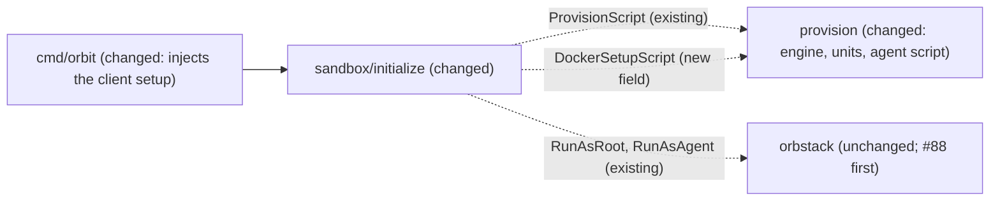

# Rootless Docker for the agent: build and run containers inside the sandbox

Issue: #9 (E01-S05), epic #2. Depends on #5 (E01-S01, done) and on PR #88 (#76, open: `orb` gets only an allowlist of host variables).
Extends: .ai/specs/2026-11-10-sandbox-provisioning.md
Extends: .ai/specs/2026-11-11-orbit-stop-start.md

## 📝 TLDR

Today a sandbox has no container engine: the agent cannot run `docker`, and provisioning only prepared the proxy address `172.31.255.1` that containers would use. This spec proposes that provisioning installs a rootless Docker Engine that belongs to `agent`, with the `buildx` and `compose` CLI plugins, starts it at every boot after the firewall and the proxy, and points the daemon, builds, and containers at the egress proxy. The host engine stays out of reach: no socket, no `DOCKER_*` from the host, and the firewall rejects every direct packet of the agent and its sub-uids (D12, D14, R01, R03). The owner decided Q1–Q12 on 2026-11-11: the proposals as written, except two changes. The default allowlist also gets GitHub Container Registry (`ghcr.io`, `pkg-containers.githubusercontent.com`) beside Docker Hub, and the package mirrors of the official Debian, Ubuntu, and Alpine images, so that `RUN apt-get` and `RUN apk add` work in a build. The Alpine mirror `dl-cdn.alpinelinux.org` is already in D24; the Debian and Ubuntu mirrors are new and plain HTTP, so the proxy also forwards plain HTTP to an allowed host, and the firewall lets the proxy reach port 80 (Q2). The `docker compose` plugin is installed beside `buildx`, so that `docker` and `docker compose` both work (Q9). One question is open: whether R01 "a host namespace" also covers the namespaces of the machine itself (Q13). The spec does not merge before the owner answers it.

## Resolved assumptions (autonomous defaults)

Every answer from Q1 to Q12 is decided by the owner, Jakub Tobiasz, on 2026-11-11. Q13 is open. All times in this spec are Europe/Warsaw (UTC+1). Q1, Q3–Q7, and Q10–Q12 are the proposals of the authoring agent, which the owner accepted exactly as written. Q8 is the proposal with one change that follows from Q2 and is not a separate decision: `httpProxy` is set beside `httpsProxy`, so that `apt` sends its plain HTTP requests to the proxy. Q2 is accepted with a change: GitHub Container Registry joins Docker Hub in the default allowlist. At 15:46 the owner changed Q2 again: image builds must work normally, so the package mirrors of Debian, Ubuntu, and Alpine are allowed as well. At 15:45 the owner changed Q9: the `docker compose` v2 plugin is installed beside `buildx`, so that `docker` and `docker compose` both work. The owner confirmed both changes in a chat with the coordinator on 2026-11-11 (15:45 for Q9, 15:46 for Q2). Q1–Q6 change the default allowlist, the package sources of root, the boot gate, a business rule, or the permissions and kernel features that the agent can use; `AGENTS.md` and `SDLC.md` give those to the owner. The rest of this spec is written under the **Decided answer** of each row. `[DATA]` marks a probe on OrbStack 2.2.5 on 2026-11-11 (machine `orbit-p9spec-755b60c3`, deleted; see Evidence), or, for GHCR, a registry API probe from the host on 2026-11-11 (see Evidence).

| # | Question | Decided answer | Options and why | Status |
|---|---|---|---|---|
| Q1 | Which engine, and from which package source? | **Ubuntu archive:** `docker.io` 29.1.3, `docker-buildx`, `rootlesskit` 2.0.2, `uidmap`, `slirp4netns`, `dbus-user-session` `[DATA]`. | (a) Ubuntu archive: no new apt source and no third-party signing key for root, Ubuntu security updates, and the same "distribution package" path that the Alpine epic (E04, #56) needs. It works rootless as `agent` and builds with BuildKit `[DATA]`. Cost: the spike's container results ran on Docker CE with rootlesskit 3.3, so every container scenario must be shown again on this stack (Phase 3 does that). (b) Docker CE from `download.docker.com`: proven in the spike, newer, but a new apt source and key that root trusts, and Docker CE has no Alpine build. (c) Podman with a Docker-compatible CLI: D14 says "rootless Docker"; it needs a superseding row. | ✅ OWNER DECISION (2026-11-11) |
| Q2 | Which registry and package hosts are in the default allowlist? | **Docker Hub, GitHub Container Registry, and the package mirrors of the official Debian, Ubuntu, and Alpine images.** D24 already holds Docker Hub (`registry-1.docker.io`, `auth.docker.io`, `production.cloudflare.docker.com`, `production.cloudfront.docker.com`) and `dl-cdn.alpinelinux.org`. New base hosts: (1) GHCR: `ghcr.io` (the `/v2/` API, the token endpoint `https://ghcr.io/token`, manifests) and `pkg-containers.githubusercontent.com` (every blob: `ghcr.io` answers a blob request with 307 to that host, which serves it with 200, no further redirect) `[DATA]`. (2) Package mirrors: `deb.debian.org`, `archive.ubuntu.com`, `security.ubuntu.com`, and `ports.ubuntu.com` are new; `dl-cdn.alpinelinux.org`, the Alpine mirror, is already in D24 and stays `[DATA]`. The official `debian` images (bookworm, trixie) use only `http://deb.debian.org` (`debian` and `debian-security`), on arm64 and amd64. The official `ubuntu` images (24.04, 26.04) use only `http://ports.ubuntu.com/ubuntu-ports` on arm64, the default architecture of a sandbox, and `http://archive.ubuntu.com` plus `http://security.ubuntu.com` on amd64. The official `alpine` images (3.18, 3.20, 3.24) use only `https://dl-cdn.alpinelinux.org` (`/etc/apk/repositories`), through `CONNECT` on port 443. Every response was 200, with no redirect. `security.debian.org` is not used by these images and is not added. (3) **Port 80 through the proxy.** The Debian and Ubuntu sources are `http://`, and `apt` sends them to the proxy as plain HTTP requests (it reads `http_proxy`, which BuildKit and the containers get from `config.json`). So tinyproxy forwards a plain HTTP request to an allowed host, and the firewall lets the proxy user reach port 80 as well as 443. tinyproxy does not limit the port of a plain HTTP request: `ConnectPort` applies only to `CONNECT`, and the host filter ignores the port. The firewall limits it: the proxy user reaches only ports 80 and 443 (and 53 of its resolvers). `CONNECT` stays on port 443 only (`ConnectPort 443`), and the agent, its sub-uids, and its containers still reach nothing but the proxy. `apt` checks the signature of `InRelease` and the hash of every package, so plain HTTP cannot change what is installed. Every new host passes `policy.ValidateHost`. The new base list and port 80 supersede D24 ("on port 443 only") with a new row in the product brief (`internal/policy/AGENTS.md`). | (a) Docker Hub only: the proposal, with the known gap that `RUN apt-get` fails. (b) Docker Hub plus GHCR: the owner's first change. (c) (b) plus the package mirrors of Debian, Ubuntu, and Alpine, and port 80 through the proxy: the owner's change at 15:46. Not added, each a separate owner yes later (`AGENTS.md`, Ask first): Quay (`quay.io`, `cdn01.quay.io`, `cdn02.quay.io`, `cdn03.quay.io`); `public.ecr.aws` and `mcr.microsoft.com`, whose blobs come from regional or CDN hosts that need a wildcard, which `policy.ValidateHost` refuses; other package sources. Known gap: an image from any other registry (Quay, ECR, MCR, `registry.k8s.io`, a private registry) fails to pull with 403 from the proxy, and a build that uses another package source (a regional mirror such as `de.archive.ubuntu.com`, a PPA, `download.docker.com`, `security.debian.org` in an older or hand-written source, `pip`/`npm` hosts outside D24) gets 403 for it. | ✅ OWNER DECISION (2026-11-11, changed 15:46 Europe/Warsaw, UTC+1; confirmed by the owner) |
| Q3 | How does the daemon run? | **A root-owned systemd user unit** `/etc/systemd/user/docker.service` with `ConditionUser=agent`, enabled with `systemctl --global enable`, plus `loginctl enable-linger agent`. | (a) Root-owned unit: provisioning repairs it on every `init`, root writes nothing into the home of `agent` (provisioning Q9), and the unit carries the daemon proxy settings. (b) Upstream `dockerd-rootless-setuptool.sh install` as `agent`: writes an agent-owned unit; Ubuntu's copy needs `/usr/share/docker.io/contrib` on `PATH` and then fails its own last check before it creates the CLI context `[DATA]`. (c) A system unit with `User=agent`: no linger, but not a mode that Docker supports for rootless, and it needs its own runtime directory and bus. With (a) and (b), linger starts the user manager of `agent` at every boot, and with it every user unit that the agent writes and every container with a restart policy. They run as `agent` and its sub-uids, behind the firewall. `orb -u agent` sessions have no user manager without linger `[DATA]`. | ✅ OWNER DECISION (2026-11-11) |
| Q4 | May the user manager of `agent` start when a boundary unit failed at boot? | **No.** A new root oneshot unit `orbit-boundary-gate.service` (`RemainAfterExit=yes`, `After=` the four boundary units) runs the boundary check without its `systemd-user-sessions.service` part (Proposed Solution, step 4): the table `inet orbit_egress` is loaded and `nftables.service`, `orbit-proxy-address.service`, `tinyproxy.service`, and `orbit-harden.service` are active. A root-owned drop-in for `user@.service` adds `Requires=` and `After=` on the gate only. | `user@.service` is ordered `After=systemd-user-sessions.service` but does not require it `[DATA]`. With ordering only, a failed `nftables.service` still lets linger start the agent's daemon and its restart-policy containers with no firewall. `orbit start` stops such a machine again (stop-start spec), but only after the fact, and a machine that OrbStack starts by itself never passes that check. The gate, not a direct `Requires=` on the boundary units, because `init` restarts `tinyproxy.service` and `orbit-harden.service` on every run, and `Requires=` would pass each restart on to the user manager and stop every container of the agent. (b) Ordering only, as today. Cost of (a): when a boundary unit fails at boot, the agent has no user manager and no Docker until `orbit init` repairs the machine; `orb -u agent` sessions still open (orbit-shell spec, Prior spec drift). | ✅ OWNER DECISION (2026-11-11) |
| Q5 | The issue asks that `docker run --privileged` fails (R01). How is that guaranteed? | **Assert it as a test and document the real boundary.** The integration test requires that `--privileged` fails; it failed on OrbStack 2.2.5 for every image (spike). | Rootless Docker supports `--privileged`: it gives every capability inside the user namespace of `agent`, none outside it. The failure on OrbStack is a property of the platform (`/dev/null` cannot be reopened), not a rule of Orbit. The agent owns its daemon, so it can restart it with any flag: no daemon setting can refuse `--privileged` (an authorization plugin would be bypassed the same way). So (a) keep the test, which fails loudly if a later OrbStack lets it start, and the owner then decides; (b) reword R01 to "no privileged mode outside the user namespace of the agent" with a superseding row. Recommended: (a) now, and the owner considers (b). The other half of R01, "a host namespace", is open: Q13. | ✅ OWNER DECISION (2026-11-11) |
| Q6 | Accept the setuid helpers `newuidmap`/`newgidmap` and the sub-uid range of `agent`? | **Yes.** `uidmap` provides both helpers; `useradd` already gave `agent` `100000:65536` in `/etc/subuid` and `/etc/subgid` `[DATA]`. | Rootless Docker needs them to map more than one uid into a container; without them, images that use a non-root user or `chown` break, and Docker does not support that mode. The agent can already create user namespaces (`unshare -rn` worked in the spike; `user.max_user_namespaces` is 2147483647 `[DATA]`), so the new kernel surface is the two setuid helpers, overlayfs in a user namespace, and cgroup delegation of `cpu memory pids`. All run on the one shared kernel that the owner accepted (A01). The firewall already matches every uid from 1000 up, so the sub-uids are covered. | ✅ OWNER DECISION (2026-11-11) |
| Q7 | Network driver of rootlesskit? | `slirp4netns`, the default of Ubuntu's `dockerd-rootless.sh` `[DATA]`. | Proven in the spike; `pasta` is untested. Reversible. | ✅ OWNER DECISION (2026-11-11) |
| Q8 | Where do the CLI endpoint and the container proxy settings go? | An **agent-side setup script**, run with `RunAsAgent` on every `init` after provisioning and before the agent install, merges `proxies.default` (`httpProxy` and `httpsProxy` both `http://172.31.255.1:3128`, so that `apt` over plain HTTP uses the proxy too; `noProxy` `localhost,127.0.0.1`) and the context `orbit-rootless` (`unix:///run/user/<uid>/docker.sock`) into `~/.docker/config.json` with `jq`, and keeps every other key, `auths` included. | The client reads `config.json` in every session, also in non-login `orb -u agent` scripts. `DOCKER_HOST` in a root-owned profile file does not reach those, and containers need `config.json` for their proxy anyway. These files are the agent's: changing them cannot widen egress, because the firewall decides (spike). Reversible. The proposal set only `httpsProxy`; `httpProxy` follows from the Q2 change at 15:46 (Europe/Warsaw, UTC+1), because `apt` reads the Debian and Ubuntu mirrors over plain HTTP. | ✅ OWNER DECISION (2026-11-11; `httpProxy` follows from Q2) |
| Q9 | Which CLI plugins? | `docker-buildx` yes, `docker-compose-v2` yes: `docker compose` (v2) works as `agent`. Both come from the Ubuntu archive, no new apt source. | `docker build` uses BuildKit through buildx. The proposal left compose out, because the issue asks for pull, build, and run; the owner changed that at 15:45 (Europe/Warsaw, UTC+1): the `docker compose` v2 plugin ships beside `buildx`, so that `docker` and `docker compose` both work normally in a sandbox. `docker-compose-v2` 2.40.3 is in the stock apt sources of the Ubuntu 26.04 image `[DATA]`, and the archive builds it for 26.04 (`2.40.3+ds1-0ubuntu1`, depends on `docker.io`; see Evidence). It is the CLI plugin, not the Python `docker-compose` v1 command, and it talks to the daemon through the context of the CLI, so it uses `orbit-rootless` and needs no allowlist host of its own: its pulls go through the daemon and its builds through buildx. Reversible. | ✅ OWNER DECISION (2026-11-11, changed 15:45 Europe/Warsaw, UTC+1; confirmed by the owner) |
| Q10 | Existing sandboxes, provisioned before this change? | Bump `provision.Version` by one. The SSH agent forwarding spec (#8, `.ai/specs/2026-11-11-ssh-agent-forwarding.md`, on `main`) also bumps it from 1 to 2. The change that merges second bumps it to 3, so that a sandbox provisioned by the first one is sent to `init` again. | `orbit start` already refuses a marker of another version and names `orbit init`, which installs Docker (`internal/sandbox/start/handler.go`). `orbit shell` (PR #94, not merged yet) reads the marker the same way; the implementation checks `shell` too when #94 has landed. So that the rule holds in both orders, this PR also changes the four lines of the #8 spec that said "1 to 2" to "the version on `main` + 1" (Proposed Solution, step 7). Reversible. | ✅ OWNER DECISION (2026-11-11) |
| Q11 | Docker in every sandbox, or only for agents that ask for it? | Every sandbox, also without `--agent`. | The engine is part of the sandbox (D12, D14), not of an agent; no field of `Definition` is needed (D16). Reversible. | ✅ OWNER DECISION (2026-11-11) |
| Q12 | One spec, or split the engine from its egress settings? | One spec. | An engine without the proxy settings cannot pull, and proxy settings without an engine do nothing; neither ships alone. | ✅ OWNER DECISION (2026-11-11) |
| Q13 | R01 says that a sandbox never gets "a host namespace". Does that also cover the namespaces of the machine itself, so that Orbit must refuse `--pid host` and `--network host` on the rootless engine of the agent? | **Open.** The spec is written under (a). | (a) "Host" means the Mac and the OrbStack VM, which are outside the machine. A rootless container with `--pid host` or `--network host` shares a namespace of the daemon of `agent` or of the machine, both inside the sandbox, and runs as `agent` or a sub-uid of `agent`. The firewall (uid rule), the root-owned proxy, and the non-root agent stay the boundary, and the Delta scenarios "Direct connections from containers", "Daemon replaced by the agent", and "Containers cannot change the boundary" expect those flags to start and to fail only at that boundary. Nothing in the spec changes. (b) R01 also covers the namespaces of the machine. Orbit cannot enforce that: rootless Docker starts those flags, and the agent owns its daemon and can restart it with any flag (the Q5 argument). The spec then needs either a superseding R01 row or those three scenarios rewritten as observed platform behavior, as "Privileged containers on the tested OrbStack version" is. Recommended: (a), recorded with a superseding R01 row that names "host" as the Mac and the OrbStack VM, so that the wording matches what Orbit enforces. | ❓ OPEN — owner decision needed before merge |

Prerequisite, not a decision: implementation starts after PR #88 merges. Today `orb` copies every host `DOCKER_*` variable into the machine (#88, probe table): a host `DOCKER_AUTH_CONFIG` or `DOCKER_CONFIG` would bring host registry credentials into the sandbox without opt-in (R08), and a host `DOCKER_HOST` would override the sandbox context.

## 📝 Problem Statement

- The owner does not want an agent to escape to the host, and the agent still needs Docker for its work (D12). `[DOCUMENT]` owner request, 2026-11-10; issue #9.
- No engine exists in a sandbox today (`internal/provision/script.go` installs only the toolchain, `nftables`, and `tinyproxy`).
- Rootless Docker needs three proxy settings, or it fails closed: the daemon (pulls), `~/.docker/config.json` (builds and containers), and a proxy address that is not loopback, because `slirp4netns` hides the loopback of the machine (spike, finding 3). The address exists already (`orbit-proxy-address.service`, `orbit0`, `172.31.255.1`).
- A rootful `docker.service` would be a root daemon with a socket; the Ubuntu package enables it on install `[DATA]`.

## 📝 Prior spec drift

- `ARCHITECTURE.md`, isolation layer table, "Rootless Docker has limits (no privileged containers …)": rootless Docker supports `--privileged` inside the user namespace; it fails on OrbStack 2.2.5 for a platform reason (Q5). The implementation PR corrects the sentence.
- `ARCHITECTURE.md`, Provisioning requirements: "a proxy drop-in for the rootless Docker daemon" (line 136) and "the daemon drop-in" (line 141) no longer match, because the daemon proxy settings are in the root-owned user unit `/etc/systemd/user/docker.service` (Q3), not in a drop-in. "No `--privileged` containers." (line 142) states a rule that Orbit cannot enforce (Q5, Delta "Privileged containers on the tested OrbStack version"). The implementation PR corrects the three lines (step 8).
- Spike, finding 3, "dockerd runs in the machine's real netns": true for Docker CE with rootlesskit 3.3. With Ubuntu's rootlesskit 2.0.2, `dockerd` runs in its own network namespace `[DATA]`, so `--network host` containers share that namespace, not the machine's, and reach the proxy only at `172.31.255.1`, not at `127.0.0.1`. The firewall still sees their traffic as `agent`, the uid of `slirp4netns`. Phase 3 shows the container scenarios on this stack.

## 📝 Proposed Solution

Root sets the engine up; the agent only configures its own client. The proxy configuration and the proxy address do not change. The allowlist gains the GHCR hosts and the package mirrors, and the firewall lets the proxy user reach port 80 for plain HTTP (Q2); the rules for the agent and its sub-uids do not change.

**Allowlist (`internal/policy`, Q2):** add `ghcr.io` and `pkg-containers.githubusercontent.com`, and `deb.debian.org`, `archive.ubuntu.com`, `security.ubuntu.com`, and `ports.ubuntu.com`, to `baseAllowlist`. `dl-cdn.alpinelinux.org`, the mirror of the official Alpine images, is in `baseAllowlist` already (D24) and stays. The root script already writes the allowlist from `policy.Allowlist` through `proxy.Config`, so no script step changes for it, and the next `init` of a sandbox applies it. A new row in the product brief supersedes D24 with the longer base list and port 80, in the same change as the code. The firewall names no host: it lets the uid of the proxy reach public addresses, and tinyproxy (`ConnectPort 443` and the allowlist) decides the host. Its one change is the port of the proxy user (below), so the golden file `internal/provision/testdata/firewall.nft` changes in that one rule.

**Firewall (`internal/provision`, Q2):** the accept rule of the proxy user becomes `tcp dport { 80, 443 } accept`, still after the refusal of private, link-local, and loopback addresses. tinyproxy already forwards plain HTTP to a host that its filter allows (`FilterURLs Off` filters by host), so `proxy.Config` does not change; `ConnectPort 443` keeps `CONNECT` on port 443. tinyproxy does not check the port of a plain HTTP request, so the firewall, not the proxy, limits plain HTTP: the proxy user reaches only ports 80 and 443 (and port 53 of its resolvers). A plain HTTP request to an allowed host on another port, such as `http://deb.debian.org:8080/`, fails at the firewall. This changes the active capability requirement "Proxy refuses non-public destinations" (`.ai/specs/capabilities/sandbox-provisioning.md:63`, "a port other than 443 and 53"), which the Delta modifies. Step 1 of the Implementation Plan lists every file that the new base hosts touch.

**Root script (`provision.Script`), new steps:**

1. Install the Q1 and Q9 packages (`docker-compose-v2` included) with a temporary `/usr/sbin/policy-rc.d` that exits 101, so that no package starts a rootful daemon, and remove it afterwards (also on failure, through `trap`).
2. Disable and mask the rootful `docker.service`, `docker.socket`, and `containerd.service`.
3. Write `/etc/systemd/user/docker.service` (Q3): `ConditionUser=agent`, `Type=notify`, `NotifyAccess=all`, `Delegate=yes`, `KillMode=mixed`, `Restart=always`, `ExecStart=/usr/share/docker.io/contrib/dockerd-rootless.sh`, `Environment=PATH=/usr/share/docker.io/contrib:…`, and `HTTP_PROXY`/`HTTPS_PROXY`/`NO_PROXY` for `172.31.255.1:3128`. Enable it with `systemctl --global enable docker.service`.
4. Write and enable `orbit-boundary-gate.service` and the `user@.service` drop-in of Q4, and start the gate after the boundary units. The gate is `Type=oneshot`, `RemainAfterExit=yes`, and `After=` exactly the four boundary units, with no `Requires=` on them. Its `ExecStart` runs a small root script with the check `boundaryUnitsCheck`: the table `inet orbit_egress` is loaded and the four boundary units are active. `boundaryUnitsCheck` is split out of `boundaryCheck` (`internal/provision/script.go`): both render the table check and one `for unit in …; do` loop from the list `boundaryUnits()`, and `boundaryCheck` adds `systemd-user-sessions.service` to that list, as today. The lines that `boundaryCheck` renders stay byte-identical, so the self-check and `BootCheckScript` do not change, and the assertions of that loop line in `check_test.go:39` and `script_test.go:133` stay as they are. The gate does not check `systemd-user-sessions.service`, so it does not race with it at boot. It does not wait for the end of the boot either (no `systemctl is-system-running --wait`, not `BootCheckScript`): `user@<uid>.service` waits for the gate, so a gate that waited for the boot would wait for itself until the 120 s timeout on every boot.
5. Repair and start, in this order: `systemctl start orbit-boundary-gate.service` (a no-op when it is active, a new check when it failed at boot), `loginctl enable-linger agent`, and `systemctl start user@<uid>.service`, so that a user manager that failed at boot behind a failed gate starts again. Then, as `agent`, `systemctl --user daemon-reload` and `systemctl --user start docker.service`. Root runs these two with `runuser -u agent -- env XDG_RUNTIME_DIR=/run/user/<uid> systemctl --user …`, never through a login shell (`su -`, `runuser -l`), so that no shell file of the agent runs inside the root script. `start` leaves a running daemon and its containers alone; a changed unit applies at the next restart of the daemon or boot. **Invariant: the root script never restarts or stops the gate.** `user@.service` has `Requires=` on it, so a stop or a restart of the gate passes on to every user manager and stops every container of the agent. A changed gate unit applies at the next boot.
6. Self-check, added to the existing one: the rootful units are masked and inactive, `/var/run/docker.sock` and `/run/docker.sock` do not exist, `agent` has linger, `/etc/subuid` and `/etc/subgid` each hold exactly one entry, the range of `agent`, which starts at 1000 or higher, `newuidmap` and `newgidmap` are owned by root, are not writable by group or others, and have exactly the mode that the script gives them (setuid root, or file capabilities without the setuid bit; Risks, Shared kernel), the gate is active, `docker.service` of `agent` is active, and `docker buildx version` and `docker compose version` exit 0 (client only, no daemon needed).
7. `Version` is the provisioning version on `main` at implementation time plus 1 (Q10). The implementation PR checks it again after every merge of `main` into it and before it merges: when the implementation of #8 merged first, `main` holds 2 and this change writes 3; when this change merges first, it writes 2 and #8 then writes 3. This PR changes the #8 spec to the same rule (its Proposed Solution 6, API Contracts, Edge Cases, and Implementation Plan step 5 said "1 to 2"), so that the #8 implementation does not write 2 again after this change. No order between the two implementation PRs is required; whichever merges second carries the bump to 3.

**Agent script (new, `RunAsAgent`, Q8):** wait up to 60 s for `/run/user/<uid>/docker.sock`; merge the context and the proxies into `~/.docker/config.json` with `jq` (create the file when missing, mode 0600); `docker context use orbit-rootless`; check that `docker info` reports `rootless` in its security options and that `docker compose version` reports v2. It pulls nothing, so `init` does not depend on a registry.

Alternatives considered: Docker Hub as the only registry (Q2 a), Docker CE (Q1 b), the upstream setup tool (Q3 b), a system unit (Q3 c), Podman (Q1 c), an authorization plugin against `--privileged` (Q5; the agent can restart its own daemon without it), and `DOCKER_HOST` in a profile file (Q8).

## 📝 Delta

### Capability: sandbox-containers

#### ADDED Requirement: Rootless engine of the agent
The system SHALL give the user `agent` its own rootless Docker Engine, started at every boot of the machine only after the firewall, the proxy address, the proxy, and the hardening unit are active, and SHALL run no rootful Docker or containerd daemon.

##### Scenario: Pull, build, and run
- WHEN `agent` runs `docker pull alpine` and `docker pull ghcr.io/containerd/busybox`, builds three images, `FROM debian:trixie` and `FROM ubuntu:26.04` with `RUN apt-get update && apt-get install -y curl` and `FROM alpine` with `RUN apk add curl`, and runs `docker run --rm alpine true`
- THEN each succeeds on the engine of `agent`, `docker info` reports `rootless`, and the tinyproxy log shows the registry hosts and `dl-cdn.alpinelinux.org` (`ghcr.io` and `pkg-containers.githubusercontent.com` included) as `CONNECT` requests and `deb.debian.org` and `ports.ubuntu.com` as plain HTTP requests

##### Scenario: Package source outside the allowlist
- WHEN `agent` builds `FROM debian:trixie` with `RUN echo 'deb http://security.debian.org/debian-security trixie-security main' > /etc/apt/sources.list.d/x.list && apt-get update`
- THEN the build fails, and the proxy answers 403 to the request for `security.debian.org`

##### Scenario: Registry outside the allowlist
- WHEN `agent` runs `docker pull quay.io/prometheus/busybox`
- THEN the pull fails, and the proxy answers 403 to `CONNECT quay.io:443`

##### Scenario: No rootful engine
- WHEN root checks the machine after provisioning and after `orbit stop` and `orbit start`
- THEN `docker.service`, `docker.socket`, and `containerd.service` are masked and inactive, and neither `/var/run/docker.sock` nor `/run/docker.sock` exists

##### Scenario: Boundary unit failed at boot
- WHEN `nftables.service` fails at boot
- THEN the user manager of `agent` does not start, and no process of a uid from 1000 up runs, except a process that `orb -u agent` starts

##### Scenario: Repair after a failed boot
- WHEN the gate and the user manager of `agent` failed at boot, the cause is removed, and the owner runs `orbit init`
- THEN the gate is active, the user manager and `docker.service` of `agent` are active, and the client setup succeeds

##### Scenario: Docker Compose
- WHEN `agent` runs `docker compose version`, then `docker compose up --abort-on-container-exit --exit-code-from app` in a directory whose `compose.yaml` holds one service `app` with `image: alpine` and `command: ["true"]`, then `docker compose down`
- THEN `docker compose version` reports v2, `up` creates the network and the container of the project on the engine of `agent` and exits 0, and `down` removes both

#### ADDED Requirement: Container traffic goes only through the proxy
The system SHALL let the engine of `agent`, its builds, and its containers reach the network only through the egress proxy, and SHALL make every direct connection fail, also after a restart, while the proxy is down, and when the agent replaces the engine with one that it starts or configures itself.

##### Scenario: Direct connections from containers
- WHEN a container connects to a public address or a host with no allow rule, on the default network, with `--network host`, on a custom network, in a `docker compose` service on the network of its project, with `--user 65534`, with `--dns 1.1.1.1`, or with `--cap-add NET_ADMIN --cap-add NET_RAW`
- THEN each connection fails

##### Scenario: Daemon replaced by the agent, in the network namespace of the machine
- WHEN `agent` stops its `docker.service`, starts `dockerd-rootless.sh` itself with `DOCKERD_ROOTLESS_ROOTLESSKIT_NET=host` (rootlesskit `--net=host`) and without any proxy environment, and runs a container with `--network host --user 100001` that connects to a public address directly and to an allowed host through `172.31.255.1:3128`
- THEN the container shares the network namespace of PID 1 and runs as a sub-uid of `agent` (the test checks both first, so that it exercises the leak path of the spike, A05), the direct connection fails, and only the connection through the proxy succeeds

##### Scenario: Agent-owned unit at boot
- WHEN `agent` writes `~/.config/systemd/user/docker.service` that starts the daemon of the previous scenario, and the machine restarts
- THEN that unit starts only after `orbit-boundary-gate.service` is active, and a direct connection from its `--network host --user 100001` container fails

##### Scenario: Refused host through the proxy
- WHEN a container with the proxy settings of `config.json` requests `https://example.org`
- THEN the proxy answers 403

##### Scenario: After a restart
- WHEN the owner runs `orbit stop` and `orbit start`, and `agent` then pulls an image and runs a container that requests an allowed host
- THEN both succeed through the proxy

##### Scenario: Proxy down
- WHEN root stops `tinyproxy.service` and `agent` pulls an image or a container connects to a public address
- THEN both fail, and nothing leaves the machine directly

#### ADDED Requirement: No host engine
The system SHALL give the sandbox no socket, endpoint, variable, image, or container of the host engine.

##### Scenario: Host engine out of reach
- WHEN `agent` lists contexts, images, and containers, and a container connects to the address of a container on the host engine
- THEN only the context `orbit-rootless` exists, nothing of the host engine is listed, and the connection fails

##### Scenario: Host Docker variables
- WHEN `orbit init` runs on a host with `DOCKER_HOST`, `DOCKER_CONFIG`, and `DOCKER_AUTH_CONFIG` set
- THEN none of them is set in a shell or script of `agent`

#### ADDED Requirement: Privileged containers on the tested OrbStack version
This requirement describes observed platform behavior, not a guarantee of Orbit. Orbit cannot enforce that `docker run --privileged` fails: rootless Docker supports `--privileged` inside the user namespace of `agent`, and the agent owns its daemon and can start it with any flag (Q5). On OrbStack 2.2.5 the flag fails for a reason of the platform. The system SHALL carry an integration test that pins this behavior on the OrbStack version that the test runs on: the test fails when `--privileged` starts a container, and the owner then decides (Q5 b). The test does not run on the machine of a user, so a later OrbStack there can let the flag start a container without notice.

##### Scenario: Privileged container
- WHEN the integration test runs `docker run --privileged alpine true` as `agent` on OrbStack 2.2.5
- THEN the container does not start; on an OrbStack version where it starts, the test fails

#### ADDED Requirement: Containers cannot change the boundary
The system SHALL keep the firewall and proxy configuration and the proxy process out of reach of every container of `agent`.

##### Scenario: Host mounts and the host pid namespace
- WHEN a container mounts `/etc` or `/` and writes `/etc/nftables.conf` or `/etc/tinyproxy/allowlist`, or runs with `--pid host` and kills the tinyproxy process
- THEN each attempt fails, and the proxy keeps its pid

### Capability: sandbox-provisioning

#### MODIFIED Requirement: Init of a project directory
The system SHALL create the machine of the project directory when it does not exist, and SHALL then provision it and set up the Docker client of `agent`, also when it already existed. When provisioning or the client setup fails on a machine that the same call created, the system SHALL delete that machine and report the failure.

##### Scenario: First init
- WHEN `init` runs in a project directory without a machine
- THEN the machine is created and provisioned, the client setup runs as `agent`, and `Created` is true

##### Scenario: Init of an existing machine
- WHEN `init` runs in a project directory whose machine exists
- THEN the machine is provisioned again and the client setup runs again, `~/.docker/config.json` keeps its other keys, the machine is not created or deleted, and `Created` is false

##### Scenario: Client setup fails on a new machine
- WHEN the client setup fails on a machine that this call created
- THEN the machine is deleted, the agent is not installed, and the error names the client setup

Frozen by: `internal/sandbox/initialize/handler_test.go` (`TestHandleCreatesTheMachine`, `TestHandleKeepsAnExistingMachine`)

#### MODIFIED Requirement: Proxy allowlist
The system SHALL let the proxy open a `CONNECT` tunnel on port 443 only, and forward a plain HTTP request, to a host of the base allowlist (the brief row that supersedes D24: the hosts of D24, `dl-cdn.alpinelinux.org` included, plus `ghcr.io` and `pkg-containers.githubusercontent.com`, `deb.debian.org`, `archive.ubuntu.com`, `security.ubuntu.com`, and `ports.ubuntu.com`) or of the `EgressDomains` of the agent of the last `init`, matched exactly and without case. The proxy does not limit the port of a plain HTTP request; the firewall does (Requirement "Proxy refuses non-public destinations"): it reaches only ports 80 and 443. Each `init` rebuilds the allowlist from its own `--agent`.

##### Scenario: GHCR hosts
- WHEN the owner runs `orbit init` without `--agent`, and `agent` asks the proxy for `CONNECT ghcr.io:443`, `CONNECT pkg-containers.githubusercontent.com:443`, and `CONNECT quay.io:443`
- THEN the first two succeed and the third gets 403

##### Scenario: Alpine mirror
- WHEN the owner runs `orbit init` without `--agent`, and `agent` asks the proxy for `CONNECT dl-cdn.alpinelinux.org:443`
- THEN it succeeds

##### Scenario: Plain HTTP to the package mirrors
- WHEN `agent` asks the proxy for `GET http://deb.debian.org/debian/dists/trixie/InRelease`, `GET http://ports.ubuntu.com/ubuntu-ports/dists/resolute/InRelease`, `GET http://example.org/`, `CONNECT deb.debian.org:80`, and `GET http://deb.debian.org:8080/`, and connects to `deb.debian.org:80` without the proxy
- THEN the first two succeed, the proxy answers 403 to the third and the fourth, the fifth fails because the firewall refuses the connection of the proxy to port 8080, and the direct connection fails

Frozen by: `internal/policy/policy_test.go` (`TestAllowlistWithoutAgentIsTheBaseListOfD24`, renamed in step 1), `internal/provision/firewall_test.go` (the order of the proxy user's rules)

#### MODIFIED Requirement: Proxy refuses non-public destinations
The system SHALL reject every connection of the proxy user to a loopback, private, link-local, shared, benchmark, multicast, or reserved address, except port 53 on its DNS resolvers, and every connection of the proxy user to a port other than 80, 443, and 53.

##### Scenario: Proxy user to a private address
- WHEN a process of the proxy user connects to `192.168.139.3`, `198.19.249.1`, `169.254.169.254`, `127.0.0.1:22`, or `fd07:b51a:cc66:f0::fe`
- THEN the connection fails

##### Scenario: Proxy user to a refused port
- WHEN a process of the proxy user connects to the public address of `deb.debian.org` on port 80, 443, 22, and 8080
- THEN the connections to ports 80 and 443 succeed, and the connections to ports 22 and 8080 fail

Frozen by: `internal/provision/firewall_test.go` (the proxy user's accept is `tcp dport { 80, 443 }` and comes after the refusal of non-public addresses), the golden file `internal/provision/testdata/firewall.nft`

## 📝 Architecture

Takeaway: no new module, no new cross-module dependency, and no new adapter operation; `policy` gains six base hosts, `provision` renders one more script, and `init` runs it with the existing `RunAsAgent`.

| Package | Change |
|---|---|
| `internal/provision` | The proxy user's firewall accept covers ports 80 and 443 (Q2). New package list, `policy-rc.d` guard, rootful mask, the user unit and the `user@.service` drop-in in `Units`, linger, the new self-checks, `boundaryUnitsCheck` split out of `boundaryCheck`, `Version` by the rule of Proposed Solution step 7 (Q10). New `DockerSetupScript() []byte` for the agent side, a pure function of constants (`proxy.ContainerAddr`, `proxy.Port`). |
| `internal/policy` | `ghcr.io` and `pkg-containers.githubusercontent.com`, `deb.debian.org`, `archive.ubuntu.com`, `security.ubuntu.com`, and `ports.ubuntu.com` in `baseAllowlist` (Q2). No new function. |
| `internal/agent` | Doc comments and one test name move from D24 to the new brief row; no behavior change. |
| `internal/sandbox/initialize` | `Handler` gains `DockerSetupScript func() []byte`; `runScripts` runs it with `RunAsAgent` after `RunAsRoot` and before the agent install. |
| `cmd/orbit` | Passes `provision.DockerSetupScript`. New integration test. |
| `internal/orbstack` | No change in this story. It relies on the allowlist of #88. |

## 📝 Edge Cases & Failure Scenarios

| Case | Behavior |
|---|---|
| The daemon socket does not appear within 60 s | The client setup fails; a new machine is deleted, an existing one stays and the next `init` retries. |
| A package starts a rootful daemon despite `policy-rc.d` | Step 2 masks and stops it; the self-check fails if it still runs. |
| The agent edits or masks its `docker.service`, or runs `dockerd-rootless.sh` with other flags | Its traffic still meets the firewall. The next `init` restores the root-owned unit; an agent-owned unit in `~/.config/systemd/user` takes precedence and stays (root does not write into the home). With rootlesskit `--net=host`, the daemon and its `--network host` containers run in the network namespace of the machine as sub-uids; the uid rule of the firewall rejects them (Delta "Daemon replaced by the agent"). |
| The agent removes the proxies from `config.json` | Builds and containers then fail closed. The next `init` merges them again. |
| The agent or a script runs `docker-compose` (v1, with a hyphen) | Not installed; only the plugin `docker compose` exists (Q9). |
| `docker login` inside the sandbox | The agent's own opt-in; the credential stays in `~/.docker/config.json` of the sandbox. Orbit passes no host registry credential (R08). |
| A Debian, Ubuntu, or Alpine based `Dockerfile` runs `apt-get` or `apk add` | Works through the proxy: `apk` over `CONNECT`, `apt` as plain HTTP on port 80 (Q2). |
| A build uses another package source (a regional Ubuntu mirror, a PPA, `download.docker.com`, `security.debian.org`) | The proxy answers 403 for that host; the build fails (Q2). |
| A process sends plain HTTP to an allowed host other than a mirror, such as `http://github.com/` | The proxy forwards it: one filter serves both ports, so every allowed host is reachable on port 80 through the proxy (Q2, Risks). |
| A process ignores the proxy and connects to port 80 directly | Fails: the firewall rules of the agent and its sub-uids do not change. |
| A plain HTTP request through the proxy to an allowed host on a port other than 80, such as `http://deb.debian.org:8080/` | tinyproxy forwards it, and the firewall refuses the connection of the proxy user to every port but 80, 443, and 53 of its resolvers, so it fails. On port 443 the server expects TLS and the request fails there (Q2). |
| The gate failed at boot | `user@<uid>.service` stays failed and the agent has no Docker. The next `init` starts the gate and then `user@<uid>.service` (Proposed Solution, step 5). |
| An image from a registry other than Docker Hub or GHCR (Quay, ECR, MCR, a private registry) | The pull fails with 403 from the proxy (Q2). Adding a registry is an owner decision and a superseding brief row. |
| `ghcr.io` moves blobs to another host than `pkg-containers.githubusercontent.com` | Pulls from GHCR fail closed (403 on the new host) until the base list changes; the integration test pulls from GHCR and shows it. |
| Containers with a restart policy at boot | They start with the user manager, after the gate (Q3, Q4). |
| `init` runs again on a sandbox with running containers | The daemon and the containers keep running; open proxy tunnels drop when tinyproxy restarts, as today. |
| `orbit destroy` (later) | Images and containers live in `/home/agent/.local/share/docker` and go with the machine. Images are not shared with the host engine and are stored per sandbox (about 400 MB for a Node image, spike). |
| `io` and `cpuset` cgroup controllers | Not delegated; `--cpuset-cpus` and `--blkio-weight` do not work (spike). |

## 📝 Risks & Impact Review

- **Shared kernel (A01).** Rootless Docker uses user namespaces, overlayfs in a user namespace, and the setuid helpers of `uidmap` (Q6). A kernel or setuid bug defeats D14. Accepted by the owner for the machine; this story widens the used surface. Hardening note, which does not change Q6: Ubuntu's `uidmap` installs `newuidmap` and `newgidmap` setuid root. File capabilities (`cap_setuid` on `newuidmap`, `cap_setgid` on `newgidmap`, setuid bit removed) are a smaller surface. The implementation may use them. Either way, the self-check verifies the mode of both helpers and that `/etc/subuid` and `/etc/subgid` hold only the range of `agent` (Proposed Solution, step 6; Implementation Plan, step 3).
- **Linger is a persistence path (Q3).** Code that the agent writes as a user unit runs at every boot, as `agent`, behind the firewall.
- **The daemon is the agent's.** Every daemon setting is convenience; the boundary is the firewall, the proxy, and that the agent is not root.
- **New root packages.** `docker.io`, `docker-buildx`, `docker-compose-v2`, and their dependencies come from the Ubuntu archive that root already uses; no new source (Q1, Q9).
- **Wider allowlist (Q2).** `ghcr.io` accepts pushes, so a process that holds a GitHub token can write data to a package; `github.com` is already allowed and accepts the same token, so the exfiltration surface of a token holder grows little. `pkg-containers.githubusercontent.com` serves blobs only, by signed URL. No credential for either host enters the sandbox from the host (R08).
- **Plain HTTP through the proxy (Q2).** The proxy user now reaches port 80 of public addresses, and tinyproxy forwards plain HTTP to every allowed host, not only to the mirrors, because one filter serves both. The set of reachable hosts stays the allowlist, so the exfiltration surface grows by the package mirrors (they serve files; a GET path reaches only their logs), not by port 80 itself. Plain HTTP is readable on the path; `apt` checks the signatures and hashes, so a changed package fails, and no credential is sent to a mirror. tinyproxy now parses and forwards full HTTP requests, more of its code than `CONNECT` alone; the firewall still refuses private, link-local, and loopback destinations of the proxy user before the port accept, so a mirror name that resolves to a private address is refused.
- **Version bump (Q10).** Every existing sandbox needs `orbit init` once. If this change and the implementation of #8 both wrote the same version, a sandbox provisioned by the first build would pass the marker checks of `start` and `shell` without the second change. The rule "the version on `main` at implementation time plus 1, checked again before merge" (Proposed Solution, step 7), the same rule in the #8 spec (changed by this PR), and the test of step 3 prevent that.
- **Rollback.** Reverting leaves Docker in machines that were provisioned with the new version; the older code writes the older version, and `init` does not remove packages. Nothing persists on the host.
- **Escape suite.** E01-S06 (#10) does not exist yet and depends on this story; the PR states that it did not run (`SDLC.md`).

## 📝 Decisions in play

Relies on D12, D14, D15, D17, D22, D24, R01, R03, R08, N07; owner of all: Jakub Tobiasz. The owner decided Q1–Q12 on 2026-11-11 and changed Q9 at 15:45 (Europe/Warsaw, UTC+1; Resolved assumptions). Q2 (c), changed at 15:46 (Europe/Warsaw, UTC+1), changes the default allowlist and its ports: the implementation adds a new brief row that supersedes D24, with the GHCR hosts and the package mirrors of Debian, Ubuntu, and Alpine in the base list, and plain HTTP on port 80 through the proxy. R03 holds: all traffic still passes through the proxy. Q5 keeps R01 as written for privileged mode; (b) stays open for a later owner decision. Whether R01 "a host namespace" covers the namespaces of the machine is open (Q13); the spec does not merge before the owner answers it. This spec supersedes no row itself.

## 📋 Phasing

- **Phase 1 — pure scripts.** The new base hosts and port 80 for the proxy user, units, root script steps, and `DockerSetupScript`, with unit tests. No behavior change until Phase 2 wires them.
- **Phase 2 — slice.** `init` runs the client setup.
- **Phase 3 — proof and records.** Integration test of every Delta scenario on a real OrbStack, documentation, archive.

## 📋 Implementation Plan

### Phase 1 — pure scripts

1. **Allowlist and port 80 (Q2).** Everything that the new base hosts and port 80 touch, in one commit:
   - Product brief: a new Decisions row with the next free number (D26 today) that supersedes D24. Its text is the text of D24, with "GitHub Container Registry: `ghcr.io`, `pkg-containers.githubusercontent.com`" and "Package mirrors of the official Debian, Ubuntu, and Alpine images: `deb.debian.org`, `archive.ubuntu.com`, `security.ubuntu.com`, `ports.ubuntu.com`, `dl-cdn.alpinelinux.org`" added to the base list (`dl-cdn.alpinelinux.org` moves there from the Docker Hub group of D24; it is not a new host), and "on port 443 only" replaced by "on port 443 through `CONNECT`, and on port 80 as plain HTTP through the proxy". The source is the owner decision of 2026-11-11 on Q2 of this spec, and the "Supersedes" column names D24. Set D24 to `superseded by D26`.
   - `internal/policy/policy.go`: the six hosts in `baseAllowlist`; the doc comments name the new row.
   - `internal/policy/policy_test.go`: `baseHostsOfD24` and `TestAllowlistWithoutAgentIsTheBaseListOfD24` are renamed to the new row and hold the new list. The six hosts are added to `TestValidateHostAccepts`. Every case of `TestValidateHostRefusesHostileInput` stays and still passes.
   - `internal/proxy/proxy_test.go`: `Config(policy.Allowlist(nil))` allows the six new hosts and still `dl-cdn.alpinelinux.org`, and no other host of their domains (for example `evil.ghcr.io`, `ghcr.io.example.org`, `de.archive.ubuntu.com`, `security.debian.org`), and `ConnectPort 443` stays its only `ConnectPort`.
   - D24 references that move to the new row: `internal/policy/AGENTS.md`, `internal/agent/AGENTS.md`, `internal/agent/claude/claude.go` (doc comment), and `TestEgressDomainsAreTheClaudeCodeHostsOfD24` in `internal/agent/claude/claude_test.go` (renamed; the eight hosts do not change), `ARCHITECTURE.md` (Agent definitions table, line 104; Provisioning requirements, line 139), and `.ai/specs/capabilities/sandbox-provisioning.md:42` (Proxy allowlist requirement, as in the Delta).
   - `internal/provision/firewall.go`, `firewall_test.go`, and the golden file `testdata/firewall.nft`: the proxy user's accept becomes `tcp dport { 80, 443 } accept` and still comes after the refusal of non-public addresses; no rule of the agent's uids accepts port 80, and the proxy user has no accept for any other port but 53 of its resolvers (Proposed Solution, Firewall). `.ai/specs/capabilities/sandbox-provisioning.md:63` (Proxy refuses non-public destinations, as in the Delta: "a port other than 80, 443, and 53", with the refused-port scenario). The port sentences of `internal/proxy/AGENTS.md` and `internal/provision/AGENTS.md` follow.

   → verify: `go test ./internal/policy/... ./internal/proxy/... ./internal/agent/... ./internal/provision/...`
2. **Units.** Add the user unit, `orbit-boundary-gate.service`, the gate script, and the `user@.service` drop-in to `Units`; split `boundaryUnitsCheck` out of `boundaryCheck` (Proposed Solution, step 4). Tests: `ConditionUser=agent`; the proxy is `172.31.255.1:3128`, never loopback; `Delegate=yes`; the gate is ordered `After=` exactly the four boundary units and has no `Requires=` on them; the gate script runs `boundaryUnitsCheck`, does not name `systemd-user-sessions.service`, and does not wait for the boot (`is-system-running` does not occur); the lines of `boundaryCheck` stay byte-identical (the loop over the four boundary units plus `systemd-user-sessions.service`), so `BootCheckScript` and the self-check do not change and the loop assertions in `check_test.go:39` and `script_test.go:133` stay unchanged; the drop-in has `Requires=` and `After=` on the gate and on nothing else. → verify: `go test ./internal/provision/...`
3. **Root script.** Packages (exactly Q1 and Q9, `docker-compose-v2` included, plus the existing ones), the `policy-rc.d` guard with `trap` removal, the rootful mask before any start, `systemctl --global enable`, the repair-and-start order of Proposed Solution step 5, the new self-checks, and `Version` by the rule of Proposed Solution step 7 (Q10). Tests: the guard exists before `apt-get install` and is removed on every path; the three rootful units are masked; no line adds `agent` to the group `docker`; the script still writes nothing under `/home`; `systemctl start orbit-boundary-gate.service` comes before `systemctl start user@<uid>.service`, which comes before the first `systemctl --user`; no line restarts, stops, or reloads the gate (`restart`, `stop`, `try-restart`, `reload-or-restart` with `orbit-boundary-gate` do not occur); every `systemctl --user` runs through `runuser -u agent --` without `-l`, and `su` does not occur; the self-check runs `docker buildx version` and `docker compose version`; the self-check fails unless `/etc/subuid` and `/etc/subgid` each hold exactly one entry, the range of `agent` from 1000 up, and unless `newuidmap` and `newgidmap` are owned by root, not writable by group or others, and have the mode that the script gives them (tests: a second entry, a range below 1000, and a group-writable helper each make the rendered check fail when run against fixtures); the marker is still the last write; two calls give equal bytes. A version test ties the bump to the change: a test-only list `provisioningChanges` names one entry per version (`"base"`, then `"ssh-agent-forwarding"` when #8 merged first, then `"rootless-docker"`), and `TestVersionCountsTheProvisioningChanges` requires `Version == len(provisioningChanges)` and that `Script` installs `docker.io` and writes `/etc/systemd/user/docker.service`. When both changes append their entry, the merge keeps both lines, and a `Version` that was resolved to the value of the other change fails the test. When this change merges first, its PR comments on #8 that the #8 implementation appends its entry and writes 3. → verify: `go test ./internal/provision/...`
4. **`DockerSetupScript`.** Tests: `set -euo pipefail` in the group; the `jq` merge keeps other keys (run it with `jq` on fixtures: missing file, `auths` present, an existing `proxies` with another address, a symlink at `config.json`); the address is `proxy.ContainerAddr`; no `docker pull`; the check requires `rootless` and runs `docker compose version`. → verify: `go test ./internal/provision/...`

### Phase 2 — slice

5. **Characterize `init`.** Make `TestHandleCreatesTheMachine` and `TestHandleKeepsAnExistingMachine` assert the complete call list on the fake, green on the unchanged handler; commit alone. → verify: `go test ./internal/sandbox/...`
6. **`init` runs the client setup.** Add the field, wire it in `cmd/orbit`, run it after `RunAsRoot` and before the install. Tests: order of the calls; a failed setup deletes a created machine, keeps an existing one, and skips the install. → verify: full validation gate.

### Phase 3 — proof and records

7. **Integration test** (`cmd/orbit`, `integration` tag, its own `orbit-it-*` machine, `-p 1 -timeout 60m`): every scenario of the `sandbox-containers` Delta (the Docker Compose scenario as `agent`: `docker compose version`, `up` of a one-service `compose.yaml`, `down`; the builds as `agent`: `RUN apt-get update && apt-get install -y curl` on `debian:trixie` and `ubuntu:26.04`, `RUN apk add curl` on `alpine`) the GHCR, Alpine mirror, and plain HTTP scenarios of the Proxy allowlist Delta (`GET http://deb.debian.org:8080/` included), and the refused-port scenario of the Proxy refuses non-public destinations Delta, with `orbit stop`/`orbit start` for the restart and `systemctl stop tinyproxy` as root for the proxy-down case; the host variables of the Delta set on the test process. For "Boundary unit failed at boot", root adds a test drop-in `/etc/systemd/system/nftables.service.d/zz-orbit-it-fail.conf` with `ExecStartPre=/bin/false`, and the test restarts the machine with `orb stop <machine>` and `orb start <machine>`, not with `orbit start`, whose boot check would stop the machine again. It then checks the scenario, removes the drop-in, and runs `orbit init` for "Repair after a failed boot". For "Agent-owned unit at boot", the test compares the start times of the gate and of the agent's unit (`ActiveEnterTimestampMonotonic`). → verify: `go test -tags integration -p 1 -timeout 60m -run Docker ./cmd/orbit/...` on a named OrbStack version.
8. **Documentation.** `ARCHITECTURE.md` (the "code so far" sentence; every line of Prior spec drift: the rootless limits sentence at line 40, the proxy drop-in at line 136, the daemon drop-in at line 141, and "No `--privileged` containers." at line 142; Provisioning requirements: the engine, linger, the boot gate), `internal/provision/AGENTS.md` (the invariants: no rootful daemon, the proxy address for containers, root never writes into the home). → verify: validation gate.
9. **Archive the Delta** into `.ai/specs/capabilities/sandbox-containers.md` and `sandbox-provisioning.md` (the Proxy allowlist requirement at line 42 and the Proxy refuses non-public destinations requirement at line 63, both already changed in step 1; the first names the new brief row). → verify: the files match the Delta.

QA evidence (`risk-high`): a terminal transcript on a named OrbStack version of a pull from Docker Hub and from GHCR (with the tinyproxy log lines `CONNECT ghcr.io:443` and `CONNECT pkg-containers.githubusercontent.com:443`), the three builds with `apt-get` and `apk add` (with the plain HTTP log lines for `deb.debian.org` and `ports.ubuntu.com`), run, `docker compose version` and `docker compose up`/`down` as `agent`, a refused direct connection from a `--network host` container, the same from the container of a daemon that the agent started with rootlesskit `--net=host`, and the restart. The escape suite does not exist; the PR says so.

## Evidence

Probe on OrbStack 2.2.5, Ubuntu 26.04, machine `orbit-p9spec-755b60c3` (created with `--isolated --isolate-network`, deleted after the probe; no firewall was installed in it, and nothing was pulled):

- `apt-cache policy`: `docker.io` 29.1.3-0ubuntu4.1, `docker-buildx` 0.30.1, `docker-compose-v2` 2.40.3, `rootlesskit` 2.0.2, `slirp4netns` 1.3.3, `passt` 2026-01-20, `uidmap` 4.17.4, `dbus-user-session` 1.16.2. `docker.io` ships `dockerd-rootless.sh` and `dockerd-rootless-setuptool.sh` under `/usr/share/docker.io/contrib`.
- With `policy-rc.d` exiting 101, the install left `docker.service`, `docker.socket`, and `containerd.service` enabled but inactive, and no `/var/run/docker.sock`.
- `useradd` gave `agent` `100000:65536` in `/etc/subuid` and `/etc/subgid`. `user.max_user_namespaces = 2147483647`; LSMs `capability,landlock,yama,bpf`.
- `orb -u agent` before linger: `XDG_RUNTIME_DIR=/run/user/1000` is set, `loginuid` is unset, and `systemctl --user` fails (no user manager).
- After `loginctl enable-linger agent`, the setup tool (with the contrib directory on `PATH`) started the rootless daemon; it then failed its own `docker version` check and created no context. With `DOCKER_HOST` set, `docker info` reported `rootless`, `overlayfs`, cgroup v2, and a `FROM scratch` build succeeded with BuildKit.
- `dockerd` of `agent` ran in another network namespace than PID 1; `slirp4netns` ran as `agent`.
- `user@.service`: `After=systemd-user-sessions.service`, no `Requires=` on it.
- `docker-compose-v2` for Ubuntu 26.04 (`resolute`) on packages.ubuntu.com, checked on 2026-11-11: version `2.40.3+ds1-0ubuntu1`, depends on `docker.io`. It matches the `apt-cache policy` line above, which came from the stock apt sources of the machine.

Package mirrors of the official images, probed on 2026-11-11 on the host engine (OrbStack, Docker 29.8.2, arm64, and `--platform linux/amd64`), without a proxy, with `apt-get -o Debug::Acquire::http=true update` and `apt-get install -y --no-install-recommends curl`, and with `apk add curl`:

- `debian:trixie`, `debian:bookworm`: sources `http://deb.debian.org/debian` and `http://deb.debian.org/debian-security`; every request went to `deb.debian.org`, on arm64 and on amd64.
- `ubuntu:26.04`, `ubuntu:24.04` on arm64: sources `http://ports.ubuntu.com/ubuntu-ports/` (security included); every request went to `ports.ubuntu.com`. `ubuntu:26.04` on amd64: `http://archive.ubuntu.com/ubuntu/` and `http://security.ubuntu.com/ubuntu/`; requests went only to those two.
- `alpine` 3.24.4, 3.20.10, 3.18.12: `https://dl-cdn.alpinelinux.org/alpine/v3.x/{main,community}`; `apk add curl` succeeded. Checked again on 2026-11-11 for the owner's Q2 change: `alpine:latest` (3.24.4) has exactly `https://dl-cdn.alpinelinux.org/alpine/v3.24/main` and `…/community` in `/etc/apk/repositories`, so `dl-cdn.alpinelinux.org` is the only Alpine host that a build needs.
- Every response was 200; none was a redirect.

GHCR pull path, probed from the host with `curl` against the registry API on 2026-11-11, anonymous, for `ghcr.io/containerd/busybox` and two other public images (not through a sandbox):

- `GET https://ghcr.io/v2/` answers 401 with `Bearer realm="https://ghcr.io/token",service="ghcr.io"`; the token, the image index, and the platform manifest all come from `ghcr.io`.
- `GET https://ghcr.io/v2/<image>/blobs/<digest>` answers 307 with `Location: https://pkg-containers.githubusercontent.com/<store>/blobs/<digest>?…&sig=…`; that host answers 200 with the blob after exactly one redirect. The `<store>` path segment varies (`ghcr1`, `ghcrblobs07`, `ghcrblobs08`); the host does not.
