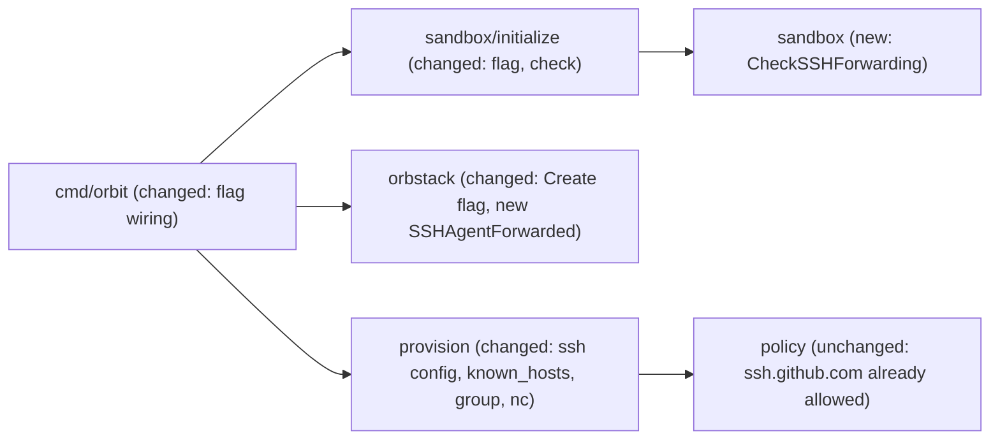

# SSH agent forwarding and Git over SSH (E01-S04)

Extends: .ai/specs/2026-11-10-sandbox-provisioning.md
Extends: .ai/specs/2026-11-11-claude-code-agent-definition.md

Issue: #8. Epic: #2. Owner of every decision: Jakub Tobiasz.

## 📝 TLDR

The agent must commit and push (D10), and the owner decided that the host SSH agent is forwarded into every sandbox by default (R08), with `orbit init --no-ssh-forwarding` to leave it out (D25). Today `init` never forwards the agent, and Git over SSH has no route through the egress proxy. This spec proposes that `init` creates the machine with OrbStack's `--forward-ssh-agent` unless the flag is passed, gives the agent user access to the forwarded socket, and routes `git@github.com` over `ssh.github.com:443` through the existing proxy (D24), with GitHub's host keys pinned. Nothing else changes in the boundary: port 22 stays closed, and no key file enters.

## Resolved assumptions (autonomous defaults)

Every answer below is a proposal of the authoring agent. Each one touches the sandbox boundary or a protected brief row, so each one needs the owner's confirmation before the spec merges.

| # | Question | Proposed answer | Rationale | Status |
|---|---|---|---|---|
| Q1 | `orb create --forward-ssh-agent` fixes forwarding when the machine is created, and `orb` has no command that changes it later. What does `init` do on an existing machine whose setting differs from the request (also every machine created before this change, which has forwarding off)? | **Refuse** with `ErrSSHForwardingMismatch`, before `init` runs any command inside the machine. The message names the current setting and the two ways out: run `init --no-ssh-forwarding` to keep the machine without forwarding, or delete the sandbox and run `init` again to get forwarding. `init` does not start, change, provision, or delete that machine. | Silently keeping the old setting gives forwarding to a user who passed `--no-ssh-forwarding`, or none to a user who expects the default. Recreating the machine automatically destroys its disk, including the `/login` of the agent (D08). A refusal is the only answer that is safe and reversible. Cost: a sandbox from before this change has forwarding off, so `init --no-ssh-forwarding` still matches it and keeps working without a new machine or a new `/login`. Only a user who wants forwarding in such a sandbox needs `orb delete <machine>` and `init` once, because `orbit destroy` does not exist yet. | ⚠ NEEDS HUMAN CONFIRMATION |
| Q2 | How does Git over SSH pass the proxy, and how does the agent's `ssh` find the forwarded socket? | Root writes `/etc/ssh/ssh_config.d/00-orbit.conf`: `Host github.com ssh.github.com` → `HostName ssh.github.com`, `Port 443`, `HostKeyAlias github.com`, `StrictHostKeyChecking yes`, `ProxyCommand /usr/bin/nc.openbsd -X connect -x 127.0.0.1:3128 %h %p` (address and port built from `proxy.LoopbackAddr` and `proxy.Port`); and `Match localuser agent` → `IdentityAgent SSH_AUTH_SOCK`. The file is written in every sandbox, also with `--no-ssh-forwarding`. | The spike showed `ssh.github.com:443` through tinyproxy works and port 22 is refused (D21/D24, Q15). New finding of this spec: OrbStack's own `10-orbstack.conf` sets `IdentityAgent /opt/orbstack-guest/run/ssh-agent-proxy.sock` for `Host *`, a socket with mode `600` that the agent cannot open. `ssh` takes the first value it reads, so without the `00-` file `git push` would ignore `SSH_AUTH_SOCK` even though `ssh-add -l` works. `Match localuser agent` leaves the default user's OrbStack setting alone. `StrictHostKeyChecking yes` makes "no prompt for an unknown or changed key" a setting, not the behaviour of the default `ask`. The absolute `nc` path removes the dependence on `PATH` and on the alternatives link (Q4). A root-owned file in `/etc` keeps "root never writes into a home directory". The agent can override it in `~/.ssh/config`, which only changes its own convenience: the firewall and the proxy still decide what it reaches. | ⚠ NEEDS HUMAN CONFIRMATION |
| Q3 | How does `ssh` trust the host key of GitHub without a prompt? | Pin GitHub's published host keys (Ed25519, ECDSA, RSA) in a root-owned `/etc/ssh/ssh_known_hosts`, under the name `github.com` (matched through `HostKeyAlias`). The keys are a constant in `internal/provision`, checked against the fingerprints that GitHub publishes when the implementation PR is written. A key rotation by GitHub needs an Orbit release; `orbit init` with that release then rewrites the file in an existing sandbox, without a new machine. | Without a known key, a non-interactive `git push` stops at the host-key prompt, so the acceptance criterion fails. `StrictHostKeyChecking accept-new` trusts the first answer through a raw TCP tunnel (weaker). Fetching `api.github.com/meta` at provisioning adds a network call and a parser to the root script. Pinning is the smallest and the strictest. | ⚠ NEEDS HUMAN CONFIRMATION |
| Q4 | `ProxyCommand` needs `nc` with `-X connect`. D20 does not list it. | Add `netcat-openbsd` to the infrastructure packages of provisioning (beside `nftables` and `tinyproxy`), not to the toolchain of D20. `ProxyCommand` calls `/usr/bin/nc.openbsd` by its absolute path, and the self-check runs `dpkg -S /usr/bin/nc.openbsd`. | The Ubuntu 26.04 image of OrbStack 2.2.5 already has it, so the install changes nothing today. `/usr/bin/nc` is an alternatives link (`/usr/bin/nc` → `/etc/alternatives/nc` → `/usr/bin/nc.openbsd`) that no package owns: `dpkg -S /usr/bin/nc` exits 1, `dpkg -S /usr/bin/nc.openbsd` prints `netcat-openbsd: /usr/bin/nc.openbsd` (spike). Naming the package makes the dependency explicit and survives an image change. OpenSSH has no HTTP CONNECT client of its own. This touches the package list that D20 and D22 describe. | ⚠ NEEDS HUMAN CONFIRMATION |
| Q5 | When does the agent user join the group `orbstack` (the group of the socket)? | Only when the machine forwards the agent. Provisioning runs `usermod -aG orbstack agent` with forwarding and nothing without it. The self-check fails in both directions: when `agent` is not in `orbstack` on a machine that forwards, and when it is on one that does not. | Least privilege. The group exists in every machine, also without forwarding (spike). `find / -group orbstack` over every mount except `/proc` finds only the two sockets in `/opt/orbstack-guest/run` (a `tmpfs`); the other one, `ssh-agent-proxy.sock`, has mode `600`, so the group gives nothing more. A removal branch is not needed: forwarding is fixed at creation and Q1 refuses a mismatch, so the setting of a machine never changes between two runs; the two-way self-check catches an unexpected membership. The provisioning spec already reserved this group for E01-S04. | ⚠ NEEDS HUMAN CONFIRMATION |
| Q6 | `ARCHITECTURE.md` plans a module `internal/credential` for "which host credentials a sandbox may get". Create it now? | **No.** The decision is one boolean; it lives as a pure function in `internal/sandbox` (`sandbox.CheckSSHForwarding`), like the other "what enters a sandbox" rules. The Credential row stays planned until a second credential exists. | A module for one boolean is an abstraction for single use (AGENTS.md conventions). A new module also needs a Key decisions row. | ⚠ NEEDS HUMAN CONFIRMATION |
| Q7 | The forwarded socket speaks the full ssh-agent protocol. The allowlist limits where the sandbox's `ssh` connects, not where a signature is used. With every key in the Mac's agent, the agent can (a) sign commits and tags as the owner (`ssh-keygen -Y sign`, Git with `gpg.format=ssh`), which GitHub shows as "Verified"; (b) act as a signing oracle for a party outside the sandbox: that party opens an SSH session to any server that trusts an owner key, sends the login challenge into the sandbox over an allowed channel (GitHub, the push path that this spec opens), gets the signature back the same way, and logs in as the owner on that server; and (c) probably add, remove (`ssh-add -D`), or lock (`ssh-add -x`) identities in the Mac's agent. Accept? | Accept as the R08 consequence, stated as above: every loaded key, usable against any SSH server that trusts it, for as long as the sandbox has a way out. Document this text in `ARCHITECTURE.md` (Credentials row) and in the R08 risk note. Recommend the mitigations that the owner controls on the host: `ssh-add -c` (confirm each use), an agent that holds only a GitHub key, and destination-constrained keys (`ssh-add -h github.com`, OpenSSH ≥ 8.9), which must be tested through OrbStack's forwarding before anyone relies on them. A filtering agent proxy is later scope. No automated test touches the Mac's agent. Proposal for the owner, to turn (c) from "probably" into a fact: on a Mac whose agent holds no identity, run from a sandbox `ssh-add -x` then `ssh-add -X`, and add then delete a throwaway key; record whether OrbStack passes each request. | The protocol never exports a private key, but (a) and (b) are the same as holding the keys while the sandbox runs, so "GitHub only" is not a correct description of the risk. (c) is not verified, because the check changes the live agent of the Mac; its effects are a denial of service on the host agent, or a key that the agent added and that the Mac's `ssh` may then offer. | ⚠ NEEDS HUMAN CONFIRMATION |
| Q8 | The first acceptance criterion needs an authenticated push. The SSH agent of the Mac holds no identity (checked again on 2026-11-11), so no automated test can push. How is A06 closed? | The integration test proves the path without a key: as `agent`, `ssh-add -l` reaches the socket, and `ssh -T git@github.com` reaches GitHub (`Permission denied (publickey)` or `successfully authenticated`). The owner closes A06 with a terminal transcript of a real `git push` from a sandbox, on a named OrbStack version, as the QA evidence of the implementation PR (`needs-qa`). | The issue already names a terminal transcript as QA evidence. A push key in tests would be a key file in a sandbox (R08). | ⚠ NEEDS HUMAN CONFIRMATION |
| Q9 | Split into two specs (forwarding, and the SSH route)? And does #8 wait for `orbit shell` (#6), which the backlog lists as a dependency? | One spec, and no wait. Forwarding without a route reaches no Git host, and the route without forwarding has no key, so neither works alone. The tests use `RunAsAgent`; `orbit shell` gets the socket for free, because `orb -u agent` already sets `SSH_AUTH_SOCK` (spike). | Smallest deliverable that satisfies the acceptance criteria. | ⚠ NEEDS HUMAN CONFIRMATION |

## 📝 Problem Statement

- D10: the agent can commit and push. R08 (amended by D25): the host SSH agent is forwarded by default, as a socket; `--no-ssh-forwarding` leaves it out; no key file enters.
- Today `internal/orbstack` never passes `--forward-ssh-agent` (its `AGENTS.md` says so, and `createArgs` has a test that asserts it). `init` has no `--no-ssh-forwarding`. The agent cannot push over SSH: there is no socket, port 22 is blocked, and nothing tells `ssh` to use the proxy.
- `[DATA]` spike of 2026-11-10 (`.ai/analysis/2026-11-10-orbstack-isolated-machine-spike.md`, Addendum): forwarding works in an isolated machine; the socket is `/opt/orbstack-guest/run/host-ssh-agent.sock`, mode `660`, group `orbstack`; `agent` can use it once in that group; it survives a restart; SSH to `ssh.github.com:443` through the proxy reaches GitHub; `github.com:22` and a host that is not allowlisted are refused.
- `[DATA]` spike of this spec, 2026-11-11, OrbStack 2.2.5, Ubuntu 26.04, two machines `orbit-gh8spike-*` (deleted):

  | Check | `--forward-ssh-agent` | without |
  |---|---|---|
  | `orb list --format json` `.config.forward_ssh_agent` | `true` | `false` |
  | `SSH_AUTH_SOCK` for root and the default user | `/opt/orbstack-guest/run/host-ssh-agent.sock` | unset, although it is set on the host |
  | `/opt/orbstack-guest/run/` | `host-ssh-agent.sock` (`660`, group `orbstack`), `ssh-agent-proxy.sock` (`600`, default user) | no socket |
  | group `orbstack` (gid 67278) | exists, member: default user | exists, member: default user |
  | `nc` | `/usr/bin/nc` → `/etc/alternatives/nc` → `/usr/bin/nc.openbsd`; `dpkg -S` owns only `/usr/bin/nc.openbsd` (`netcat-openbsd`) | same |
  | `/etc/ssh/ssh_config.d/` | `10-orbstack.conf` (`Host *` → `IdentityAgent …/ssh-agent-proxy.sock`), `20-systemd-ssh-proxy.conf`; included at line 19 of `/etc/ssh/ssh_config` | same |
  | `ssh-add -l` as the default user | `The agent has no identities.` | `Could not open a connection to your authentication agent.` |

  Checked again on 2026-11-11 on one throwaway `orbit-pr87fix-*` machine (deleted): the `nc` row, and `ssh -G` as a test user with the proposed `00-orbit.conf` prints `hostname ssh.github.com`, `port 443`, `hostkeyalias github.com`, `stricthostkeychecking true`, `identityagent SSH_AUTH_SOCK`, and the `nc.openbsd` `ProxyCommand`, also for `git@ssh.github.com`; root keeps OrbStack's `IdentityAgent`; `-p 22` gives `port 22`.

- Known consequence, accepted with R08 (Q7): the agent can sign with every key in the forwarded agent. The allowlist limits where the sandbox's `ssh` connects, not where a signature is used: the agent can sign commits and tags as the owner (GitHub shows them as "Verified"), and a party outside the sandbox can relay SSH login challenges through an allowed channel such as the GitHub push path and log in as the owner on any server that trusts one of the keys, for as long as the sandbox has a way out.

## 📝 Proposed Solution

1. **The flag.** `orbit init` gets `--no-ssh-forwarding` (D19, D25). `initialize.Input` gets `NoSSHForwarding bool`; the zero value forwards, as R08 requires.
2. **Creation.** `orbstack.Client.Create` takes the forwarding choice and adds `--forward-ssh-agent` to `createArgs` only when it is true. `--isolated`, `--isolate-network`, and the single mount stay fixed.
3. **Reading the setting.** A new adapter method `SSHAgentForwarded(ctx, name)` reads `.config.forward_ssh_agent` of that machine from `orb list --format json`. A missing machine, a missing field, or a value that is not a boolean is an error, never a default.
4. **The decision.** `sandbox.CheckSSHForwarding(want, have bool) error` returns `ErrSSHForwardingMismatch` when they differ. `SSHAgentForwarded` reads only `orb list`, so the handler calls the check right after it finds or creates the machine and before the mount check, whose `ActiveMounts` is the first command that runs inside the machine (`orb -m`). On an existing machine, `init` thus refuses without starting or touching it (Q1; the owner decisions on #62 and #75: Orbit starts nothing implicitly). On a machine it just created, a mismatch deletes that machine (defense in depth, as on a mount mismatch).
5. **Provisioning.** `provision.Script` gets the forwarding choice. The script installs `netcat-openbsd` (Q4), writes `/etc/ssh/ssh_config.d/00-orbit.conf` (Q2) and `/etc/ssh/ssh_known_hosts` (Q3) through `put`, adds `agent` to `orbstack` only with forwarding (Q5), and the self-check verifies the membership in both directions, both files, and that `/usr/bin/nc.openbsd` belongs to `netcat-openbsd` (`dpkg -S /usr/bin/nc.openbsd`), the variant with `-X connect`.
6. **Provisioning version.** `provision.Version` goes from 1 to 2, because provisioning now writes a package, two files in `/etc`, and a group membership. `shell` (#6) and `start` (#11) read "marker == `provision.Version`" as "provisioned by this build", so they send a sandbox from before this change to `init`. `init` then provisions it again with `--no-ssh-forwarding`, or refuses it without the flag under Q1 with the message that names both ways out. Without the bump, such a sandbox would pass those checks without the SSH route.

**Alternatives considered.**

- *Bind-mount the host socket* (`--mount $SSH_AUTH_SOCK`): the socket path on macOS is under `/private/tmp/com.apple.launchd.*` and changes per login; a socket over virtiofs is not supported. OrbStack's own forwarding is the narrowest form (R08). Rejected.
- *Pass `SSH_AUTH_SOCK` through `ORBENV`*: a host path is useless in the machine, and #76 removes `ORBENV` from every `orb` command. Rejected.
- *Open port 22 to `github.com` in the firewall*: the proxy is the only egress (R03); a direct rule for one uid is the kind of rule that leaked in the spike (A05). Rejected; D21/D24 already chose `ssh.github.com:443`.

## 📝 Delta

### Capability: ssh-agent-forwarding

#### ADDED Requirement: Forward the host SSH agent by default
The system SHALL create the machine of `orbit init` with OrbStack SSH agent forwarding when `--no-ssh-forwarding` is not passed, and SHALL let the user `agent` use the forwarded socket.

##### Scenario: Init without the flag
- WHEN `orbit init` creates a sandbox without `--no-ssh-forwarding`, and `SSH_AUTH_SOCK` on the Mac names a running agent (the integration test skips this check, and says so, when it does not)
- THEN `orb list` reports `forward_ssh_agent: true` for the machine, and `ssh-add -l` run as `agent` connects to the socket (it lists identities or reports that the agent has none)

#### ADDED Requirement: Leave the SSH agent out on request
The system SHALL create the machine without SSH agent forwarding when `--no-ssh-forwarding` is passed, and the user `agent` SHALL NOT be in the group `orbstack`.

##### Scenario: Init with the flag
- WHEN `orbit init --no-ssh-forwarding` creates a sandbox
- THEN no file exists at `/opt/orbstack-guest/run/host-ssh-agent.sock`, `SSH_AUTH_SOCK` is unset for `agent`, and `ssh-add -l` as `agent` fails

#### ADDED Requirement: Forwarding is fixed at creation
The system SHALL refuse `init` on an existing machine whose forwarding setting differs from the request, before it provisions the machine, and SHALL NOT change or delete that machine.

##### Scenario: Flag differs from the machine
- WHEN `init` runs with `--no-ssh-forwarding` in a project directory whose machine forwards the agent, or without it where the machine does not
- THEN `init` fails with `ErrSSHForwardingMismatch` before it runs a command inside the machine, the message names `--no-ssh-forwarding` and how to recreate the sandbox, and the machine is neither started, provisioned, nor deleted

##### Scenario: Created machine reports another setting
- WHEN the machine that this call created reports a forwarding setting other than the requested one
- THEN `init` deletes that machine and fails with `ErrSSHForwardingMismatch`

#### ADDED Requirement: Git over SSH to GitHub through the proxy
The system SHALL route SSH from `agent` to `github.com` over `ssh.github.com:443` through the egress proxy, with GitHub's pinned host keys, and SHALL leave port 22 closed.

##### Scenario: Push path
- WHEN `agent` runs `ssh -T git@github.com` in a sandbox that forwards the agent
- THEN the connection reaches GitHub without a host-key prompt (`Permission denied (publickey)` with no key, `successfully authenticated` with one)

##### Scenario: Authenticated push (manual, QA)
- WHEN the Mac's SSH agent holds a key with push access and `agent` runs `git push` to a `git@github.com:` remote
- THEN the push succeeds

#### ADDED Requirement: No other SSH destination
The system SHALL block SSH from `agent` to any host and port without an allow rule, also with the forwarded agent.

##### Scenario: Host without an allow rule
- WHEN `agent` runs `ssh -o ConnectTimeout=5 git@gitlab.com`, `ssh -p 22 git@ssh.github.com`, or `ssh` with `ProxyCommand` through the proxy to `altssh.gitlab.com:443`
- THEN each connection fails

#### ADDED Requirement: No host key material in the sandbox
The system SHALL NOT place a private key file or any content of the host `~/.ssh` in a sandbox.

##### Scenario: Search for keys
- WHEN the sandbox forwards the agent
- THEN `/home/agent/.ssh` is absent or empty right after `init`, the only host mount is the project directory, no file under `/home` (outside the project directory) or `/root` holds private-key content (`PRIVATE KEY-----`), and `/etc/ssh` holds none besides the machine's own `ssh_host_*_key` files, if the image has them

### Capability: sandbox-provisioning

#### MODIFIED Requirement: Agent user without privileges
The system SHALL create the user `agent` with a uid from 1000 up, no sudo rule, and no privileged group (`sudo`, `admin`, `adm`, `docker`, `lxd`, `disk`, `shadow`). The system SHALL add `agent` to the group `orbstack` exactly when the machine forwards the host SSH agent, and to no other group.

##### Scenario: The agent tries to become root
- WHEN a process of `agent` runs `sudo -n true`, `su root`, or `su <default user>`
- THEN each command fails

##### Scenario: Group of the forwarded socket
- WHEN provisioning runs on a machine that forwards the agent, and again on one that does not
- THEN `id -nG agent` holds `orbstack` on the first and not on the second

Frozen by: `internal/provision/script_test.go` (`TestScriptCreatesTheAgentOnceWithoutGroups`)

## 📝 Architecture

The allowlist does not change: `ssh.github.com` is already in the base list (D24). The change stays inside the existing modules and their dependency rules: no new module, no new cross-module dependency, no new Go dependency. `cmd/orbit` keeps being the only importer of the adapter. The handler's narrow interface gains `SSHAgentForwarded` and the new `Create` signature; `orbstacktest.Fake` gets both in the same change, with the same prefix rule.

Interaction with #76 / PR #72: forwarding uses OrbStack's own mechanism, not the environment. Removing `ORBENV` does not affect it; the spike shows that a host `SSH_AUTH_SOCK` does not reach a machine without forwarding.

## 📝 API Contracts

- CLI: `orbit init [--agent NAME] [--no-ssh-forwarding]`. Help text: `do not forward the host SSH agent into the sandbox`.
- `initialize.Input.NoSSHForwarding bool`. `Output` and the printed message do not change.
- `orbstack.Client.Create(ctx, name, dir string, forwardSSHAgent bool) error`; `orbstack.Client.SSHAgentForwarded(ctx, name string) (bool, error)`, which refuses a foreign name (`ErrForeignMachine`) before it runs a command.
- `sandbox.CheckSSHForwarding(want, have bool) error`; `sandbox.ErrSSHForwardingMismatch`.
- `provision.Version` goes from 1 to 2 (Proposed Solution 6).
- `provision.Script` takes one input struct `ScriptInput{DefaultUID, AgentDomains, ForwardSSHAgent}` instead of growing a third positional argument; `Handler.ProvisionScript` changes with it.

## 📝 Edge Cases & Failure Scenarios

| Case | Behaviour |
|---|---|
| Existing sandbox from before this change, plain `init` | Refused before any command runs inside it (Q1); the message names `init --no-ssh-forwarding`, which matches it, and deleting the machine and running `init` again to get forwarding. |
| Existing sandbox from before this change, `init --no-ssh-forwarding` | Matches; provisioned again to `provision.Version` 2, with the SSH route and without the group. No new machine, no new `/login`. |
| Host has no SSH agent (`SSH_AUTH_SOCK` unset on the Mac) | Not checked by Orbit. OrbStack still creates the socket; `ssh-add -l` in the machine fails to reach an agent. `git push` fails with `Permission denied (publickey)`. Documented, no refusal. |
| Host agent has no identity | Same as above, but `ssh-add -l` says `The agent has no identities.` |
| `orb list` lacks `forward_ssh_agent` (other OrbStack version) | `SSHAgentForwarded` fails; `init` stops before provisioning and names the field. |
| `/usr/bin/nc.openbsd` missing or not owned by `netcat-openbsd` after the install | Self-check fails, the marker is not written, a new machine is deleted. |
| Remote with port 22 (`ssh -p 22 git@github.com`, `ssh://git@github.com:22/…`) | The explicit port overrides `Port 443` (`ssh -G -p 22` prints `port 22`, spike); the proxy allows CONNECT only to 443, so the connection is refused. Documented; the user writes the remote without a port. |
| Remote written as `ssh.github.com` (port 443 or none) | Matches the same `Host github.com ssh.github.com` block, so it gets the proxy and the pinned keys (spike). |
| GitHub rotates its host keys | `git push` fails with a host-key mismatch, and `StrictHostKeyChecking yes` never prompts to accept the new key. Fixed by a release with the new keys and `orbit init`, which rewrites `/etc/ssh/ssh_known_hosts` in the existing sandbox. |
| Agent overrides `~/.ssh/config` | Its own choice; it still reaches only the proxy, and the proxy only allowlisted hosts on 443. |
| Restart of the machine | Socket and group survive (spike); the files are in `/etc`. |
| Rootless container of the agent | Has neither the socket nor the SSH config. Out of scope. |

## 📝 Risks & Impact Review

- **Boundary (risk-high).** The change adds a host credential to every sandbox by default, by owner decision (R08). The agent can sign with every key in the Mac's agent, and the allowlist does not limit where those signatures are used: commits and tags signed as the owner show as "Verified" on GitHub, and an outsider can relay SSH login challenges through the GitHub push path to log in as the owner on any server that trusts the keys. It can probably also manage the identities of the host agent (Q7). Mitigations the owner controls on the host: `ssh-add -c`, an agent that holds only a GitHub key, and destination-constrained keys once tested through OrbStack. Rollback: `--no-ssh-forwarding`, or a release that flips the default after an owner decision superseding R08.
- **Existing sandboxes.** Q1 makes a plain `init` refuse every existing sandbox, because forwarding is off on it. `init --no-ssh-forwarding` still matches it and keeps working, without a new machine. Only forwarding in such a sandbox costs a recreation and one `/login` (D08). Only the owner has sandboxes today.
- **Pinned host keys** (Q3) put an external fact into the binary. Rotation is rare (GitHub last rotated its RSA key in March 2023) and fails closed.
- **Brief rows.** A06 stays open until the owner's push transcript (Q8). The spec proposes no superseding row; Q4 extends the package list that D20/D22 describe and Q7 extends the R08 risk note, both for the owner to approve.

## 📝 Decisions in play

Relies on R01, R03, R04, R08, D08, D10, D14, D19, D20, D22, D24, D25. Open: A06 (closed by the owner's transcript, Q8). Supersedes none. Owner of all: Jakub Tobiasz.

## 📋 Phasing

One phase delivers the story; the steps below each leave the whole gate green (`go build ./... && go test ./...`), so a step that changes a signature also changes its interface, the fake, and the wiring in `cmd/orbit`. Splitting it further would ship a flag without a route or a route without a key (Q9).

## 📋 Implementation Plan

Branch `feat/issue-8-ssh-agent-forwarding`, PR `risk-high`, `feature`, `needs-qa`, `Refs` this spec and `Fixes #8`.

1. **Characterize.** Commit alone: the existing `createArgs` test (`internal/orbstack/orbstack_test.go`, "want no SSH agent forwarding") and `TestScriptCreatesTheAgentOnceWithoutGroups` stay green on the unchanged code. → verify: `go test ./internal/orbstack/... ./internal/provision/...`
2. **Adapter.** `createArgs(name, dir, forward)` adds `--forward-ssh-agent` only when `forward`; table test with hostile names and both values. `SSHAgentForwarded` with a pure parser of `orb list --format json`: tests for `true`, `false`, missing machine, missing field, non-boolean, duplicate name. `orbstacktest.Fake`: stored setting, `OpSSHAgentForwarded`. In the same step: the `initialize.Machines` interface and `orbstacktest.Fake` take the new `Create` signature, and `cmd/orbit` passes `true` until step 4 wires the flag. `internal/orbstack/AGENTS.md`: replace "does not pass `--forward-ssh-agent`" with the new invariant. Integration test (`-p 1`, `orbit-it-<random>`): create with and without, read back. → verify: `go build ./... && go test ./...`, `go test -tags integration -p 1 -count=1 ./internal/orbstack/...`
3. **Decision.** `sandbox.CheckSSHForwarding` with a table of all four combinations. → verify: `go build ./... && go test ./...`
4. **Slice.** Flag, contract fields, handler: the check runs after the machine is found or created and before `ActiveMounts`; on an existing machine a mismatch runs no command inside it (no start, no provision, no delete); on a created machine a mismatch deletes it. Handler tests against the fake for every branch, including a read error of the setting, and assert the order: on a refused existing machine, the fake records no `ActiveMounts`, `RunAsRoot`, or `Delete`. → verify: `go build ./... && go test ./...`
5. **Provisioning.** `ScriptInput`, with `Handler.ProvisionScript` and the `cmd/orbit` wiring changed in the same step; `provision.Version` = 2; `netcat-openbsd` in the infrastructure list; `00-orbit.conf` (with `StrictHostKeyChecking yes`, `ProxyCommand /usr/bin/nc.openbsd`, and the proxy address built from `proxy.LoopbackAddr` and `proxy.Port`) and `ssh_known_hosts` (golden files under `testdata/`, keys checked against GitHub's published fingerprints, cited in the PR); group added only with forwarding; self-check of membership in both directions, files, and `dpkg -S /usr/bin/nc.openbsd` naming `netcat-openbsd`. Update `TestScriptCreatesTheAgentOnceWithoutGroups` to the new scenarios, rename it `TestScriptCreatesTheAgentOnceWithOnlyTheSocketGroup`, and update `TestScriptInstallsExactlyTheToolchainAndInfrastructure`. Hostile input: a `ScriptInput` with `DefaultUID` 0 still refuses; the heredoc-delimiter check covers the new files. `internal/provision/AGENTS.md`: the group invariant. → verify: `go build ./... && go test ./...`
6. **Integration.** In `cmd/orbit` (shared init lock, unique project directories, only own machines): (a) `init` without the flag → Scenarios "Init without the flag", "Push path", "Host without an allow rule", "Search for keys", agent in `orbstack`; (b) `init --no-ssh-forwarding` → "Init with the flag"; (c) `init --no-ssh-forwarding` on machine (a) → refused, machine untouched. → verify: `go test -tags integration -p 1 -count=1 ./...`
7. **Docs.** `ARCHITECTURE.md`: Provisioning requirements (the `IdentityAgent` finding, `00-orbit.conf`, pinned keys), the Credentials row of Cross-cutting concerns (A06 status, Q7 note), and the planned Credential module row (the forwarding decision lives in `internal/sandbox` until a second credential exists, Q6). `internal/sandbox/AGENTS.md`: `init` provisions every time it runs, except on a forwarding mismatch, which it refuses before any command inside the machine (Q1); `CheckSSHForwarding` in the Layout. Root `AGENTS.md` overview: the flag now exists. No brief edit without the owner.
8. **Archive the Delta** into `.ai/specs/capabilities/ssh-agent-forwarding.md` (new) and `.ai/specs/capabilities/sandbox-provisioning.md` (the modified requirement).
9. **QA evidence.** The owner loads a key into the Mac's agent, runs `orbit init` and a `git push` from the sandbox, and posts the transcript with the OrbStack version (Q8). The escape suite (E01-S06) does not exist yet; the PR states that it did not run.
