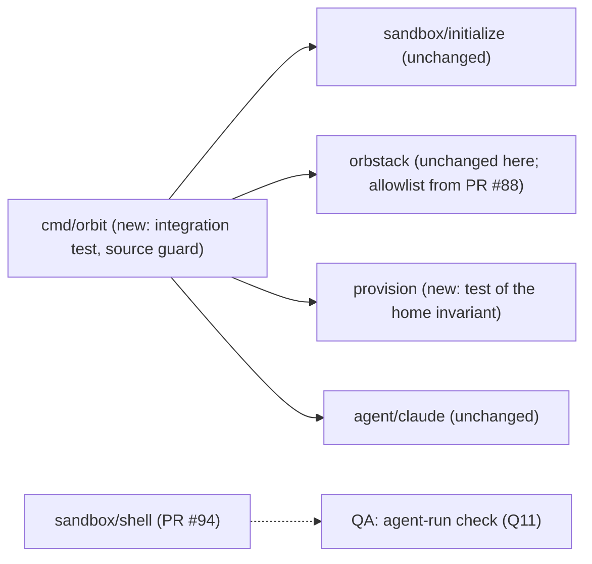

# Sign in with `/login` once per sandbox and stay signed in (E01-S03)

Extends: .ai/specs/2026-11-11-claude-code-agent-definition.md
Extends: .ai/specs/2026-11-11-orbit-stop-start.md
Extends: .ai/specs/2026-11-10-sandbox-provisioning.md

Issue: #7. Epic: #2. Depends on: #6 (`orbit shell`, open PR #94) and #76 (environment allowlist of `orb`, open PR #88). Owner of every decision: Jakub Tobiasz.

## 📝 TLDR

The owner wants Claude Code in a sandbox to run on the Claude subscription, not on an API key (D04). D08 already decides how: the owner runs `/login` in the unmodified client inside the sandbox, once, and the login stays on the disk of that machine; Orbit never touches the credential (R04). What is missing is proof (A02 is untested) and a guard that keeps it true. This spec proposes no new command and no new product behavior. It adds integration tests and a source guard that prove the negative criteria (no host `~/.claude`, no host credential in the agent's environment, no copy held by Orbit, no request by Orbit to the provider), one provisioning invariant (the agent user and its home are never removed or recreated), the documentation of where the login lives and who can read it, and a QA check, run by an agent, that closes A02 (Q11): the owner does not run `/login` for it.

## Open questions (decided by the owner)

The owner, Jakub Tobiasz, decided Q1–Q12 on 2026-11-11 at 16:45 (Europe/Warsaw, UTC+1) and accepted every recommendation as proposed. Q11 is decided as an agent-run check: an agent, not the owner's manual `/login`, runs the QA check that closes A02, because the owner is away from home. Q1–Q4, Q10, and Q12 are `risk-high`: they decide where the credential lives, whether it survives, and what can read it. The rest of the spec is written under these decisions.

| # | Question | Options | Recommendation | Status |
|---|---|---|---|---|
| Q1 | **`risk-high` — Where does the login live?** | (a) Where the unmodified client puts it on Linux: `/home/agent/.claude/.credentials.json`, mode `0600`, on the disk of the machine; Orbit sets nothing. (b) A root-managed location through `CLAUDE_CONFIG_DIR` set by Orbit. (c) Outside the sandbox, on the host, as `sbx` does. | **(a).** It is D08 as written and the client's documented default ("On Linux, credentials are stored in `~/.claude/.credentials.json` with file mode `0600`", Claude Code authentication docs, 2026-11-11). (b) changes the configuration of the client, which R04 and the definition test forbid, and moves the file without making it less readable to the agent, which runs the client. (c) is A04, refuted by the provider terms (R04). | ✅ OWNER DECISION (2026-11-11 16:45) |
| Q2 | **`risk-high` — Who can read the login, and is that accepted?** Spike of this spec (Evidence): the file is readable by the `agent` user and every process that runs as it (Claude Code, every tool it starts, every other agent in the same sandbox, D18, and later its rootless containers, E01-S05); by root in the machine; and by any process of the Mac user through `orb -m <machine> -u agent` or `-u root`. It is **not** readable by the default user in the machine (`/home/agent` is `0750`) nor by the Mac user through `~/OrbStack/<machine>/home/agent` (`Permission denied`). The agent can send it to any allowlisted host (D24: "an allowed host can receive uploads"). | (a) Accept, and state it as an explicit risk in `ARCHITECTURE.md` (Credentials row) and the R04/D08 risk note. (b) Run the client as one user and its tools as another. (c) Narrow the allowlist so that the token has nowhere to go. | **(a).** `ARCHITECTURE.md` already records "The agent can read its own login" as the accepted consequence of D08. (b) needs a change to the client (R04). (c) is not possible: `api.anthropic.com` must be reachable for the client to work, and GitHub must be reachable for D10. Recommended owner hygiene, documented: run `/logout` in the sandbox before `orbit destroy` (#12) and revoke sessions on claude.ai if a sandbox is suspected compromised (the revocation path on claude.ai is not verified by this spec). | ✅ OWNER DECISION (2026-11-11 16:45) |
| Q3 | **`risk-high` — What keeps the login, and what removes it?** Code on `main`: stop/start keeps `/home/agent` (`cmd/orbit/stopstart_integration_test.go:32`, the `sandbox-lifecycle` requirement "State survives"); `init` re-provisions on every run but the root script never writes into a home (`TestScriptWritesNothingIntoAHome`) and creates `agent` only when it is missing (`internal/provision/script.go:243`); `init --agent claude-code` re-runs the official installer as `agent` every time (`initialize/handler.go:185`), and whether the installer leaves `~/.claude` alone is not tested. Removing the machine removes the login: `orbit destroy` (#12), a recreation forced by an SSH forwarding mismatch (#8, Q1 of its spec), and a distribution change (E04). | (a) Keep that behavior; extend the existing provisioning tests to the invariant "provisioning never removes or recreates the agent user or its home", and test that a second `init --agent claude-code` keeps `~/.claude` and `~/.claude.json` (the client's account state lives in the home, not in `~/.claude`). (b) Also make `orbit destroy` print that the login is deleted. (c) Keep the login across a destroy or a recreation. | **(a)**, and leave (b) to the spec of #12. (c) means Orbit copies the credential out and back in, which D08 and R04 forbid. | ✅ OWNER DECISION (2026-11-11 16:45) |
| Q4 | **`risk-high` — Can a host credential reach the agent's environment?** Spike of this spec on OrbStack 2.2.5: without `ORBENV`, host `ANTHROPIC_API_KEY`, `CLAUDE_CODE_OAUTH_TOKEN`, and `CLAUDE_CONFIG_DIR` do not reach `orb -u agent`; with `ORBENV=ANTHROPIC_API_KEY` the key does. The client prefers an API key to the `/login` credential (authentication precedence 3 vs 7) and always uses it with `-p`. So on `main` today a host variable can silently replace the subscription with a host credential that the user did not opt in to (R08). | (a) #7 depends on PR #88 (#76), whose allowlist removes `ORBENV` and every non-allowlisted variable from every `orb` command and keeps `HOME`; the integration test of this spec asserts the result. (b) #7 adds its own denylist of `ANTHROPIC_*` and `CLAUDE_*`. | **(a).** The owner rejected a denylist on #76 (2026-11-11). One mechanism, the function `execute` in `internal/orbstack/orbstack.go`, covers `RunAsAgent`; PR #94 moves the start of `orb` into a new `executeStreams`, and whichever of #88 and #94 merges second must put the filter there, or `orbit shell` skips it (PR #94 notes this). #88 also replaces the invariant of `internal/orbstack/AGENTS.md` "never changes the environment of `orb` (owner decision on #70)"; that is #88's change, not this spec's. The implementation of #7 starts after #88 merges. | ✅ OWNER DECISION (2026-11-11 16:45) |
| Q5 | Does #7 wait for `orbit shell` (PR #94)? The first acceptance criterion names `orbit shell`. | (a) The tests and docs can land before #94; the QA run that closes A02 uses `orbit shell` and so runs after #94 merges. (b) QA with `orb -m <machine> -u agent` now. | **(a).** The tests use `RunAsAgent`, which exists on `main`. A QA run outside `orbit shell` would not prove the criterion as written. | ✅ OWNER DECISION (2026-11-11 16:45) |
| Q6 | Which hosts does a signed-in session need? The spike of 2026-11-10 saw only the hosts before sign-in; the token exchange is documented at `platform.claude.com`, which D24 allows. | (a) QA records every `Proxying refused on filtered domain` line of `/var/log/tinyproxy/tinyproxy.log` during `/login`, one prompt, `/status`, and a restart; a needed host that D24 lacks stops the PR and goes to the owner as a superseding row of D24. (b) Add `claude.com`, `sso.claude.com`, `console.anthropic.com` now. | **(a).** D24 is a protected row and an allowed host can receive uploads; no host is added without evidence. `claude.com` and `sso.claude.com` are opened in the Mac's browser, not in the machine (spike of 2026-11-10). | ✅ OWNER DECISION (2026-11-11 16:45) |
| Q7 | How is "Orbit holds no copy of the credential — not in its config directory, its logs, or the Keychain" proven? Code on `main`: Orbit writes no host file (no `os.WriteFile`/`os.Create`/`os.MkdirAll` outside tests; `os.OpenFile` only opens directories in `realpath`), has no log file, and calls no Keychain tool. | (a) A source guard test: no non-test Go file names `.credentials.json`, `Claude Code-credentials`, the `security` command (a string literal that is `security` or starts with `security `), `find-generic-password`, `CLAUDE_CODE_OAUTH_TOKEN`, `ANTHROPIC_API_KEY`, or `ANTHROPIC_AUTH_TOKEN`; plus a QA check of the Keychain. (b) Code review only. (c) (a) and also forbid an import of `net/http` in the whole module. | **(a).** Cheap, and it fails on the change that would break the rule. It is a tripwire, not proof: a name built at run time passes it, so the review stays. `orbit` has no config directory yet; the guard covers it when one is added. (c) would forbid every HTTP call of the host process for any reason, which is more than D08 ("never calls the provider itself"); it would be a new architecture rule with its own Key decisions row, so it is not proposed here. | ✅ OWNER DECISION (2026-11-11 16:45) |
| Q8 | What does "Orbit sends no request to the provider" mean? `init --agent claude-code` runs `curl -fsSL https://claude.ai/install.sh \| bash` as `agent` (`internal/agent/claude/claude.go:12`), a request to the provider's download host. | (a) Orbit sends no request **with a credential** (R04: "does not send requests to the provider with them"), and the Orbit process on the host never calls the provider itself (D08); the install download inside the sandbox, run as `agent` without a credential, stays (accepted in the agent-definition spec). (b) Literally no request, which rules out the official installer. | **(a).** It stays within both R04 and D08. (b) would contradict R04's own "official agent client" and the accepted install source. | ✅ OWNER DECISION (2026-11-11 16:45) |
| Q9 | Does Orbit print a hint such as "run `claude`, then `/login`"? | (a) No. (b) A static line after `init --agent`. (c) A `LoginHint` field in the agent definition. | **(a).** `ARCHITECTURE.md` (Agent definitions): "There is no `Start` and no `LoginHint`". (b) without (c) would make a slice depend on the agent; (c) is a field for one string. The client prints `Not logged in · Please run /login` itself (spike of 2026-11-10). | ✅ OWNER DECISION (2026-11-11 16:45) |
| Q10 | **`risk-high` — The shared project directory as a path to the *host* login.** The project directory is mounted read-write (R08). The agent can write `<project>/.claude/settings.json`. Claude Code reads project settings, which can set `env` (for example `ANTHROPIC_BASE_URL`) and `apiKeyHelper`. If the owner later starts `claude` on the Mac in that directory, those settings may redirect the host client, with the host login from the Keychain, or run a command on the host. Not verified by this spec; `ARCHITECTURE.md` (Workspace row) already says that `.claude/` settings written in a session need review. | (a) Out of scope for #7: name it in Risks, and the owner files a follow-up issue to verify it and decide a mitigation. (b) Add it to #7. | **(a).** It is about the host login, not the sandbox login, and the mitigation (if any) changes the workspace boundary, which needs its own spec. | ✅ OWNER DECISION (2026-11-11 16:45) |
| Q11 | Who closes A02 and edits the brief? | (a) The owner runs `/login` in QA and posts the redacted transcript; the implementation PR proposes the text for A02 (result) and the review note of D08; the owner edits the brief. (b) The implementing agent edits the brief. (c) An agent runs the QA check of Proposed Solution 7 instead of the owner's manual `/login`; the implementation PR proposes the A02 and D08 text; the owner edits the brief. | **(c).** The owner is away from home, so an agent runs the check that closes A02. The agent never opens the sign-in URL, never handles a code or a token, and never signs in to the owner's account (D08, R04, root `AGENTS.md`), so the check stops before the browser step and the A02 result names what stays untested. Active rows are a protected contract (root `AGENTS.md`): only the owner edits the brief. | ✅ OWNER DECISION (2026-11-11 16:45) |
| Q12 | **`risk-high` — The disk image of the machine on the Mac.** The login lives on the machine's disk, which OrbStack keeps in its data directory on the Mac (`~/Library/Group Containers/HUAQ24HBR6.dev.orbstack/data/`; the spike of 2026-11-10 got `Operation not permitted` there, macOS privacy protection). A Mac process with Full Disk Access, or a backup tool, may read or copy that image. Not verified by this spec. | (a) Accept as part of "the Mac user can read it" (Q2), and have QA record whether Time Machine excludes the directory (`tmutil isexcluded <path>`). (b) Spike it before the implementation: read access without Full Disk Access, and the backup state. (c) Ask the owner to exclude the directory from backups. | **(a)**, with (c) as a documented recommendation. The host owner can already read the login through `orb` (Q2); the new fact is a copy in backups, which outlives `orbit destroy`. | ✅ OWNER DECISION (2026-11-11 16:45) |

## 📝 Problem Statement

- D04, D08, R04, R08: the agent runs on the user's subscription; the user signs in with `/login` inside the sandbox, once; Orbit never asks for, stores, changes, or intermediates a credential of the agent; host `~/.claude` is never mounted.
- A02 is untested `[DATA]` (`.ai/analysis/2026-11-10-orbstack-isolated-machine-spike.md`, section 5): the client installs and starts through the proxy, `claude -p hi` prints `Not logged in · Please run /login`, the documented login hosts are reachable, and the login has a paste-the-code path, so no callback into the machine is needed. The sign-in itself, token refresh, and the hosts of a signed-in session were not exercised. The brief's Definition of Ready is not signed because of A02.
- What `main` already enforces (no change proposed):
  - Host `~/.claude` and `~/.claude.json` never enter a sandbox: `protectedNames` and `protectedFileNames` (`internal/sandbox/sandbox.go:106`, `:110`), applied by `ValidateProjectDir` (`:276`) to every spelling of every home, and to the directory and the `.claude.json` that `CLAUDE_CONFIG_DIR` moves them to (`dirRelocations`, `:123`; `singleLinkRelocations`, `:140`; #40). The machine mounts exactly the project directory (`ValidateMounts`, `:314`, on the configuration and on `/proc/self/mountinfo`).
  - A hard link of a protected file refuses every project directory (`ErrHardLinkedFile`, `:73`; #37, #69): `~/.claude.json` and `$CLAUDE_CONFIG_DIR/.claude.json` may have one link, and every file in `~/.claude` may have no link outside the protected locations (`cmd/orbit/hardlink_integration_test.go:123`).
  - The handler reads only metadata of these paths and never opens a file (D08; `internal/sandbox/AGENTS.md`).
  - The agent definition is checked against R04: an official `https` install, no write into `~/.claude`, no token or key variable, no client flag (`internal/agent/claude/claude_test.go`, `TestCheckR04RefusesHostileInstalls`).
  - The state of the machine survives `orbit stop` and `orbit start` (#11; `stopstart_integration_test.go:32`, a file in `/home/agent`).
  - Provisioning writes nothing into a home (`TestScriptWritesNothingIntoAHome`) and creates `agent` only when it is missing (`script.go:243`).
- What `main` does not yet guarantee:
  - A host variable named in `ORBENV` reaches the agent, including `ANTHROPIC_API_KEY`, which the client prefers to `/login` (Q4; closed by PR #88).
  - Nothing tests that a second `init --agent claude-code` (installer re-run) keeps `~/.claude`.
  - Nothing fails when a later change makes Orbit name the credential file, the Keychain entry, or a provider variable (Q7).
  - `orbit shell` does not exist on `main` (PR #94).

## 📝 Proposed Solution

No new command, flag, or contract. The story is verification plus guards:

1. **Environment.** After PR #88, every `orb` command gets only the allowlisted host variables. An integration test sets `ORBENV`/`WSLENV` naming `ANTHROPIC_API_KEY`, `ANTHROPIC_AUTH_TOKEN`, `CLAUDE_CODE_OAUTH_TOKEN`, and `CLAUDE_CONFIG_DIR` (marker values, never a real credential) and asserts that none of them is in the environment of an `agent` script, and that `claude -p hi` as `agent` reports that it is not logged in (Q4, Q8: no API key is needed or set, and the client keeps `/login`).
2. **No host `~/.claude` in the machine.** The same test asserts, as root in the machine, that `<host home>/.claude` and `<host home>/.claude.json` do not exist and that `ActiveMounts` is exactly the project directory. (The mount point of the project creates its parent directories, so `<host home>` itself exists in the machine; the spike shows it holds only the path to the project.)
3. **Persistence.** The test writes a sentinel `/home/agent/.claude/orbit-it-sentinel` (not a credential, never `.credentials.json`) and records the SHA-256 of `/home/agent/.claude.json` (which `claude -p hi` creates; it holds account state, no token, and the test compares only the checksum, never prints the content). It runs `init --agent claude-code` again, then `orbit stop` and `orbit start`, and asserts after each command that the sentinel is intact and the checksum is unchanged (Q3). The test never reads or writes `.credentials.json`.
4. **Provisioning invariant.** The root script never removes or recreates the agent user or anything under `/home`. `TestScriptWritesNothingIntoAHome` (`script_test.go:70`) already fails on any line with `/home`, and `TestScriptCreatesTheAgentOnceWithoutGroups` (`:81`) on any `usermod` of `agent`; the new part is a refusal of `userdel` and `deluser`, added to the second test. `internal/provision/AGENTS.md` gets the invariant (Q3).
5. **Source guard.** A unit test walks every non-test `.go` file of the module and fails on the names of Q7 (Q7, Q8). The check is a pure function over source text, so its hostile cases are committed table tests, not one-off mutations.
6. **Documentation.** `ARCHITECTURE.md`, Credentials row and Data and state: where the login lives, who can read it (Q2, with the spike facts), what removes it (Q3). `internal/agent/AGENTS.md`: the invariant that Orbit never reads `.credentials.json`, by any path, also not through `RunAsAgent` or `RunAsRoot`.
7. **QA (agent-run, Q11).** An agent runs this check, not the owner. After #88 and #94 merge, on a named OrbStack version: `orbit init --agent claude-code`, `orbit shell`, `claude`, `/login` with the subscription sign-in; the client prints the sign-in URL and waits for the code, and the proxy log has no refused-host line up to that point (Q6); as `agent`, a request through the proxy to `https://platform.claude.com`, the documented token exchange host, gets an answer that is not a refusal of the proxy; in the same `orbit shell`, `env | grep -E '^(ANTHROPIC|CLAUDE)_'` prints nothing (with a marker `ANTHROPIC_API_KEY` and `ORBENV` set on the Mac); the item labels of `security dump-keychain` (attributes only, no `-d`) are the same before and after the run; `tmutil isexcluded` on the OrbStack data directory (Q12). The agent never opens the sign-in URL, never handles a code or a token, and never signs in to the owner's account (D08, R04). The persistence of the home is proven by the integration test (step 3). The transcript names what the check does not cover: the completed sign-in, `/status` on the subscription, the hosts of a signed-in session, and token refresh. This closes A02 (Q11): the implementation PR proposes the A02 result ("held up to the code exchange; sign-in untested") and the D08 review note, and the owner edits the brief.

**Alternatives considered.**

- *Token path* (`CLAUDE_CODE_OAUTH_TOKEN` from `claude setup-token`): out of scope (Q12 of the brief, D08).
- *Mount host `~/.claude` read-only*: cannot authenticate on macOS (the login is in the Keychain) and is forbidden by R08 (D08).
- *Keep the token on the host behind the proxy, as `sbx` does*: refuted by the provider terms (A04, R04).

## 📝 Delta

### Capability: agent-sign-in

#### ADDED Requirement: Sign in with the subscription inside the sandbox
The system SHALL let the owner sign in to the unmodified client with `/login` inside the sandbox, through the egress allowlist, and SHALL NOT need or set an API key.

##### Scenario: Sign-in starts (agent-run QA)
- WHEN an agent runs `claude` in `orbit shell` and starts `/login` with the subscription sign-in
- THEN the client prints the sign-in URL and waits for the code, and the proxy log shows no refused host up to that point

##### Scenario: First sign-in (owner, not part of the A02 check; Q11)
- WHEN the owner runs `claude` in `orbit shell`, runs `/login`, opens the printed URL in a browser on the Mac, and pastes the code back
- THEN the client reports a successful login on the owner's subscription (`/status`), and the proxy log shows no refused host that the session needed

##### Scenario: No key, no login yet
- WHEN `init --agent claude-code` created the sandbox and no one signed in
- THEN `claude -p hi` as `agent` reports that it is not logged in and names `/login`

#### ADDED Requirement: The login stays on the disk of the sandbox
The system SHALL keep the home directory of the agent, and so the login, across `orbit stop`, `orbit start`, and a repeated `orbit init`, and SHALL NOT remove or recreate the agent user or its home.

##### Scenario: Stop, start, and init again
- WHEN a file exists in `/home/agent/.claude` and `/home/agent/.claude.json` exists, and the owner runs `orbit init --agent claude-code` again, then `orbit stop` and `orbit start`
- THEN the file exists with the same content, and `~/.claude.json` has the same checksum, after each command

##### Scenario: Signed in after a restart (owner, not part of the A02 check; Q11)
- WHEN the owner signed in, and runs `orbit stop`, `orbit start`, and `orbit shell`
- THEN `claude` starts signed in, without `/login`

#### ADDED Requirement: No host credential of the agent enters the sandbox
The system SHALL NOT mount host `~/.claude` or `~/.claude.json`, and SHALL NOT pass a host variable of the agent's provider into the sandbox.

##### Scenario: Host variables
- WHEN the environment of `orbit` holds `ANTHROPIC_API_KEY`, `ANTHROPIC_AUTH_TOKEN`, `CLAUDE_CODE_OAUTH_TOKEN`, and `CLAUDE_CONFIG_DIR`, and `ORBENV` and `WSLENV` name them
- THEN none of them is set in a script that runs as `agent`, nor in `orbit shell` (QA)

##### Scenario: Host directory
- WHEN a sandbox exists
- THEN `<host home>/.claude` and `<host home>/.claude.json` do not exist in the machine, and the machine mounts only the project directory

#### ADDED Requirement: Orbit holds no copy of the credential
The system SHALL NOT read, copy, store, log, or forward the credential of the agent, and the Orbit process SHALL send no request to the provider.

##### Scenario: Source guard
- WHEN a non-test Go file of the module names the credential file, the Keychain entry or tool, or a provider credential variable
- THEN `go test ./...` fails

##### Scenario: Keychain (agent-run QA)
- WHEN the agent-run QA check of Proposed Solution 7 ran
- THEN the item labels of `security dump-keychain` are the same as before the run

### Capability: sandbox-provisioning

#### ADDED Requirement: Provisioning keeps the agent and its home
The system SHALL create the user `agent` only when it does not exist, and the root script SHALL NOT remove, move, or recreate the user or any directory under `/home`.

##### Scenario: Script content
- WHEN the root script is rendered
- THEN it holds no `userdel`, no `deluser`, no `usermod` of `agent`, and no line that names `/home` (besides the `/home/*)` pattern of the self-check)

Frozen by: `internal/provision/script_test.go` (`TestScriptWritesNothingIntoAHome`, `TestScriptCreatesTheAgentOnceWithoutGroups`)

## 📝 Architecture

No production code changes: every guard is a test or a document. No new module, no new cross-module dependency, no new Go dependency, no change to the allowlist (Q6), the mounts, or the isolation settings. The `Credential` module stays planned (`ARCHITECTURE.md`): the login is not a host credential that Orbit selects.

Where the login lives (Q1, Q2), as the spike of this spec saw it:

| Who | Can read `/home/agent/.claude/.credentials.json` |
|---|---|
| `agent` and every process as `agent` (client, tools, other agents, D18) | yes |
| root in the machine | yes |
| default user in the machine (Mac uid) | no: `/home/agent` is `0750` (`HOME_MODE 0750` of Ubuntu 26.04) |
| Mac user through `~/OrbStack/<machine>/home/agent` | no: `Permission denied` (uid 1000 in the machine, Mac uid 501) |
| any process of the Mac user through `orb -m <machine> -u agent` or `-u root` | yes; Orbit never runs such a command on this file |
| another sandbox | no: isolated machine, only its own project directory mounted |
| a Mac process with Full Disk Access, or a backup, through the disk image in OrbStack's data directory | not verified (Q12) |

## 📝 API Contracts

None. No command, flag, output, or exported identifier changes.

## 📝 Edge Cases & Failure Scenarios

| Case | Behavior |
|---|---|
| `ANTHROPIC_API_KEY` set on the host, PR #88 merged | Does not reach the sandbox; the client keeps `/login` (Q4). |
| `ANTHROPIC_API_KEY` set inside the sandbox by the owner or the agent (`~/.bashrc`) | The client asks once in interactive mode whether to use it, and prefers it when approved (precedence 3 vs 7). The owner's choice; Orbit sets nothing. |
| A needed host is not in D24 | `/login` or a prompt fails with a proxy error; QA records the refused host; the owner decides a superseding row of D24 (Q6). |
| The URL does not open in the machine | Expected: `xdg-open` and the clipboard do not work in an isolated machine (spike of 2026-11-10). The owner copies the URL from the terminal and pastes the code back. |
| The login expires and cannot be refreshed | The client prints `Login expired · Please run /login`; the owner runs `/login` again in the same sandbox. Orbit does nothing. |
| `orbit destroy` (#12), a recreation for an SSH forwarding mismatch (#8), or another distribution (E04) | The machine and the login are deleted; the next sandbox needs one `/login` (Q3). |
| The installer changes `~/.claude` on a repeated `init` | The integration test of Proposed Solution 3 fails; the story is blocked until the owner decides. |
| Several agents in one sandbox | They share the login (D18, accepted). |
| The agent sends the token to an allowlisted host | Accepted risk of Q2 (D24: an allowed host can receive uploads). |

## 📝 Risks & Impact Review

- **`risk-high` (boundary, credentials).** The login is readable by everything that runs as `agent` and can leave over any allowed host (Q2). It is deleted with the machine (Q3). Until PR #88 merges, a host `ORBENV` can put a host API key in front of the subscription (Q4). The implementation PR carries the hostile-input integration test, the source guard, a statement that the escape suite (#10) did not run, a review by a second person, and the transcript of the agent-run QA check (Q11); no self-QA.
- **Host login through the project directory** (Q10): not verified, out of scope, follow-up issue proposed.
- **Disk image and backups** (Q12): a copy of the login may outlive `orbit destroy` in a backup of OrbStack's data directory. Not verified.
- **Sign-in untested by A02** (Q11): the agent-run check stops before the browser step, so the completed sign-in, the hosts of a signed-in session, and token refresh stay untested until the owner runs the owner scenarios of the Delta.
- **Provider terms.** R04 and D08 rest on the agent's reading of the Claude Code legal page (not legal advice; brief Q11 for a public release). Nothing here changes it.
- **Brief rows.** No row is superseded. A02 gets a result and D08 its review only after the agent-run QA check, and only the owner edits the brief (Q11).
- **Rollback.** Revert the PR: only tests and documents change.

## 📝 Decisions in play

Relies on D04, D08, D18, D24, R03, R04, R08, and the owner decision on #76 (allowlist, not denylist). Closes A02 by the agent-run QA check (Q11, owner decision 2026-11-11 16:45). Supersedes none. Owner of all: Jakub Tobiasz.

## 📝 Evidence

Spike of this spec, OrbStack 2.2.5 (2020500), 2026-11-11, one throwaway machine `orbit-gh7spike-66ea688c` created with `--isolated --isolate-network --mount DIR:DIR ubuntu:26.04` and a plain `agent` user created by `useradd --create-home --shell /bin/bash --user-group agent` (as provisioning does), deleted afterwards. No real credential was used; the file below held the text `NOT-A-CREDENTIAL-orbit-gh7-spike`.

- `/etc/login.defs`: `HOME_MODE 0750`; `/home/agent` is `750 agent:agent`.
- `orb -m M -u agent`: `HOME=/home/agent`.
- Host `ANTHROPIC_API_KEY`, `CLAUDE_CODE_OAUTH_TOKEN`, `CLAUDE_CONFIG_DIR` set, `ORBENV` unset: no `ANTHROPIC_*` or `CLAUDE_*` variable in the agent's environment. With `ORBENV=ANTHROPIC_API_KEY`: `ANTHROPIC_API_KEY` is set for `agent`.
- `/home/agent/.claude/.credentials.json`, mode `600`, owner `agent`: root reads it; the default user (`jacob`, uid 501) gets `Permission denied` on the file and on `/home/agent`; the Mac lists `~/OrbStack/M/home/agent` (uid 1000, `drwxr-x---`) and gets `Permission denied` on `.claude` and on the file.
- `~/OrbStack` on the Mac lists every machine, isolated ones included, with `.metadata_never_index` (Spotlight off).

Documentation, checked 2026-11-11: Claude Code authentication (https://code.claude.com/docs/en/authentication): Linux storage `~/.claude/.credentials.json` mode `0600`, or under `CLAUDE_CONFIG_DIR`; the paste-code path; precedence (`ANTHROPIC_AUTH_TOKEN` 2, `ANTHROPIC_API_KEY` 3, `CLAUDE_CODE_OAUTH_TOKEN` 5, `/login` 7); expiry warning and `Login expired · Please run /login`. OrbStack isolated machines (https://docs.orbstack.dev/machines/isolated): the Mac keeps SSH and `orb` access to an isolated machine; the page does not cover `~/OrbStack` or environment variables.

## 📋 Phasing

One phase. Every step leaves the gate green. Steps 1–4 can land before PR #94; step 2 needs PR #88 merged (Q4); step 6 needs both (Q5).

## 📋 Implementation Plan

Branch `feat/issue-7-subscription-sign-in`, PR `risk-high`, `feature`, `needs-qa`, `Refs` this spec and `Fixes #7`.

1. **Provisioning invariant.** Characterize first: `TestScriptWritesNothingIntoAHome` and `TestScriptCreatesTheAgentOnceWithoutGroups` stay green on the unchanged script. Then extend the second test to refuse `userdel` and `deluser`, through a line predicate with committed table cases (`userdel agent`, `deluser agent`, `usermod -d /x agent`, a clean line). `internal/provision/AGENTS.md`: the invariant. → verify: `go test ./internal/provision/...`
2. **Integration test** `cmd/orbit/signin_integration_test.go` (`integration` tag, `-p 1`, shared init lock, unique project directory, only own `orbit-it-*` machines): `init --agent claude-code` with the host variables and `ORBENV`/`WSLENV` of the Delta (marker values); assert the agent environment; `claude -p hi` not logged in; as root, no `<host home>/.claude`, no `<host home>/.claude.json`, `ActiveMounts` exactly the project; write the sentinel and record the checksum of `~/.claude.json`; `init --agent claude-code` again; `orbit stop`; `orbit start`; sentinel intact and checksum unchanged after each. Never reads or writes `.credentials.json`. → verify: `go test -tags integration -p 1 -count=1 -run TestSignIn ./cmd/orbit/` on a named OrbStack version.
3. **Source guard** `cmd/orbit/credential_guard_test.go` (no build tag): a pure function `forbiddenNames(src []byte) []string` (parsed with `go/parser`: string literals and identifiers of Q7), table-tested with hostile sources (`".credentials.json"`, `"security find-generic-password"`, `os.Getenv("ANTHROPIC_API_KEY")`, a name only in a comment, which passes), and one test that runs it over every non-test `.go` file of the module; allow-list nothing. → verify: `go test ./cmd/orbit/`
4. **Docs.** `ARCHITECTURE.md`: Credentials row (Q2 table, Q3), Data and state (agent state, what removes the login). `internal/agent/AGENTS.md`: Orbit never reads `.credentials.json` by any path. No brief edit. → verify: full validation gate.
5. **Archive the Delta** into `.ai/specs/capabilities/agent-sign-in.md` (new) and `.ai/specs/capabilities/sandbox-provisioning.md` (the added requirement). → verify: both files match the Delta.
6. **QA evidence** (an agent, after #88 and #94 merge; Q11): the run of Proposed Solution 7, transcript redacted, OrbStack version named, refused-host lines of the proxy log attached, and the untested parts named. The escape suite (#10) does not exist yet; the PR states that it did not run. The PR proposes the A02 and D08 text for the owner (Q11).
