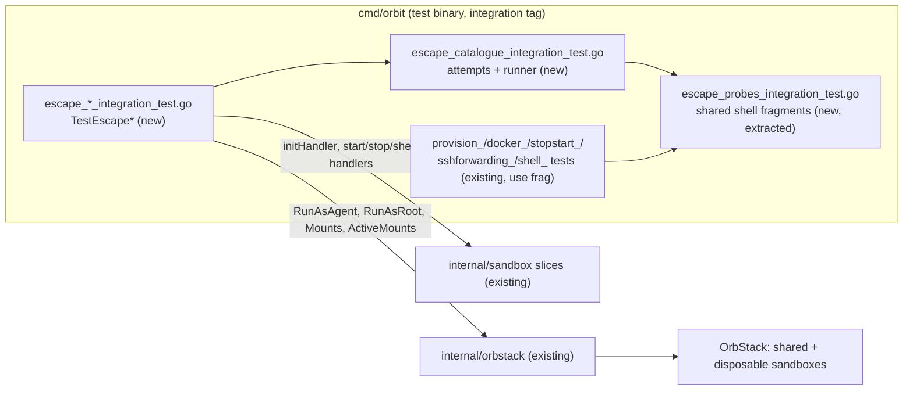

# Escape suite: every documented escape attempt fails in a real sandbox

Issue: #10 (E01-S06), epic #2. Depends on #5 (E01-S01, code on `main`) and #9 (E01-S05, closed by #107). Criteria moved in from #29 (symlink swap during `init`), #28 (credential locations), and #115 (the `orbit shell` refusal case and the raw `orb -u agent` observation). Triage: https://github.com/cultofthecode/orbit/issues/10#issuecomment-6820772175.
Extends: .ai/specs/2026-11-10-sandbox-provisioning.md
Extends: .ai/specs/2026-11-11-rootless-docker.md
Extends: .ai/specs/2026-11-11-ssh-agent-forwarding.md
Extends: .ai/specs/2026-11-11-orbit-shell.md
Extends: .ai/specs/2026-11-11-orbit-stop-start.md

## 📝 TLDR

The owner wants proof that an agent in a sandbox cannot reach the host. Today `SDLC.md` asks every `risk-high` boundary PR for "a passing run of the escape suite", but no escape suite exists: such a PR only states that it did not run. Pieces of the attempts are spread over six capability tests in `cmd/orbit`, and nobody can run them as one set or read one result per attempt. This spec proposes an escape suite: integration tests named `TestEscape*` in `cmd/orbit/escape_*_integration_test.go`. Each test runs a catalogue of escape attempts inside real OrbStack sandboxes, as the agent and from its rootless containers. Every attempt is its own subtest with a positive control. The suite logs the OrbStack version once. A meta-test proves that the suite fails when a boundary is weakened on purpose. The suite is test-only; it changes no product behavior. Fourteen questions are open for the owner (below). The design follows the default answer of each.

## ⚠️ Open Questions for the owner (defaults applied)

The triage of #10 recommended answers to Q1–Q8, and the owner asked for them to be questions in this spec, each with that recommendation as the default. Q9–Q14 came up while writing this spec. The rest of the document is written under these defaults. Any answer can be changed before merge, and the design section that depends on it is named.

| # | Question | Default applied | Why | Confirm? |
|---|---|---|---|---|
| Q1 | The issue cites R01 for the container attempts. The brief supersedes R01 with R10: rootless containers of the agent may use `--pid host` and `--network host`. Which rule does the suite cite, and what do the container attempts check? | Cite **R10**, not R01. The container attempts check that the **firewall and the proxy** still hold for containers with host namespaces of the machine. They do not check that a container cannot get those namespaces. | R01 is `superseded by R10` in the brief. A test that expects `--pid host` to fail would fail on a correct sandbox (`docker_integration_test.go` expects it to succeed). | ⚠ NEEDS HUMAN CONFIRMATION |
| Q2 | Where does the suite live? | `cmd/orbit/escape_*_integration_test.go`, package `main`, build tag `integration`. | Only `cmd/orbit` may import `internal/orbstack` (depguard, `ARCHITECTURE.md` rule 1). The helpers that the suite reuses (`initHandler`, `newSandboxDir`, `lockInit`, `accountHomeMachines`) are in that package. Another package would need a depguard exception. | ⚠ NEEDS HUMAN CONFIRMATION |
| Q3 | One sandbox or many? | One **shared** provisioned sandbox for the read-only attempts. **Disposable** sandboxes for the restart and boot-order case, the `--no-ssh-forwarding` case, the weakened-boundary case, "reach another sandbox" (it needs two), and the symlink swap (it needs the exclusive init lock). Refinement in this spec: for "reach another sandbox", the shared sandbox is the source and one disposable sandbox is the target, so the case creates one machine, not two. | The read-only attempts change nothing, so they can share one sandbox. Every case that changes the machine or needs special lock handling gets its own machine and cannot affect another case. | ⚠ NEEDS HUMAN CONFIRMATION |
| Q4 | The first acceptance criterion says `go test -tags integration ./...`. `AGENTS.md` requires `-p 1`. | The criterion says `go test -tags integration -p 1 -timeout 60m ./...`. | Without `-p 1`, `TestActiveMountsShowASwappedPath` in `internal/orbstack` makes `init` refuse every directory while it runs. | ⚠ NEEDS HUMAN CONFIRMATION |
| Q5 | How do the credential cases from #28 run without touching the owner's credentials? | They use a **fake `HOME`** with fixture directories and symlinks, as `temporaryHome` and `accountHomeMachines` in `hardlink_integration_test.go` do. The suite never reads the contents of, creates, changes, or links the owner's real `~/.ssh`, `~/.claude`, `~/.aws`, `~/.gnupg`, `~/.config/gh`, or `~/.claude.json`. The path rules of `init` still resolve the account home's protected paths through the current user, as they do on every run: they look at paths, not at contents. | D08 and `AGENTS.md` Never: Orbit never reads, copies, or forwards the user's credentials. Fixtures exercise the same path rules. | ⚠ NEEDS HUMAN CONFIRMATION |
| Q6 | How is the negative criterion ("a weakened boundary makes the suite fail") tested? | A **meta-test** in a disposable sandbox. As root, it weakens the firewall so that only the agent uid is filtered, which is the leak of the spike. It runs the same container-attempt function that the suite runs and asserts that the function reports reach. A normal run passes; the meta-test fails only when the attempt cannot detect the leak. | Weakening the shared sandbox would make the normal run fail, which the criterion forbids. The meta-test proves that the detector works, and it is not a second red run. | ⚠ NEEDS HUMAN CONFIRMATION |
| Q7 | #115: what does the suite do with the raw `orb -u agent` result while a boundary unit is down, and where does the `orbit shell` refusal case live? | The suite **asserts** the observed raw result: today `orb -m <name> -u agent id -un` prints `agent` although `/run/nologin` exists. If that changes, the failure message says that OrbStack now honours `/run/nologin` and that `internal/provision/AGENTS.md` and the provisioning spec must change. The `orbit shell` refusal case (failed boundary unit → `ErrNotProvisioned`, no agent session) **moves** from `shell_integration_test.go` into the suite. | The observation is a known limit that the documents state. If an assertion pins it, a change in OrbStack becomes visible. With one home for the refusal case, it does not run twice. | ⚠ NEEDS HUMAN CONFIRMATION |
| Q8 | How does the suite name the OrbStack version? | It logs `orb version` once per test binary, in the header of the first `TestEscape*` test that runs. | The criterion asks for the version. One line is enough, and the header puts it at the top of the output pasted in a PR. | reversible |
| Q9 | As whom does an attempt run? Most existing probes run as root and switch to the agent with `runuser`. | Each attempt runs in the **agent's own session**: `RunAsAgent` (`orb -u agent`), the path that `orbit shell` and Claude Code use. Root runs only setup, the positive controls, and the attempts for uids without a session (the default uid, a sub-uid, the proxy user), with `setpriv`. | The suite must show what the agent can do from where it actually runs. `runuser` from root gives a different environment, login path, and cgroup. | ⚠ NEEDS HUMAN CONFIRMATION |
| Q10 | What happens when a positive control fails, for example root cannot reach the Mac listener or no container of the host engine starts? Today `macPortReachableByRoot` and `hostContainerReachableByRoot` log and skip the probe. | The suite **fails closed**: the attempt fails with `CONTROL FAILED: …`, and the run is not valid gate evidence. One exception: the control of "reach another sandbox" is informational. When root in the source cannot reach the target, the attempt passes and logs that OrbStack blocked the path below the Orbit firewall. | Gate evidence that silently skips an attempt is weaker than no evidence. No spike data exists for traffic between machines (spike table: "not tested"). | ⚠ NEEDS HUMAN CONFIRMATION |
| Q11 | Which agent does the shared sandbox have? | The shared sandbox runs `init --agent claude-code`, the owner's configuration, so the allowlist under test is the real one: the base list plus the eight Claude Code hosts. The disposable sandboxes run without `--agent`. | The attempts are tested against the policy that the owner actually runs. Only one Claude Code install per run is needed. | reversible |
| Q12 | What does a `risk-high` PR run and paste? | `go test -tags integration -p 1 -timeout 60m -run '^TestEscape' -v ./cmd/orbit/`. `SDLC.md` (the risk-high row and the Validation section) and `AGENTS.md` name this command. The full integration run also includes the suite. Step 10 of the plan measures the run time of `cmd/orbit` with the whole suite in place. If a full run goes past 60 min, the documented `-timeout` is raised to the measured need in the same PR. | A boundary PR then needs only the suite, not every integration test. `-timeout` applies per test binary, and `cmd/orbit` gets one more slow test. | ⚠ NEEDS HUMAN CONFIRMATION |
| Q13 | `ARCHITECTURE.md` (D22): "an allow rule cannot open the host engine or the Mac". Does the suite test it, although the issue does not list it? | Yes, in the weakened-boundary sandbox, before the firewall is weakened. Root adds `host.orb.internal` to the allowlist and reloads tinyproxy. The agent's `CONNECT host.orb.internal:443` through the proxy must not connect, because the firewall rule of the proxy user refuses private destinations. | This is the second layer that keeps the Mac out of reach. It is cheap to add in a sandbox that the suite weakens anyway. | reversible |
| Q14 | `ARCHITECTURE.md` (Provisioning requirements) says "Each one is a test in the escape suite". Does the suite cover every provisioning requirement, including the image, the machine name, and the footprint? | No. The suite covers the escape attempts of #10 and the moved criteria. The requirements that are not escape attempts stay covered by their capability tests. The sentence becomes: "Each one is covered by the escape suite (escape attempts) or by the integration test of its capability." | An escape suite that also checks names and image versions is no longer a clear gate. Those checks already exist in `TestInitProvisionsTheSandbox` and the `internal/orbstack` tests. | ⚠ NEEDS HUMAN CONFIRMATION |

## 📝 Problem Statement

- **Owner request** (`[DOCUMENT]`, 2026-11-10): the agent must not escape to the host. The brief's riskiest assumptions A05 (a root-owned firewall and proxy hold against an unprivileged agent with rootless Docker) and A01 (the shared kernel, accepted untested) both name an escape suite as their test.
- **Gate without evidence:** `SDLC.md` requires "a passing run of the escape suite … with its output in the PR" for every sandbox-boundary change. "Until the escape suite exists, the PR states that it did not run." As long as the suite is missing, that exemption is the only option for every boundary PR.
- **Scattered coverage:** today most attempts are checked somewhere, but none of these locations is the suite:
  - `TestInitProvisionsTheSandbox` covers direct egress, DNS, IPv6, the Mac, the host-engine container, sudo, and tampering with the firewall and proxy (as root, with `runuser`).
  - `TestInitGivesTheAgentRootlessDocker` covers containers with host namespaces, the leak path of the spike, and boot failure.
  - `TestStopAndStartTheSandbox` covers the boot order.
  - `TestInitLeavesTheSSHAgentOutOnRequest` covers `--no-ssh-forwarding`.
  - `TestInitRefusesAHardLinkedCredentialFile` covers hard-linked credential files.
  - `TestActiveMountsShowASwappedPath` covers the adapter side of the swap.

  Each of them mixes attempts with capability checks, reports one pass or fail per script, and silently skips probes when a control fails. Nobody can answer "did every documented escape attempt fail on this OrbStack version?" from one run.
- **Untested gaps:** reaching another sandbox (spike: "not tested"), DNS from a rootless container, the symlink swap during `init` end to end (#29), the credential locations end to end (#28), and a check that the probes would detect a leak at all.

## 📝 Proposed Solution

A set of `TestEscape*` integration tests in `cmd/orbit`. They share one **attempt** type and one **catalogue**, and run each attempt as a named subtest.

```go
// attempt is one escape attempt of the suite.
type attempt struct {
	id      string   // stable id, e.g. "E04-mac-direct"
	rule    string   // brief ids it proves, e.g. "R03 R10 N07"
	as      identity // agent session, agent container, or root with setpriv
	control   string   // shell that must succeed (positive control), or ""
	controlAs identity // where the control runs: root, agent, container, or the Mac
	try     string   // shell that must fail; prints the evidence on success
}
```

The control has its own identity (`controlAs`): root, the agent, a container, or the Mac (the test process). A runner executes `control` as `controlAs`, then `try` as the attempt's identity. The cases that are Go flows rather than shell (E13's restart, E14, E16, E17) call the same pure verdict function directly with their own results. The subtest passes only when the control succeeded and the attempt failed. It fails with `ESCAPE: <id> succeeded: <evidence>` or with `CONTROL FAILED: <id>: <output>`. The test name is `TestEscape<Sandbox>/<id>`, so `go test -v` prints one PASS or FAIL line per attempt.

### Attempt catalogue

"Agent" means the agent's own session (Q9). "Container" means a rootless container of the agent, started from the agent's session. The image is built once per sandbox from `alpine` with `curl` and `bind-tools`.

| Id | Attempt (must fail) | As | Positive control | Rules | Reuses |
|---|---|---|---|---|---|
| E01 | Read a host path outside the project directory. A sentinel file with random content is written on the host next to the project directory. The attempt looks for it at its host path, under `/mnt/mac`, `/Users`, and `/Volumes`, and checks that `/proc/self/mountinfo` names no host share besides the project directory. Root runs the same probe. | agent, root | The same sentinel content in the project directory is readable | R08, D12 | `TestCreateMountsOnlyTheDirectoryAtItsOwnPath` (paths) |
| E02 | Reach the host engine socket. No `docker.sock` exists. No unix socket in the machine except the agent's rootless one answers `/_ping`. TCP to `host.docker.internal:2375/2376` and to `docker.orb.local` fails. A container cannot bind-mount a host engine socket. | agent, container | `docker version` on the Mac answers (an engine exists to escape to) | R10, D12, D15 | socket loop of `probeScript` |
| E03 | Reach the macOS host. The attempt dials a listener of the test on the Mac at the bridge address `192.168.139.3`, at `host.orb.internal`, at `host.docker.internal`, and at the Mac's first LAN IPv4. It dials directly and through the proxy (`CONNECT` gets 403). | agent, container (default, `--network host`) | root reaches the listener at the bridge address | R03, R10, N07 | `serveOnTheMac`, `macPortReachableByRoot` |
| E04 | Reach a container of the host engine on its address. | agent, container | root reaches it | N07, D15 | `startHostContainer`, `hostContainerReachableByRoot` |
| E05 | Reach a destination with no allow rule, from the agent: direct by IPv4 and IPv6 address, by name, over UDP and ICMP; through the proxy to `example.org`, and to `github.com:22` (403). | agent | the agent reaches `https://github.com` through the proxy (200) | R03 | `probeScript` egress block |
| E06 | Reach a destination with no allow rule from a rootless container: default network, `--network host`, a custom network, `--user 65534`, `--cap-add NET_ADMIN`, a compose service, and the sub-uid process in the machine's network namespace (the leak path of A05). | container | the same container reaches `github.com` through the proxy | R03, R10, A05 | `containerTraffic`, `leakProbe` |
| E07 | Resolve or send DNS: the agent to `0.250.250.200:53` over UDP and TCP, to `1.1.1.1:53`, with `resolvectl` and `getent hosts`. A container resolves with its default resolver, with `--dns 1.1.1.1`, and with `--network host`. | agent, container | root resolves `github.com` through OrbStack DNS | R03 | DNS lines of `probeScript` |
| E08 | Become root: `sudo`, `sudo.ws`, the Rust `sudo`, `su` to root and to the default user, `pkexec`; a non-zero `CapEff`; membership in `sudo`, `admin`, `adm`, `docker`, `lxd`, `disk`, or `shadow`; a privileged container. | agent, container | — | R10, D14, D17 | `shellProbes`, `probeScript` |
| E09 | Disable or change the boundary: stop or restart the four boundary units, kill tinyproxy (directly and from a `--pid host` container), change the nftables ruleset, write the root-only files directly and through a container mount of `/` or `/etc`. Afterwards the boundary is unchanged: the units are active, tinyproxy has the same pid, and a direct connection is still refused. | agent, container | — | D14, A05 | `probeScript` tail, `containerTraffic` |
| E10 | Direct egress for uids without a session: the default uid, a sub-uid (100000), and the proxy user to the Mac, to `169.254.169.254`, to the OrbStack gateway, and to ports other than 80 and 443. | root with `setpriv` | root reaches `1.1.1.1:443` directly | R03, D22 | `as_uid` lines of `probeScript` |
| E11 | Reach another sandbox. From the shared sandbox, the attempt dials a listener of root in the target sandbox on its address and on `<target>.orb.local`, directly and through the proxy, as the agent and from a container. | agent, container | root in the source reaches the listener (informational, Q10) | R03 | new |
| E12 | An allow rule opens the Mac (Q13). Root writes the Mac's bridge address and `host.orb.internal` into the allowlist and reloads tinyproxy. The agent's `CONNECT` through the proxy to a test listener on the Mac on port 443 must not connect, and the listener must see no connection. | agent | root reaches the listener at the bridge address, and the proxy log shows that the filter let the `CONNECT` through | D22 | new |
| E13 | Escape after a restart: E03, E05, E06, and E07 run again after `orbit stop` and `orbit start`. Every boundary unit entered active before the unit of any process with a uid from 1000 up started. A boundary unit that fails at boot keeps the agent's user manager down. | agent, container, root | the boundary units are active before the stop, and the controls of E03, E05, E06, and E07 pass again after the start | A05 | `afterStartProbes`, `bootFailure` |
| E14 | Open a session through `orbit shell` while a boundary unit has failed: `ErrNotProvisioned` naming the unit, and no agent session. | host | `orbit shell` opens after the restore | #74, #115 | `checkShellWithAFailedBoundaryUnit` (moved) |
| E15 | Reach an SSH agent in a sandbox created with `--no-ssh-forwarding`: no `host-ssh-agent.sock`, no other socket that answers `ssh-add -l`, no `SSH_AUTH_SOCK`, and the agent is not in `orbstack`. | agent | `SSH_AUTH_SOCK` is set on the Mac and `ssh-add -l` answers there (so a forwarding would have something to forward) | R08, D25 | `unforwardedProbes` |
| E16 | Mount a path other than the validated one by swapping the project path for a symlink between validation and `orb create` (#29). | host | the active mounts that the adapter reads show the target of the symlink (`TestActiveMountsShowASwappedPath` proves that the reader sees a swap) | R08 | `TestActiveMountsShowASwappedPath` (adapter side) |
| E17 | Mount a host credential location (#28): `init` on `~/.ssh`, `~/.claude`, `~/.aws`, `~/.gnupg`, `~/.config/gh`, and the directory that holds the resolved target of `~/.claude.json`, each plain and through a symlink, plus a child and an ancestor (28 cases), in a fake `HOME` (Q5). | host | — | R08, D08 | `temporaryHome`, `accountHomeMachines` |
| O01 | **Pinned observation, not an attempt** (Q7): while a boundary unit has failed, the raw `orb -m <name> -u agent id -un` still prints `agent`, because OrbStack ignores `/run/nologin`. The subtest asserts this known limit and is reported apart from the attempts. When it fails, its message says that OrbStack now honours `/run/nologin` and that the documents must change. | host | — | #74, #115 | `checkShellWithAFailedBoundaryUnit` (log line) |
| M01 | Meta-test (Q6): with the firewall weakened to the agent uid, E06's sub-uid and `--network host --user` attempts **succeed**, and the shared detector reports it. | container | the weakening is in place (`nft list ruleset`) | A05 | — |

E01–E11 run in the shared sandbox; E11 also creates one disposable target. E09 runs **last** there, because it tries to stop the boundary: the order is E01–E08, E10, E11, E09. After E09 the test re-checks the boundary and stops when that check fails, so no result comes from a damaged sandbox. E12 and M01 run in one disposable "weakened" sandbox; E13, E14, and O01 in one disposable "restart" sandbox; E15 in one disposable `--no-ssh-forwarding` sandbox; E16 in one disposable sandbox under the exclusive init lock. E17 creates no machine when it passes.

### Alternatives considered

- **Rename the existing capability tests into the suite.** Rejected. They check capabilities (pull, build, compose, worktrees) beside the attempts, and a capability failure would read as an escape. The suite instead takes the attempt fragments out of them into shared shell functions (Architecture). Both use these functions, so no probe text exists twice.
- **One sandbox for everything, with restores between destructive cases.** Rejected (Q3). A failed restore leaks into every later attempt, and the swap case needs the exclusive lock for its whole lifetime.
- **A separate Go package `test/escape`.** Rejected (Q2): depguard, and duplicated helpers.
- **Run the attempts with `runuser` from one root script, as today.** Rejected (Q9): it reports one result per script, and it does not run from the agent's real session.
- **Kernel exploit attempts.** Out of scope: A01 is accepted untested (D12), and the issue excludes it.

## 📝 Architecture

No production code changes. The suite is test code in `cmd/orbit` plus documentation.



The suite reaches OrbStack only through the existing adapter and slices. The only new code is in test files. If a probe needs an adapter call that is missing, for example the address of the target sandbox, Phase 1 adds it to `internal/orbstack` with its own adapter test. The first choice is to read the address inside the target machine as root (`ip -4 -o addr show eth0`), which needs no new call.

### Files

| File | Content |
|---|---|
| `escape_catalogue_integration_test.go` | `attempt`, `identity`, the runner (`runAttempt`), the version header (`logOrbStackVersionOnce`, a `sync.Once` around `orb version`), the result lines. |
| `escape_verdict_test.go` (no build tag) | The pure verdict function and its table test, in the default gate. |
| `escape_probes_integration_test.go` | Shell fragments extracted from `probeScript`, `agentHelpers`, `leakProbe`, `containerTraffic`, `afterStartProbes`, and `unforwardedProbes`: `direct`, `no_direct`, `proxied`, `refused_by_proxy`, `leak_probe`, `dns_probe`, `engine_sockets`. The existing tests switch to these fragments in the same PR as the extraction, with no behavior change. |
| `escape_shared_integration_test.go` | `TestEscapeShared`: E01–E11 on the shared sandbox (E11 creates its disposable target). |
| `escape_restart_integration_test.go` | `TestEscapeRestart`: E13, E14, and O01 (E14 and O01 are moved from `shell_integration_test.go`). |
| `escape_ssh_integration_test.go` | `TestEscapeNoSSHForwarding`: E15. |
| `escape_weakened_integration_test.go` | `TestEscapeWeakenedBoundary`: E12, then M01. |
| `escape_mounts_integration_test.go` | `TestEscapeSymlinkSwap` (E16) and `TestEscapeCredentialLocations` (E17). |

### Identities

- **Agent:** `client.RunAsAgent(ctx, name, script)`, the `orb -u agent` path. Its `HOME`, groups, and environment are those of a real session. The script exits non-zero when any line of `try` succeeded and prints the evidence.
- **Container:** an agent script that runs `docker run --rm <flags> orbit-escape-probe <command>`. The image is built once per sandbox in the setup step, through the proxy.
- **Root with `setpriv`:** `client.RunAsRoot` with `setpriv --reuid N --regid N --clear-groups`, only for E10 and the controls.
- **Host:** the test process itself (E14, E16, E17), through the slice handlers.

### Locks and lifetimes

- Every `TestEscape*` that runs `init` holds the shared init lock (`waitToRunInit` / `lockInit(t, LOCK_SH)`).
- `TestEscapeSymlinkSwap` takes the exclusive lock (`lockInit(t, LOCK_EX)`) before it creates anything and holds it until its machine is gone. While the swapped machine exists, `init` refuses every directory. It never holds the shared lock at the same time: two `flock` descriptors in one process deadlock.
- Every machine is created by the test that deletes it (`t.Cleanup`), as `SDLC.md` requires. The context comes from `provisionContext(t)`, so cleanup survives the deadline.

### Symlink swap (E16)

The handler of `init` validates the project directory on an open handle and then calls `Machines.Create`. The test wraps the adapter as `accountHomeMachines` does: its `Create` replaces the validated directory with a relative symlink to a sibling `secret` directory, then delegates to the real client. The expected outcome is that `init` returns an error wrapping `sandbox.ErrMountMismatch` from the active-mount check, and the new machine has been deleted. Afterwards no machine in `client.Mounts` names `secret` or the validated path. The swap happens inside `Create`, after validation, so the refusal that checks before `Create` cannot see it (`ErrLinkedProjectDir` covers the stored paths of an existing sandbox). The test therefore requires `ErrMountMismatch`. Any other outcome fails it, including a refusal before `Create`, because that would mean the swap was not exercised.

### Credential locations (E17)

The fake `HOME` from `temporaryHome` gets the six fixture locations. `~/.claude.json` is a symlink to `$HOME/dotfiles/claude.json`, so the protected directory is `dotfiles`. A table test runs `init` for each of the five protected directories in five forms: the location, a child, an ancestor (`HOME` itself when the location lies directly in `HOME`), a symlink to the location, and a symlink to a child. For `dotfiles` it runs three forms: the directory, an ancestor, and a symlink to it. That makes 28 cases. A child of `dotfiles` is accepted by design: `ValidateProjectDir` protects the directory that holds a protected file and its ancestors, and a directory inside it does not contain the file. So the child forms are not escape attempts for `~/.claude.json`, and the suite leaves them out. Each run must return one of `ErrProtectedDir`, `ErrProtectedAncestor`, `ErrProtectedFile`, `ErrHomeDir`, or `ErrHomeAncestor`, and must leave no machine for the directory (`Exists` is false, and no mount names the path). The adapter runs with the account `HOME` (`accountHomeMachines`), because `orb` needs it (#70).

### Weakened boundary (E12, M01)

The setup provisions a disposable sandbox and runs E12 first, while the firewall is intact. E12 needs a listener on port 443 of the Mac (macOS lets an unprivileged process bind it). The firewall rule of the proxy user refuses only ports other than 80 and 443 and private destinations, so on any other port the attempt would pass for the wrong reason. Root writes the allowlist file directly, which bypasses `policy.ValidateHost` on purpose: the attempt asks what happens when an allow rule names the Mac. Then root inserts `meta skuid != <agent uid> accept` at the top of `inet orbit_egress output`, at run time and never persisted. M01 calls the same `leak_probe` fragment and the same container `no_direct` that E06 uses, and asserts that they report reach. If they report "blocked", M01 fails with `the suite cannot detect the A05 leak`. The sandbox is deleted at the end.

### Reporting

- The header is `OrbStack: <orb version output>; macOS <sw_vers -productVersion>; orbit provision version <provision.Version>`, logged once.
- One subtest per attempt, with the `id` and the rules in its name and log.
- At the end of each `TestEscape*`, a summary line `escape attempts: N passed, M failed, K controls failed, I inconclusive; observations: O held`. E11 counts as **inconclusive**, not passed, when its informational control failed: OrbStack blocked the path, and the Orbit firewall was not exercised.

## 📝 Edge Cases & Failure Scenarios

| Case | Behavior |
|---|---|
| OrbStack is not running, or `orb` is missing | The header fails the test with the `orb version` error. No attempt runs. |
| `docker` on the Mac is missing (E02, E04 controls) | `CONTROL FAILED` (Q10). The run is not valid gate evidence. The message names the missing engine. |
| `SSH_AUTH_SOCK` is unset on the Mac (E15 control) | `CONTROL FAILED`, with a message to run the suite from a shell that has an SSH agent. |
| A disposable `init` fails | That test fails at setup with `otherMachines` in the message. The other `TestEscape*` tests still run. |
| Another run on the host holds the exclusive lock | The test logs that it waits, as today. |
| The test binary deadline arrives mid-suite | `provisionContext` leaves `cleanupGrace`, so the machines are still deleted. |
| OrbStack starts to honour `/run/nologin` | O01 fails and asks for the documents to be updated (Q7). |
| OrbStack already isolates machines from each other | The E11 control fails, and E11 passes and logs that the path is blocked below the Orbit firewall (Q10). |
| A probe image cannot be built (registry outage) | The container attempts fail with `CONTROL FAILED: image`, not with a false pass. |
| The extraction of fragments changes an existing test | Phase 1 runs the touched capability tests before and after the extraction, and their results must match. |

## 📝 Risks & Impact Review

- **False confidence.** An attempt that cannot fail proves nothing. Every attempt has a positive control, or M01 mutates it, except E11, whose control is informational and which is counted as inconclusive when that control fails. Attempts without a control (E08, E09, E17) assert a specific refusal: an error value or the exit status of a privileged action. A missing **probe** tool (`curl`, `docker`, `nslookup`, `bash`) does not count as a refusal: each `try` first checks that its probe tools exist (`command -v`), and a missing one fails the attempt. A missing **privilege** tool (`pkexec`, a `sudo` variant) counts as refused, because no path exists through it.
- **Weakening on a real machine.** M01 and E12 weaken the boundary of a machine that only the test created, at run time. The machine is deleted in `t.Cleanup`. Nothing is persisted, and no other sandbox is touched.
- **Run time.** The suite adds about six machine creations to `cmd/orbit`. Phase 1 measures it (Q12).
- **Gate wording.** Q12 and Q14 change the text of `SDLC.md` and `ARCHITECTURE.md`. These are process documents. The owner confirms them through this spec.
- **Product contracts:** none change. No new flag, file, dependency, allowlist entry, or mount.

## 📝 Decisions in play

Relied on: R03, R08, R09, R10 (instead of the superseded R01, Q1), D08, D12, D14, D15, D17, D22, D25, N07, A01 (stays untested), A05 (this suite is its repeat). No row is superseded. A05's "Test" column ("Repeat as the escape suite, and test the boot order and a restart") is satisfied by E06, E09, E13, and M01. The brief's status of A05 changes only by the owner, after the first passing run.

## 📝 Documentation changes (in the implementation PR)

- `SDLC.md`: the risk-high row names the Q12 command and drops "Until the escape suite exists …". The Validation section names the command.
- `AGENTS.md`: Validation commands name the escape suite command. The "Sandbox boundary" routing row says "Run the escape suite (`-run '^TestEscape'`)".
- `ARCHITECTURE.md`, Testing strategy: the escape suite bullet lists the attempt ids, cites R10, and points at this spec. The Provisioning requirements sentence changes as Q14 says.
- `internal/provision/AGENTS.md` and `.ai/specs/2026-11-10-sandbox-provisioning.md`: the known limit of `orb -u agent` points to O01.
- `shell_integration_test.go`: the doc comment no longer says "The escape suite (#10) is not part of this test", and the refusal case is removed (moved to E14).
- Item 1 of #115 (which `init` agent-user sessions are gated) is **not** in scope. It stays on #115.

## 📋 Phasing

- **Phase 0 (precursor PR):** extract the shell fragments from the six capability tests, with no behavior change. It is a refactor of tests, reviewed alone.
- **Phase 1:** the catalogue, runner, verdict, and the shared sandbox (E01–E11, header). It does not change the gate yet: `SDLC.md` keeps its exemption text until Phase 3.
- **Phase 2:** the disposable cases (E12–E16, M01) and the credential table (E17).
- **Phase 3:** the documentation and the move of the shell case.

Every phase leaves `go test ./...` green and `go vet` clean with and without `-tags integration`.

## 📋 Implementation Plan

### Phase 0 — extract the fragments (precursor PR)

1. First, commit a golden test without the build tag: it renders each of `probeScript`, `agentHelpers`, `leakProbe`, `containerTraffic`, `afterStartProbes`, and `unforwardedProbes` with fixed arguments and compares the result with files under `cmd/orbit/testdata/escape-golden/`. Then extract the fragments into `escape_probes_integration_test.go` and switch the six scripts to them. Verify: the golden test is unchanged, so the rendered scripts are byte-identical, and the touched capability tests still pass against a real OrbStack. The constants that the golden test renders are moved into an untagged test file, so that the default gate compiles them.

### Phase 1 — catalogue and the shared sandbox

2. Add `attempt`, `identity`, `runAttempt`, and `logOrbStackVersionOnce`. The verdict (control result, attempt result, evidence → pass, `ESCAPE:`, or `CONTROL FAILED:`) is a pure function in `escape_verdict_test.go`, a test file **without** the build tag: the tagged suite files use it, and its table test runs in the default gate. No production file is added. Verify: `go test ./cmd/orbit/` covers a succeeding attempt, a failed control, an informational control (E11), and a missing probe tool.
3. Add `TestEscapeShared` with E01–E08 and E10. Verify: `go test -tags integration -p 1 -run '^TestEscapeShared$' -v ./cmd/orbit/` passes, with one line per attempt.
4. Add E11 with its disposable target, then E09 as the last attempt, with its re-check of the boundary. Verify: same command. Record whether the control of OrbStack reaches the target.

### Phase 2 — disposable cases

5. `TestEscapeRestart`: E13, then E14 moved from `shell_integration_test.go`, and O01 with the Q7 assertion. Verify: run it, and run `TestShellIsTheAgentInTheProjectDirectory` without the moved check.
6. `TestEscapeNoSSHForwarding`: E15. Verify: `go test -tags integration -p 1 -run '^TestEscapeNoSSHForwarding$' -v ./cmd/orbit/` passes, with one line for E15 and its control.
7. `TestEscapeWeakenedBoundary`: E12, then M01. Verify: M01 passes; temporarily skipping the weakening makes M01 fail (checked once by hand, noted in the PR, not committed).
8. `TestEscapeSymlinkSwap`: E16 under the exclusive lock. Verify: `init` returns `ErrMountMismatch`, and no machine is left.
9. `TestEscapeCredentialLocations`: E17 table. Verify: 28 subtests pass, and `Exists` is false for each. `HOME` is the fake home at the moment each handler call starts; `accountHomeMachines` switches to the account home only for the adapter calls. No fixture path lies under the account home.
10. Measure the run time of `go test -tags integration -p 1 ./cmd/orbit/` with the whole suite in place, and write it into the PR. When it is over 60 min, set the documented `-timeout` to the measured time plus a margin of at least 50 % (Q12).

### Phase 3 — docs

11. Apply the documentation changes listed above. Verify: `go test -tags integration -p 1 -timeout 60m -run '^TestEscape' -v ./cmd/orbit/` passes. Its output, with the OrbStack version header, goes into the PR body as the first escape-suite evidence. Then the full `go test -tags integration -p 1 -timeout <the value from step 10> ./...` passes.
