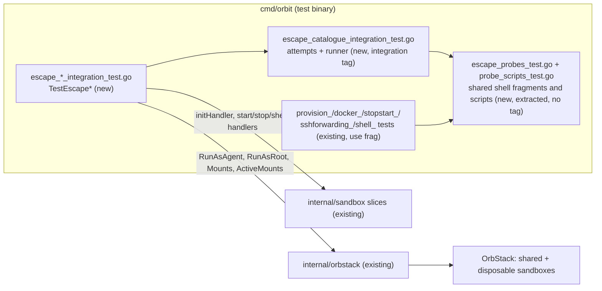

# Escape suite: every documented escape attempt fails in a real sandbox

Issue: #10 (E01-S06), epic #2. Depends on #5 (E01-S01, code on `main`) and #9 (E01-S05, closed by #107). Criteria moved in from #29 (symlink swap during `init`), #28 (credential locations), and #115 (the `orbit shell` refusal case and the raw `orb -u agent` observation). Triage: https://github.com/cultofthecode/orbit/issues/10#issuecomment-6820772175.
Extends: .ai/specs/2026-11-10-sandbox-provisioning.md
Extends: .ai/specs/2026-11-11-rootless-docker.md
Extends: .ai/specs/2026-11-11-ssh-agent-forwarding.md
Extends: .ai/specs/2026-11-11-orbit-shell.md
Extends: .ai/specs/2026-11-11-orbit-stop-start.md

## 📝 TLDR

The owner wants proof that an agent in a sandbox cannot reach the host. Today `SDLC.md` asks every `risk-high` boundary PR for "a passing run of the escape suite", but no escape suite exists: such a PR only states that it did not run. Pieces of the attempts are spread over six capability tests in `cmd/orbit`, and nobody can run them as one set or read one result per attempt. This spec proposes an escape suite: integration tests named `TestEscape*` in `cmd/orbit/escape_*_integration_test.go`. Each test runs a catalogue of escape attempts inside real OrbStack sandboxes, as the agent and from its rootless containers. Every attempt is its own subtest with a positive control. The suite logs the OrbStack version once. A meta-test proves that the suite fails when a boundary is weakened on purpose. The suite is test-only; it changes no product behavior. The owner decided all fourteen questions on 2026-11-12, each as the recommended default (below), and decided three more points on 2026-11-12 at 14:14, after the first runs (A1–A3, below). At 15:38 the same day the owner accepted E15 with a known limit on OrbStack 2.2.5 (A4, below). The Requirements and Acceptance criteria state these decisions.

## Resolved assumptions (owner decisions)

This spec was written unattended. The triage of #10 recommended answers to Q1–Q8, and the owner asked for them to be questions in this spec, each with that recommendation as the default. Q9–Q14 came up while writing this spec. The owner accepted every recommended default without a change on 2026-11-12 at 12:00 (#10, PR #131). **Q1–Q14 are decided.** The rest of the spec is written under these answers, and the Requirements and Acceptance criteria below state them as obligations of the implementation.

| # | Question | Decided answer | Why |
|---|---|---|---|
| Q1 | The issue cites R01 for the container attempts. The brief supersedes R01 with R10: rootless containers of the agent may use `--pid host` and `--network host`. Which rule does the suite cite, and what do the container attempts check? | ✅ **Decided (owner, 2026-11-12).** Cite **R10**, not R01. The container attempts check that the **firewall and the proxy** still hold for containers with host namespaces of the machine. They do not check that a container cannot get those namespaces. | R01 is `superseded by R10` in the brief. A test that expects `--pid host` to fail would fail on a correct sandbox (`docker_integration_test.go` expects it to succeed). |
| Q2 | Where does the suite live? | ✅ **Decided (owner, 2026-11-12).** `cmd/orbit/escape_*_integration_test.go`, package `main`, build tag `integration`. | Only `cmd/orbit` may import `internal/orbstack` (depguard, `ARCHITECTURE.md` rule 1). The helpers that the suite reuses (`initHandler`, `newSandboxDir`, `lockInit`, `accountHomeMachines`) are in that package. Another package would need a depguard exception. |
| Q3 | One sandbox or many? | ✅ **Decided (owner, 2026-11-12).** One **shared** provisioned sandbox for the read-only attempts. **Disposable** sandboxes for the restart and boot-order case, the `--no-ssh-forwarding` case, the weakened-boundary case, "reach another sandbox" (it needs two), and the symlink swap (it needs the exclusive init lock). For "reach another sandbox", the shared sandbox is the source and one disposable sandbox is the target, so the case creates one machine, not two. | The read-only attempts change nothing, so they can share one sandbox. Every case that changes the machine or needs special lock handling gets its own machine and cannot affect another case. |
| Q4 | The first acceptance criterion says `go test -tags integration ./...`. `AGENTS.md` requires `-p 1`. | ✅ **Decided (owner, 2026-11-12).** The criterion says `go test -tags integration -p 1 -timeout 60m ./...` (AC1). | Without `-p 1`, `TestActiveMountsShowASwappedPath` in `internal/orbstack` makes `init` refuse every directory while it runs. |
| Q5 | How do the credential cases from #28 run without touching the owner's credentials? | ✅ **Decided (owner, 2026-11-12).** They use a **fake `HOME`** with fixture directories and symlinks, as `temporaryHome` and `accountHomeMachines` in `hardlink_integration_test.go` do. The suite never reads the contents of, creates, changes, or links the owner's real `~/.ssh`, `~/.claude`, `~/.aws`, `~/.gnupg`, `~/.config/gh`, or `~/.claude.json`. The path rules of `init` still resolve the account home's protected paths through the current user, as they do on every run: they look at paths, not at contents. | D08 and `AGENTS.md` Never: Orbit never reads, copies, or forwards the user's credentials. Fixtures exercise the same path rules. |
| Q6 | How is the negative criterion ("a weakened boundary makes the suite fail") tested? | ✅ **Decided (owner, 2026-11-12).** A **meta-test** in a disposable sandbox. As root, it weakens the firewall so that only the agent uid is filtered, which is the leak of the spike. It runs the same container-attempt function that the suite runs and asserts that the function reports reach. A normal run passes; the meta-test fails only when the attempt cannot detect the leak. | Weakening the shared sandbox would make the normal run fail, which the criterion forbids. The meta-test proves that the detector works, and it is not a second red run. Narrowed by A3: M01 requires only the sub-uid detector. |
| Q7 | #115: what does the suite do with the raw `orb -u agent` result while a boundary unit is down, and where does the `orbit shell` refusal case live? | ✅ **Decided (owner, 2026-11-12).** The suite **asserts** the observed raw result: today `orb -m <name> -u agent id -un` prints `agent` although `/run/nologin` exists. If that changes, the failure message says that OrbStack now honours `/run/nologin` and that `internal/provision/AGENTS.md` and the provisioning spec must change. The `orbit shell` refusal case (failed boundary unit → `ErrNotProvisioned`, no agent session) **moves** from `shell_integration_test.go` into the suite. | The observation is a known limit that the documents state. If an assertion pins it, a change in OrbStack becomes visible. With one home for the refusal case, it does not run twice. |
| Q8 | How does the suite name the OrbStack version? | ✅ **Decided (owner, 2026-11-12).** It logs `orb version` once per test binary, in the header of the first `TestEscape*` test that runs. | The criterion asks for the version. One line is enough, and the header puts it at the top of the output pasted in a PR. |
| Q9 | As whom does an attempt run? Most existing probes run as root and switch to the agent with `runuser`. | ✅ **Decided (owner, 2026-11-12).** Each attempt runs in the **agent's own session**: `RunAsAgent` (`orb -u agent`), the path that `orbit shell` and Claude Code use. Root runs only setup, the positive controls, and the attempts for uids without a session (the default uid, a sub-uid, the proxy user), with `setpriv`. | The suite must show what the agent can do from where it actually runs. `runuser` from root gives a different environment, login path, and cgroup. |
| Q10 | What happens when a positive control fails, for example root cannot reach the Mac listener or no container of the host engine starts? Today `macPortReachableByRoot` and `hostContainerReachableByRoot` log and skip the probe. | ✅ **Decided (owner, 2026-11-12).** The suite **fails closed**: the attempt fails with `CONTROL FAILED: …`, and the run is not valid gate evidence. One exception: the control of "reach another sandbox" is informational. When root in the source cannot reach the target, the attempt passes and logs that OrbStack blocked the path below the Orbit firewall. | Gate evidence that silently skips an attempt is weaker than no evidence. No spike data exists for traffic between machines (spike table: "not tested"). Extended by A1: E04 is inconclusive in the same way when root cannot reach the network of the host engine. |
| Q11 | Which agent does the shared sandbox have? | ✅ **Decided (owner, 2026-11-12).** The shared sandbox runs `init --agent claude-code`, the owner's configuration, so the allowlist under test is the real one: the base list plus the eight Claude Code hosts. The disposable sandboxes run without `--agent`. | The attempts are tested against the policy that the owner actually runs. Only one Claude Code install per run is needed. |
| Q12 | What does a `risk-high` PR run and paste? | ✅ **Decided (owner, 2026-11-12).** `go test -tags integration -p 1 -timeout 60m -run '^TestEscape' -v ./cmd/orbit/`. `SDLC.md` (the risk-high row and the Validation section) and `AGENTS.md` name this command. The full integration run also includes the suite. Step 10 of the plan measures the run time of `cmd/orbit` with the whole suite in place. If a full run goes past 60 min, the documented `-timeout` is raised to the measured need in the same PR. | A boundary PR then needs only the suite, not every integration test. `-timeout` applies per test binary, and `cmd/orbit` gets one more slow test. |
| Q13 | `ARCHITECTURE.md` (D22): "an allow rule cannot open the host engine or the Mac". Does the suite test it, although the issue does not list it? | ✅ **Decided (owner, 2026-11-12).** Yes, in the weakened-boundary sandbox, before the firewall is weakened. Root adds `host.orb.internal` to the allowlist and reloads tinyproxy. The agent's `CONNECT host.orb.internal:443` through the proxy must not connect, because the firewall rule of the proxy user refuses private destinations. | This is the second layer that keeps the Mac out of reach. It is cheap to add in a sandbox that the suite weakens anyway. |
| Q14 | `ARCHITECTURE.md` (Provisioning requirements) says "Each one is a test in the escape suite". Does the suite cover every provisioning requirement, including the image, the machine name, and the footprint? | ✅ **Decided (owner, 2026-11-12).** No. The suite covers the escape attempts of #10 and the moved criteria. The requirements that are not escape attempts stay covered by their capability tests. The sentence becomes: "Each one is covered by the escape suite (escape attempts) or by the integration test of its capability." | An escape suite that also checks names and image versions is no longer a clear gate. Those checks already exist in `TestInitProvisionsTheSandbox` and the `internal/orbstack` tests. |

Note on Q13, after review (the decision is unchanged): the suite still adds `host.orb.internal` to the allowlist and still requires that the agent's `CONNECT host.orb.internal:443` does not connect. That refusal, however, comes from `--isolate-network` below the Orbit firewall, even for root (spike §2), not from the firewall rule of the proxy user. The D22 evidence of E12 is therefore the `CONNECT` to the Mac's bridge address, which has a root control and the proxy-log check; the `host.orb.internal` half is logged as informational (Weakened boundary, below).

### Decisions after the first runs (owner, 2026-11-12 14:14)

The first implementation run on OrbStack 2.2.5 stopped before a PR, because three attempts could not work as written (#10, "Stopped before opening a PR"). The owner, @jakubtobiasz, decided each of them on 2026-11-12 at 14:14 Europe/Warsaw, as option (a). They amend Q6 and Q10 and the catalogue rows of E04, E15, and M01.

| # | Finding of the first run | Decided answer | Evidence |
|---|---|---|---|
| A1 | E04: the control fails. Root in the machine cannot reach a container of the host engine at all: the network of the host engine (`192.168.215.0/24`) gives no answer, although the spike table says 200. | ✅ **Decided (owner, 2026-11-12 14:14).** When the control of E04 cannot reach the network of the target, E04 ends **inconclusive**, with a log line, as E11 does: not a failure and not a pass. The agent and container attempts of E04 still run, and a connection still fails E04 as an escape. A control failure of another kind still fails closed: no container of the host engine started (no engine on the Mac), or the network answered with a refusal (the listener is missing). | On 2026-11-12, root in a sandbox created by `orbit init` on OrbStack 2.2.5 dialled a `busybox` container of the host engine at `192.168.215.2`: `ip route get` names the route `via 192.168.139.1 dev eth0`, but TCP to the open port 8080 and to a closed port both time out (exit 124) and `ping` loses 100 % of the packets. Root passes the Orbit firewall (`meta skuid < 1000 meta skuid != 501 accept`), so `--isolate-network` blocks the path below it. |
| A2 | E15: the machine has an SSH agent of its own at `/run/user/1000/openssh_agent`. It answers `ssh-add -l` with "The agent has no identities.", so the criterion "no socket answers" fails, although that agent is not the host's. | ✅ **Decided (owner, 2026-11-12 14:14).** For the duration of the test, the test generates a one-time throwaway key in a fake `HOME`, starts an SSH agent of its own on the Mac on a temporary socket, loads the key into it, and points `SSH_AUTH_SOCK` of the test process at it. It never touches the user's agent or keys (Q5, D08). E15 asserts that this key is **not visible** inside the machine through any socket. The machine's own empty agent is fine. The criterion "no socket answers `ssh-add -l`" is removed. | The first run (#10). Checked by hand on 2026-11-12 in a throwaway sandbox *with* forwarding, created by an `init` whose `SSH_AUTH_SOCK` named the test agent: the forwarded socket listed no identities, not the throwaway key. OrbStack forwards the agent that OrbStack itself connects to, not the `SSH_AUTH_SOCK` of the process that calls `orb`. So on OrbStack 2.2.5 the throwaway key is not forwarded even with forwarding on: the key check shows that the test's agent does not reach the machine, and the other checks of E15 (no `host-ssh-agent.sock`, no `SSH_AUTH_SOCK`, the agent not in `orbstack`) show that no forwarding exists. |
| A3 | M01: with the firewall weakened to the agent uid, the sub-uid detector reports reach, but `docker run --network host --user 65534` does not. | ✅ **Decided (owner, 2026-11-12 14:14).** M01 requires **only the sub-uid detector** to catch the weakened firewall. The spec records why the container probe does not detect it, after the cause was confirmed with evidence (below). | Confirmed on 2026-11-12 in a sandbox created by `orbit init` (Ubuntu `docker.io` 29.1.3, `rootlesskit` 2.0.2 with `--net=slirp4netns`, `slirp4netns` 1.3.3); see "Why a `--network host` container does not detect the weakening" under Weakened boundary. The hypothesis holds: the traffic of a rootless container leaves the machine as the agent uid. |

### E15 accepted with a known limit (owner, 2026-11-12 15:38)

| # | Finding | Decided answer | Evidence |
|---|---|---|---|
| A4 | E15 on OrbStack 2.2.5: the throwaway-key check of A2 **cannot fail**. OrbStack forwards the SSH agent that OrbStack itself is connected to, not the `SSH_AUTH_SOCK` of the process that calls `orb`. So the test's throwaway key never reaches a machine, even one created *with* forwarding, and a real leak of the user's agent would not show up as that key. | ✅ **Decided (owner, @jakubtobiasz, 2026-11-12 15:38 Europe/Warsaw), option (a): accept E15 as implemented.** The key check stays as a check that the test's own agent does not reach the machine. It is **not** evidence that the user's agent is not forwarded. The evidence for that is the structural checks of E15: no `/opt/orbstack-guest/run/host-ssh-agent.sock`, no `SSH_AUTH_SOCK` for the agent, the agent not in the group `orbstack`, and `checkForwarding(false)` (OrbStack reports no forwarding). Each of these detectors is shown to fire in `TestInitForwardsTheSSHAgentByDefaultAndRefusesTheOtherSetting`, the forwarding-on test, but not by a control of E15 itself. This limit does not block #157. A stronger E15 check was tracked in #160 (item 3). **Resolved in #160 (option (a)):** E15 has no key check any more, because it cannot fail on OrbStack 2.2.5, and its output no longer suggests that it gives that evidence. E15 now has a control of its own: a second disposable sandbox, created **with** forwarding, in which the same three detectors (`host-ssh-agent.sock` exists, `SSH_AUTH_SOCK` is set for the agent, the agent is in `orbstack`) must all fire; if one does not, E15 is `CONTROL FAILED`. The control lists and uses no key of any agent (D08). The test agent on the Mac stays, with no key, so that `init` never carries the agent of the user. | [Owner decision on PR #157](https://github.com/cultofthecode/orbit/pull/157#issuecomment-6826603874); the hand check of A2; the second-person review of PR #157 (head d22952d), which reached the same conclusion. |

## 📝 Problem Statement

- **Owner request** (`[DOCUMENT]`, 2026-11-10): the agent must not escape to the host. The brief's riskiest assumptions A05 (a root-owned firewall and proxy hold against an unprivileged agent with rootless Docker) and A01 (the shared kernel, accepted untested) both name an escape suite as their test.
- **Gate without evidence:** `SDLC.md` requires "a passing run of the escape suite … with its output in the PR" for every sandbox-boundary change. "Until the escape suite exists, the PR states that it did not run." As long as the suite is missing, that exemption is the only option for every boundary PR.
- **Scattered coverage:** today most attempts are checked somewhere, but none of these locations is the suite:
  - `TestInitProvisionsTheSandbox` covers direct egress, DNS, IPv6, the Mac, the host-engine container, sudo, and tampering with the firewall and proxy (as root, with `runuser`).
  - `TestInitGivesTheAgentRootlessDocker` covers containers with host namespaces, the leak path of the spike, and boot failure.
  - `TestStopAndStartTheSandbox` covers the boot order.
  - `TestInitLeavesTheSSHAgentOutOnRequest` covers `--no-ssh-forwarding`.
  - `TestInitRefusesAHardLinkedCredentialFile` covers hard-linked credential files.
  - `TestActiveMountsShowASwappedPath` covers the adapter side of the swap.

  Each of them mixes attempts with capability checks, reports one pass or fail per script, and silently skips probes when a control fails. Nobody can answer "did every documented escape attempt fail on this OrbStack version?" from one run.
- **Untested gaps:** reaching another sandbox (spike: "not tested"), DNS from a rootless container, the symlink swap during `init` end to end (#29), the credential locations end to end (#28), and a check that the probes would detect a leak at all.

## 📝 Proposed Solution

A set of `TestEscape*` integration tests in `cmd/orbit`. They share one **attempt** type and one **catalogue**, and run each attempt as a named subtest.

```go
// attempt is one escape attempt of the suite.
type attempt struct {
	id      string   // stable id, e.g. "E04-mac-direct"
	rule    string   // brief ids it proves, e.g. "R03 R10 N07"
	as      identity // agent session, agent container, or root with setpriv
	control   string   // shell that must succeed (positive control), or ""
	controlAs identity // where the control runs: root, agent, container, or the Mac
	try     string   // shell that must fail; prints the evidence on success
}
```

The control has its own identity (`controlAs`): root, the agent, a container, or the Mac (the test process). A runner executes `control` as `controlAs`, then `try` as the attempt's identity. The cases that are Go flows rather than shell (E13's restart, E14, E16, E17) call the same pure verdict function directly with their own results. The subtest passes only when the control succeeded and the attempt failed. It fails with `ESCAPE: <id> succeeded: <evidence>` or with `CONTROL FAILED: <id>: <output>`. The test name is `TestEscape<Sandbox>/<id>`, so `go test -v` prints one PASS or FAIL line per attempt.

### Attempt catalogue

"Agent" means the agent's own session (Q9). "Container" means a rootless container of the agent, started from the agent's session. The image is built once per sandbox from `alpine` with `curl` and `bind-tools`.

| Id | Attempt (must fail) | As | Positive control | Rules | Reuses |
|---|---|---|---|---|---|
| E01 | Read a host path outside the project directory. A sentinel file with random content is written on the host next to the project directory. The attempt looks for it at its host path, under `/mnt/mac`, `/Users`, and `/Volumes`, and checks that `/proc/self/mountinfo` names no host share besides the project directory. Root runs the same probe. | agent, root | The same sentinel content in the project directory is readable | R08, D12 | `TestCreateMountsOnlyTheDirectoryAtItsOwnPath` (paths) |
| E02 | Reach the host engine socket. No `docker.sock` exists. No unix socket in the machine except the agent's rootless one answers `/_ping`. TCP to `host.docker.internal:2375/2376` and to `docker.orb.local` fails. A container cannot bind-mount a host engine socket. | agent, container | `docker version` on the Mac answers (an engine exists to escape to) | R10, D12, D15 | socket loop of `probeScript` |
| E03 | Reach the macOS host. The attempt dials a listener of the test on the Mac at the bridge address `192.168.139.3`, at `host.orb.internal`, at `host.docker.internal`, and at the Mac's first LAN IPv4. It dials directly and through the proxy (`CONNECT` gets 403). | agent, container (default, `--network host`) | root reaches the listener at the bridge address | R03, R10, N07 | `serveOnTheMac`, `macPortReachableByRoot` |
| E04 | Reach a container of the host engine on its address. | agent, container | root reaches it. When root gets no answer from the network of the container at all (timeout, no route), the control is informational and E04 is inconclusive (A1) | N07, D15 | `startHostContainer`, `hostContainerReachableByRoot` |
| E05 | Reach a destination with no allow rule, from the agent: direct by IPv4 and IPv6 address, by name, over UDP and ICMP; through the proxy to `example.org`, and to `github.com:22` (403). | agent | the agent reaches `https://github.com` through the proxy (200) | R03 | `probeScript` egress block |
| E06 | Reach a destination with no allow rule from a rootless container: default network, `--network host`, a custom network, `--user 65534`, `--cap-add NET_ADMIN`, a compose service, and the sub-uid process in the machine's network namespace (the leak path of A05). | container | the same container reaches `github.com` through the proxy | R03, R10, A05 | `containerTraffic`, `leakProbe` |
| E07 | Resolve or send DNS: the agent to `0.250.250.200:53` over UDP and TCP, to `1.1.1.1:53`, with `resolvectl` and `getent hosts`. A container resolves with its default resolver, with `--dns 1.1.1.1`, and with `--network host`. | agent, container | root resolves `github.com` through OrbStack DNS | R03 | DNS lines of `probeScript` |
| E08 | Become root: `sudo`, `sudo.ws`, the Rust `sudo`, `su` to root and to the default user, `pkexec`; a non-zero `CapEff`; membership in `sudo`, `admin`, `adm`, `docker`, `lxd`, `disk`, or `shadow`; a privileged container, also on the runtimes `runc` and `io.containerd.runc.v2` (each with an unprivileged control); where the profile carries the runc guard: a container with every capability and no seccomp and AppArmor profile (on the default runtime and on both stock runtimes, with controls), and a privileged exec. | agent, container | — | R10, D14, D17 | `shellProbes`, `probeScript` |
| E09 | Disable or change the boundary: stop or restart the four boundary units, kill tinyproxy (directly and from a `--pid host` container), change the nftables ruleset, write the root-only files directly and through a container mount of `/` or `/etc`. Afterwards the boundary is unchanged: the units are active, tinyproxy has the same pid, and a direct connection is still refused. | agent, container | — | D14, A05 | `probeScript` tail, `containerTraffic` |
| E10 | Direct egress for uids without a session: the default uid, a sub-uid (100000), and the proxy user to the Mac, to `169.254.169.254`, to the OrbStack gateway, and to ports other than 80 and 443. | root with `setpriv` | root reaches `1.1.1.1:443` directly | R03, D22 | `as_uid` lines of `probeScript` |
| E11 | Reach another sandbox. From the shared sandbox, the attempt dials a listener of root in the target sandbox on its address and on `<target>.orb.local`, directly and through the proxy, as the agent and from a container. | agent, container | root in the source reaches the listener (informational, Q10) | R03 | new |
| E12 | An allow rule opens the Mac (Q13). Root writes the Mac's bridge address and `host.orb.internal` into the allowlist and reloads tinyproxy. The agent's `CONNECT` through the proxy to a test listener on the Mac on port 443 must not connect, at either name, and the listener must see no connection. **Only the bridge-address `CONNECT` is D22 evidence.** The `host.orb.internal` `CONNECT` is informational, as E11's control is: `--isolate-network` already refuses `host.orb.internal` below the Orbit firewall, even for root (spike §2), so its refusal says nothing about the firewall rule of the proxy user. A connection at either name still fails E12 as an escape. | agent | root reaches the listener at the bridge address, and the proxy log shows that the filter let the bridge-address `CONNECT` through | D22 | new |
| E13 | Escape after a restart: E03, E05, E06, and E07 run again after `orbit stop` and `orbit start`. Every boundary unit entered active before the unit of any process with a uid from 1000 up started. A boundary unit that fails at boot keeps the agent's user manager down. | agent, container, root | the boundary units are active before the stop, and the controls of E03, E05, E06, and E07 pass again after the start | A05 | `afterStartProbes`, `bootFailure` |
| E14 | Open a session through `orbit shell` while a boundary unit has failed: `ErrNotProvisioned` naming the unit, and no agent session. | host | `orbit shell` opens after the restore | #74, #115 | `checkShellWithAFailedBoundaryUnit` (moved) |
| E15 | In a sandbox created with `--no-ssh-forwarding` (A2, A4): no `host-ssh-agent.sock`, no `SSH_AUTH_SOCK` for the agent, and the agent is not in `orbstack`. No key is listed or used. A socket that answers with other keys or with none, such as the machine's own agent at `/run/user/1000/openssh_agent`, is not an escape. | agent | in a second disposable sandbox created with forwarding, all three detectors fire (A4, #160) | R08, D25 | `unforwardedProbes` |
| E16 | Mount a path other than the validated one by swapping the project path for a symlink between validation and `orb create` (#29). | host | the active mounts that the adapter reads show the target of the symlink (`TestActiveMountsShowASwappedPath` proves that the reader sees a swap) | R08 | `TestActiveMountsShowASwappedPath` (adapter side) |
| E17 | Mount a host credential location (#28): `init` on `~/.ssh`, `~/.claude`, `~/.aws`, `~/.gnupg`, `~/.config/gh`, and the directory that holds the resolved target of `~/.claude.json`, each plain and through a symlink, plus a child and an ancestor (28 cases), and the symlink-hop layouts of #36 (4 cases: `~/.aws`, `~/.config`, and `~/.claude.json` through a hop in a project directory, and `HOME` itself through a hop), in a fake `HOME` (Q5). | host | — | R08, D08 | `temporaryHome`, `accountHomeMachines` |
| E23 | Stop the firewall unit as root (#168). On a running sandbox, root runs `systemctl stop nftables.service`, and in a second subtest `systemctl restart nftables.service`, as the owner does with `orb -u root` and as a package upgrade does. Afterwards the table `inet orbit_egress` is still loaded and the agent has no direct path out (IPv4, IPv6, name, UDP, ICMP). The `stop` subtest is the proof of the fix: with the distribution `ExecStop` it flushes the ruleset. The `restart` subtest is a regression check (the table survives a restart and is not duplicated); it cannot fail on the old provisioning, because the restart reloads `/etc/nftables.conf` before the checks run. | root, agent | before the action, the agent reaches `https://github.com` through the proxy and root lists the table; after the restore, the agent reaches `github.com` again | R03, D14, #168 | `checkRootStopsTheFirewallUnit` |
| O01 | **Pinned observation, not an attempt** (Q7): while a boundary unit has failed, the raw `orb -m <name> -u agent id -un` still prints `agent`, because OrbStack ignores `/run/nologin`. The subtest asserts this known limit and is reported apart from the attempts. When it fails, its message says that OrbStack now honours `/run/nologin` and that the documents must change. | host | — | #74, #115 | `checkShellWithAFailedBoundaryUnit` (log line) |
| M01 | Meta-test (Q6, A3): with the firewall weakened to the agent uid, E06's sub-uid attempt **succeeds**, and the shared detector reports it. A container with `--network host --user` is not a detector of this weakening (Weakened boundary). | container | the weakening is in place (`nft list ruleset`) | A05 | — |
| E18 | Privileged-container attempt; the steps are in the sandbox-distributions spec (Delta). Must fail. | container | the shared privileged control | R10 | — |
| E19 | Privileged-container attempt; the steps are in the sandbox-distributions spec (Delta). Must fail. | container | the shared privileged control | R10 | — |
| E20 | Privileged-container attempt; the steps are in the sandbox-distributions spec (Delta). Must fail. | container | the shared privileged control | R08, R10 | — |
| E21 | Privileged-container attempt; the steps are in the sandbox-distributions spec (Delta). Must fail. | container | the shared privileged control | R08 | — |
| E22 | Privileged-container attempt; the steps are in the sandbox-distributions spec (Delta). Must fail. | container | the shared privileged control | R03, R10 | — |
| M02 | Meta-test for E22 (privileged containers); the steps are in the sandbox-distributions spec (Delta). | container | the detector reports a weakening | A05 | — |

E01–E11 run in the shared sandbox; E11 also creates one disposable target. E09 runs **last** there, because it tries to stop the boundary: the order is E01–E08, E10, E11, E09. After E09 the test re-checks the boundary and stops when that check fails, so no result comes from a damaged sandbox. E12 and M01 run in one disposable "weakened" sandbox; E13, E14, E23, and O01 in one disposable "restart" sandbox (E23 runs between E13 and E14, restores the units, and stops the test when the restore fails); E15 in one disposable `--no-ssh-forwarding` sandbox; E16 in one disposable sandbox under the exclusive init lock. E17 creates no machine when it passes.

**Privileged containers (E18–E22, M02).** The owner decided on 2026-11-13 that `--privileged` is refused on every distribution, Debian included, so E18–E22 and M02 are `n/a` on both. The earlier decision follows for the record. The owner decided on 2026-11-12 (Q1 b of `.ai/specs/2026-11-12-sandbox-distributions.md`) that privileged containers are allowed only on Debian 13 trixie, and only where `docker run --privileged` starts a container, and that the escape suite proves that they stay inside their machine; on any other distribution, a privileged container that starts is a change that the owner decides. That spec adds E18 (the OrbStack VM and its kernel), E19 (other machines), E20 (integrations of the Mac), E21 (the host SSH agent without forwarding), E22 (the egress rules of the machine), and the meta-test M02, with their controls, their placement in the sandboxes above, and the change to E08, in its Delta (Capability: escape-suite). They run wherever its per-distribution privileged table says allowed, and are reported as `n/a` elsewhere. Its implementation step 10 copies the rows into this catalogue.

### Alternatives considered

- **Rename the existing capability tests into the suite.** Rejected. They check capabilities (pull, build, compose, worktrees) beside the attempts, and a capability failure would read as an escape. The suite instead takes the attempt fragments out of them into shared shell functions (Architecture). Both use these functions, so no probe text exists twice.
- **One sandbox for everything, with restores between destructive cases.** Rejected (Q3). A failed restore leaks into every later attempt, and the swap case needs the exclusive lock for its whole lifetime.
- **A separate Go package `test/escape`.** Rejected (Q2): depguard, and duplicated helpers.
- **Run the attempts with `runuser` from one root script, as today.** Rejected (Q9): it reports one result per script, and it does not run from the agent's real session.
- **Kernel exploit attempts.** Out of scope: A01 is accepted untested (D12), and the issue excludes it.

## 📝 Delta

### Capability: escape-suite

#### ADDED Requirement: The suite runs in real sandboxes and reports each attempt
The system SHALL provide integration tests named `TestEscape*` in `cmd/orbit/escape_*_integration_test.go` (package `main`, build tag `integration`) that run every attempt of the catalogue inside real OrbStack sandboxes, report one subtest per attempt, and log the OrbStack version once per test binary; the default validation gate SHALL NOT run them (Q2, Q4, Q8).

##### Scenario: One line per attempt, version first
- WHEN the owner runs `go test -tags integration -p 1 -timeout 60m -run '^TestEscape' -v ./cmd/orbit/`
- THEN the first `TestEscape*` test logs `OrbStack: <orb version output>; macOS <version>; orbit provision version <n>` once, each attempt prints its own PASS or FAIL line as `TestEscape<Sandbox>/<id>`, and each `TestEscape*` ends with the summary line (Reporting)

##### Scenario: Part of the full integration run
- WHEN the owner runs `go test -tags integration -p 1 -timeout 60m ./...`, or with the `-timeout` that step 10 measured
- THEN the suite runs as part of it (Q4, Q12)

##### Scenario: Not in the default gate
- WHEN the default gate runs `go test ./...` without the `integration` tag
- THEN no `TestEscape*` test runs; of the suite's files, only the pure verdict test `TestAttemptVerdict` (`escape_verdict_test.go`) and the golden test `TestProbeScriptsMatchGolden` of the shared scripts run, and neither starts a machine

#### ADDED Requirement: Every documented escape attempt fails, against a control that passes
The system SHALL run each attempt E01–E17 and E23 of the catalogue (E18–E22 are reserved for the privileged containers) and SHALL pass an attempt only when its positive control, if it has one, succeeded and the attempt failed. A failed control SHALL fail the attempt with `CONTROL FAILED: <id>: <output>`, except the informational control of E11 and the control of E04 when the network of its target gives no answer even to root (A1), and the run is then not valid gate evidence (Q10). Attempts run in the agent's own session (`orb -u agent`) or from its rootless containers; root runs only setup, the controls, and the attempts of uids without a session, with `setpriv` (Q9). The shared sandbox is created with `init --agent claude-code`, so the allowlist under test is the owner's (Q11).

##### Scenario: An escape succeeds
- WHEN the `try` of an attempt succeeds
- THEN its subtest fails with `ESCAPE: <id> succeeded: <evidence>`

##### Scenario: A control fails
- WHEN the control of an attempt other than E11 fails, and it is not the E04 control finding the network of the host engine unreachable, for example root cannot reach the Mac listener, `docker` on the Mac is missing, or the probe image cannot be built
- THEN the attempt fails with `CONTROL FAILED: <id>: <output>`, and it is never skipped or counted as passed

##### Scenario: Another sandbox is blocked below the firewall
- WHEN root in the shared sandbox cannot reach the listener in the E11 target
- THEN E11 passes, logs that OrbStack blocked the path below the Orbit firewall, and the summary counts it as inconclusive (Q10)

##### Scenario: The network of the host engine is blocked below the firewall
- WHEN root in the shared sandbox gets no answer from the container of the host engine, neither a connection nor a refusal, within five tries
- THEN the E04 attempts still run, E04 is neither failed nor passed, it logs that OrbStack blocked the path below the Orbit firewall, and the summary counts it as inconclusive (A1)
- AND when no container of the host engine started, or the network answered with a refusal, E04 fails with `CONTROL FAILED` (Q10)

##### Scenario: A probe tool is missing
- WHEN `curl`, `docker`, `nslookup`, or `bash` is missing where an attempt needs it
- THEN the attempt fails; a missing privilege tool (`pkexec`, a `sudo` variant) counts as refused

##### Scenario: Containers with host namespaces stay inside the boundary
- WHEN a rootless container of the agent runs with `--pid host` or `--network host`
- THEN the container is allowed to start (R10), and the attempts of E03, E06, E07, and E09 from it still fail: the firewall and the proxy hold (Q1)

#### ADDED Requirement: Cases that change a machine run in their own sandbox
The system SHALL run the read-only attempts E01–E11 in one shared sandbox, with E09 last and a re-check of the boundary after it, and SHALL run E12–E16, E23, O01, and M01 in disposable sandboxes that the creating test deletes in `t.Cleanup`; E11 creates exactly one disposable target, and E17 creates no machine when it passes (Q3).

##### Scenario: A destructive case cannot affect another
- WHEN E12, E13, E14, E15, E16, E23, O01, or M01 changes or weakens its machine
- THEN no other `TestEscape*` test runs in that machine, and the machine is deleted at the end of its test, also after the deadline (`provisionContext`)

##### Scenario: E09 leaves a damaged sandbox
- WHEN the boundary re-check after E09 fails
- THEN `TestEscapeShared` stops, and no later result comes from the damaged sandbox

#### ADDED Requirement: The owner's credentials are never touched
The system SHALL run the credential-location cases of E17 in a fake `HOME` with fixture directories and symlinks, and SHALL NOT read the contents of, create, change, or link the owner's real `~/.ssh`, `~/.claude`, `~/.aws`, `~/.gnupg`, `~/.config/gh`, or `~/.claude.json` (Q5, D08).

##### Scenario: Every credential form is refused
- WHEN `init` runs on one of the 34 forms of E17 in the fake `HOME`
- THEN it returns `ErrProtectedDir`, `ErrProtectedAncestor`, `ErrProtectedFile`, `ErrHomeDir`, or `ErrHomeAncestor`, `Exists` is false for the directory, and no mount names the path

#### ADDED Requirement: A weakened boundary is detected
The system SHALL include the meta-test M01, which weakens the firewall of a disposable sandbox at run time to filter only the agent uid and asserts that the sub-uid detector that E06 uses reports reach; M01 SHALL fail with `the suite cannot detect the A05 leak` when the detector reports "blocked" (Q6, A3).

##### Scenario: The leak is visible
- WHEN root inserts `meta skuid != <agent uid> accept` at the top of `inet orbit_egress output`
- THEN the sub-uid attempt of E06 reports reach, and M01 passes; the `--network host --user` container is not required to report reach, because its traffic leaves the machine as the agent uid (A3)

##### Scenario: An allow rule does not open the Mac
- WHEN, before the weakening, root writes the Mac's bridge address and `host.orb.internal` into the allowlist and reloads tinyproxy
- THEN the agent's `CONNECT` through the proxy to a listener on port 443 of the Mac does not connect at the bridge address, although root reaches that address and the proxy log shows that the filter let the `CONNECT` through, and the listener sees no connection; this bridge-address attempt is the D22 evidence (E12, Q13)
- AND the `CONNECT` to `host.orb.internal:443` does not connect either, and the suite logs it as informational, because `--isolate-network` refuses `host.orb.internal` below the Orbit firewall (spike §2)

#### ADDED Requirement: The refusal of `orbit shell` and the raw `orb -u agent` limit live in the suite
The system SHALL move the `orbit shell` refusal case (a failed boundary unit → `ErrNotProvisioned`, no agent session) from `shell_integration_test.go` into the suite as E14, and SHALL assert, as the pinned observation O01, that the raw `orb -m <name> -u agent id -un` prints `agent` while a boundary unit has failed (Q7).

##### Scenario: OrbStack starts to honour `/run/nologin`
- WHEN the raw `orb -u agent` no longer prints `agent` while `/run/nologin` exists
- THEN O01 fails, and its message says that OrbStack now honours `/run/nologin` and that `internal/provision/AGENTS.md` and the provisioning spec must change

##### Scenario: The case runs once
- WHEN the full integration run completes
- THEN the refusal case runs only in `TestEscapeRestart`, not in `TestShellIsTheAgentInTheProjectDirectory`

#### ADDED Requirement: The gate names the suite, and the suite covers only escape attempts
The system SHALL document `go test -tags integration -p 1 -timeout 60m -run '^TestEscape' -v ./cmd/orbit/` as the evidence of a `risk-high` boundary PR in `SDLC.md` (the risk-high row and the Validation section, including its sentence on what a `risk-high` boundary change must run) and `AGENTS.md`, with the `-timeout` raised to the need measured in step 10 when a full run of `cmd/orbit` exceeds 60 min (Q12). `ARCHITECTURE.md` (Provisioning requirements) SHALL say "Each one is covered by the escape suite (escape attempts) or by the integration test of its capability." (Q14)

##### Scenario: The exemption ends
- WHEN the implementation PR merges
- THEN the risk-high row of `SDLC.md` no longer contains "Until the escape suite exists, the PR states that it did not run."

Frozen by: none — all requirements are new, and no product behavior changes. The extraction of the shell fragments changes no existing test; the golden test of Phase 0 freezes the rendered scripts byte for byte (Implementation Plan, step 1).

## ✅ Acceptance criteria

The criteria of #10, the criteria moved in from #28, #29, and #115, and the owner decisions of 2026-11-12, with where the implementation PR proves each one.

| # | Criterion | Source | Proven by |
|---|---|---|---|
| AC1 | Given a provisioned sandbox, when the owner runs `go test -tags integration -p 1 -timeout 60m ./...` (or the `-timeout` measured in step 10), then the suite runs inside real sandboxes, reports each attempt as its own subtest, and logs the OrbStack version once. | #10 criterion 1, Q2, Q4, Q8, Q12 | Steps 3 and 11; the output pasted in the implementation PR |
| AC2 | Given the suite runs, then each of these attempts fails and its subtest passes, with a positive control that passed: read a host path outside the project directory (E01); reach the host engine socket (E02); reach the macOS host (E03) and a container of the host engine (E04); reach a destination with no allow rule from the agent (E05), from a rootless container (E06), and over DNS (E07); become root (E08); disable the boundary (E09); egress of uids without a session (E10); reach another sandbox (E11). The container attempts cite R10 and check the firewall and the proxy, not the namespaces (Q1). | #10 criterion 2, R03, R08, R10, Q1 | `TestEscapeShared` (steps 3 and 4) |
| AC3 | Each attempt runs in the agent's own session (`orb -u agent`) or from its rootless container; root runs only setup, the controls, and E10 with `setpriv`. The shared sandbox has `--agent claude-code`. | Q9, Q11 | Runner review; `TestEscapeShared` setup |
| AC4 | A failed positive control fails its attempt with `CONTROL FAILED`, never a skip or a pass. Two controls are inconclusive when they fail: E11's informational control, and E04's control when root gets no answer from the network of the host engine (A1). Then the attempt still runs, passes neither way, logs the block below the Orbit firewall, and is counted inconclusive; an escape still fails it. | Q10, A1 | `TestAttemptVerdict`, the pure verdict table test in the default gate (step 2) |
| AC5 | Given the suite runs, then it covers the boot order and a restart: after `orbit stop` and `orbit start`, E03, E05, E06, and E07 fail again with their controls passing; every boundary unit was active before any unit of a uid from 1000 up started; a boundary unit that fails at boot keeps the agent's user manager down (E13). | #10 criterion 3, A05 | `TestEscapeRestart` (step 5) |
| AC6 | Given a sandbox created with `--no-ssh-forwarding`, then no `host-ssh-agent.sock` exists, `SSH_AUTH_SOCK` is not set for the agent, and the agent is not in `orbstack`, with the control that a second sandbox created with forwarding fires all three detectors (E15, A4, #160). No key of any agent is listed or used; `SSH_AUTH_SOCK` of the test process names a test-owned agent with no key, so `init` never carries the agent of the user (the forwarding control sandbox still receives the agent that OrbStack 2.2.5 forwards on its own, which is the Mac's, per A4; the test never queries it and deletes the sandbox at the end). | #10 criterion 4, R08, D25, A2, A4 | `TestEscapeNoSSHForwarding` (step 6) |
| AC7 | Given the default validation gate, then the suite is not part of it: `go test ./...` without the tag runs no `TestEscape*` test; of the suite's files, it runs only `TestAttemptVerdict` and `TestProbeScriptsMatchGolden`, which start no machine. | #10 criterion 5 | Default gate run in the implementation PR |
| AC8 | Negative: given a disposable sandbox whose firewall filters only the agent uid, then the sub-uid detector of E06 reports reach, and M01 passes; M01 fails when the detector reports "blocked" (A3). The shared sandbox is never weakened. | #10 criterion 6, A05, Q6 | `TestEscapeWeakenedBoundary` (step 7), with a one-time manual check that skipping the weakening fails M01 |
| AC9 | An allow rule for the Mac's bridge address and `host.orb.internal` does not open the Mac: the agent's `CONNECT` to port 443 of the Mac through the proxy does not connect (E12). The evidence for D22 is the bridge-address `CONNECT`, with root reaching that address and the proxy log showing that the filter let it through; the `host.orb.internal` `CONNECT` is logged as informational, because OrbStack refuses that name below the Orbit firewall. | Q13, D22 | `TestEscapeWeakenedBoundary` (step 7) |
| AC10 | Swapping the project path for a symlink between validation and `orb create` makes `init` return `ErrMountMismatch` and leaves no machine that names the validated path or `secret` (E16). | #29, R08, Q3 | `TestEscapeSymlinkSwap` (step 8) |
| AC11 | `init` refuses all 34 credential-location forms in a fake `HOME` with a protected-path error and leaves no machine; the owner's real credential locations are never read, created, changed, or linked (E17). | #28, R08, D08, Q5 | `TestEscapeCredentialLocations` (step 9) |
| AC12 | While a boundary unit has failed, `orbit shell` returns `ErrNotProvisioned` naming the unit and opens no session (E14), and the raw `orb -u agent id -un` prints `agent` (O01, a pinned observation with the Q7 failure message). The refusal case is gone from `shell_integration_test.go`. | #115, #74, Q7 | `TestEscapeRestart` (step 5) |
| AC13 | Each `TestEscape*` test that changes a machine creates one disposable sandbox of its own: `TestEscapeWeakenedBoundary` (E12, M01), `TestEscapeRestart` (E13, E14, O01), `TestEscapeNoSSHForwarding` (E15), and `TestEscapeSymlinkSwap` (E16); no two of these tests share a machine. E11 creates one target; every machine is deleted by the test that created it. | Q3, `SDLC.md` | Steps 4–9; no machine that the run created is left after it (`t.Cleanup`) |
| AC14 | `SDLC.md` and `AGENTS.md` name `go test -tags integration -p 1 -timeout 60m -run '^TestEscape' -v ./cmd/orbit/` (with the measured `-timeout` when step 10 raises it), and `SDLC.md` drops the exemption text. The last sentence of the `SDLC.md` Validation section asks a boundary PR for the suite, not for every integration test, so it agrees with the risk-high row. `ARCHITECTURE.md` uses the Q14 sentence. | Q12, Q14 | Documentation diff (step 11); measurement in the PR (step 10) |

## 📝 Architecture

No production code changes. The suite is test code in `cmd/orbit` plus documentation.



The suite reaches OrbStack only through the existing adapter and slices. The only new code is in test files. If a probe needs an adapter call that is missing, for example the address of the target sandbox, Phase 1 adds it to `internal/orbstack` with its own adapter test. The first choice is to read the address inside the target machine as root (`ip -4 -o addr show eth0`), which needs no new call.

### Files

| File | Content |
|---|---|
| `escape_catalogue_integration_test.go` | `attempt`, `identity`, the runner (`runAttempt`), the version header (`logOrbStackVersionOnce`, a `sync.Once` around `orb version`), the result lines. |
| `escape_verdict_test.go` (no build tag) | The pure verdict function and its table test `TestAttemptVerdict`, in the default gate. |
| `escape_probes_test.go` (no build tag) | Shell fragments extracted from `probeScript`, `agentHelpers`, `leakProbe`, `containerTraffic`, `afterStartProbes`, and `unforwardedProbes`: `direct`, `no_direct`, `proxied`, `refused_by_proxy`, `leak_probe`, `dns_probe`, `engine_sockets`. The existing tests switch to these fragments in the same PR as the extraction, with no behavior change. Untagged, because the untagged constants of `probe_scripts_test.go` are built from them. |
| `probe_scripts_test.go` (no build tag) | The six rendered constants, moved unchanged from the capability tests in Phase 0, and the golden test `TestProbeScriptsMatchGolden` with its files under `testdata/escape-golden/`. |
| `escape_shared_integration_test.go` | `TestEscapeShared`: E01–E11 on the shared sandbox (E11 creates its disposable target). |
| `escape_restart_integration_test.go` | `TestEscapeRestart`: E13, E23, E14, and O01 (E14 and O01 are moved from `shell_integration_test.go`). |
| `escape_ssh_integration_test.go` | `TestEscapeNoSSHForwarding`: E15. |
| `escape_weakened_integration_test.go` | `TestEscapeWeakenedBoundary`: E12, then M01. |
| `escape_mounts_integration_test.go` | `TestEscapeSymlinkSwap` (E16) and `TestEscapeCredentialLocations` (E17). |

### Identities

- **Agent:** `client.RunAsAgent(ctx, name, script)`, the `orb -u agent` path. Its `HOME`, groups, and environment are those of a real session. The script exits non-zero when any line of `try` succeeded and prints the evidence.
- **Container:** an agent script that runs `docker run --rm <flags> orbit-escape-probe <command>`. The image is built once per sandbox in the setup step, through the proxy.
- **Root with `setpriv`:** `client.RunAsRoot` with `setpriv --reuid N --regid N --clear-groups`, only for E10 and the controls.
- **Host:** the test process itself (E14, E16, E17), through the slice handlers.

### Locks and lifetimes

- Every `TestEscape*` that runs `init` holds the shared init lock (`waitToRunInit` / `lockInit(t, LOCK_SH)`).
- `TestEscapeSymlinkSwap` takes the exclusive lock (`lockInit(t, LOCK_EX)`) before it creates anything and holds it until its machine is gone. While the swapped machine exists, `init` refuses every directory. It never holds the shared lock at the same time: two `flock` descriptors in one process deadlock.
- Every machine is created by the test that deletes it (`t.Cleanup`), as `SDLC.md` requires. The context comes from `provisionContext(t)`, so cleanup survives the deadline.

### Symlink swap (E16)

The handler of `init` validates the project directory on an open handle and then calls `Machines.Create`. The test wraps the adapter as `accountHomeMachines` does: its `Create` replaces the validated directory with a relative symlink to a sibling `secret` directory, then delegates to the real client. The expected outcome is that `init` returns an error wrapping `sandbox.ErrMountMismatch` from the active-mount check, and the new machine has been deleted. Afterwards no machine in `client.Mounts` names `secret` or the validated path. The swap happens inside `Create`, after validation, so the refusal that checks before `Create` cannot see it (`ErrLinkedProjectDir` covers the stored paths of an existing sandbox). The test therefore requires `ErrMountMismatch`. Any other outcome fails it, including a refusal before `Create`, because that would mean the swap was not exercised.

### Credential locations (E17)

The fake `HOME` from `temporaryHome` gets the six fixture locations. `~/.claude.json` is a symlink to `$HOME/dotfiles/claude.json`, so the protected directory is `dotfiles`. A table test runs `init` for each of the five protected directories in five forms: the location, a child, an ancestor (`HOME` itself when the location lies directly in `HOME`), a symlink to the location, and a symlink to a child. For `dotfiles` it runs three forms: the directory, an ancestor, and a symlink to it. That makes 28 cases. A child of `dotfiles` is accepted by design: `ValidateProjectDir` protects the directory that holds a protected file and its ancestors, and a directory inside it does not contain the file. So the child forms are not escape attempts for `~/.claude.json`, and the suite leaves them out. A second fake `HOME` from `hopFixtures` adds the four symlink-hop layouts of #36: `.aws -> work/aws/link -> vault/aws`, `.config -> work/config/cfg -> dotfiles/config`, and `.claude.json -> work/claude/c.json -> store/state/claude.json`, each with `init` on the project directory that holds the hop, and `HOME` set to `proj/h -> <second home>` with `init` on `proj`. It also adds two links whose relative target has a `..` that cancels a plain name in a project directory: `.gnupg -> work/gnupg/x/../../../vault/gnupg` with `init` on `work/gnupg`, and `.ssh/config -> ../work/ssh/x/../../../dotfiles/ssh/config` with `init` on `work/ssh`. The agent could repoint such a hop, or replace the cancelled name with a symlink, and reach a directory that it controls; the refusal is `ErrProtectedFile`. That makes 34 cases. Each run must return one of `ErrProtectedDir`, `ErrProtectedAncestor`, `ErrProtectedFile`, `ErrHomeDir`, or `ErrHomeAncestor`, and must leave no machine for the directory (`Exists` is false, and no mount names the path). The adapter runs with the account `HOME` (`accountHomeMachines`), because `orb` needs it (#70).

### Weakened boundary (E12, M01)

The setup provisions a disposable sandbox and runs E12 first, while the firewall is intact. E12 needs a listener on port 443 of the Mac (macOS lets an unprivileged process bind it). The firewall rule of the proxy user refuses only ports other than 80 and 443 and private destinations, so on any other port the attempt would pass for the wrong reason. For the same reason only the bridge-address `CONNECT` proves D22: `--isolate-network` refuses `host.orb.internal` even for root (spike §2, `host.orb.internal` row), so that `CONNECT` fails whatever the proxy user's rule does, and the suite logs it as informational. Root writes the allowlist file directly, which bypasses `policy.ValidateHost` on purpose: the attempt asks what happens when an allow rule names the Mac. Then root inserts `meta skuid != <agent uid> accept` at the top of `inet orbit_egress output`, at run time and never persisted. M01 calls the same `leak_probe` fragment that E06 uses and asserts that it reports reach (A3). If they report "blocked", M01 fails with `the suite cannot detect the A05 leak`. The sandbox is deleted at the end.

#### Why a `--network host` container does not detect the weakening (A3)

The weakening accepts every uid except the agent's. A detector catches it only when its traffic leaves the machine as another uid. Checked on 2026-11-12 in a sandbox created by `orbit init`, on the stack that Orbit provisions (Ubuntu `docker.io` 29.1.3, `rootlesskit` 2.0.2 started by `dockerd-rootless.sh` with `--net=slirp4netns --disable-host-loopback`, `slirp4netns` 1.3.3, `/etc/subuid` `agent:100000:65536`):

- The machine's network namespace (PID 1) is `net:[4026532401]`. The agent's `dockerd` runs in `net:[4026532504]`, the namespace of RootlessKit. A container with `--network host --user 65534` reads `net:[4026532504]` as its own: "host" is the namespace of RootlessKit, not of the machine.
- `slirp4netns` runs as uid 1000 (the agent) in `net:[4026532401]`. While that container dialled `1.1.1.1:80`, `ss -tnpe` as root in the machine showed the only socket as `SYN-SENT … users:(("slirp4netns",pid=3315)) uid:1000`, in the cgroup of the agent's `docker.service`.
- With `meta skuid != 1000 accept` inserted, the same container still timed out to `https://1.1.1.1`; the sub-uid process of `leak_probe` (`rootlesskit --net=host` and `setpriv`, in the machine's namespace) got HTTP 301 from `https://1.1.1.1`, and its socket showed `uid:100999`.

So the traffic of a rootless container leaves the machine as the agent uid, and only a process that runs as a sub-uid in the machine's own namespace detects a rule that filters the agent uid alone. This differs from the spike, where Docker CE with RootlessKit 3.3 ran `dockerd` in the machine's namespace (detach-netns), so a `--network host --user 65534` container sent its traffic itself as kuid 165533 and leaked (spike, finding 3). `.ai/specs/2026-11-11-rootless-docker.md` already records that the Ubuntu stack runs `dockerd` in a namespace of its own. E06 keeps the `--network host` and `--user 65534` containers as attempts, because they must still fail; they are not detectors for M01.

### Reporting

- The header is `OrbStack: <orb version output>; macOS <sw_vers -productVersion>; orbit provision version <provision.Version>`, logged once.
- One subtest per attempt, with the `id` and the rules in its name and log.
- At the end of each `TestEscape*`, a summary line `escape attempts: N passed, M failed, K controls failed, I inconclusive; observations: O held`. E11 counts as **inconclusive**, not passed, when its informational control failed, and so does E04 when root gets no answer from the network of the host engine (A1): OrbStack blocked the path, and the Orbit firewall was not exercised.

## 📝 Edge Cases & Failure Scenarios

| Case | Behavior |
|---|---|
| OrbStack is not running, or `orb` is missing | The header fails the test with the `orb version` error. No attempt runs. |
| `docker` on the Mac is missing (E02, E04 controls) | `CONTROL FAILED` (Q10). The run is not valid gate evidence. The message names the missing engine. |
| `ssh-agent` is missing on the Mac, or the second sandbox with forwarding does not fire a detector of E15 (E15 control) | `CONTROL FAILED`. The suite never falls back to the user's agent (A2). |
| Root gets no answer from the network of the host engine (E04 control) | E04 is inconclusive and logs the block below the Orbit firewall; its attempts still run (A1). A refusal, or no started container, is `CONTROL FAILED`. |
| A disposable `init` fails | That test fails at setup with `otherMachines` in the message. The other `TestEscape*` tests still run. |
| Another run on the host holds the exclusive lock | The test logs that it waits, as today. |
| The test binary deadline arrives mid-suite | `provisionContext` leaves `cleanupGrace`, so the machines are still deleted. |
| OrbStack starts to honour `/run/nologin` | O01 fails and asks for the documents to be updated (Q7). |
| OrbStack already isolates machines from each other | The E11 control fails, and E11 passes and logs that the path is blocked below the Orbit firewall (Q10). |
| A probe image cannot be built (registry outage) | The container attempts fail with `CONTROL FAILED: image`, not with a false pass. |
| The extraction of fragments changes an existing test | Phase 0 runs the touched capability tests before and after the extraction, and their results must match; the golden test fails on any change of a rendered script. |

## 📝 Risks & Impact Review

- **False confidence.** An attempt that cannot fail proves nothing. Every attempt has a positive control, or M01 mutates it, except E11, whose control is informational and which is counted as inconclusive when that control fails; E04 is counted the same way when its target network is unreachable even for root (A1). E15 has no key check, because on OrbStack 2.2.5 it cannot fail (A4); its control is a second sandbox with forwarding, in which its three detectors must fire (#160). Attempts without a control (E08, E09, E17) assert a specific refusal: an error value or the exit status of a privileged action. A missing **probe** tool (`curl`, `docker`, `nslookup`, `bash`) does not count as a refusal: each `try` first checks that its probe tools exist (`command -v`), and a missing one fails the attempt. A missing **privilege** tool (`pkexec`, a `sudo` variant) counts as refused, because no path exists through it.
- **Weakening on a real machine.** M01 and E12 weaken the boundary of a machine that only the test created, at run time. The machine is deleted in `t.Cleanup`. Nothing is persisted, and no other sandbox is touched.
- **Run time.** The suite adds about six machine creations to `cmd/orbit`. Step 10 (Phase 2) measures it, after every `TestEscape*` exists, and Phase 3 documents the result (Q12).
- **Gate wording.** Q12 and Q14 change the text of `SDLC.md` and `ARCHITECTURE.md`. These are process documents. The owner confirmed them through this spec on 2026-11-12.
- **Product contracts:** none change. No new flag, file, dependency, allowlist entry, or mount.

## 📝 Decisions in play

Relied on: R03, R08, R09, R10 (instead of the superseded R01, Q1), D08, D12, D14, D15, D17, D22, D25, N07, A01 (stays untested), A05 (this suite is its repeat). No row is superseded. A05's "Test" column ("Repeat as the escape suite, and test the boot order and a restart") is satisfied by E06, E09, E13, and M01. The brief's status of A05 changes only by the owner, after the first passing run.

## 📝 Documentation changes (in the implementation PR)

- `SDLC.md`: the risk-high row names the Q12 command and drops "Until the escape suite exists …". The Validation section names the command, and its last sentence, "A `risk-high` change to the sandbox boundary must run them (see the risk table).", which today asks for every integration test, becomes: "A `risk-high` change to the sandbox boundary must run the escape suite (`go test -tags integration -p 1 -timeout 60m -run '^TestEscape' -v ./cmd/orbit/`, see the risk table); the full integration run is not required for it." (Q12). Both `SDLC.md` statements then name the same command.
- `AGENTS.md`: Validation commands name the escape suite command. The "Sandbox boundary" routing row says "Run the escape suite (`-run '^TestEscape'`)".
- `ARCHITECTURE.md`, Testing strategy: the escape suite bullet lists the attempt ids, cites R10, and points at this spec. The Provisioning requirements sentence changes as Q14 says.
- `internal/provision/AGENTS.md` and `.ai/specs/2026-11-10-sandbox-provisioning.md`: the known limit of `orb -u agent` points to O01.
- `shell_integration_test.go`: the doc comment no longer says "The escape suite (#10) is not part of this test". The refusal case itself is removed earlier, in step 5 (Phase 2), together with its move to E14.
- Item 1 of #115 (which `init` agent-user sessions are gated) is **not** in scope. It stays on #115.

## 📋 Phasing

- **Phase 0 (precursor PR):** extract the shell fragments from the six capability tests, with no behavior change. It is a refactor of tests, reviewed alone.
- **Phase 1:** the catalogue, runner, verdict, and the shared sandbox (E01–E11, header). It does not change the gate yet: `SDLC.md` keeps its exemption text until Phase 3.
- **Phase 2:** the disposable cases (E12–E16, O01, M01), including the move of the `orbit shell` refusal case from `shell_integration_test.go` into E14 (step 5), the credential table (E17), and the run-time measurement of `cmd/orbit` with the whole suite (step 10).
- **Phase 3:** the documentation, with the `-timeout` that step 10 measured (step 11).

Every phase leaves `go test ./...` green and `go vet` clean with and without `-tags integration`.

## 📋 Implementation Plan

### Phase 0 — extract the fragments (precursor PR)

1. First, move the six rendered constants `probeScript`, `agentHelpers`, `leakProbe`, `containerTraffic`, `afterStartProbes`, and `unforwardedProbes`, with the constants they are built from (`agentProbes`), unchanged into `probe_scripts_test.go`, a test file **without** the build tag, and commit a golden test `TestProbeScriptsMatchGolden` in the same untagged file. It renders each of the six with fixed arguments and compares the result with files under `cmd/orbit/testdata/escape-golden/`. Then extract the fragments into `escape_probes_test.go`, also **without** the build tag, and switch the six constants to them. Every file that the constants or the golden test reference is untagged, so the default build compiles them; the tagged capability tests keep using the constants from the untagged files, which a tagged file may do. Verify: `go vet ./...` and `go test ./cmd/orbit/` pass without the tag, and `go vet -tags integration ./...` passes; the golden test is unchanged, so the rendered scripts are byte-identical; and the touched capability tests still pass against a real OrbStack (`go test -tags integration -p 1 -timeout 60m -run '^(TestInitProvisionsTheSandbox|TestInitGivesTheAgentRootlessDocker|TestStopAndStartTheSandbox|TestInitForwardsTheSSHAgent|TestInitLeavesTheSSHAgentOutOnRequest)$' -v ./cmd/orbit/`).

### Phase 1 — catalogue and the shared sandbox

2. Add `attempt`, `identity`, `runAttempt`, and `logOrbStackVersionOnce`. The verdict (control result, attempt result, evidence → pass, `ESCAPE:`, or `CONTROL FAILED:`) is a pure function in `escape_verdict_test.go`, a test file **without** the build tag: the tagged suite files use it, and its table test runs in the default gate. The table test is named `TestAttemptVerdict`, not `TestEscape…`, so `-run '^TestEscape'` does not select it and no `TestEscape*` test runs in the default gate. No production file is added. Verify: `go test ./cmd/orbit/` covers a succeeding attempt, a failed control, an informational control (E11), and a missing probe tool.
3. Add `TestEscapeShared` with E01–E08 and E10. Verify: `go test -tags integration -p 1 -timeout 60m -run '^TestEscapeShared$' -v ./cmd/orbit/` passes, with one line per attempt.
4. Add E11 with its disposable target, then E09 as the last attempt, with its re-check of the boundary. Verify: `go test -tags integration -p 1 -timeout 60m -run '^TestEscapeShared$' -v ./cmd/orbit/` passes. Record whether the control of OrbStack reaches the target.

### Phase 2 — disposable cases

5. `TestEscapeRestart`: E13, then E14 moved from `shell_integration_test.go`, and O01 with the Q7 assertion. The refusal case is removed from `shell_integration_test.go` in this step, so it never runs twice. Verify: `go test -tags integration -p 1 -timeout 60m -run '^(TestEscapeRestart|TestShellIsTheAgentInTheProjectDirectory)$' -v ./cmd/orbit/` passes, and the shell test no longer contains the moved check.
6. `TestEscapeNoSSHForwarding`: E15. Verify: `go test -tags integration -p 1 -timeout 60m -run '^TestEscapeNoSSHForwarding$' -v ./cmd/orbit/` passes, with one line for E15 and its control.
7. `TestEscapeWeakenedBoundary`: E12, then M01. Verify: `go test -tags integration -p 1 -timeout 60m -run '^TestEscapeWeakenedBoundary$' -v ./cmd/orbit/` passes, and M01 passes; temporarily skipping the weakening makes M01 fail (checked once by hand, noted in the PR, not committed).
8. `TestEscapeSymlinkSwap`: E16 under the exclusive lock. Verify: `go test -tags integration -p 1 -timeout 60m -run '^TestEscapeSymlinkSwap$' -v ./cmd/orbit/` passes: `init` returns `ErrMountMismatch`, and no machine is left.
9. `TestEscapeCredentialLocations`: E17 table. Verify: `go test -tags integration -p 1 -timeout 60m -run '^TestEscapeCredentialLocations$' -v ./cmd/orbit/` passes: 34 subtests pass, and `Exists` is false for each. `HOME` is the fake home of the form at the moment each handler call starts; `accountHomeMachines` switches to the account home only for the adapter calls. No fixture path lies under the account home.
10. Measure the run time of `go test -tags integration -p 1 -timeout 180m -v ./cmd/orbit/` with the whole suite in place, and write it into the PR. The `-timeout 180m` is only for the measurement: it must not cut a run that goes past 60 min, and Go's default of 10 min would panic before the first sandbox is provisioned. When it is over 60 min, set the documented `-timeout` to the measured time plus a margin of at least 50 % (Q12).

### Phase 3 — docs

11. Apply the documentation changes listed above. Verify: `go test -tags integration -p 1 -timeout 60m -run '^TestEscape' -v ./cmd/orbit/` passes. Its output, with the OrbStack version header, goes into the PR body as the first escape-suite evidence. Then the full `go test -tags integration -p 1 -timeout <the value from step 10> ./...` passes.
