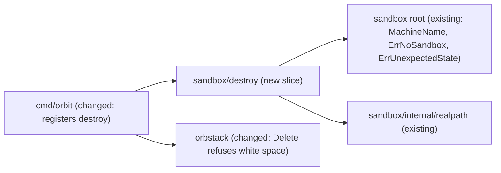

# `orbit destroy`: remove the project sandbox

Issue: #12 (E02-S02), epic #3. Depends on #5 (E01-S01, `init` merged). Related: #13 (`orbit ls`, its own spec, PR #118, merged; not implemented yet), #11 (`stop`/`start`, merged), #75 / PR #117 (Orbit never starts a machine through `orb -m`), #62 (Orbit never starts OrbStack), #82 / PR #112 (`ActiveMounts` fails closed on an empty mount table), #78 / PR #79 (herdr; its Q7: `destroy` does not call `hc`).
Extends: .ai/specs/2026-11-11-orbit-stop-start.md (it declared `ErrNoSandbox` and `ErrUnexpectedState` in the root package "so that `stop`, `start`, and later `destroy` report them alike")
Extends: .ai/specs/2026-11-10-sandbox-provisioning.md

## 📝 TLDR

A sandbox holds about 2.3 GB of disk `[DATA]` (spike of 2026-11-10), and today the only way to remove one is `orb delete <machine>` by hand. This spec adds `orbit destroy`, a slice that deletes the sandbox of the current project directory and nothing else. It works on a running or a stopped sandbox, always asks for a confirmation unless `--yes` is passed and refuses without a terminal (owner decision, Q1), and never starts, provisions, or enters the machine. Deleting the machine deletes the agent state, because that state lives on the machine disk; Orbit runs no logout and cleans up nothing on the host (owner decision, Q2). The project files on the host stay. The adapter's existing `Delete` gets the same hostile-input rules that `Start` and `Stop` have, because `orb delete` takes several names and has `--all`.

## Resolved assumptions (owner decisions)

This spec was written unattended. The owner decided Q1–Q3 on 2026-11-12 at 09:59 (#12, PR #119), each with the option the draft recommended: Q1 (d), Q2 (a), Q3 (a). **Q1–Q3 are decided.** Q4–Q7 follow from earlier owner decisions and repository rules; the owner can still override them in review. The rest of the spec is written under these answers. Facts marked `[DATA]` come from a probe on OrbStack 2.2.5 on 2026-11-12 (see Evidence).

| # | Question | Decided answer | Why |
|---|---|---|---|
| Q1 | Does destroying a **running** sandbox need a flag or a confirmation? | ✅ **Decided (owner, 2026-11-12): (d).** Ask in **every** state, running or stopped: a `[y/N]` prompt that names the machine, the project directory, and what is lost (the login, history, and images of the agent; the project files stay; for a running sandbox, that open shells end). Only `y` or `yes`, case-insensitive, deletes. `--yes` (`-y`) skips the prompt. Without a terminal on standard input and without `--yes`, Orbit refuses and deletes nothing. | The irreversible part, the disk with the login, history, and images, is the same in both states. Running only adds that open `orbit shell` sessions end. A refusal of a running sandbox alone (with or without `--force`) would protect it but not a stopped one, which holds the same state. The likely mistake with project-scoped commands (D19) is running the command in the wrong directory; a prompt that names the directory catches that. `orb delete` itself prompts unless `--force` is passed (`orb delete --help`) `[DATA]`. Refusing without a terminal keeps a script explicit and never turns a missing answer into a delete. The terminal check uses only the standard library (no new module dependency). Not chosen: (a) no prompt, like `orb delete --force`; (b) refuse a running sandbox; (c) refuse a running sandbox unless `--force`. |
| Q2 | Does deleting the machine remove all agent state? | ✅ **Decided (owner, 2026-11-12): (a).** Yes: the delete of the machine is the whole removal. Orbit runs nothing in the machine before the delete (no `/logout`, no removal of the login file) and cleans up nothing on the host (no OrbStack data, no backups). The spec documents what lives outside the machine disk and stays. | The login (`/home/agent/.claude/.credentials.json`), `~/.claude.json`, the history in `~/.claude`, installed tools, the images of the rootless engine, and everything root set up all live on the machine disk (`ARCHITECTURE.md`, Data → Agent state). `orb delete` deletes "all files stored in the machine" (`orb delete --help`) `[DATA]`, and a recreated machine of the same name has none of them (Implementation Plan, step 3, proves it). A logout is forbidden: Orbit never reads, changes, or uses a credential of the agent and never calls the provider (D08, R04); it would also need a running machine, so a stopped sandbox would be started (#75). A host cleanup is out of scope: the issue forbids any change to host files. **What stays** (documented, not removed): files the agent wrote into the project directory, Git worktrees inside it included, because they are project files; the provider session (the login is not revoked: the owner runs `/logout` before `orbit destroy`, as `ARCHITECTURE.md` already says); a Time Machine copy of OrbStack's data directory (`ARCHITECTURE.md`); the keys in the host SSH agent. |
| Q3 | Acceptance criterion 1 says "`orbit ls` no longer shows it", and `orbit ls` is #13, specified in parallel. How is it verified? | ✅ **Decided (owner, 2026-11-12): (a).** #12 proves "`orbit ls` no longer shows it" through the adapter: after `Delete`, `State` returns `""`, which reads the same `orb list --format json` that `orbit ls` reads. Whichever of #12 and #13 merges **second** adds the end-to-end check, `orbit ls` after `orbit destroy`, to its integration test. Neither blocks the other. | Both stories are independent (triage of #12); waiting for #13 would serialize them for one assertion, and dropping the clause would change the issue's criterion. With (a), each PR proves its own command, and the cross-check lands once both exist. The draft spec of #13 already names `destroy` as the way to remove a sandbox from the list. |
| Q4 | Which states does `destroy` act on? | `running` and `stopped` are deleted. No machine is `ErrNoSandbox` (names `orbit init`, as `stop`). Any other state (`starting`, `stopping`, `creating`, `deleting`) is `ErrUnexpectedState` (`wait and try again`), with no delete. After the delete, `State` must be `""`; otherwise an error names the state. | The rule of `stop` and `start` (#11, Q3): Orbit acts only on the states it knows; a machine in transition is left alone. The read-back after the delete mirrors `stop`, which reads `State` again after `Stop`. |
| Q5 | Which checks run before the delete? | Only `realpath.Resolve` of the current directory, `MachineName`, and the prefix rule. **Not** `ValidateProjectDir`, the mount checks, or the nesting refusal. `destroy` runs no `-m` command: no `ActiveMounts`, no `RunAsRoot`. | Those checks guard what enters a machine and what a start mounts; a delete mounts and starts nothing. Requiring them would leave a sandbox whose directory the rules now refuse (a new hard link to `~/.claude.json`, a stored path that became a symlink) with no Orbit way to remove it, and `internal/sandbox/AGENTS.md` names deleting such a machine as the remedy. Without a `-m` command, `destroy` cannot start a stopped machine (#75, owner decision: Orbit never starts anything implicitly), and the empty-mount-table rule of `ActiveMounts` (#82, fails closed, never retried) is not on this path. |
| Q6 | Does the adapter's `Delete` change? | Yes, hardening only: `Delete` refuses a name with white space (`ErrMachineName`) in addition to the prefix (`ErrForeignMachine`), as `Start` and `Stop` do (`checkNamed` instead of `checkOwned`). `deleteArgs` stays exactly `["delete", "--force", name]`. Hostile-input tests: empty, prefix only, `-a`, `--all`, `orbit-x --all`, `orbit-a orbit-b`, a foreign name, an empty client prefix: no command runs. The fake gets the same rule. | `orb delete` accepts several names and `-a/--all` deletes every machine (`orb delete --help`) `[DATA]`; `destroy` is the first slice where a delete is the user's request and not the cleanup of a machine that the same call created. Machine IDs are 26-character ULIDs `[DATA]`, so a name with the Orbit prefix cannot match the ID of another machine. Valid names are unchanged, so `init`'s cleanup keeps its behavior. |
| Q7 | A sandbox whose project directory was moved or deleted on the host. | Out of scope (issue: "removing a sandbox by name from another directory"). `destroy` in the new location computes another name and reports `ErrNoSandbox`. Until a later story, the owner removes such a machine with `orb delete <name>`; `orbit ls` (#13) shows it with its stored path. | Keeps one rule for every project-scoped command (D19): the sandbox is found from the canonical current directory, exactly. |

## 📝 Problem Statement

- A sandbox takes about 2.3 GB of disk `[DATA]` (spike of 2026-11-10). The owner needs to remove it (D19, issue #12).
- Today: `orb delete <machine>` by hand. The owner has to compute or look up the name `orbit-<slug>-<hash>`, and `orb delete` with a wrong name, several names, or `--all` deletes other machines, the owner's own machines that are not Orbit's included.
- Other specs point at `destroy` as the repair path: `start` (#11) names "`orbit destroy` and `orbit init`" for a broken provisioning, and `internal/sandbox/AGENTS.md` names deleting the machine as the way out of a stored mount path that became a symlink.

## 📝 Proposed Solution

One slice in the sandbox module, `internal/sandbox/destroy`, and a hardening of the adapter's existing `Delete`.

`orbit destroy [--yes]`, in order:

1. Resolve the current directory with `realpath.Resolve`; `sandbox.MachineName`. No OrbStack call yet.
2. `State(name)`: `""` → `ErrNoSandbox`; `running` or `stopped` → go on; any other state → `ErrUnexpectedState`. Nothing is deleted on a refusal.
3. Confirm (Q1): the handler calls its `Confirm` field with the name, the directory, and whether the sandbox runs. The command fills `Confirm`: with `--yes`, it answers yes without a prompt; with a terminal on standard input, it prompts on standard error and accepts only `y` or `yes`, case-insensitive; without a terminal, it fails with `ErrNotConfirmed` and the advice to pass `--yes`. A `no`, an empty line, end of input, or any other answer is `ErrNotConfirmed`; an error while reading the answer is returned as is. Nothing is deleted. Ctrl-C at the prompt ends Orbit before any delete (Edge Cases).
4. `State(name)` again, because the prompt can wait for minutes: `""` → `ErrNoSandbox`; any state but `running` or `stopped` → `ErrUnexpectedState`.
5. `Delete(name)` (`orb delete --force <name>`; it stops a running machine itself `[DATA]`).
6. `State(name)`, after a successful **and** after a failed `Delete`, once: a single read, with no retry and no poll (the rule of #82 and of the `ls` spec, #13 Q3: a read that does not say for certain fails, it is not repeated). The read uses a context that a cancellation of the caller does not stop (`context.WithoutCancel` with a 30-second timeout, as `init`'s cleanup and `start`'s stop do). That guards a caller that cancels the context; Ctrl-C does not reach it, because `cmd/orbit` handles no signal (Edge Cases). Success needs `""`: after `orb delete --force` exits 0, the very next `orb list` no longer lists the machine, running or stopped before `[DATA]` (Evidence), so a single read is enough. Otherwise the error names the state (or both errors, when the read fails as well), says that the sandbox may be partly deleted, and names `orbit destroy` again.

`destroy` runs only `orb status`, `orb list`, and `orb delete --force <name>`. It runs no `-m` command, so it never starts a machine. It never starts OrbStack: each of its four `orb` commands (three `orb list`, one `orb delete`) runs behind the `orb status` check of the adapter (#62), with the window that the owner accepted on #62 (2026-11-11 09:56) and that every command has: if OrbStack stops between `orb status` and the next `orb` command, that command starts it, because `orb` has no flag that prevents it. It writes nothing on the host.

Alternatives considered:

- **Run the host-side checks of `init` first.** Rejected (Q5): a delete mounts nothing, and the checks would block the repair they are meant to point at.
- **Stop first, then delete.** `orb delete` already stops a running machine `[DATA]`; a separate `Stop` adds a call and a failure mode without a benefit. Rejected.
- **Log out the agent first.** Forbidden by D08 and R04, and it needs a running machine (Q2). Rejected.
- **`orbit destroy <name>` from any directory.** Out of scope (issue, Q7). Deferred.
- **Keep the login across a destroy and re-init (export/import).** Not asked for; it would mean Orbit handles the credential (D08). Rejected.

## 📝 Delta

### Capability: sandbox-lifecycle

#### ADDED Requirement: Destroy the sandbox of the project directory
The system SHALL delete, for `orbit destroy` in a project directory whose sandbox is running or stopped and after the owner confirmed, the machine of that directory with everything on its disk, and no other machine, and SHALL NOT change any file on the host.

##### Scenario: Destroy a stopped sandbox
- WHEN the owner runs `orbit destroy --yes` in a directory where `orbit init --agent claude-code` ran and the sandbox is stopped
- THEN no machine has the name of the sandbox, Orbit prints `Destroyed sandbox <name> for <dir>`, and exits 0

##### Scenario: Destroy a running sandbox
- WHEN the sandbox of the directory runs and the owner runs `orbit destroy --yes`
- THEN no machine has the name of the sandbox, and Orbit exits 0

##### Scenario: Gone from the machine list
- WHEN `orbit destroy --yes` exits 0
- THEN the adapter's `State` for the name returns `""`, read from the same `orb list --format json` that `orbit ls` (#13) reads (Q3)

##### Scenario: Agent state is gone
- WHEN a file exists in `/home/agent` (for example `~/.claude.json` after `/login`) and an image exists in the rootless engine of `agent`, and the owner runs `orbit destroy --yes` and then `orbit init` in the same directory
- THEN the new sandbox has the same name, the file does not exist, and the engine lists no image (D08, D19)

##### Scenario: No logout, no host cleanup
- WHEN the owner runs `orbit destroy --yes`
- THEN Orbit runs no command in the machine (no `/logout`, no removal of the login file) and deletes, moves, or writes no file on the host; the delete of the machine is the whole removal (Q2, D08)

##### Scenario: Project files untouched
- WHEN the owner runs `orbit destroy --yes`
- THEN every file and directory in the project directory has the same content, mode, and modification time as before

##### Scenario: A stopped sandbox is not started
- WHEN the sandbox is stopped and the owner runs `orbit destroy --yes`
- THEN Orbit runs only `orb status`, `orb list`, and `orb delete --force <name>`: no `orb start` and no `orb -m` command (#75)

#### ADDED Requirement: Destroy only after a confirmation
The system SHALL, in every state of the sandbox, delete nothing unless the owner answered `y` or `yes` (case-insensitive) to a `[y/N]` prompt that names the machine, the project directory, and what is lost, or passed `--yes`, and SHALL refuse without a prompt when standard input is not a terminal and `--yes` is not passed (Q1).

##### Scenario: Owner declines
- WHEN the owner runs `orbit destroy` and answers `n`, or presses Enter, or ends the input
- THEN Orbit exits 1, says that nothing was deleted, and the machine is unchanged

##### Scenario: No terminal
- WHEN `orbit destroy` runs with standard input from a pipe or `/dev/null` and without `--yes`
- THEN Orbit exits 1, names `--yes`, and the machine is unchanged

##### Scenario: Prompt names the target
- WHEN the owner runs `orbit destroy` in a terminal, on a running or a stopped sandbox
- THEN the prompt names the machine and the project directory, says that the login, history, and images of the agent are deleted and the project files stay, and, for a running sandbox, says that open shells end

##### Scenario: `--yes` skips the prompt
- WHEN the owner runs `orbit destroy --yes` (or `-y`), with or without a terminal
- THEN Orbit shows no prompt, reads no input, and deletes the sandbox

#### ADDED Requirement: No sandbox, no delete
The system SHALL exit non-zero and SHALL NOT delete any machine when the current directory has no sandbox, or when its sandbox is in a state other than `running` or `stopped`. The adapter SHALL refuse, before any command, a name that lacks the Orbit prefix or holds white space, so a machine that Orbit did not create is never deleted (R07); `MachineName` always adds the prefix, so this guard is proven at the adapter, not through the CLI.

##### Scenario: No sandbox
- WHEN the owner runs `orbit destroy --yes` in a directory with no sandbox, or in a subdirectory of a project
- THEN Orbit exits 1, names `orbit init`, and every machine is unchanged

##### Scenario: Unexpected state
- WHEN the sandbox of the directory is `starting`
- THEN Orbit exits 1, names the state, and runs no `orb delete`

##### Scenario: Hostile machine name
- WHEN the adapter's `Delete` gets a name that is empty, only the prefix, starts with `-` (`-a`, `--all`), holds white space (`orbit-a orbit-b`, `orbit-x --all`), or lacks the prefix
- THEN it runs no `orb` command and returns `ErrForeignMachine` or `ErrMachineName`

Frozen by: none for the requirements, which are all new. The hardening of `Delete` changes no result for a valid name; the existing tests of `init`'s cleanup (`internal/sandbox/initialize/handler_test.go`, `TestInitDeletesTheNewMachineWhenTheDownloadIsRefused`) and of the fake (`TestFakeReportsMountsAndDeletes`, `TestFakeDeletesAndRunsScripts`) freeze that (Implementation Plan, step 1).

## ✅ Acceptance criteria

The criteria of #12, with the owner decisions of 2026-11-12, and where the implementation PR proves each one.

| # | Criterion | Source | Proven by |
|---|---|---|---|
| AC1 | Given a running or a stopped sandbox, when the owner runs `orbit destroy --yes` in the project directory, then the machine and the agent state (login, history, images) are gone: the adapter's `State` for the name returns `""`, and a sandbox that `orbit init` recreates in the same directory has none of the old files or images. | #12 criterion 1, D19, Q2, Q3 | Integration test (step 3); handler tests (step 2) |
| AC2 | The `orbit ls` clause of AC1 is proven in #12 through `State`, which reads the same `orb list --format json` as `orbit ls`. Whichever of #12 and #13 merges second adds `orbit ls` after `orbit destroy` to its integration test; neither PR waits for the other. | #12 criterion 1, Q3 | Step 3 of this PR (`State`); the `ls` cross-check of step 3 when this PR merges second, otherwise the integration test of #13 |
| AC3 | Given `orbit destroy` ran, then every file and directory in the project directory has the same content, mode, and modification time. Orbit runs no logout and no command in the machine, and deletes or writes nothing on the host. | #12 criterion 2, Q2, D08 | Integration test (project tree); handler tests (exact call sequence `State, Confirm, State, Delete, State` on a two-method `Machines`) |
| AC4 | In every state, Orbit deletes nothing until the owner answers `y` or `yes` (case-insensitive) to a `[y/N]` prompt that names the machine, the project directory, and what is lost. `n`, an empty line, end of input, or any other answer deletes nothing, says so, and exits 1. Ctrl-C at the prompt ends Orbit through Go's default handling of SIGINT, before any delete. | Q1 (d) | Command tests through `confirmer`; handler tests (`Confirm` declines or fails → no `Delete`; Ctrl-C needs no test of its own, because `Delete` runs only after `Confirm` returned nil) |
| AC5 | `--yes` (`-y`) skips the prompt and reads no input. Without a terminal on standard input and without `--yes`, Orbit exits 1, names `--yes`, and deletes nothing. | Q1 (d) | Command tests; `isTerminal` unit test; integration test (`/dev/null` on standard input) |
| AC6 | Negative: in a directory with no sandbox (a subdirectory of a project included), Orbit exits non-zero, names `orbit init`, and deletes nothing; a sandbox in any state but `running` or `stopped` is not deleted. | #12 criterion 3, Q4 | Handler tests; integration test |
| AC7 | Negative: a machine that Orbit did not create is never deleted. The adapter's `Delete` runs no `orb` command for a name without the prefix, with white space, or starting with `-` (`-a`, `--all`, several names). | #12 criterion 3, R07, Q6 | Hostile-input table test of `Delete` and of the fake (step 1); integration test (the second machine is unchanged) |
| AC8 | A stopped sandbox is never started: `destroy` runs only `orb status`, `orb list`, and `orb delete --force <name>`. | #75, #62, Q5 | `Machines` interface review; integration smoke poll (step 3) |

## 📝 Architecture

Takeaway: one new slice that copies the shape of `stop`, and a tightening of an existing adapter method. No new module, no new cross-module dependency, no new third-party dependency, and no change to `provision`, `policy`, `proxy`, or `agent`.

### Contracts

`internal/sandbox/destroy`:

- `Input{Dir string}`, `Output{Name, Dir string}` (the two values of the line on standard output).
- `Machines`: `State`, `Delete`.
- Handler fields: `Machines Machines`, `Confirm func(ctx context.Context, t Target) error`, where `Target{Name, Dir string; Running bool}`. `Confirm` returns nil for yes and `ErrNotConfirmed` (or the error of reading the answer) otherwise.
- Errors: `sandbox.ErrNoSandbox`, `sandbox.ErrUnexpectedState`, `ErrNotConfirmed` (in the slice: only `destroy` asks), the errors of the adapter.

`Target.Running` comes from the `State` read of step 2, which the prompt shows.

`command.go` builds `Confirm` with a small function `confirmer(yes bool, in io.Reader, errOut io.Writer, isTerminal func(io.Reader) bool)`, so command tests pass a `strings.Reader` and a fake `isTerminal` and need no pseudo-terminal. The real `isTerminal` is true only when the reader is an `*os.File` whose descriptor answers the terminal-attributes `ioctl`. `os.ModeCharDevice` alone is not enough: `/dev/null` is a character device too. `golang.org/x/term` would do the same, but it is a new module dependency, which needs the owner's yes first (root `AGENTS.md`, Ask first). The prompt goes to `cmd.ErrOrStderr()`, so standard output carries only the result.

`isTerminal` is split by platform, as `realpath` is (`realpath_darwin.go`, `realpath_other.go`), because `syscall.TIOCGETA` exists only on macOS and the BSDs:

- `isterminal_darwin.go`: the `ioctl` `TIOCGETA` into a `syscall.Termios`, through `syscall.Syscall(syscall.SYS_IOCTL, …)` with `unsafe.Pointer`, as `realpath_darwin.go` calls `fcntl`.
- `isterminal_other.go` (`//go:build !darwin`): always `false`. This fails closed: without `--yes`, `destroy` refuses and deletes nothing. Orbit runs only on macOS (OrbStack); the split keeps `go build ./...` and `go vet ./...` working for other `GOOS` values.

Both files sit in the slice package, next to `command.go`, the only user.

### Adapter (`internal/orbstack`)

- `Delete(ctx, name)`: `checkNamed` (prefix and white space) instead of `checkOwned`; everything else unchanged. It still runs behind the `orb status` check (#62).
- `orbstacktest`: `Delete` applies the same white-space rule (`ErrMachineName`).
- `internal/orbstack/AGENTS.md`: the invariant "never run `orb delete` without exactly one machine name"; `orb delete` takes several names and `--all` deletes every machine.

## 📝 UI/UX

A terminal command with no argument (`cobra.NoArgs`) and one flag, `--yes` / `-y` ("delete without asking").

- stderr, the prompt (terminal only):
  `Destroy sandbox orbit-proj-0123456789abcdef for /Users/dev/proj? It runs; open shells end. The login, history, and images of the agent in it are deleted; the project files stay. [y/N] `
  (without "It runs; open shells end." for a stopped sandbox)
- stdout: `Destroyed sandbox <name> for <dir>`.
- stderr, exit 1:
  - `orbit: no sandbox for /Users/dev/proj: run "orbit init" here, or run this command in the directory where you ran "orbit init"` (the message of `stop`)
  - `orbit: sandbox orbit-proj-0123456789abcdef is stopping; wait and try again`
  - `orbit: not confirmed; nothing was deleted`
  - `orbit: not confirmed; nothing was deleted: standard input is not a terminal; run "orbit destroy --yes" to destroy sandbox orbit-proj-0123456789abcdef without a prompt`
  - `orbit: sandbox orbit-proj-0123456789abcdef is deleting after orb delete, not gone; it may be partly deleted; run "orbit destroy" again`

## 📝 Edge Cases & Failure Scenarios

| Case | Behavior |
|---|---|
| OrbStack stopped | The `orb status` check of the adapter fails with `ErrNotRunning` (#62); nothing is deleted, OrbStack is not started. Exit 1. |
| State changes while the prompt waits (another terminal runs `orbit stop`, `start`, or `orb delete`) | Step 4 reads `State` again: gone → `ErrNoSandbox`; a state in transition → `ErrUnexpectedState`; `running` ↔ `stopped` → the delete goes on, because the confirmation covered both. |
| State changes between step 4 and `orb delete` | Residual race of milliseconds; `orb delete` stops and deletes a machine in either state. A machine that disappeared makes `orb delete` exit 1 with `machine not found` `[DATA]`, reported as is. Accepted, as in #11. |
| Ctrl-C at the prompt | `cmd/orbit` handles no signal: `main` passes `context.Background()` (`cmd/orbit/main.go`), and only the adapter's `Shell` holds SIGINT while `orb` runs (`holdingSignals`). So Go's default handling of SIGINT ends Orbit at once: nothing is deleted, because `Delete` runs only after a yes; no "not confirmed" message is printed, and the shell reports the status of a process ended by SIGINT (130), not 1. |
| Ctrl-C during `orb delete` | SIGINT goes to the foreground process group, so it ends Orbit and the `orb delete` child; Orbit prints nothing and reads no state after the delete. Whether the machine is gone, `deleting`, or still there is unknown. Running `orbit destroy` again resolves it: it deletes a `running` or `stopped` leftover after a new prompt, refuses a `deleting` one (`wait and try again`), and reports `ErrNoSandbox` for a gone one. |
| A failure of `orb delete` | The error is reported; the post-delete `State` read tells whether the machine is gone, in transition, or still there. The message names `orbit destroy` again, which resolves it as for Ctrl-C. |
| `orbit shell` open in the sandbox | `orb delete` stops the machine; the shell ends and `shell` passes the status of `orb` through (#6). The prompt says so (Q1). |
| A stored mount path of the sandbox became a symlink, or a protected file got a hard link | `destroy` runs none of the `init` checks (Q5), so it deletes the sandbox. This is the remedy that `internal/sandbox/AGENTS.md` names. |
| Project directory moved or deleted | Out of scope (Q7): `ErrNoSandbox` in the new location; `orb delete <name>` by hand. |
| Two sandboxes | Only the computed name of the current directory reaches `orb`; the integration test checks that the other machine is unchanged. |
| The owner's own machines that are not Orbit's | The prefix rule refuses their names before any command (R07). |
| herdr registered the sandbox (#78) | `destroy` does not call `hc` (PR #79, Q7); herdr reports the machine as unreachable. |
| Disk space | `orb delete` removes the files of the machine `[DATA]`. Whether macOS gets the space back at once depends on OrbStack's disk image and is not verified here; the integration test does not assert it. |

## 📝 Risks & Impact Review

- **`risk-high` (implementation).** The command deletes a machine with the owner's login, history, and images, and it cannot be undone. The guard is the name: only the computed name of the current directory, with the prefix and without white space, reaches `orb delete --force`, and `orb delete` with `--all` or several names is refused by construction (Q6). The implementation PR carries the hostile-input tests of `Delete`, the handler tests with the fake, the integration test, a statement whether the escape suite (#10) ran, a review by a second person, and a terminal transcript on a named OrbStack version.
- **Irreversible by design.** No rollback of a destroy exists; the prompt (Q1) is the only undo. The owner keeps the project files (Delta) and can recreate the sandbox with `orbit init`, then sign in again.
- **Credentials.** `destroy` does not revoke the provider session (Q2). A copy of the login can survive in a Time Machine backup (`ARCHITECTURE.md`). Both are documented, not changed, because Orbit never handles the credential (D08, R04).
- **Shared adapter change.** `Delete` also serves `init`'s cleanup; the change refuses only names that `MachineName` never produces.
- **Parallel work.** The spec of #13 (`orbit ls`, PR #118, merged) also touches `internal/orbstack/AGENTS.md`, the fake (`orbstacktest`), `cmd/orbit/main.go`, the Components section of `ARCHITECTURE.md`, and the project overview in the root `AGENTS.md`; the conflicts between the two implementation PRs are textual.
- **No signal handling.** Ctrl-C ends Orbit with Go's default handling (Edge Cases). Handling SIGINT in `cmd/orbit`, so that Ctrl-C at the prompt reports "not confirmed" and Ctrl-C during `orb delete` is followed by the read-back, would change every command; it is a separate change for the owner to decide, not part of #12.
- **Rollback of the change:** revert the PR; the command disappears. `Delete` returns to the prefix-only check.

## 📝 Decisions in play

D08 (the login stays on the disk of the machine; Orbit never changes a credential), D12 (one isolated machine per sandbox), D19 (`destroy` acts on the sandbox of the current directory; the owner's Q1 adds the flag `--yes`, which does not contradict D19's text, so no row changes), R04, R07 (only `internal/orbstack` runs `orb`; a machine that Orbit did not create is never deleted), R08. The owner decisions of 2026-11-11 and 2026-11-12 on #62 and #75 (Orbit never starts anything implicitly) and of 2026-11-12 on #82 (`ActiveMounts` fails closed on an empty mount table, never retried): `destroy` keeps both by running no `-m` command (Q5). The owner decisions of 2026-11-12 on #12 (Q1 (d), Q2 (a), Q3 (a)) are specific to this command. No active row of the product brief changes.

## 📝 Evidence

Probe on OrbStack 2.2.5 (2020500), 2026-11-12, on one throwaway machine `gh12probe-39544d` (no Orbit prefix, so no Orbit code could see it), created with `orb create --isolated --isolate-network ubuntu:26.04` and no mount, deleted by the probe. No other machine was touched.

- `orb delete --help`: "The machine will be stopped if it is running. All files stored in the machine will be PERMANENTLY LOST without warning!" Usage `orb delete [flags] [ID/NAME]...` (several names); flags `-a, --all` ("Delete all machines") and `-f, --force` ("Force deletion without confirmation").
- `orb stop M` then `orb delete --force M` on the stopped machine: exit 0 in 0.08 s. `orb list --format json`, polled during the delete, showed `stopped` and then `deleting`, never `running` (7 samples; coarse, so the integration test checks it again).
- `orb delete --force M` on a name that no longer exists: exit 1, `[-32098] machine not found: 'M'`.
- `orb list --format json` gives machine IDs as 26-character ULIDs (`01M77DW61KZZM0RH48X01HQ697`), never with the prefix `orbit-`.

Second probe on OrbStack 2.2.5 (2020500), 2026-11-12 (review finding m3 of PR #119), on one throwaway machine `gh12probe-626a2b` (no Orbit prefix), created six times with `orb create --isolated --isolate-network ubuntu:26.04` and no mount, and deleted by the probe each time. No other machine was touched. For each run: `orb delete --force M`, then `orb list --format json` at once, then five more reads.

- Running machine (3 runs): `orb delete --force M` exit 0 in 0.16 s; the first `orb list` after the exit (about 0.04 s) no longer listed `M`, and neither did the five reads after it.
- Stopped machine (3 runs, `orb stop M` first): exit 0 in 0.09 s; the same result, absent at the first read.
- `deleting` was never seen after `orb delete` exited. So `orb delete --force` returns after the machine left the list, and the single read-back of step 6 needs no wait or retry.
- With no machine at all, `orb list --format json` printed `[]`; `parseState` reads that as no machine (`""`).

## 📋 Phasing

- **Phase 1 — `orbit destroy`.** The `Delete` hardening, the slice, registration, the integration test. One PR; it changes nothing that exists for a valid name.

## 📋 Implementation Plan

### Phase 1 — `orbit destroy`

1. **Harden `Delete`.** First run the existing `Delete` tests and `init`'s cleanup tests unchanged (characterization). Then `Delete` uses `checkNamed`; table test of hostile names (empty, prefix only, `-a`, `--all`, `orbit-x --all`, `orbit-a orbit-b`, `orbit-x\t`, foreign name, empty client prefix): no command runs, not even `orb status`; `deleteArgs` is exactly three elements. Fake: `Delete` refuses white space with `ErrMachineName`. The doc comment of `ErrMachineName`, which names only `Start` and `Stop`, names `Delete` too. `internal/orbstack/AGENTS.md`: the `orb delete` invariant. → verify: `go test ./internal/orbstack/... ./internal/sandbox/...`
2. **Slice `destroy`.** `contract.go`, `handler.go`, `command.go`, `handler_test.go`, `command_test.go`, copied from `stop`, plus `isterminal_darwin.go`, `isterminal_other.go` (`//go:build !darwin`, always `false`), and `isterminal_test.go`. Handler tests: no sandbox (only `State`, no `Confirm`); each unexpected state (no `Confirm`, no `Delete`); `Confirm` declines or fails (no `Delete`); running and stopped (`State, Confirm, State, Delete, State`); gone or in transition at step 4 (no `Delete`); `Delete` fails or its context is cancelled (error, then exactly one `State` read that still runs, message names `orbit destroy`); the read after the delete fails too (both errors, no second read); not gone afterwards, for example `deleting` (error names the state, no second read); the recorded call sequence is exactly the expected one in every case (that `destroy` cannot call `Start`, `Stop`, or a `-m` method is enforced by its two-method `Machines` interface, so a review checks the interface, not a test). `Target.Running` matches the read of step 2. Command tests (`command_test.go`) through `confirmer` with a `strings.Reader` and a fake `isTerminal`: `--yes` never reads input and never calls `isTerminal`; not a terminal without `--yes` refuses with the message that names `--yes`; `y`, `Y`, `yes` accept; `n`, empty line, EOF, other text decline; the prompt goes to stderr and names the machine and the directory. Unit test of the real `isTerminal` (`isterminal_test.go`, no build tag): `/dev/null`, a pipe, and a reader that is not an `*os.File` are not terminals; on macOS this exercises the `ioctl`, elsewhere the `false` of `isterminal_other.go`. `GOOS=linux go vet ./internal/sandbox/destroy/` proves the split builds. Register in `cmd/orbit`. `internal/sandbox/AGENTS.md`: the slice. `ARCHITECTURE.md`: Components (adapter `Delete` hardening). Root `AGENTS.md`: the project overview lists `orbit destroy` and the `destroy` slice. → verify: full validation gate.
3. **Integration test** (`cmd/orbit`, `integration` tag, `-p 1`). The machine names are `sandbox.MachineName` of the canonical temporary project directories (`projectDir(t)`), as the other `cmd/orbit` integration tests compute them (`cmd/orbit/agent_integration_test.go`, `docker_integration_test.go`); `orbit-it-` is the prefix of the adapter-level tests in `internal/orbstack` only. Cleanup deletes exactly those names. The test runs `init` three times, so it follows the `init` rules of `SDLC.md` (Validation gate): it holds the init lock shared (`lockInit(t, syscall.LOCK_SH)`) for its whole run, and each failure message of an `init` names the machines that it did not create (`otherMachines`). Two temporary projects, each with `orbit init --agent claude-code`. In the first: write a file in `/home/agent`, load a small image into the rootless engine of `agent` (from a tarball, no network), record the project tree (path, content hash, mode, modification time). `orbit destroy --yes` on the running sandbox → the adapter's `State` for that name returns `""` (Q3), the second machine unchanged, the project tree unchanged. `orbit init` again in the first project → same name, the file is gone, the engine lists no image. `orbit stop`, then `orbit destroy --yes` while a poller reads `orb list` → `running` never seen (a smoke check, not proof: sampling cannot prove a negative; the guarantee is by construction, because the slice's `Machines` interface has only `State` and `Delete`). Negative: `destroy --yes` in a directory without a sandbox and in a subdirectory → `ErrNoSandbox`, both machines unchanged; `destroy` with standard input from `/dev/null` and no `--yes` → exit 1, machine unchanged. **Cross-check with #13 (Q3, AC2):** if the implementation of #13 (`orbit ls`) is on `main` when this PR merges, this PR merges second, so it adds the check: after `orbit destroy --yes` on the first project, the test runs `orbit ls` and checks that the destroyed name is no longer listed and the second sandbox still is. The check is then part of this PR's gate. If this PR merges first, it leaves the check to #13's PR and says so in the PR body. → verify: `go test -tags integration -p 1 -run Destroy ./cmd/orbit/...` on a named OrbStack version.
4. **Archive the Delta** into `.ai/specs/capabilities/sandbox-lifecycle.md`. → verify: the file matches the Delta.
