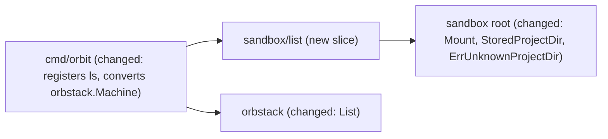

# `orbit ls`: list every sandbox with its project directory and state

Issue: #13 (E02-S03), epic #3. Depends on #5 (E01-S01, `init` merged). Related: #62 (Orbit never starts OrbStack), #75 / PR #117 (Orbit never starts a machine through `orb -m`), #82 / PR #112 (`ActiveMounts` fails closed on an empty mount table and does not retry), #12 (`orbit destroy`, its own spec, PR #119).

## 📝 TLDR

Today the owner sees which sandboxes exist only through `orb list`, which mixes Orbit sandboxes with every other OrbStack machine and does not show which project directory a sandbox belongs to. `orbit ls` reads `orb list --format json` once, keeps the machines with the Orbit name prefix, and prints the name, the state, and the project directory of each sandbox. The directory comes from the mount that OrbStack stores for the machine, so `ls` works for a stopped sandbox without starting it, and it runs no command inside any machine.

## Decisions (owner, 2026-11-12)

The owner decided Q1–Q4 on 2026-11-12 at 09:59. Each decision below is a requirement of this spec; the acceptance criteria that test it follow in [Acceptance criteria](#-acceptance-criteria).

### Q1 — How does Orbit read a machine's project directory back from OrbStack? — **decided by the owner: the stored mount in `orb list`**

- The project directory is the mount that OrbStack stores for the machine in `orb list --format json` (`config.mounts[].source`), the same data that `Client.Mounts` reads for `init` and `start`.
- `ls` shows the directory only when the stored mounts are exactly one mount `DIR:DIR`, `DIR` is absolute and clean, and `sandbox.MachineName(DIR)` equals the machine name. Otherwise it shows `?` (Q3).
- `ls` reads nothing on the host disk: a directory that was moved or removed after `init` is shown as OrbStack stores it.

Rejected: the kernel view through `ActiveMounts` (it starts a stopped machine on `main` (#75), refuses one after PR #117, covers only running machines, and its empty read fails closed under #82); a record that Orbit writes at `init` (OrbStack is the only state store); deriving the directory from the name (the slug is cut at 30 characters and the hash cannot be reversed).

### Q2 — Output format and ordering? — **decided by the owner: a `NAME  STATE  DIRECTORY` table sorted by name**

- An aligned table on stdout with the header `NAME  STATE  DIRECTORY`, one sandbox per line, sorted by name. No flags.
- The header is printed only when at least one sandbox exists; with no sandbox, `ls` prints nothing and exits 0.
- `DIRECTORY` is the last column because a path may hold spaces (only a colon and a comma are refused, `ErrMountPath`). The state is OrbStack's word as it is (`running`, `stopped`, `starting`, …).
- A value with a control character or a non-printable rune is printed Go-quoted, so a stored path cannot write escape sequences to the terminal. Columns are aligned with `text/tabwriter` (standard library, no new dependency).

Rejected: sorting by directory (not a total order when a directory is `?`); `--json` and `-q` now (no flag that nobody asked for; they can be added later).

### Q3 — How is a stopped or an unreadable machine shown? — **decided by the owner: `?` per row, exit 0; an unreadable list fails closed, exit 1**

- A stopped machine is a normal row with state `stopped` and its stored directory (Q1).
- A single machine that cannot be read (no state, no mount, more than one mount, a mount at another path, a path that is not absolute and clean, or a name that does not match its directory) is a row with `?` in the affected column. The reason is printed on stderr, and `ls` exits 0.
- When the whole list cannot be read (`orb list` output that is not JSON, empty output, a prefixed name listed twice, OrbStack not running), `ls` exits 1 and prints no partial list. An empty `orb list` output is never read as "no machines" and is never retried, as in the #82 decision.
- A machine whose state is neither `running` nor `stopped` is listed with that state; `ls` never waits for it.

Rejected: failing the whole list on one bad machine (it hides every sandbox because of one); leaving unreadable machines out (it hides exactly the machine that needs attention).

### Q4 — Where does the read of machine names live? — **decided by the owner: a new read-only `orbstack.Client.List`**

- `internal/orbstack` gets `Client.List(ctx) ([]orbstack.Machine, error)`. It runs `orb status` and one `orb list --format json`, skips every machine whose name does not start with the `orbit-` prefix of the client (and the bare prefix), and returns each remaining machine with its state and its stored mounts. It is read-only: it starts nothing and runs no `-m` command.
- `orbstacktest` gets `List` and `OpList` in the same change.
- The slice declares `List` in its narrow `Machines` interface with its own `list.Machine` type, and `cmd/orbit` converts `orbstack.Machine` to it, because no slice imports the adapter (depguard) and the adapter imports no other package of the repository. The slice drops foreign names again (defense in depth, R07).
- `Mounts` and `State` stay unchanged for `init`, `start`, `stop`, and `shell`.

Rejected: `Mounts()` plus `State(name)` per machine (no consistent snapshot, foreign names reach the slice, one bad entry fails the whole read); extending `Mounts()` (it changes a method that the nesting refusal of `init` and `start` uses).

### From #12 — the end-to-end check of `ls` after `destroy`

The owner decided on #12 (its Q3) that whichever implementation PR of #12 (`destroy`) and #13 (`ls`) merges **second** adds the end-to-end integration check: `orbit ls` after `orbit destroy` no longer lists the destroyed sandbox. Neither PR waits for the other.

## ✅ Acceptance criteria

From the issue:

- Given one running and one stopped sandbox, when the owner runs `orbit ls`, then both are listed with name, project directory, and state, read from OrbStack (D19).
- Given no sandboxes, then nothing is printed and the exit code is 0.
- Negative: given an OrbStack machine without the Orbit name prefix, then it is never listed (R07).

From the owner's decisions:

- **Q1.** Given a sandbox that `orbit init` created, its row shows the directory stored as its mount. Given a prefixed machine with no mount, two mounts, a mount at another path, a path that is not absolute and clean, or a name that is not `MachineName` of its directory, its row shows `?`. `ls` reads no file on the host.
- **Q2.** The output is a table with the header `NAME  STATE  DIRECTORY`, rows sorted by name. A value with a non-printable rune is Go-quoted in the table and on stderr.
- **Q3.** Given one unreadable machine among readable ones, every machine is listed, the unreadable one with `?`, its reason is on stderr, and the exit code is 0. Given `orb list` output that is empty, not JSON, or lists a prefixed name twice, or OrbStack not running, stdout is empty, the exit code is 1, and `orb list` runs at most once.
- **Q4.** `orbstack.Client.List` runs only `orb status` and `orb list --format json` with the environment allowlist, never a `-m` command, and returns only names with the `orbit-` prefix. The `ls` handler records only `OpList` on the fake. A stopped sandbox is still `stopped` after `orbit ls`.
- **#12 cross-check.** When this PR merges after the implementation of #12, its integration test also runs `orbit destroy --yes` in one project and checks that `orbit ls` no longer lists that sandbox. When it merges first, #12's PR adds that check.

## 📝 Problem Statement

- With one sandbox per project directory (D18), the owner needs to see which sandboxes exist on the Mac and which run (D19, #13).
- `orb list` shows every OrbStack machine, Orbit's and others, and only the name `orbit-<slug>-<hash>`; the slug is cut at 30 characters and the hash cannot be reversed, so the owner cannot tell which directory a sandbox belongs to without `orb list --format json` and reading `config.mounts` by hand.
- Every `orb -m` command starts a stopped machine (#75), and `orb` starts a stopped OrbStack by itself (#62). A listing must not do either.

## 📝 Proposed Solution

`orbit ls`, in order:

1. `List()` (adapter): `orb status` must print `Running`, else `ErrNotRunning` or `ErrHome` and no other command (#62, #70). Then one `orb list --format json`. Output that is not a JSON array, empty output, and a prefixed name listed twice fail with `ErrMachineList`. Entries whose name lacks the prefix are dropped.
2. For each machine: `sandbox.StoredProjectDir(name, mounts)` returns the directory or `ErrUnknownProjectDir` with the reason (Q1). A missing state becomes `?` with the reason "no state".
3. Sort by name. Return `Output`.
4. The command prints the table on stdout and one reason line per `?` on stderr, exit 0. An error of step 1 prints nothing on stdout and exits 1.

`ls` takes no argument and no flag, does not read the current directory, and never calls `State`, `Start`, `Stop`, `Create`, `Delete`, or any `-m` method (`ActiveMounts`, `RunAsRoot`, `RunAsAgent`, `Shell`).

Alternatives that the owner rejected are listed under each decision above. Also deferred:

- **A column for isolation (`isolated`, `isolate_network`) or SSH forwarding.** `orb list` has them (`config`, Evidence). Not asked for; deferred.
- **Mark the sandbox of the current directory.** Not asked for; it would need `realpath.Resolve` of the current directory in a command that otherwise needs no directory. Deferred.
- **Check the host directory (exists, still canonical).** That is the job of `start` (`hostcheck`); `ls` reads OrbStack only. Deferred.

## 📝 Delta

### Capability: sandbox-listing

#### ADDED Requirement: List every sandbox with its project directory and state
The system SHALL print, for `orbit ls`, one line per OrbStack machine whose name starts with the Orbit prefix, with its name, its state as OrbStack reports it, and the project directory that OrbStack stores as its mount, sorted by name, from one read of the machine list.

##### Scenario: One running and one stopped sandbox
- WHEN the owner ran `orbit init` in `/Users/dev/api` and in `/Users/dev/web`, ran `orbit stop` in `/Users/dev/web`, and runs `orbit ls` in any directory
- THEN Orbit prints a header `NAME STATE DIRECTORY` and two lines, `orbit-api-<hash> running /Users/dev/api` and `orbit-web-<hash> stopped /Users/dev/web`, and exits 0

##### Scenario: No sandbox
- WHEN no OrbStack machine has a name with the Orbit prefix
- THEN Orbit prints nothing on stdout and exits 0

#### ADDED Requirement: Only Orbit machines are listed
The system SHALL never list a machine whose name does not start with the Orbit prefix (R07).

##### Scenario: A foreign machine
- WHEN OrbStack has the machines `ubuntu`, `xorbit-a`, and `Orbit-b` and one Orbit sandbox
- THEN Orbit lists only the Orbit sandbox

#### ADDED Requirement: Listing starts nothing
The system SHALL not start OrbStack or a machine, and SHALL run no command inside a machine, for `orbit ls`.

##### Scenario: A stopped sandbox stays stopped
- WHEN a sandbox is stopped and the owner runs `orbit ls`
- THEN it is listed as `stopped` with its project directory, and its state is still `stopped` afterwards

##### Scenario: OrbStack is not running
- WHEN OrbStack is stopped and the owner runs `orbit ls`
- THEN Orbit prints nothing on stdout, fails with the cause and the advice to start OrbStack, exits 1, and OrbStack stays stopped

#### ADDED Requirement: An unknown project directory is shown, not guessed
The system SHALL show `?` as the project directory of a prefixed machine whose stored mounts are not exactly one mount of an absolute, clean directory at its own path whose machine name equals the name of the machine, and SHALL print the reason on stderr.

##### Scenario: A machine created by hand with the prefix
- WHEN a machine `orbit-manual` mounts `/Users/dev/x` at `/Users/dev/x`
- THEN Orbit lists `orbit-manual` with its state and `?`, prints `orbit: orbit-manual: project directory unknown: the name does not match "/Users/dev/x"` on stderr, and exits 0

##### Scenario: One unreadable machine among readable ones
- WHEN one sandbox has a valid stored mount and another prefixed machine has two mounts
- THEN Orbit lists both, the first with its directory and the second with `?`, prints the reason for the second on stderr, and exits 0

#### ADDED Requirement: An unreadable machine list fails closed
The system SHALL fail with exit 1 and print no partial list when the machine list cannot be read as a whole.

##### Scenario: Empty output of `orb list`
- WHEN `orb list --format json` exits 0 and prints nothing
- THEN Orbit fails with `ErrMachineList`, prints nothing on stdout, exits 1, and does not run `orb list` again

#### ADDED Requirement: A destroyed sandbox is no longer listed
The system SHALL not list a sandbox after `orbit destroy` removed it. The end-to-end check is added by whichever implementation PR of #12 and #13 merges second (owner decision on #12).

##### Scenario: `ls` after `destroy`
- WHEN the owner ran `orbit init` in two projects, then `orbit destroy --yes` in one of them, and runs `orbit ls`
- THEN Orbit lists the other sandbox and not the destroyed one, and exits 0

## 📝 Architecture



Takeaway: one new slice, one new adapter read, one new pure function; no new module dependency, no third-party dependency, and no change to an existing method.

### Adapter (`internal/orbstack`)

- `type Machine struct { Name, State string; Mounts []Mount }` and `type Mount struct { Source, Destination string }`.
- `List(ctx) ([]Machine, error)`: `run(ctx, mountsArgs(), nil)` (behind `orb status`, through `executeStreams`), then `parseList(list, prefix)`. It never starts a machine and runs no `-m` command.
- `parseList` fails with `ErrMachineList` on output that is not a JSON array (empty output included; `null` is read as no machines, as `encoding/json` does) and on a prefixed name that appears twice. It drops names without the prefix and the name equal to the prefix (`orbit-`), the same rule as `checkOwned`; a client with an empty prefix lists nothing, as it refuses every name elsewhere. It keeps `state` as it is, also `""`, and the mounts in the order of `config.mounts`, without merging duplicates: the decision is the pure function's.
- `orbstacktest`: `List` and `OpList`, listing the machines of the fake with their state and their one mount `DIR:DIR`, and a seed for raw entries (foreign names, no state, odd mounts) so that handler tests reach every Q3 case.
- `internal/orbstack/AGENTS.md`: Layout (`List`) and the invariant that `List` runs only `orb status` and `orb list` and returns only prefixed names.

### Sandbox root (`internal/sandbox/sandbox.go`)

- `type Mount struct { Source, Destination string }`.
- `StoredProjectDir(name string, mounts []Mount) (string, error)`: the project directory when there is exactly one mount, `Destination == Source`, the path passes `checkPaths` (absolute and clean), and `MachineName(Source) == name`; otherwise `ErrUnknownProjectDir` with one reason: "no mount", "N mounts", "mounted at <dest>", the error of `checkPaths`, or "the name does not match <dir>". Every path in a reason is formatted with `%q`, so a stored path cannot carry an escape sequence into the message. Pure; table tests with hostile input.

### Slice `internal/sandbox/list`

- `contract.go`: `Input{}`; `Output{Sandboxes []Sandbox}`; `Sandbox{Name, State, Dir, Problem string}`. `Problem` is the reason of `StoredProjectDir` and is set exactly when `Dir` is empty. `State` is empty when OrbStack gave none; the command derives the reason "no state" from that, so a row can carry both reasons.
- `handler.go`: `Machines` with `List(ctx) ([]Machine, error)`; `Machine{Name, State string; Mounts []sandbox.Mount}`. `Handle` drops names without `sandbox.NamePrefix` and the bare prefix, calls `StoredProjectDir`, sorts by name. It wraps an error of `List` with "list sandboxes".
- `command.go`: `NewCommand(handler)` registers `ls` with `cobra.NoArgs` and a help text that says the directory is the one OrbStack stores for the machine, not a check of the mounted directory; renders with `text/tabwriter`; `?` for an empty `State` or `Dir`; one reason line per unknown value on stderr; `printable(s)` quotes a value that holds a non-printable rune, and every table cell and every reason line goes through it.
- `cmd/orbit`: `listCommand(machines)` with a converter from `*orbstack.Client` to `list.Machines`.

## 📝 UI/UX

```text
$ orbit ls
NAME                        STATE    DIRECTORY
orbit-api-0123456789abcdef  running  /Users/dev/api
orbit-manual                stopped  ?
orbit-web-fedcba9876543210  stopped  /Users/dev/my web
orbit: orbit-manual: project directory unknown: the name does not match "/Users/dev/x"
$ echo $?
0
```

- No sandbox: no output, exit 0.
- Errors on stderr, exit 1, nothing on stdout: the existing `ErrNotRunning` / `ErrHome` messages of the adapter; `orbit: list sandboxes: machine list cannot be read: …`.

## 📝 Edge Cases & Failure Scenarios

| Case | Behavior |
|---|---|
| OrbStack stopped or starting | `orb status` check fails (`ErrNotRunning`, or `ErrHome` for a wrong `HOME`); no other command; exit 1 (#62, #70). |
| Empty or malformed `orb list` output | `ErrMachineList`, exit 1, no retry, no partial list (Q3). |
| A prefixed name listed twice | `ErrMachineList`, exit 1: `ls` cannot tell which entry is the machine. |
| A sandbox in `starting`, `stopping`, or `creating` | Listed with that state; no wait (Q3). |
| `orbit init` creating a machine in another terminal | One snapshot; the new machine is listed or not. A machine listed before its mount exists shows `?` with "no mount". |
| Project directory moved or deleted on the host after `init` | Listed with the stored path (Q1). `start` refuses it there; `destroy` acts on the sandbox of the current directory (#12), so such a sandbox is removed with `orb delete <name>`, as the spec of #12 states (its Q7). |
| Integration test machines `orbit-it-*` left behind | Listed; their name does not match their directory, so `?` with the reason. |
| Path with spaces | Printed as is in the last column. |
| Name, state, or path with a newline, tab, or escape sequence | Printed Go-quoted, in the table and in the reason lines on stderr; it cannot break a line or drive the terminal. |
| `ActiveMounts` empty read (#82) | Not reachable: `ls` never calls `ActiveMounts`. A later option that reads the kernel view inherits the no-retry decision and the running-only rule of #75. |

## 📝 Risks & Impact Review

- **`risk-high` (implementation).** A new read in `internal/orbstack`. It is read-only and starts nothing, but it is in the package that every boundary path uses. The PR carries the hostile-input tests of `parseList` and `StoredProjectDir`, the command test that `List` runs only `orb status` and `orb list`, the handler test that the fake records only `OpList`, and the integration test.
- **What `ls` does not prove.** The directory is the stored configuration, checked for consistency with the name; it is not the kernel view and not the identity of the directory (Q1). The help text and `ARCHITECTURE.md` say so; no slice may use `ls` output as a check.
- **Contract.** The column layout becomes something scripts read. No `--json` yet (Q2), so the table is the contract; changing it later is a visible change.
- **Parallel work.** The spec of #12 (`destroy`) and PR #117 (#75) also touch `internal/orbstack/AGENTS.md`, the fake, and `cmd/orbit/main.go`; the conflicts are textual. PR #117 does not change `orb list` reads.
- **Escape suite.** `ls` adds no path into a machine and changes nothing that the escape suite covers; the PR states that the suite did not run.
- **Rollback:** revert the PR; the command disappears. `ls` writes nothing on the host or in any machine.

## 📝 Decisions in play

D18 (one sandbox per project directory), D19 (`orbit ls` lists all sandboxes), R07 (OrbStack only; adapter in one package; handler tests without OrbStack), and the owner decisions on #62 (Orbit never starts OrbStack), #75 (Orbit never starts a machine implicitly), and #82 (an empty mount-table read fails closed and is not retried). The owner decided Q1–Q4 of this spec on 2026-11-12, and on #12 that whichever of #12 and #13 merges second adds the `ls`-after-`destroy` check. No active row of the product brief changes.

## 📝 Evidence

Read-only probe on OrbStack 2.2.5 (2020500), 2026-11-12, after `orb status` printed `Running`: entries of `orb list --format json` have the keys `builtin, config, id, image, name, os_release, state`; `config` has `default_username, forward_ssh_agent, http_port, https_port, isolate_network, isolated, mounts`; an Orbit sandbox has one mount. `orb list --help` offers `--format text|json`, `-q`, and `-r`. Not checked: the output of `orb list --format json` with no machine at all (`[]` or `null`); `parseList` accepts both.

## 📋 Phasing

- **Phase 1 — `orbit ls`.** One PR: adapter `List`, the pure function, the slice, registration, the integration test, docs. Each step below leaves the gate green.

## 📋 Implementation Plan

### Phase 1 — `orbit ls`

1. **Adapter `List`.** `Machine`, `Mount`, `List`, `parseList`. Tests: foreign names (`ubuntu`, `xorbit-a`, `Orbit-b`, `orbit` without the dash) and the bare prefix `orbit-` dropped; a prefixed name twice fails; a foreign name twice ignored; empty output fails with `ErrMachineList`; `null` and `[]` give no machines; malformed JSON fails; entry without `state` kept with `""`; entry without `config` or `mounts` kept with no mounts; control characters pass through unchanged; empty client prefix lists nothing; `List` runs exactly `orb status` and `orb list --format json`, with the same environment as every other command: add `List` to `TestEveryCommandRunsOrbWithTheSameEnvironment` and `TestEveryCommandGetsOnlyAllowedVariables`, which call each method by name. Fake: `List`, `OpList`, raw-entry seed. `internal/orbstack/AGENTS.md`. → verify: `go test ./internal/orbstack/...`
2. **`sandbox.Mount`, `StoredProjectDir`, `ErrUnknownProjectDir`.** Table tests: one mount at its own path with the matching name; zero and two mounts; mount at another path; relative path, `..`, trailing slash; one hex character of the name changed; the slug changed; prefix only; a path with spaces (valid); a path with a newline (valid, the name matches). → verify: `go test ./internal/sandbox/...`
3. **Slice `list` and registration.** `contract.go`, `handler.go`, `command.go`, `handler_test.go`, `command_test.go`: no machine (no output, exit 0); running and stopped sorted by name; foreign entries dropped; unknown directory and missing state (`?`, stderr reason, exit 0); `List` error (nothing on stdout, error returned); the fake records only `OpList` (no `State`, no `Start`, no `-m` operation); a value with an escape sequence is quoted in the table and in the reason line; a row with no state and an unknown directory prints both reasons; the help text names the stored mount. Register in `cmd/orbit` with the converter. `internal/sandbox/AGENTS.md` (layout and the invariant "`ls` reads only `List`"), `ARCHITECTURE.md` (Components; a Key decisions row: `ls` reads the stored mount from `orb list`, not the kernel view), root `AGENTS.md` (project overview). → verify: full validation gate.
4. **Integration test** (`cmd/orbit`, `integration` tag, `-p 1`, machine names `sandbox.MachineName` of the canonical temporary project directories, as the other `cmd/orbit` integration tests compute them; cleanup deletes exactly those names). Two `orbit init` on two temporary projects; `orbit stop` in one. `orbit ls` lists both with `running` / `stopped` and their canonical directories; the stopped one is still `stopped` afterwards (`State`); every listed name starts with `orbit-`. The test never asserts the absence of other machines: the host may have real sandboxes. **Cross-check with #12:** if the implementation of #12 is on `main` when this PR merges, the test also runs `orbit destroy --yes` in the first project and checks that `orbit ls` no longer lists its name (the other one still listed); if this PR merges first, it leaves the check to #12's PR and says so in the PR body. → verify: `go test -tags integration -p 1 -run TestListSandboxes ./cmd/orbit/` on a named OrbStack version.
5. **Archive the Delta** into `.ai/specs/capabilities/sandbox-listing.md`. → verify: the file matches the Delta.
