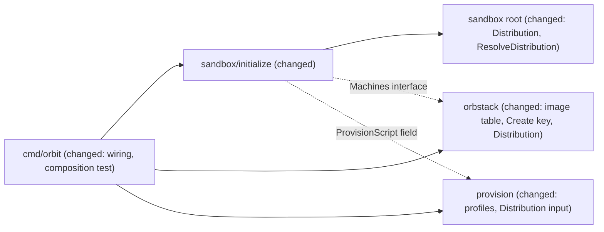

# Sandbox distributions: Ubuntu 26.04 and Debian 13 trixie in release 0.1, Alpine in 0.2

Issue: #48 (E04-T02), epic #46 (E04). Depends on #47, the spike `.ai/analysis/2026-11-12-orbstack-alpine-debian-spike.md` (merged in #164).
Extends: .ai/specs/2026-11-10-sandbox-provisioning.md
Extends: .ai/specs/2026-11-11-rootless-docker.md

## 📝 TLDR

Every sandbox runs Ubuntu 26.04 today: `internal/orbstack` holds one image, and `internal/provision` renders one apt/systemd root script. In release 0.1, `orbit init --distro ubuntu|debian` will create the sandbox on Ubuntu 26.04 (the default) or on Debian 13 trixie. Both have the same boundary, toolchain, and agent install. Alpine is deferred to release 0.2, both as a choice and as the default. This was the owner's decision on 2026-11-12, after the spike showed that Alpine needs a second boundary implementation and has open gaps. The design keeps Alpine one profile and one init-system family away. This spec records what 0.2 must close.

## Decisions taken, and open questions

**Owner decision (2026-11-12 19:20 Europe/Warsaw, recorded on #48, https://github.com/cultofthecode/orbit/issues/48#issuecomment-6832171898):** release 0.1 supports Ubuntu 26.04 (default) and Debian 13 trixie. Alpine is deferred to 0.2, including Alpine as the default. This replaces epic decisions 1 and 6 for 0.1 and is recorded as brief row **D28**. D25 was the id that the epic planned for decision 1, but D25 to D27 are already taken. D28 amends D19. D20 does not change in 0.1, because Ubuntu and Debian install the toolchain under the same package names.

The epic's other decisions carry over, narrowed to 0.1:

| Epic decision | In this spec |
|---|---|
| 1 (Alpine is the default; brief row) | Replaced by the owner's decision: Ubuntu stays the default in 0.1; D28. |
| 2 (`--distro alpine\|debian\|ubuntu`, a fixed enum) | Kept as a fixed enum, with the values `ubuntu` and `debian` in 0.1. Topic 1. |
| 3 (pins Alpine 3.23, Debian 13 trixie, Ubuntu 26.04) | `ubuntu:26.04` and `debian:trixie` are pinned. Alpine 3.23 is the pin for 0.2. Topic 1. |
| 4 (Alpine toolchain adds `bash`, `libgcc`, `libstdc++`) | Deferred to 0.2. The spike contradicts part of its premise; see Q6. |
| 5 (`init --distro X` on a sandbox of another distribution fails and names `orbit destroy`) | Kept. Topic 7. |
| 6 (Alpine becomes the default only after #52, #56, and the escape suite on Alpine) | Deferred to 0.2. The spike adds conditions; see Q5. |
| 7 (the agent's login shell is `/bin/bash` on Alpine) | Deferred to 0.2. It is already true on Ubuntu and Debian. |
| 8 (no new egress host) | Kept. The spike found no new host (topic 8 of the spike). |
| 9 (`orbit ls` does not show the distribution) | Kept. |

The owner delegated the product decisions of this epic to the coordinator. Each open question below has options and a recommended default, and the rest of the spec is written under those defaults. The coordinator answers on the PR, and any changed answer is applied before the merge.

| # | Question (epic decision it touches) | Options | Recommended default |
|---|---|---|---|
| Q1 | If `docker run --privileged` starts a container on Debian trixie, as it does on Alpine, what follows? The pinned requirement "Privileged containers on the tested OrbStack version" fails then. The Debian engine has not run a container yet (spike, topic 7). (Epic decision 6; rootless Docker spec Q5 b.) | (a) Stop E04-S01 and ask the owner, as that requirement says today. (b) Decide now: on a distribution where `--privileged` starts, replace the pinned observation with escape attempts that prove a privileged container cannot change the boundary (the spike's Alpine set: `nft flush ruleset`, `ip link add`, a write to `/etc/nftables.conf` through `-v /:/h`, `kill` of tinyproxy, all with `--privileged`). Ship if they hold. | **(a)**, because the active requirement reserves this choice to the owner, and the spec does not override it. Recommended pre-decision: **(b)**, if the coordinator, under the owner's delegation, wants to take it now so that E04-S01 does not stall. On Alpine, a privileged container that started still could not touch the boundary, because it runs in the user namespace of the agent. Choosing (b) adds a MODIFIED requirement "Privileged containers on the tested OrbStack version" (`sandbox-containers`) to the Delta before the merge. ⚠ |
| Q2 | Does every `risk-high` PR that touches the sandbox boundary run the escape suite on both distributions? (Epic decision 3: "changes a pin only in a PR that runs the integration tests and the escape suite on it".) | (a) Both distributions, every time (about 27 min instead of 13.5). (b) Debian only when the PR touches `internal/provision` or the image table. | **(a)**. The boundary is rendered per distribution, and a change that looks shared (for example a unit drop-in) can behave differently on Debian. `SDLC.md` and `AGENTS.md` name the second run. |
| Q3 | Does a release run the full integration suite on both distributions? (Epic decision 3.) | (a) Both: two runs of about 36 min each, each under the 60 min timeout of one test binary. (b) Ubuntu in full, Debian only for the escape suite. | **(a)**. A release ships both distributions, so both must pass the same evidence. |
| Q4 | What does `orbit init --distro alpine` say in 0.1? (Epic decision 2.) | (a) The same refusal as any unknown value: `unknown distribution "alpine"; use one of: ubuntu, debian`. (b) A dedicated message that Alpine comes in 0.2. | **(a)**. It needs no special case and makes no release promise in the binary, and the enum stays the single list. |
| Q5 | Which conditions gate Alpine in 0.2, and Alpine as the default? (Epic decision 6, which the spike "supports, and adds conditions".) | (a) Decision 6 as written: #52, #56, and the escape suite on Alpine. (b) Decision 6, plus the four conditions of the spike: an OpenRC counterpart of `ReadinessScript`, `BootCheckScript`, and `waitForBoot` on every Orbit entry path; a measurement of IPv6 addresses and direct IPv6 egress in the 5–7 s start window; escape tests for `--privileged` containers on Alpine; and a position on container resource limits (Q7). | **(b)**. These are exactly the unproven gaps behind the owner's deferral, and the 0.2 spec has to close each one. |
| Q6 | The Alpine toolchain of epic decision 4 (`bash`, `libgcc`, `libstdc++`). The spike found that Claude Code 2.1.322 does not need `libstdc++` (`ldd` lists only `ld-musl`). It also found that root needs `shadow`, `runuser`, `setpriv`, `iproute2-ss`, and `netcat-openbsd`. (Epic decision 4, amends D20 for Alpine.) | (a) Keep decision 4 as written. (b) For 0.2, the toolchain adds `bash` and `libgcc` but not `libstdc++`. The root-only packages are infrastructure, not toolchain. | **(b)**, to be confirmed in the 0.2 spec. It is the smallest set that the evidence supports, and a client that later needs `libstdc++` fails its install loudly, not silently. Nothing changes in 0.1. |
| Q7 | Rootless containers on Alpine get no resource limits: OpenRC delegates no cgroup controllers, and `--memory`, `--pids-limit`, and `--cpus` are accepted but not enforced. Is that acceptable for Alpine in 0.2? (Epic decision 6; brief Scope lists resource limits under *Later*.) | (a) Accept and document it as a parity gap with Ubuntu and Debian. (b) Block Alpine until limits work. (c) Ship Alpine in 0.2 but not as the default until limits work. | **(a)**. Resource limits are *Later* scope in the brief, no business rule requires them, and the boundary does not depend on them. Show the gap in `orbit init --help` text for `--distro alpine` in 0.2. |

## 📝 Problem Statement

- The owner asked on 2026-11-11 for a choice of distribution. The image is a constant: `internal/orbstack/orbstack.go:37` (`image = "ubuntu:26.04"`).
- The root script assumes Ubuntu everywhere: `apt-get`, the systemd units of `internal/provision/units.go` and `docker.go`, the Docker package names (`docker-compose-v2`), and `/usr/bin/nc.openbsd`.
- The spike `[DATA]` ran the unmodified Ubuntu script on Debian trixie. It failed only on the Docker package list (`docker-compose-v2` is `docker-compose` there, and `docker-cli` must be named because `--no-install-recommends` drops it). With those two changes it passed `probeScript` and `afterStartProbes`, including a restart. Debian bookworm, which OrbStack picks for a bare `debian`, cannot provide the Docker design: docker.io 20.10, no buildx, no compose v2, and its `dash` has no `pipefail`.
- Alpine needs a second implementation of the boundary: apk, OpenRC services, another rules file, no `/run/tinyproxy`, no bash, and no login gate. It also has open gaps (Q5, Q7). The owner deferred it to 0.2.

So 0.1 needs: a way to choose the distribution, one pinned image per value, a root script that renders per distribution without a runtime guess, and a guard against running one distribution's script on another. It also needs a design that does not have to be rebuilt when the OpenRC family arrives.

## 📝 Facts from the spike that correct premises of the epic

The table "What is Debian/Ubuntu-specific today" on #46 states premises that the spike contradicts. The spec relies on the observed facts.

- **Login gate.** The epic says that `systemd-user-sessions.service` holds every login on Ubuntu and Debian. It does not. `orb -m <m> -u <user>` ran 0.02 s after a slow boundary stand-in started, while `systemd-user-sessions.service` was `inactive` and `/run/nologin` existed. That happened on Ubuntu, trixie, and bookworm. Alpine has no gate at all (spike, topic 1). This matches #74 and the pinned observation O01 of the escape suite. Consequence: on every distribution, the gate for Orbit's own paths is the root-side check that Orbit runs before it hands the machine to the agent (`ReadinessScript` for `shell`, `BootCheckScript` for `start`, and the self-check of the root script for `init`). The `systemd-user-sessions.service` drop-in stays on Ubuntu and Debian. It still holds PAM logins (`su -`, `login`), and the readiness check requires it. No design in this spec relies on it for `orb` sessions. A session that someone opens by hand with `orb -m <m> -u agent` stays ungated on every distribution (known limit, O01).
- **`/etc/environment` without PAM.** OrbStack reads it for every `orb -u` command, on Alpine too. Only `su -` on Alpine ignores it (spike, topic 6).
- **`libstdc++` and `USE_BUILTIN_RIPGREP=0`.** Claude Code does not need either of them on musl (spike, topic 8; Q6).
- **nftables stop.** The OpenRC service flushes the ruleset on stop, as the Debian unit does. Only the rules file differs (spike, topic 4).

## 📝 Prior spec drift

- `.ai/specs/2026-11-10-sandbox-provisioning.md`, API Contracts and Phase 1: `Script(defaultUID)` writes version `1`, and the proxy allows port 443 only. The code has `Script(ScriptInput{DefaultUID, AgentDomains, ForwardSSHAgent})` and `Version = 3` (`internal/provision/script.go:17`), and allows ports 80 and 443 (D26). It also installs rootless Docker (`docker.go`). This spec starts from the code.
- The same spec, Units: the gate "does not reach `orb` sessions". This is already in the code comments (`internal/provision/check.go`, `ReadinessScript`) and in `internal/provision/AGENTS.md`. In sync. The epic table was the outlier.

## 📝 Proposed Solution

A distribution is a value from a closed set (`ubuntu`, `debian`). It is parsed and checked as a pure function in the sandbox module. Each value maps to one pinned image in the adapter and to one provisioning profile in `internal/provision`. A test in `cmd/orbit` ties the three lists together. The root script is rendered for a known distribution and refuses to run on another. Nothing at run time guesses the distribution.

### Topic 1: the distribution type, its home, and the image table

**Decision.**

- **Home: `internal/sandbox` (root package).** It holds `type Distribution string`, the constants `Ubuntu` (`"ubuntu"`) and `Debian` (`"debian"`), `DefaultDistribution = Ubuntu`, `Distributions() []Distribution` (in that order), `ParseDistribution(string) (Distribution, error)`, and the pure rule `ResolveDistribution` (topic 7). The `init` slice may import its own module root (dependency rule 2). The flag, the default, and the mismatch rule are part of the sandbox spec, which this module owns (dependency rule 5).
- **Image table: inside `internal/orbstack` only (R07).** The adapter imports no package of this repository, so it keys a private table by the plain name. Each pin records the spelling it passes to `orb create` and the spelling that OrbStack stores for the machine:

  | Key | `orb create` image | Stored `image.distro` / `image.version` |
  |---|---|---|
  | `ubuntu` | `ubuntu:26.04` | `ubuntu` / `resolute` (observed below) |
  | `debian` | `debian:trixie` | `debian` / `trixie` (expected; the integration test pins it) |

  Evidence for the `ubuntu` row: `orb list --format json` on OrbStack 2.2.5, 2026-11-12, read-only, for a machine that a spike created with `ubuntu:26.04`. Mount paths are removed:

  ```json
  "image": {"distro": "ubuntu", "version": "resolute", "arch": "arm64", "variant": "default"},
  "os_release": {"name": "Ubuntu", "version_id": "26.04", "pretty_name": "Ubuntu 26.04.1 LTS"},
  ```

  Step 3 commits a real capture of this output as test data. The `debian` row stays expected until `TestInitPinsTheStoredImage` runs on Debian (step 8).

  `Create(ctx, name, dir, distribution string, forwardSSHAgent bool)` looks the key up and refuses an unknown key with `ErrDistribution`, before any command. A caller passes a key, never an image, so no image string or version from the user reaches `orb create` (epic decision 2). `createArgs` takes the resolved image from the table. `Distributions() []string` exports the keys for the composition test.
- **Composition test in `cmd/orbit`:** `TestEveryDistributionHasAnImageAndAProfile`. For every `sandbox.Distributions()` value it checks that `orbstack.Distributions()` and `provision.Distributions()` list it, and that the three lists are equal. The existing test for `AgentUser` (`orbstack.AgentUser` equals `provision.AgentUser`) follows the same pattern.
- **Pins** follow epic decision 3: `debian:trixie`, never a bare `debian`, which resolves to bookworm on OrbStack 2.2.5. A pin changes only in a PR that runs the integration tests and the escape suite on it.
- **Rule** (new, for `ARCHITECTURE.md`, the analogue of D16): no slice and no agent definition compares a distribution name. Per-distribution facts are data, in the profile table of `internal/provision` and in the image table of `internal/orbstack`.

**Alternatives considered.**

- *A new module `internal/distro`:* slices may not import it (dependency rule 2) without a new rule, and it would be a module for one type. Rejected.
- *`internal/kernel`:* it does not exist yet, and it is for what three or more modules need. The adapter cannot import it anyway. Rejected.
- *Home in `internal/provision`:* the slice may not import `provision`, so it would need an injected parse function and would still compare values. Rejected.
- *Free-form `--image`:* refused by epic decision 2. It would put untested distributions and an injection surface into machine creation.

### Topic 2: how `internal/provision` varies per distribution

**Decision.** There is one exported `Script(ScriptInput)`, with a new field `Distribution string`. Inside the package, a private `profiles` table maps each name to a `profile`. The profile holds the data that differs, plus the init-system **family** that selects the renderer. `Script` refuses an unknown or empty name with `ErrScriptInput`. `Distributions() []string` lists the keys.

```go
type profile struct {
	osID, codename string   // what /etc/os-release must say (the guard of topic 7)
	family         family   // aptSystemd in 0.1; openRC joins in 0.2
	dockerPackages []string // the rootless engine from the distribution archive
}
```

| Field | `ubuntu` | `debian` (trixie) | Evidence |
|---|---|---|---|
| `osID` / `codename` | `ubuntu` / `resolute` | `debian` / `trixie` | spike, environment table |
| `family` | `aptSystemd` | `aptSystemd` | spike, topic 1 |
| `dockerPackages` | `docker.io docker-buildx docker-compose-v2 rootlesskit uidmap slirp4netns dbus-user-session` (unchanged) | `docker.io docker-cli docker-buildx docker-compose rootlesskit uidmap slirp4netns dbus-user-session` | spike, topic 7, trixie changes 1 and 2 |

The rest stays shared within the `aptSystemd` family, because the spike ran it unchanged on trixie: the toolchain and infrastructure package names, `aptGet`, the masking of `systemd-resolved`, every unit and drop-in, the harden script, the self-check, `/usr/bin/nc.openbsd`, and the `PATH` of `/etc/environment`. On Debian, `/usr/games` and `/snap/bin` are missing, which is harmless. Keeping one `PATH` leaves the Ubuntu bytes unchanged. The pieces that are shared across families keep their signatures: `Firewall` (only the path that the file is written to will differ per family), `proxy.Config`, `policy.Allowlist`, `sshFiles`, and `environment`.

`BootCheckScript`, `MarkerCheckScript`, `ReadinessScript`, and `DockerSetupScript` stay without input in 0.1, because both distributions are systemd. In 0.2 they take the distribution, and `start` and `shell` read it from the adapter (topic 7).

**Ubuntu bytes.** For `ubuntu`, the rendered script is byte-identical to today, except for the `/etc/os-release` guard of topic 7. A golden file proves it (Phase 2, steps 5 and 6). `Version` stays `3`: an Ubuntu machine provisioned by version 3 holds exactly the state that this build provisions, and a Debian machine is new.

**Alternatives considered.**

- *One exported renderer per distribution (`UbuntuScript`, `DebianScript`):* it duplicates almost all of the apt/systemd script for a difference of one package list. Rejected for 0.1. The family seam gives Alpine its own renderer in 0.2 without this duplication.
- *Detecting the distribution inside the script (`if [ -f /etc/alpine-release ]`):* the script would stop being a pure function of known input, every branch would ship to every machine, and a wrong detection could run a half-fitting boundary. Rejected. The guard of topic 7 fails closed instead.
- *A `sed` over the Ubuntu script:* rejected by the spike (Q1 note: "not a `sed` over the Ubuntu one").

### Topic 3: running the root script where bash is missing

**Decision for 0.1: no change.** Root's shell is `/bin/bash` on Ubuntu and trixie, and `/usr/bin/bash` exists (spike, topic 2), so `RunAsRoot` and `RunAsAgent` keep `orb -m NAME -u <user> bash -s`. The root script keeps `#!/bin/bash`, the braced group, and `set -euo pipefail`.

**Direction for 0.2 (Alpine), decided by the 0.2 spec.** The spike recommends keeping `bash -s` for every script after a POSIX bootstrap that installs bash. The bootstrap would be a new adapter operation, `RunAsRootPOSIX` (`orb -m NAME -u root sh -s`), that runs `provision.BootstrapScript(distribution)`, which is `apk add --no-cache bash` for Alpine and empty for the apt family. Epic decisions 4 and 7 already put bash on Alpine, so this costs nothing more. A fully POSIX root script was the alternative; its only extra gain was bookworm's `dash`, which no pin uses.

### Topic 4: OpenRC equivalents, boot order, and the login gate

**Decision for 0.1: no OpenRC code.** The units of `units.go` and `docker.go` serve both distributions. The boot order is unchanged: firewall, proxy address, proxy, harden, `systemd-user-sessions.service`, then `orbit-boundary-gate.service` and `user@.service`. The spike measured the boundary up at first contact in 6 of 6 runs on trixie.

**The gate.** On every distribution, the gate for Orbit's paths is Orbit's root-side check, not a login gate (see the facts section). In 0.1 this is already in place (`ReadinessScript`, `BootCheckScript`, the self-check of `init`), and the Debian integration run proves it.

**Design input for 0.2.** The spike built the Alpine counterparts by hand, and all probes passed with them. The 0.2 spec starts from this table:

| systemd (0.1) | OpenRC (0.2 input) | Dependency kind and why |
|---|---|---|
| `nftables.service` + drop-in, rules in `/etc/nftables.conf` | stock `nftables` service in `default`, `rules_file` pointed at an Orbit-owned path (the stock `/etc/nftables.nft` has `flush ruleset` and is a conffile that an `apk upgrade` may replace) | stock `before net; provide firewall`. Never `stop` or `restart`, which flush the ruleset. |
| `orbit-proxy-address.service` | `/etc/init.d/orbit-proxy-address` | `need localmount; before tinyproxy` |
| `tinyproxy.service` drop-in | `/etc/conf.d/tinyproxy`: `rc_need="nftables orbit-proxy-address"`, and no `PidFile` line in `tinyproxy.conf` (Alpine has no `/run/tinyproxy`; the daemon crashes with it). This needs a family option in `proxy.Config`. | `need`, as `Requires=` today |
| `orbit-harden.service` | `/etc/init.d/orbit-harden`; the harden script adds `wheel` | `need localmount; after nftables` |
| `systemd-user-sessions.service` drop-in | **none**: Alpine has no PAM login gate and no `pam_nologin` | The readiness check is the gate (Q5). |
| `orbit-boundary-gate.service` + `user@.service` drop-in | `/etc/init.d/orbit-boundary` | `after` only, never `need`: a restart of a `need` dependency stops and restarts its dependents (spike, problem 2) |
| `docker.service` user unit (systemd user manager) | system service `orbit-docker`: `supervise-daemon`, `command_user=agent:agent`, `respawn_max=0`, proxy at `172.31.255.1:3128` | `need orbit-boundary`; the script only ever starts `orbit-boundary`, so `need` does not cascade |
| masked rootful `docker.service`, `docker.socket`, `containerd.service` | not in any runlevel, and the self-check requires `stopped`. OpenRC has no `mask`. | — |
| masked `systemd-resolved` | none to mask; `nohook resolv.conf` in `/etc/dhcpcd.conf` | — |
| `waitForBoot` (`systemctl is-system-running --wait`) | open: an OpenRC definition of "the boot ended" | Q5 |

The Alpine failure-mode table, redone from the provisioning spec, is under Edge Cases (Alpine, 0.2 design input).

### Topic 5: where the proxy environment and `PATH` of every login come from

**Decision.** `/etc/environment`, owned by root, on both distributions, unchanged. OrbStack applies it to every `orb -u` command (bare, `sh -c`, `bash -lc`, stdin) on Ubuntu and trixie. `pam_env` applies it to `su -`. It does not reach `runuser -l` or services (spike, topic 6). Services carry their own environment: the rootless Docker user unit sets `HTTP_PROXY` and `HTTPS_PROXY` to `172.31.255.1:3128`, as today. On Alpine in 0.2 the same file works for `orb` entries. The `orbit-docker` service sets its own variables.

The agent's `~/.local/bin` is where the Claude Code installer puts `claude`. On Ubuntu, the skeleton `.profile` adds it to `PATH` only when the directory exists at login, so the installer warns that it is missing from the current `PATH` (spike, topic 8, on Alpine and Ubuntu), and the next login shell finds `claude`. Debian 13's skeleton is expected to behave the same, but the spike did not run the installer on Debian. The Debian integration run asserts that `command -v claude` succeeds in a login shell of `agent` after `init --agent claude-code`. If it fails, the fix is a root-owned `/etc/profile.d/orbit-path.sh`, never a write into the home (provisioning invariant).

### Topic 6: hardening on each distribution

**Decision for 0.1: the current harden script and self-check, unchanged, on both distributions.** On trixie the default user is in `sudo` (no `admin`), `/etc/sudoers` holds `%sudo ALL=(ALL:ALL) ALL`, OrbStack adds `/etc/sudoers.d/orbstack`, and no `doas` is installed. The harden script empties `/etc/sudoers.d`, removes every member except root from `sudo` and `adm`, and locks the passwords. It skips `admin` when the group does not exist (`getent ... || continue`). The spike's Debian probes passed: `agent sudo`, `agent su to root`, `default user has a sudo rule`, `default user password not locked`, and `group sudo has members`. `privilegedGroups` (`sudo admin adm docker lxd disk shadow`) is a membership check and holds for groups that do not exist.

**Direction for 0.2.** The harden group list adds `wheel`. The probes ignore `root` in `wheel` and `adm`, where Alpine makes it a member. `/etc/doas.conf` becomes a root-owned file without a `permit` rule, and `/etc/doas.d` is emptied. The self-check adds `doas -n true` as the agent, which must fail. The setuid `sudo` and `doas` binaries stay, as `su` does today (provisioning spec, Risks).

### Topic 7: how `init` learns the distribution of an existing sandbox, and a mismatch

**Decision.** The adapter gains `Distribution(ctx, name) (string, error)`. It reads the `image.distro` and `image.version` that OrbStack stores for the machine from `orb list --format json`. The parser is pure: `parseDistribution(list, name)`. It maps that pair back through the image table to a key. Like `State` and `List`, it runs only `orb status` and `orb list`, so it never starts a machine, and it refuses a name without the Orbit prefix. It fails closed with `ErrUnknownImage` on a missing `image` field, a pair that no pin has (for example `debian` / `bookworm`), or a name that is listed twice. This follows the key decision "OrbStack is the state store", so no second record can drift. Every sandbox created before this change is `ubuntu` / `resolute` and reads as `ubuntu` with no migration.

The pure rule, in `internal/sandbox`:

```go
// ResolveDistribution returns the distribution of the sandbox: the requested
// one or DefaultDistribution for a new machine, the existing one for an
// existing machine. requested is "" when --distro was not given.
func ResolveDistribution(requested string, existing Distribution, exists bool) (Distribution, error)
```

| Machine | `--distro` | Result |
|---|---|---|
| new | not given | `DefaultDistribution` (`ubuntu`) |
| new | `debian` | `debian` |
| new or existing | not a value of the enum | `ErrUnknownDistribution`, before any OrbStack command |
| existing `debian` | not given | `debian` (epic decision 5: an existing sandbox keeps its distribution) |
| existing `ubuntu` | `ubuntu` | `ubuntu` |
| existing `ubuntu` | `debian` | `ErrDistributionMismatch`: `sandbox <name> runs ubuntu, not debian; run "orbit destroy" to replace it`. This happens before any command in the machine, and the machine is untouched. |
| existing, image not in the table | any | `ErrUnknownImage` from the adapter, wrapped. `init` stops before any command in the machine. |

**Second guard, inside the machine.** The first lines of the root script, before it removes the marker or changes anything, fail unless `/etc/os-release` holds `ID=<osID>` and `VERSION_CODENAME=<codename>` of the profile (`grep -qx`). So a script that reaches the wrong machine, through a bug or a race with `orbit destroy` and a new `init`, stops with the machine untouched.

**Order in the handler.** The handler keeps its invariant that it builds the root script before its first OrbStack call. That invariant is frozen by `TestHandleRefusesAScriptThatCannotBeBuiltBeforeItAsksOrbStack`, `TestHandleRefusesAHostileAgentDomainBeforeItAsksOrbStack`, and `cmd/orbit/compose_test.go`. `prepare` parses `--distro`, resolves the agent, and renders the script once for every value of `Distributions()`. That is pure and cheap, and every render fails on the same bad input. The handler then asks OrbStack. For a new machine it takes the script of the requested or default distribution. For an existing one, it reads the stored distribution, which runs no `-m` command, and takes that script before its first command in the machine. `Output` gains `Distribution`, and the message of `init` names it.

**Alternatives considered.**

- *The marker file (`/etc/orbit/provisioned` holds the distribution):* reading it needs a `-m` command, which needs a running machine. It also changes the marker format that `shell` and `start` compare byte for byte, which needs a `Version` bump that would make every existing sandbox refuse `shell` until it is re-initialized. Machines created before the change would hold no record. Rejected. The os-release guard covers the in-machine side.
- *`/etc/os-release` read through `-m`:* same running-machine problem, and it duplicates the guard. Rejected as the primary source.
- *`os_release` from `orb list`:* OrbStack also stores it (`version_id: 26.04`), but `image` is what Orbit chose at `create`. `image` it is.

### Topic 8: per-distribution install needs of agent definitions

**Decision for 0.1: none, and no new field.** Both distributions are glibc with bash, and the installer is the same `curl -fsSL https://claude.ai/install.sh | bash`. `agent.Definition` is unchanged.

**Direction for 0.2.** The spike found one musl need: `bash`, which the installer pipes into. That is part of the Alpine toolchain profile (epic decisions 4 and 7, Q6), so it is a fact of the distribution, not of the agent. The definition stays distribution-free, and no slice or definition compares an agent and a distribution together. If a later agent needs a distribution-specific package, the 0.2-or-later spec adds a declarative field such as `Requires []string`, a capability name that each profile maps to its package names. Until then, adding a field would be an option nobody asked for.

### Topic 9: the test plan and run time

**Unit tests (default gate, no OrbStack):**

- `internal/sandbox`: `ParseDistribution` and `ResolveDistribution`, as table tests with hostile input: `Ubuntu`, `ubuntu` with a leading or a trailing space, `ubuntu:26.04`, `debian:bookworm`, `bookworm`, `alpine`, `../ubuntu`, `ubuntu\ndebian`, and the empty string (`ParseDistribution("")` refuses it; the handler never passes `""`, which means "not given"). Every case of the topic 7 table is included.
- `internal/orbstack`: `createArgs` for each key; `Create` refuses an unknown key before any `orb` command; `parseDistribution` gets a pinned fixture of today's JSON (the `ubuntu` / `resolute` entry), plus a missing `image`, a missing `version`, `debian` / `bookworm`, `alpine` / `3.23`, a name listed twice, `null`, and invalid JSON. The fake gets `Distribution` and stores the key that `Create` received.
- `internal/provision`: every structural test of `script_test.go`, `units_test.go`, and `docker_test.go` runs once per name in `Distributions()`. A golden file per distribution (`testdata/script-ubuntu.sh`, `testdata/script-debian.sh`) pins the bytes. The Ubuntu golden is committed first, on the unchanged code. Further tests: an unknown or empty `Distribution` is refused; the os-release guard comes before the line that removes the marker; Debian names `docker-cli` and `docker-compose`, and never `docker-compose-v2`.
- `internal/sandbox/initialize`: the scenarios of the Delta on the fake. An invalid `--distro` makes no OrbStack call. A mismatch runs no `-m` command and deletes nothing. A new machine is created with the resolved key. An existing machine keeps its own.
- `cmd/orbit`: `TestEveryDistributionHasAnImageAndAProfile`.

**Integration tests and the escape suite (by hand, on a Mac with OrbStack):**

- The integration environment variable `ORBIT_IT_DISTRO` (`ubuntu`, the default, or `debian`) selects the distribution of every machine that a test creates through `init`, the `TestEscape*` tests included. Each run logs the distribution next to the OrbStack version. The probe harness stops needing `python3` (Debian images have none): the IPv6 listener of `probe_scripts_test.go` becomes `nc -6 -k -l`, and the `python3 -m http.server` target listener of `escape_catalogue_integration_test.go` becomes an `nc -k -l` listener. Both come from `netcat-openbsd`, which every sandbox has. Root installs nothing extra for the tests.
- New: `TestInitRefusesAnotherDistribution` creates an Ubuntu sandbox, then runs `init --distro debian` and expects the mismatch with the machine untouched (runs on Ubuntu only). `TestInitPinsTheStoredImage` checks that `Distribution` reads back the key that `Create` used, for the run's distribution. This test pins the `debian` / `trixie` spelling.
- On Debian, the existing tests then show what the spike did not run: the rootless engine pulls and runs containers through the proxy (`TestInitGivesTheAgentRootlessDocker`, `containerTraffic`, `leakProbe`), the project mount, SSH forwarding, `claude` on the login `PATH`, and the privileged-container observation (Q1).

**Run time** (measured on Ubuntu, OrbStack 2.2.5, PR #157): the full integration run takes 35 min 29 s (`cmd/orbit` 33 min 17 s), and the `TestEscape*` tests take about 13.5 min. Debian provisioning was a few seconds slower in the spike (apt 16 s), and its run time is expected to be similar. Per distribution, one run stays under the 60 min per-binary timeout. Both distributions together take about 71 min for the full run, as two invocations, and about 27 min for the escape suite (Q2, Q3). The two distributions are not looped inside one run, because `cmd/orbit` would pass the 60 min timeout.

## 📝 Delta

### Capability: sandbox-provisioning

#### MODIFIED Requirement: Init of a project directory
The system SHALL create the machine of the project directory on its resolved distribution when it does not exist, and SHALL then provision it with the root script of that distribution and set up the Docker client of `agent`, also when it already existed. When provisioning or the client setup fails on a machine that the same call created, the system SHALL delete that machine and report the failure.

##### Scenario: First init
- WHEN `init` runs in a project directory without a machine and without `--distro`
- THEN the machine is created from the pinned Ubuntu image and provisioned, the client setup runs as `agent`, `Created` is true, and the output names `ubuntu`

##### Scenario: Init of an existing machine
- WHEN `init` runs in a project directory whose machine exists
- THEN the machine is provisioned again with the root script of its own distribution, the client setup runs again, `~/.docker/config.json` keeps its other keys, the machine is not created or deleted, and `Created` is false

##### Scenario: Provisioning fails on a new machine
- WHEN provisioning fails on a machine that this call created
- THEN the machine is deleted and the error names the failed provisioning

##### Scenario: Client setup fails on a new machine
- WHEN the client setup fails on a machine that this call created
- THEN the machine is deleted, the agent is not installed, and the error names the client setup

Frozen by: `internal/sandbox/initialize/handler_test.go` (`TestHandleCreatesTheMachine`, `TestHandleKeepsAnExistingMachine`)

#### ADDED Requirement: Distribution of a new sandbox
The system SHALL create a new sandbox on Ubuntu 26.04 by default, or on Debian 13 trixie with `--distro debian`, from an image that only the adapter's pinned table names, and SHALL refuse any other `--distro` value before any OrbStack command.

##### Scenario: Debian sandbox
- WHEN `orbit init --distro debian` runs in a project directory without a machine
- THEN OrbStack creates the machine from `debian:trixie` with `--isolated --isolate-network`, and the root script of `debian` provisions it

##### Scenario: Value outside the enum
- WHEN `orbit init --distro <v>` runs with `v` in `alpine`, `Ubuntu`, `ubuntu:26.04`, `debian:bookworm`, `bookworm`
- THEN init fails with `unknown distribution "<v>"; use one of: ubuntu, debian`, and runs no OrbStack command

#### ADDED Requirement: An existing sandbox keeps its distribution
The system SHALL read the distribution of an existing sandbox from the image that OrbStack stores for it, without a command in the machine. It SHALL keep that distribution when `--distro` is not given, and SHALL refuse a different `--distro`, or an image that no pin matches, before any command in the machine.

##### Scenario: No flag on an existing Debian sandbox
- WHEN `orbit init` runs without `--distro` where the sandbox runs Debian
- THEN the Debian root script provisions it again

##### Scenario: Another distribution requested
- WHEN `orbit init --distro debian` runs where the sandbox runs Ubuntu
- THEN init fails with a message that names both distributions and `orbit destroy`, and the machine is neither changed nor deleted

##### Scenario: Unknown stored image
- WHEN the stored image of the existing machine matches no pin
- THEN init fails and runs no command in the machine

#### ADDED Requirement: The root script runs only on its distribution
The system SHALL make the root script fail, before it removes the marker or changes anything, unless `/etc/os-release` names the distribution and release that the script was rendered for.

##### Scenario: Debian script on an Ubuntu machine
- WHEN the root script rendered for `debian` runs on an Ubuntu 26.04 machine
- THEN it exits non-zero, and `/etc/orbit/provisioned` and every boundary file are as they were

#### ADDED Requirement: The same boundary on every distribution
The system SHALL give a Debian sandbox every requirement of this capability and of `sandbox-containers`, `sandbox-lifecycle`, `sandbox-shell`, `ssh-agent-forwarding`, and `agent-install` that an Ubuntu sandbox has.

##### Scenario: Integration and escape runs on Debian
- WHEN the integration tests and the escape suite run with `ORBIT_IT_DISTRO=debian`
- THEN every test that passes on Ubuntu passes on Debian; if the privileged-container observation fails on Debian, E04-S01 stops for the owner's decision (Q1)

## 📝 Architecture



No new module and no new import edge: the adapter and `provision` take the distribution as a plain name, and `cmd/orbit` ties them together. So this PR adds no Key decisions row for a module or a dependency. The implementation PR adds one new dated Key decisions row: the enum in `internal/sandbox`, the image table in the adapter, the profiles in `provision`, the composition test, and the rule that no slice compares a distribution name. It also changes the Provisioning requirements line "The image is Ubuntu 26.04" to name D28. The invariant "the handler builds the provisioning script before its first OrbStack call" stays as it is (topic 7).

| Package | Change |
|---|---|
| `internal/sandbox` | `Distribution`, `Ubuntu`, `Debian`, `DefaultDistribution`, `Distributions`, `ParseDistribution`, `ResolveDistribution`, `ErrUnknownDistribution`, `ErrDistributionMismatch`. |
| `internal/sandbox/initialize` | `Input.Distro string` (`""` when not given; `--distro ""` reads as not given); `Output.Distribution`; `Machines` gains `Distribution`, and `Create` takes the key; `ProvisionScript` gains the distribution; the order of topic 7. `command.go` binds `--distro` with the help text `distribution of a new sandbox: ubuntu, debian (default ubuntu)`. |
| `internal/orbstack` | The image table, `Distributions()`, `Create(..., distribution, ...)`, `ErrDistribution`, `Distribution(ctx, name)`, `parseDistribution`, `ErrUnknownImage`; the fake in step. |
| `internal/provision` | `ScriptInput.Distribution`, `profiles`, `Distributions()`, the os-release guard, `dockerPackages` per profile. |
| `cmd/orbit` | Passes the distribution through; `TestEveryDistributionHasAnImageAndAProfile`; integration helpers read `ORBIT_IT_DISTRO`; the probe harness drops `python3`. |
| `.ai/specs/product-brief.md` | D28; D19 names `--distro`; Scope (this PR). |

## 📝 API Contracts

- **CLI:** `orbit init [--agent claude-code] [--no-ssh-forwarding] [--distro ubuntu|debian]`. Exit codes are unchanged (0 or 1). New error texts: `unknown distribution "<v>"; use one of: ubuntu, debian` and `sandbox <name> runs <have>, not <want>; run "orbit destroy" to replace it`. The success line of `init` names the distribution. `orbit ls` is unchanged (epic decision 9).
- **Adapter:** `Create(ctx, name, dir, distribution string, forwardSSHAgent bool) error`, which refuses an unknown key with `ErrDistribution` before any `orb` command. `Distribution(ctx, name) (string, error)`, which runs only `orb status` and `orb list --format json` and fails with `ErrForeignMachine`, `ErrMachineList` (machine not listed, or listed twice), or `ErrUnknownImage`.
- **Provision:** `Script(ScriptInput{..., Distribution})` is still deterministic per input, and refuses an unknown or empty distribution. `Distributions() []string`.

## 📝 Edge Cases & Failure Scenarios

### Release 0.1 (Ubuntu and Debian)

| Case | Behavior |
|---|---|
| `--distro` outside the enum, including `alpine` | Refused before any OrbStack call (Q4). |
| Existing sandbox, other `--distro` | `ErrDistributionMismatch`, names `orbit destroy`, no command in the machine. |
| Existing sandbox from before this change | Stored `ubuntu` / `resolute` reads as `ubuntu`; `init` re-provisions as today. No `Version` bump. |
| OrbStack changes the stored spelling (for example `version: 26.04` instead of `resolute`) | `ErrUnknownImage`: `init` refuses every existing sandbox, fail-closed. A new pin row, and `TestInitPinsTheStoredImage`, come with the OrbStack upgrade. |
| Root script for one distribution reaches another machine | The os-release guard stops it before any change. |
| Debian archive missing a package (`apt-get` fails) | As today: the script fails before an agent user exists, and a new machine is deleted. |
| Debian `tinyproxy` starts on port 8888 after install, with the stock config | Same as Ubuntu: the firewall already filters the agent, and the script replaces the configuration and restarts the proxy. |
| `--privileged` starts a container on Debian | The pinned test fails; Q1 decides. |
| `~/.local/bin` not on the login `PATH` on Debian | The integration assertion fails; fix with a root-owned `/etc/profile.d` file (topic 5). |
| Raw `orb -m <m> -u agent` during boot on Debian | Ungated, as on Ubuntu (O01). Orbit's paths are gated by their root-side checks. |

### Alpine (0.2 design input, not built in 0.1)

The failure-mode table of the provisioning spec, redone for Alpine from the spike:

| Case | Behavior the 0.2 design must give |
|---|---|
| `orb -u agent` arrives during boot (5–7 s window; 8 of 8 first contacts found every boundary service stopped) | IPv4: closed, because the firewall loads at +0.2 s, before the address. IPv6: **unmeasured** (Q5). Orbit's paths need the OpenRC readiness check. Raw `orb` stays ungated (O01). |
| `nftables` fails at boot | No gate holds logins. The readiness check refuses Orbit's paths, and `orbit-docker` does not start (`need orbit-boundary`). |
| `tinyproxy` crashes (for example on the `PidFile` of `/run/tinyproxy`) | No egress (fail-closed). `rc-service tinyproxy start` prints `[ ok ]` while the status is `crashed`, so the checks must read the status, not the start. |
| A `need` dependency restarts | OpenRC restarts its dependents. The gate uses `after`. The script never restarts `orbit-boundary`. |
| `dhcpcd` rewrites `/etc/resolv.conf` | Prevented with `nohook resolv.conf`. Otherwise the resolver follows OrbStack's DHCP server. |
| `apk upgrade` replaces the rules file | Untested. Use an Orbit-owned `rules_file`. |
| `sudo` and `doas` stay installed and setuid | No rule survives hardening. The probes run both as the agent. |
| Rootless containers request limits | Accepted, not enforced (Q7). |
| `--privileged` container | Starts. The spike's attempts on the boundary failed; escape tests are required (Q5). |
| `supervise-daemon` gives up after 5 respawns | `respawn_max=0`. |

## 📝 Risks & Impact Review

- **Debian's Docker path is unproven.** The spike activated the rootless engine on trixie, but ran no container on it. The Debian integration run is the first proof. Until it passes, E04-S01 does not merge.
- **Stored-image spelling is an OrbStack detail.** `image.version` is a codename (`resolute`), not the version passed to `create`. An OrbStack change can make `init` refuse existing sandboxes. This fails closed and is visible, and the pin test catches it on the upgrade.
- **Double the evidence time.** Q2 and Q3 add about 13.5 min to every boundary PR and about 36 min to a release. Without them, a boundary change could silently break Debian.
- **The `--distro` value is a durable contract.** Removing `debian` later would strand sandboxes. Adding `alpine` in 0.2 is additive. The default can change in 0.2 (or later) without touching existing sandboxes, because an existing sandbox keeps its stored distribution.
- **No `Version` bump.** This relies on the Ubuntu golden showing that only the guard lines changed.
- **Rollback:** reverting the code leaves Debian sandboxes that the old build would provision with the Ubuntu script. That script fails on `docker-compose-v2` before any agent user is touched, so the result is fail-closed but broken. The user then runs `orbit destroy`. Ubuntu sandboxes are unaffected.

## 📝 Decisions in play

Relies on R03, R07, R08, R10, D12, D14, D16, D17, D19, D20, D22, D26, and the key decision "OrbStack is the state store". Adds **D28** (owner, active) and amends **D19** (the `--distro` flag), both in this PR. D20 is unchanged in 0.1. Epic decision 4 (the Alpine toolchain) waits for 0.2 and Q6. The planned D25 of the epic is not created: its id is taken, and the owner's decision replaced it. Owner of all: Jakub Tobiasz. Under the owner's delegation, the coordinator answers Q1–Q7.

## 📋 Phasing

- **Phase 1: plumbing with Ubuntu only (E04-S01-T01, #50).** The enum (with `ubuntu` only), the flag, the image table and `Create` key, `Distribution`, `ResolveDistribution`, and the composition test. Behavior is unchanged except the new flag and the output line.
- **Phase 2: Debian (E04-S01-T02, #51).** Profiles, the os-release guard, a probe harness without `python3`, and then the `debian` value in all three tables at once, with the mismatch refusal. The PR that adds `debian` carries the Debian integration and escape runs, so `debian` never reaches `main` without evidence.
- **Phase 3: records (E04-S01, #49).** The docs and the archive of the Delta.
- **Release 0.2 (not planned here).** E04-S02 (#52), E04-S03 (#56), and E04-S04 (#57) wait for a 0.2 distribution spec that starts from topics 3, 4, 6, and 8 above, the Alpine failure table, and Q5–Q7.

## 📋 Implementation Plan

### Phase 1: plumbing with Ubuntu only

1. **Characterize `init`.** Make `TestHandleCreatesTheMachine` and `TestHandleKeepsAnExistingMachine` assert the arguments of `Create` and the full call list on the fake, green on the unchanged handler. Commit alone. → verify: `go test ./internal/sandbox/...`
2. **`sandbox.Distribution`.** Add the type with `Ubuntu` only, `ParseDistribution`, `ResolveDistribution`, the two errors, and the hostile-input tables. → verify: `go test ./internal/sandbox/...`
3. **Adapter.** Add the image table (`ubuntu` only), the `Create` key, `ErrDistribution`, `Distribution`, `parseDistribution` with a real capture of `orb list --format json` committed as test data, and the fake. → verify: `go test ./internal/orbstack/...`
4. **Slice and wiring.** Add `--distro`, `Input.Distro`, `Output.Distribution`, the order of topic 7, `cmd/orbit` wiring, `TestEveryDistributionHasAnImageAndAProfile` (with `provision.Distributions()` returning `ubuntu`), and the integration test `TestInitPinsTheStoredImage`. Update the tests of step 1 to the MODIFIED scenarios. → verify: full validation gate; `go test -tags integration -p 1 -run 'TestInitProvisionsTheSandbox|TestInitPinsTheStoredImage' ./cmd/orbit/`

### Phase 2: Debian

5. **Ubuntu golden.** Commit `testdata/script-ubuntu.sh` from the unchanged `Script`, with a test that compares it. → verify: `go test ./internal/provision/...`
6. **Profiles.** Add `ScriptInput.Distribution`, `profiles` with `ubuntu`, and the os-release guard, and refuse unknown names. Update the Ubuntu golden: its diff shows only the guard lines. Run every structural test per distribution. → verify: `go test ./internal/provision/...`
7. **Probe harness.** Replace both `python3` listeners with `nc` (topic 9). Add `ORBIT_IT_DISTRO` to the integration helpers and the `TestEscape*` setup, and add `TestInitRefusesAnotherDistribution`. → verify: `go vet -tags integration ./...`, then on Ubuntu `go test -tags integration -p 1 -timeout 60m -run 'TestInitProvisionsTheSandbox|TestEscapeShared|TestInitRefusesAnotherDistribution' -v ./cmd/orbit/`
8. **Add `debian`, with its evidence.** Add the profile, the image pin `debian:trixie` (stored as `debian` / `trixie`), the enum value, the golden `script-debian.sh`, and the handler tests for the mismatch and for keeping an existing distribution. On a Mac with OrbStack 2.2.5, run `go test -tags integration -p 1 -timeout 60m ./...` once with `ORBIT_IT_DISTRO=ubuntu` and once with `debian`, and the escape suite on each. Paste both transcripts with the OrbStack version. If the privileged observation fails on Debian, stop for Q1. → verify: full validation gate, and both runs green

### Phase 3: records

9. **Documents.** `ARCHITECTURE.md` (the new Key decisions row and the Provisioning requirements line of the Architecture section), the root `AGENTS.md` overview, `internal/orbstack/AGENTS.md` (the image table, `Distribution`), `internal/provision/AGENTS.md` (profiles, the guard, the per-distribution tests), `internal/sandbox/AGENTS.md` (`--distro`, the mismatch), and `SDLC.md` and `AGENTS.md` (the escape command per distribution, Q2 and Q3). → verify: validation gate
10. **Archive the Delta** into `.ai/specs/capabilities/sandbox-provisioning.md`. → verify: the file matches the Delta.

`risk-high` evidence for each implementation PR: hostile-input unit tests for `ParseDistribution`, `ResolveDistribution`, `parseDistribution`, and the profile refusal; the escape suite on every distribution that the enum holds at the PR head (Q2); and a review by a second person.
