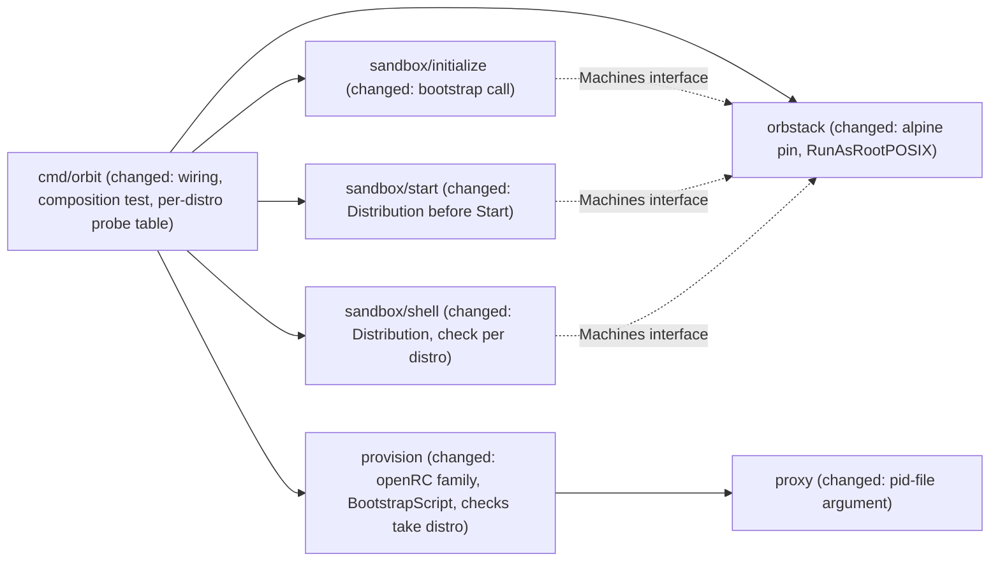

# Alpine sandboxes in release 0.2: `--distro alpine`, then Alpine as the default

Issues: epic #46 (E04); E04-S02 #52 with its tasks #53 (E04-S02-T01), #54 (E04-S02-T02), #55 (E04-S02-T03); E04-S03 #56; E04-S04 #57.
Evidence: `.ai/analysis/2026-11-12-orbstack-alpine-debian-spike.md` (#47, cited as "spike 47, topic N"), `.ai/analysis/2026-11-12-boundary-unit-failure-poweroff-spike.md` (#83, cited as "spike 83").
Extends: .ai/specs/2026-11-12-sandbox-distributions.md
Extends: .ai/specs/2026-11-10-sandbox-provisioning.md
Extends: .ai/specs/2026-11-11-rootless-docker.md
Extends: .ai/specs/2026-11-11-claude-code-agent-definition.md
Extends: .ai/specs/2026-11-11-orbit-shell.md
Extends: .ai/specs/2026-11-11-orbit-stop-start.md
Extends: .ai/specs/2026-11-12-escape-suite.md

## 📝 TLDR

The owner wants Alpine sandboxes, with Debian and Ubuntu as fallbacks. On 2026-11-12 the owner deferred Alpine to release 0.2, both as a choice and as the default. Release 0.1 ships `--distro ubuntu|debian` (`.ai/specs/2026-11-12-sandbox-distributions.md`, "the 0.1 spec"). This spec designs 0.2. `orbit init --distro alpine` will create an Alpine 3.23 sandbox with the same boundary, toolchain, Claude Code client, and rootless Docker as on Ubuntu. After that, a separate change makes Alpine the default for new sandboxes, but only when every gate of the 0.1 spec's Q5 has passed. The design adds one more provisioning family, OpenRC, next to apt/systemd. It adds a POSIX bootstrap that installs bash before any bash script runs, and Orbit's own OpenRC readiness and boot checks on every Orbit entry path. The agent's engine runs as a supervised system service, because Alpine has no systemd user manager. OrbStack is blocked on the owner's Mac while this is written. Every claim that needs a running machine and that spike 47 did not observe is marked **[UNVERIFIED]**, with a verification step in the Verification ledger.

## Resolved assumptions (autonomous defaults)

These were the open questions of this spec. Each was answered with the most reversible default (autonomous mode), and the owner can override any of them before merge. Questions that the 0.1 spec already decided (its Q2–Q7) are not asked again. Their answers apply here and are cited where used.

| # | Question | Applied default | Why |
|---|---|---|---|
| Q1 | One spec for S02, S03, and S04, or three? | **One spec, with one phase per story.** Each phase ships as its own PR. | The three stories share the OpenRC family, the readiness checks, and the evidence runs. Three specs would repeat that design three times. The 0.1 spec did the same for S01. Splitting later only means moving sections. |
| Q2 | How does root run scripts on a machine without bash (#53)? | **A POSIX bootstrap.** A new adapter call, `RunAsRootPOSIX` (`orb -m NAME -u root sh -s`), runs `provision.BootstrapScript(distribution)` before the root script, on every distribution. The bootstrap checks `/etc/os-release` and installs `bash` when it is missing. Every other script keeps `bash -s`. | This was the 0.1 spec's direction (topic 3). Epic decisions 4 and 7 already put bash on Alpine. A fully POSIX root script would rewrite all of `internal/provision`. Its only extra gain, bookworm's dash, is not pinned. |
| Q3 | Does the firewall use the stock OpenRC `nftables` service with an Orbit `rules_file`, as the 0.1 spec's design input said? | **No. An Orbit-owned service, `orbit-firewall`, in the `boot` runlevel, whose `stop` leaves the table loaded.** The stock `nftables` service stays in no runlevel, and its `rules_file` points at the Orbit rules file. | The stock `stop()` flushes the ruleset (spike 47, topic 4). The owner decided on #168 that a root stop must keep egress closed (PR #191 does this for systemd). A function in `/etc/conf.d` cannot override the `stop()` of an init script reliably. |
| Q4 | Can `alpine` enter the enum before rootless Docker works on Alpine (S02 before S03)? | **No. The value lands once, in one PR, with the S02 and S03 evidence.** The S02 tasks and S03 build the renderer behind unit tests and golden files. Then a single step adds `alpine` to the three tables and runs the full integration suite and the escape suite on Alpine. There is no hidden or experimental flag. | `init` always runs the Docker client setup, so an `alpine` value without an engine would fail on every `init`. The 0.1 spec put `debian` on `main` only together with its evidence. A hidden flag is an option that nobody asked for. |
| Q5 | What if the boot-window attempt W01 finds direct egress by the agent uid before the firewall loads? | **It blocks step 13 (the `alpine` value), not only the default.** Step 13 first tries the mitigations of topic 4: `orbit-firewall` in `sysinit`, and IPv6 autoconfiguration off on `eth0` until the firewall is loaded. If W01 still fails, step 13 stops until the owner either accepts the measured window in writing, as a known limit next to O01, or rejects Alpine. | Direct egress by the agent uid is an R03 matter, and accepting it is the owner's call, not a default. Only a raw `orb -u agent` can run in the window, so the owner may well accept it, but a spec default must not. Spike 47 measured IPv4 as closed and did not check IPv6. |
| Q6 | `--privileged` starts a container on Alpine (spike 47, topic 9). Q1 of the 0.1 spec allowed this on Debian 13 trixie only. | **This spec does not decide it.** Step 13 adds `alpine` and stops until the owner answers. The recommended answer is to allow it with the same proof as Debian: E18–E22 and M02 on Alpine, and R11 extended to Alpine. Without a yes, Alpine cannot ship, because Orbit cannot refuse the flag (the agent owns its daemon). | The 0.1 spec, which the owner approved, already says that a privileged container that starts on another distribution "is a change that the owner decides". Deciding here would change an active `risk-high` requirement. Leaving it open costs nothing until step 13. |
| Q7 | Alpine's tinyproxy crashes with the Orbit `PidFile` line (no `/run/tinyproxy`). Do we drop the line, or create the directory at boot? | **Drop the line on the OpenRC family.** `proxy.Config` gains a pid-file argument, and `""` leaves the line out. Ubuntu and Debian pass today's path, so their bytes do not change. | Spike 47 observed that the version without the line works. Creating the directory with `checkpath` in an Orbit service is the alternative; it was not tested and it would give OpenRC two pid files. |
| Q8 | Does the in-machine guard require an exact Alpine release (`3.23.8`) or any 3.23 patch release? | **Any 3.23 patch release.** `ID=alpine` and `VERSION_ID` matching `3\.23\.[0-9]+`. | The pin is `alpine:3.23`. OrbStack resolved it to 3.23.8 in the one spike run, and it presumably follows the newest 3.23.x **[UNVERIFIED, V2]**, so an exact guard would break every new sandbox at the next patch release. A minor release (3.24) is a new pin, and a new pin needs its own evidence run. |

**Owner gates at implementation time** (they do not block the merge of this spec; the step that needs them stops until the owner answers):

- **Before step 13:** Q6. Q5, only if W01 fails after the mitigations. The brief rows that step 13 would otherwise contradict: the D20 amendment (Alpine toolchain), the enum of D19 and D28 with `alpine`, the opt-in clause of D29, and, if Q6 is yes, R11 extended to Alpine.
- **Before step 15:** the default clause of D29 and the *Scope → Now* line.

## 📝 Problem Statement

- The owner asked on 2026-11-11 for Alpine by default, with Debian and Ubuntu as fallbacks (#46). On 2026-11-12, after spike 47, the owner deferred Alpine to 0.2 (#48), because Alpine needs a second implementation of the boundary and has open gaps.
- Every provisioning step after the prelude assumes apt and systemd: `installPackages`, `staticDNS` (systemd-resolved), `Units`, `startBoundary`, `selfCheck`, `boundaryCheck` (`systemctl`), `sshCheck` (`dpkg -S`), and the rootless engine as a systemd user unit (`internal/provision/{script,units,docker,check,ssh}.go`). The adapter runs every script with `bash -s` (`internal/orbstack/orbstack.go`, `runAsRootArgs`, `runAsAgentArgs`), and the Alpine image has no bash (spike 47, topic 2).
- `orbit start` and `orbit shell` check the boundary with `systemctl` scripts that take no input (`provision.BootCheckScript`, `ReadinessScript`, `MarkerCheckScript`, injected in `cmd/orbit/main.go`). On Alpine those scripts are the only gate on Orbit's paths: Alpine has no login gate of any kind, and at first contact after a boot every boundary service was still stopped, in 8 of 8 runs (spike 47, topic 1).
- The 0.1 spec, Q5, names the four conditions that gate Alpine and Alpine as the default. This spec turns each condition into a design and a test.

## 📝 Prior spec drift

- `.ai/specs/2026-11-12-sandbox-distributions.md`, topics 1, 2, and 7: **not implemented yet.** PR #189 (E04-S01-T01, #50) adds `sandbox.Distribution` with `ubuntu` only, the pinned image table, and `Create(ctx, name, dir, key, forward)`. #51 (profiles, the os-release guard, `debian`) has no PR yet. This spec builds on the 0.1 design as written. Its Phase 0 waits for #49–#51 to merge.
- The same spec, topic 4, design-input table, row `nftables.service`: "stock `nftables` service in `default`, `rules_file` pointed at an Orbit-owned path". PR #191 (#168, open) shows that the owner wants a root stop of the firewall service to keep the table loaded. The stock OpenRC `stop()` flushes the ruleset. This spec replaces that row (Q3).
- The 0.1 spec's Delta has not been archived into `.ai/specs/capabilities/` yet. The MODIFIED entries below that name 0.1 requirements ("Distribution of a new sandbox", "The same boundary on every distribution", and the 0.1 version of "Privileged containers on the tested OrbStack version") apply after Phase 0, once that archive step has run.
- The same spec, topic 10, reserves escape ids E18–E22 and M02 for the privileged attempts. PR #191 (open) adds a case named `E18-nftables-stop` to `TestEscapeRestart`. Whichever of the two lands second renumbers its ids. This spec cites the privileged attempts as "E18–E22 of the 0.1 spec", and its own new case has the id W01, which collides with neither.
- `internal/provision/script.go:16` has `Version = 3`. PR #191 raises it to 4. Alpine machines are new, so this spec bumps nothing (topic 2).

## 📝 Proposed Solution

### Topic 1: the `alpine` value, its pin, and the stored image

- `sandbox.Distributions()` becomes `ubuntu, debian, alpine`. Appending keeps the order stable. The refusal message of the 0.1 spec becomes `unknown distribution "<v>"; use one of: ubuntu, debian, alpine`.
- Adapter pin: key `alpine` → `orb create … alpine:3.23`. Stored `image.distro` / `image.version`: expected `alpine` / `3.23` **[UNVERIFIED, V1]**. The Ubuntu row stores a codename (`resolute`), not the version that was passed, so the Alpine spelling must be captured, not guessed. Step 13 commits the real `orb list --format json` capture as the fixture of `parseDistribution`, and `TestInitPinsTheStoredImage` pins it.
- Provision profile `alpine`: family `openRC`, guard `ID=alpine` and `VERSION_ID=3\.23\.[0-9]+` (Q8; content **[UNVERIFIED, V2]**: spike 47 recorded "Alpine Linux v3.23.8", the pretty name, not the file).
- The composition test of the 0.1 spec (`TestEveryDistributionHasAnImageAndAProfile`) holds the three lists equal. No slice and no agent definition compares a distribution name. The rule of the 0.1 spec, topic 1, applies unchanged.

### Topic 2: the OpenRC family in `internal/provision`

`profile.family` gains a second value, `openRC`. `Script(ScriptInput)` dispatches on the family to one of two private renderers: the existing apt/systemd body (unchanged), and a new `openRCScript` in `internal/provision/openrc.go`. The pieces that the 0.1 spec calls shared stay shared and keep their signatures: `Firewall`, `policy.Allowlist`, `sshFiles` (with the netcat path taken from the profile), the harden script body (with the group list from the profile), and `putFile`/`writeFiles`. The `profile` struct gains data fields and no behavior:

| Field | apt/systemd (`ubuntu`, `debian`) | `alpine` | Evidence |
|---|---|---|---|
| `guard` | `ID=…`, `VERSION_CODENAME=…` (`grep -qx`) | `ID=alpine`, `VERSION_ID=3\.23\.[0-9]+` (`grep -Eqx`) | Q8; V2 |
| `packages` | unchanged | toolchain `git openssh-client curl ca-certificates jq ripgrep unzip bash libgcc`; infrastructure `nftables tinyproxy netcat-openbsd`; root helpers `shadow runuser setpriv iproute2-ss` | spike 47, topics 7 and 8; 0.1 Q6 (no `libstdc++`) |
| `netcatPath`, owner check | `/usr/bin/nc.openbsd`, `dpkg -S` | `/usr/bin/nc`, `apk info -W` | spike 47, topic 4 |
| `firewallPath` | `/etc/nftables.conf` | `/etc/orbit/firewall.nft` (Orbit-owned, not a package conffile) | spike 47, topic 4; Q3 |
| `proxyPidFile` | `/run/tinyproxy/tinyproxy.pid` | `""` (no line) | spike 47, topics 4 and 7; Q7 |
| `environmentPath` `PATH` | unchanged | without `/usr/games:/usr/local/games:/snap/bin` | spike 47, topic 6 |
| `privilegedGroups` | unchanged | adds `wheel` | spike 47, topic 3 |
| `rootMembersAllowed` | none | `wheel`, `adm` (Alpine makes root a member of both) | spike 47, topic 3 |

The order of `openRCScript` mirrors the apt family, and each step stays fail-closed:

1. **Prelude**: `set -euo pipefail` (bash, installed by the bootstrap), the os-release guard of the profile, then `rm -f` of the marker. The guard runs before anything changes, as in 0.1.
2. **Packages**: `apk add --no-cache <packages> </dev/null`. Root installs directly from the Alpine repositories, outside the proxy (D17), as apt does today. No new egress host (spike 47, topic 8; epic decision 8).
3. **DNS**: the static `/etc/resolv.conf` of `staticDNS` (the stock file is a symlink into `/opt/orbstack-guest`, as on Ubuntu), plus one idempotent `nohook resolv.conf` line in `/etc/dhcpcd.conf`. Nothing needs masking: there is no systemd-resolved (spike 47, topic 5).
4. **Files**: the firewall rules at `firewallPath`; `/etc/conf.d/nftables` with `rules_file=<firewallPath>`, so that a stray start of the stock service loads Orbit's table and not the stock `flush ruleset` file; the init scripts of topic 4; `/etc/conf.d/tinyproxy` (`rc_need="orbit-firewall orbit-proxy-address"`); `/etc/conf.d/crond` (`rc_need="orbit-boundary"`); mode `0644` on `/etc/init.d/nftables` (topic 4); the tinyproxy configuration without `PidFile`; the allowlist; `/etc/environment`; `/etc/profile.d/orbit-path.sh` (topic 6); the SSH files; the harden script; and `/etc/doas.conf`, root-owned, mode 0400, with no `permit` line.
5. **Start the boundary** (topic 4): `rc-update` adds, then `nft -f <firewallPath>`, `rc-service orbit-firewall start` (never `restart`), `rc-service orbit-proxy-address start`, `rc-service tinyproxy restart`, `rc-service orbit-harden restart`.
6. **Agent user**: `useradd --create-home --shell /bin/bash --user-group agent`, `passwd -l`, the uid floor, and `orbstack` only with forwarding. These are the same lines as `createAgent`; `shadow` provides the tools.
7. **Gate and engine**: `rc-service orbit-boundary start` (never `restart`), then the engine of topic 7 (`rc-service orbit-docker start`, never `restart`).
8. **Self-check** (topic 5), then the **marker**.

`Version` is not bumped: an Alpine machine is new, and the apt bytes do not change (golden files). A golden `testdata/script-alpine.sh` pins the OpenRC bytes.

**Alternatives considered.** *Branches inside the apt renderer* (`if family == openRC`): every step differs, so the functions would carry two bodies each and the Ubuntu golden would be at risk with every Alpine change. Rejected. *A `distro` interface with methods per step:* an abstraction with two implementations and one caller. The private family switch is enough (AGENTS.md: no abstraction for single-use code).

### Topic 3: the bootstrap, and scripts without bash (#53)

```go
// BootstrapScript returns the POSIX sh script that root runs before Script on
// a machine of the distribution: it fails unless /etc/os-release matches the
// profile, and installs bash when the profile's family needs it and it is
// missing. The same input yields the same bytes.
func BootstrapScript(distribution string) ([]byte, error)
```

- The body is one braced group, so the whole script parses before any of it runs. A truncated script fails to parse, and a child cannot read the rest of standard input. These are the guarantees of `provision.group`, given here in POSIX syntax: `{`, `set -eu`, `fail()`, `unset HTTP_PROXY HTTPS_PROXY http_proxy https_proxy NO_PROXY no_proxy` (on a re-init, OrbStack gives root the proxy variables of `/etc/environment`, and root installs packages directly, as in the prelude of `Script`), the guard lines, `command -v bash >/dev/null 2>&1 || apk add --no-cache bash </dev/null`, `command -v bash >/dev/null 2>&1 || fail "bash is missing"`, `}`. There is no `pipefail`, which the script does not need. For the apt family the install line is left out, and the guard and the `command -v bash` check remain.
- Adapter: `RunAsRootPOSIX(ctx, name, script) error` runs `orb -m NAME -u root sh -s` with fixed arguments. It has the same preconditions as `RunAsRoot` (Orbit prefix, `State` running). `RunAsRoot` and `RunAsAgent` keep `bash -s`. The adapter runs no other new command.
- `init` order: after the mount check (`ActiveMounts` uses `cat`, which BusyBox has), `init` calls `RunAsRootPOSIX(bootstrap)` and then `RunAsRoot(script)`. It does this on every distribution, so no slice compares names. That adds one `orb` call per `init` on Ubuntu and Debian. A failed bootstrap on a machine that the call created deletes the machine, as a failed provisioning does today.
- `start` and `shell` never run the bootstrap. On a machine that never finished `init`, their `bash -s` check fails, and the slice reports `ErrNotProvisioned` or `ErrBoundaryDown` as today. That is fail-closed.
- The agent install keeps `curl -fsSL https://claude.ai/install.sh | bash`, because bash is in the Alpine toolchain (0.1 Q6). `agent.Definition` does not change (0.1 spec, topic 8).
- BusyBox ash parsing a braced group from `orb … sh -s` standard input before it runs it: expected from POSIX, **[UNVERIFIED, V3]**. The unit tests prove it for dash (the CI runner) and for bash, and the adapter integration test proves it on Alpine.

### Topic 4: OpenRC services, boot order, and the firewall stop (#54)

| Service (runlevel) | `depend()` | Start | Stop |
|---|---|---|---|
| `orbit-firewall` (`boot`) | `need localmount; before net; provide firewall` | `nft -f <firewallPath>` | `return 0`: the table stays loaded (Q3, #168 parity). `reload` is the same as `start`. |
| `orbit-proxy-address` (`default`) | `need localmount; before tinyproxy` | the `orbit0` dummy address `172.31.255.1/32` (spike 47, topic 7, verbatim) | `return 0` |
| `tinyproxy` (`default`, stock script) | stock, plus `rc_need="orbit-firewall orbit-proxy-address"` | stock | stock |
| `orbit-harden` (`default`) | `need localmount; after orbit-firewall` | the harden script | `return 0` |
| `orbit-boundary` (`default`) | `after orbit-firewall orbit-proxy-address tinyproxy orbit-harden`, **ordering only, never `need`** | the gate script (topic 5); as its last action it writes its own start time (field 22 of `/proc/self/stat`) to `/run/orbit/boundary-up` | `return 0` |
| `orbit-docker` (`default`) | `need orbit-boundary; after tinyproxy` | topic 7 | supervise-daemon stop |

- `orbit-firewall` sits in `boot`, not `default`, so that it loads before every service of `default`, `networking` and `dhcpcd` among them. Spike 47 measured the firewall at +0.2 s with the stock service in `default`, before the IPv4 address. OrbStack's `boot` runlevel holds only `bootmisc devfs syslog`, and has no `localmount` (spike 47, topic 1). That `need localmount` pulls `localmount` into `boot`, and that `before net` orders across runlevels, are **[UNVERIFIED, V4]**. Whether any IPv6 address exists before the firewall loads is also **[UNVERIFIED, V4]**. W01 (topic 8) measures both.
- **Mitigations, if W01 fails** (Q5; in this order, each with W01 again): (1) `orbit-firewall` in `sysinit`, with `need` only on what `nft` needs; (2) a root-owned `/etc/sysctl.d/orbit-ipv6.conf` with `net.ipv6.conf.eth0.autoconf=0` and `accept_ra=0`, applied by the `sysctl` service of `boot`, so `eth0` gets no global IPv6 address before `orbit-firewall` loads. Neither has been tried; both are root-only data of the profile. Mitigation 2 would remove IPv6 from the sandbox, which the boundary does not need, because the proxy dials out as the `tinyproxy` uid.
- **Other boot paths that run agent code** (the boundary must precede them, as the "Enforcement survives a restart" requirement says): the stock `default` runlevel runs `crond` (spike 47, topic 1). `/etc/conf.d/crond` gets `rc_need="orbit-boundary"`, so cron jobs of any user start only after the gate. The self-check also requires that `/etc/crontabs` holds no file except `root`. `/etc/local.d`, `/etc/user/init.d` (the per-user OpenRC instance of `docker-rootless-extras`, not used), and `getty` are inventoried in V18. Whether the agent can install a crontab on Alpine (BusyBox `crontab` needs setuid through `bbsuid`) is **[UNVERIFIED, V18]**.
- The gate uses `after` because, in OpenRC, a restart of a `need` dependency stops and restarts its dependents (spike 47, topic 7, problem 2). `init` restarts `tinyproxy` and `orbit-harden`, so a `need` would cascade into the gate and into the agent's engine. The script starts `orbit-boundary` and never restarts it, so `orbit-docker`'s `need` does not cascade. This is the same reasoning as `gateUnit` (`internal/provision/docker.go`).
- No init script exports `PATH`: doing so removes `/usr/libexec/rc/bin`, and `checkpath` and `einfo` then fail (spike 47, topic 9).
- **The stock `nftables` service is neutralized**, because its `stop()` flushes the ruleset, which is the #168 class under the name an operator would type. It is in no runlevel. Every `init` sets `/etc/init.d/nftables` to mode `0644`, so that `rc-service nftables start|stop` refuses to run it **[UNVERIFIED, V7]**. Its `rules_file` points at Orbit's file, so that even a start by another path loads Orbit's table. The readiness and boot checks of `shell` and `start` (topic 5) require the stock `nftables`, `docker`, and `containerd` services to be stopped and in no runlevel, not only the self-check of `init`. Both `orbit-firewall` and the stock script `provide firewall`. OpenRC picks the provider that is in the runlevel, which is only `orbit-firewall` **[UNVERIFIED, V7]**. Whether `apk upgrade nftables` starts a service or restores the mode of the script is **[UNVERIFIED, V7]**. Every `init` sets the mode again, and the checks refuse a sandbox where the stock service runs.

### Topic 5: Orbit's root-side checks on OpenRC (the gate)

The 0.1 spec established that `orb -u` sessions pass every login gate on every distribution, and that Orbit's paths are gated by root-side checks. On Alpine those checks are the only gate. Condition 1 of 0.1 Q5 is met when every Orbit entry path runs the OpenRC check of the machine's distribution:

| Entry path | Today | 0.2 |
|---|---|---|
| `init` | `selfCheck` at the end of `Script` | `selfCheck` of the family |
| `start` | `BootCheckScript()`, then `MarkerCheckScript()` | `Distribution(ctx, name)` (the adapter call of the 0.1 spec; it reads `orb list` and starts nothing), read **before** `Start`; then `BootCheckScript(d)` and `MarkerCheckScript(d)` |
| `shell` | `ReadinessScript()` | `Distribution(ctx, name)` after the mount checks, then `ReadinessScript(d)` |
| the agent's supervised services | `user@.service` requires `orbit-boundary-gate.service` | `orbit-docker` `need orbit-boundary` |

- The check scripts take the distribution: `BootCheckScript(distribution string) ([]byte, error)`, `ReadinessScript(…)`, and `MarkerCheckScript(…)`. Each refuses an unknown name. The slice fields become `func(string) ([]byte, error)`, and `cmd/orbit` injects them. When `Distribution` fails, `shell` and `start` refuse with the adapter's error, wrapped. They do not use `ErrNotProvisioned`, whose message names `orbit init`: a transient `ErrMachineList` is not a provisioning problem, and `init` refuses an `ErrUnknownImage` too. For `ErrUnknownImage` the message says that the stored image of the sandbox matches no pin of this Orbit version. `start` refuses before `Start`, so the machine stays stopped. `DockerSetupScript` stays without input: it ran unmodified on Alpine (spike 47, topic 9).
- **OpenRC boundary check** (`unitsCheck` of the family): the table `inet orbit_egress` is loaded; `rc-service <svc> status` exits 0 for `orbit-firewall`, `orbit-proxy-address`, `tinyproxy`, `orbit-harden`, and `orbit-boundary`; the stock `nftables`, `docker`, and `containerd` services are stopped and in no runlevel (topic 4); and the pid in tinyproxy's pid file is alive and its `/proc/<pid>/comm` is `tinyproxy`, so a reused pid does not pass. That pid file is `/run/tinyproxy.pid`, written by OpenRC through the stock script's `pidfile=` (spike 47, topic 4); it is not the `PidFile` line of the configuration, which Q7 drops. The pid check exists because `rc-service tinyproxy start` printed `[ ok ]` while the status was `crashed` (spike 47, topic 7, problem 1). The exit codes of `status` for `crashed` and `stopped` are **[UNVERIFIED, V6]**. The check therefore also requires the printed status to be `started`. There is no `systemd-user-sessions` and no `/run/nologin` on Alpine (no PAM gate).
- **End of the boot on OpenRC** (`waitForBoot` of the family; 0.1 Q5, condition 1): wait at most `bootWaitSeconds` until `/run/openrc/softlevel` holds `default` and no `openrc` process runs (the `::wait:/sbin/openrc default` entry of `/etc/inittab` has returned). The state is not trusted, and the checks after it decide, as with `systemctl is-system-running --wait`. This assumes that `/run` is a fresh tmpfs at every boot, so that no `softlevel` from the previous boot survives. That assumption, and the exact commands on OpenRC 0.63 / BusyBox 1.37, are **[UNVERIFIED, V5]**. BusyBox `pgrep -x` matches nothing (spike 47, topic 2), so the check uses `pidof openrc`.
- **Self-check additions** of the family: the stock `nftables`, `docker`, and `containerd` services are in no runlevel and are stopped; `rc-service orbit-firewall stop` leaves the table loaded (exercised by the integration test, not by the script); `/etc/doas.conf` holds no `permit` line and `/etc/doas.d` is empty; `runuser -u agent -- doas -n true` fails; `nohook resolv.conf` is present; `apk info -W <netcatPath>` names `netcat-openbsd`; `/etc/init.d/nftables` is not executable; `/etc/conf.d/crond` holds the `rc_need` line; `/etc/crontabs` holds no file except `root`. The `sudo -n -l` loop, the uid floor, and the group checks are unchanged, with `wheel` added, and with root allowed in `wheel` and `adm`.

### Topic 6: the agent's `PATH`, and Claude Code on musl (#55)

- `/etc/profile.d/orbit-path.sh` (root, 0644, rendered for the `openRC` family only) puts `$HOME/.local/bin` in front of `PATH` when it is not already there. Root never writes into a home (provisioning invariant). Spike 47, topic 6, observed that every `orb -u` entry on Alpine applies `/etc/profile.d` (`PROFILED_VAR` set), and `orbit shell` starts the login shell, bash, which reads `/etc/profile`. That `claude` resolves in `orbit shell` and in `bash -lc` on Alpine is **[UNVERIFIED, V8]**. The agent integration test asserts it.
- Toolchain on musl: `bash` and `libgcc`, not `libstdc++`, and no `USE_BUILTIN_RIPGREP` (0.1 Q6). Spike 47, topic 8, observed this for Claude Code 2.1.322: `ldd` lists only `ld-musl`, and `claude doctor` reports `Search: OK (bundled)`. That the version current at implementation needs nothing more is **[UNVERIFIED, V9]**. If a later client needs `libstdc++`, its install fails loudly, and the fix is a profile package line, not a change to the client (R04).
- The installer contacted only `claude.ai`, `downloads.claude.ai`, and `api.anthropic.com` (spike 47, topic 8). No new egress host, so no question for the owner (epic decision 8).

### Topic 7: rootless Docker on Alpine (#56)

- **Packages** (root, `apk add`): `docker docker-cli-buildx docker-cli-compose docker-rootless-extras shadow-uidmap shadow-subids slirp4netns` (spike 47, topic 9, without `fuse-overlayfs`). The spike's storage driver was `overlayfs`, but `fuse-overlayfs` was installed. That rootless `overlayfs` works without it is **[UNVERIFIED, V13]**. If it does not, the package goes back into the list. Docker 29.5.2, compose 2.40.3, and buildx 0.30.1 were observed; the versions at implementation are whatever Alpine 3.23 ships.
- **No rootful engine:** the `docker` and `containerd` services stay in no runlevel and stay stopped, and neither socket exists. OpenRC has no `mask`. The self-check enforces this state, and the agent is not in `docker` (`privilegedGroups`).
- **Sub-ids:** `usermod --add-subuids 100000-165535 --add-subgids 100000-165535 agent`, only when `/etc/subuid` has no `agent` line. Alpine's `useradd` writes none (spike 47, topic 9). `subIDCheck` is unchanged. `helperPermissions` (`chmod 4755` on `newuidmap`/`newgidmap`) is unchanged; the paths are the same.
- **Supervision:** an Orbit system service, `orbit-docker`, as tested in spike 47, topic 9, with two changes. The uid is resolved at run time (`agent_uid=$(id -u agent)` in the script; `XDG_RUNTIME_DIR=/run/user/$agent_uid`), not hard-coded as `1000`. RootlessKit's network is set explicitly, as on Ubuntu: `DOCKERD_ROOTLESS_ROOTLESSKIT_NET=slirp4netns` and `DOCKERD_ROOTLESS_ROOTLESSKIT_DISABLE_HOST_LOOPBACK=true`. The service keeps `supervisor=supervise-daemon`, `command_user=agent:agent`, `respawn_max=0`, `respawn_delay=2`, `output_logger`/`error_logger` through `logger`, the proxy variables at `172.31.255.1:3128`, and `start_pre` `checkpath` for `/run/user` and `/run/user/$agent_uid`.
- **What the agent can do:** it cannot stop, restart, or reconfigure `orbit-docker` (only root runs `rc-service`). It can kill its own `dockerd`, which supervise-daemon restarts, and it can run another `dockerd-rootless` by hand as itself. That is the same power it has over its systemd user unit on Ubuntu. The 0.1 spec's reasoning on `--privileged` (the agent owns its daemon) holds.
- **Network namespace of `dockerd`:** the M01 detector (escape suite, A3) relies on rootless container traffic leaving the machine as the agent uid, which holds when `dockerd` runs in RootlessKit's own namespace. Alpine ships RootlessKit 2.3.5. Whether its `dockerd` runs there, or in the machine's namespace (detach-netns), is **[UNVERIFIED, V12]**. Step 13 compares `readlink /proc/<dockerd>/ns/net` with that of pid 1, and M01 must still detect its weakening on Alpine. If the namespaces are equal, the escape suite's A3 note gains an Alpine paragraph. Either way the attempts of E06 must fail.
- **No resource limits** (0.1 Q7, accepted): `--memory`, `--pids-limit`, and `--cpus` are accepted and not enforced, because OpenRC delegates no cgroup controllers (spike 47, topic 9). Orbit does not move `init` into a child cgroup to work around this. That is a root-side change to the cgroup layout of the machine, and Q7 accepted the gap. The `--distro` help text names the gap.

### Topic 8: tests and evidence

**Unit tests (default gate, no OrbStack):**

- `internal/provision`: every structural test that runs per distribution now also covers `alpine`; the golden `testdata/script-alpine.sh`; `BootstrapScript` for every distribution; and a **truncation test** that cuts each bootstrap at every byte before its final `}`, then runs the prefix with `sh -n` under `/bin/sh` and under `bash --posix`, and expects a parse error each time (the CI runner's `/bin/sh` is dash). A unit test also requires that no OpenRC init script exports `PATH`, that `orbit-boundary` has no `need`, that `orbit-firewall`'s `stop()` is `return 0`, and that the guard comes before the marker removal. Hostile input: an unknown or empty distribution is refused by `Script`, `BootstrapScript`, and every check script.
- `internal/proxy`: `Config(hosts, pidFile)` with `""` has no `PidFile` line, and the bytes with today's path are unchanged (a golden test).
- `internal/orbstack`: `RunAsRootPOSIX` arguments are fixed and take no caller input; the prefix and running-state refusals; and the `alpine` pin and stored-image fixture (from V1).
- Slices: `init` calls the bootstrap before the root script and deletes a machine that it created when the bootstrap fails. `start` reads `Distribution` before `Start`, refuses an unknown image with the machine still stopped, and passes the distribution to both check scripts. `shell` reads `Distribution` and refuses an unknown image or an unreadable list with the adapter error, wrapped, never `ErrNotProvisioned`.
- `cmd/orbit`: the composition test with three values.

**Integration tests and the escape suite (by hand, on a Mac with OrbStack, `ORBIT_IT_DISTRO=alpine`):**

- The probe harness becomes per distribution in test code only, with a table keyed by `ORBIT_IT_DISTRO`: the service verbs (`systemctl …` or `rc-service …`), the rules file path, `pgrep -o tinyproxy` (not `-x`), the listener exclusion of UDP 546 (`dhcpcd`, DHCPv6, root-owned), and the group check that allows root in `wheel` and `adm` (spike 47, topic 7, probe changes). Product code compares no name.
- **Alpine harness before the enum value** (Q4 keeps `alpine` out of the enum until step 13): an integration test, `TestOpenRCProvisioning` (`cmd/orbit`, integration tag, test code only), creates a test-local Alpine machine with `orb create --isolated --isolate-network alpine:3.23`, as the adapter test of step 3 does. It renders the private `alpine` profile, runs the bootstrap and the root script through the adapter, runs the self-check, restarts the machine, and runs the OpenRC boot check and the probe table. Steps 6–10 extend it, so each Phase 2 PR carries Alpine evidence for its own change, and step 13 does not have to resolve every ledger item at once. It is not a user option, so Q4 holds.
- The ordering probe of `afterStartProbes` and E13 ("every boundary unit entered active before any process of a uid from 1000 up") needs one clock on both sides. On OpenRC, the gate script writes its own start time, field 22 of `/proc/self/stat` (clock ticks since the VM kernel booted, the same clock as every other process), into `/run/orbit/boundary-up`. The probe compares it with field 22 of every process of a uid from 1000 up. It excludes, and lists in the log, only the processes whose ancestry leads to the session helper of OrbStack for an `orb -u` call. A negative control runs first: a uid-1000 process that root starts from `/etc/local.d` before the gate must be flagged. The OpenRC per-service time (`started 00:00:14` in `rc-status`) has a resolution of one second, which is not enough (spike 47, topic 7: everything started in the same second). The name of the session helper process and the resolution of the result are **[UNVERIFIED, V17]**.
- **W01, boot window** (new, in `TestEscapeRestart`, on every distribution): `orbit stop`, then the test calls the adapter's `Start` in a goroutine, and at once starts a raw `orb -m <m> -u root` loop every 0.1 s until the table is loaded. On each turn it logs the time, the `ip -4` and `ip -6` addresses with global scope on `eth0`, and the table state. Whenever an address of a family exists while the table is absent, it starts, in the background so that the sampling continues, a direct try as the agent uid (`setpriv --reuid <agent>`) to `1.1.1.1:443` or `[2606:4700:4700::1111]:443` with a 1 s timeout. **Control per family:** once the table is loaded, uid 0, which the firewall accepts, must reach the same target directly. A family whose control fails is reported `n/a: no <family> route`, never passed. The attempt passes when its control passed and no try connected. It logs the window length (first contact to table loaded) as an observation. A pass on Ubuntu and Debian is expected, because the boundary was up at first contact in 18 of 18 runs. Afterwards `orbit start` must succeed. Q5 decides what a failure on Alpine blocks.
- On Alpine, the existing integration tests then show what spike 47 did not run: `init` itself, the project mount and the agent's write access on Alpine **[UNVERIFIED, V11]**, SSH forwarding and `--no-ssh-forwarding` **[UNVERIFIED, V10]**, `claude` on the login `PATH` (V8, V9), `containerTraffic`, `leakProbe`, compose and buildx through the proxy **[UNVERIFIED, V13]**, `init` twice without restarting the engine (V15), and the privileged table row (Q6, V14).
- **Run time:** spike 47 timed `apk add` at 3 s, against 16 s for apt. No integration or escape run on Alpine exists **[UNVERIFIED, V16]**. Under 0.1 Q2 and Q3, which apply to every distribution that the enum holds, a boundary PR runs the escape suite three times (about 41 min on today's Ubuntu figure of 13.5 min each, plus E18–E22 where allowed). A release runs the full suite three times, as three invocations, each under the 60 min timeout of one test binary.

### Topic 9: Alpine becomes the default (#57)

`sandbox.DefaultDistribution` becomes `Alpine` in its own PR, after these gates, each with a pasted transcript:

1. The full integration suite and the escape suite pass on `alpine`, `debian`, and `ubuntu` on the same OrbStack version and the same `main` head (#57, AC 2).
2. W01 passes on Alpine in 10 of 10 restarts, with both family controls passed or `n/a` (Q5). An owner's acceptance from step 13 carries over only when the measured window has not grown.
3. The privileged row of `alpine` matches the run, in both directions (0.1 spec, topic 10). Q6 itself was answered before step 13.
4. The owner has landed the default clause of D29 and the *Scope → Now* line.

The help text becomes `distribution of a new sandbox: ubuntu, debian, alpine (default alpine; alpine does not enforce container resource limits)`. The integration default of `ORBIT_IT_DISTRO` follows `sandbox.DefaultDistribution`. An existing sandbox keeps its stored distribution, whatever the default (0.1 spec, topic 7). `orbit ls` is unchanged (epic decision 9).

## 📝 Delta

### Capability: sandbox-provisioning

#### MODIFIED Requirement: Distribution of a new sandbox
The system SHALL create a new sandbox on `DefaultDistribution` when `--distro` is not given, or on Ubuntu 26.04 (`ubuntu`), Debian 13 trixie (`debian`), or Alpine 3.23 (`alpine`) when it is given, from an image that only the adapter's pinned table names, and SHALL refuse any other `--distro` value before any OrbStack command. `DefaultDistribution` is `ubuntu` until Phase 4, and `alpine` after it.

##### Scenario: Alpine sandbox
- WHEN `orbit init --distro alpine --agent claude-code` runs in a project directory without a machine
- THEN OrbStack creates the machine from `alpine:3.23` with `--isolated --isolate-network`, the bootstrap and the root script of `alpine` provision it, and the output names `alpine`

##### Scenario: Value outside the enum
- WHEN `orbit init --distro <v>` runs with `v` in `Alpine`, `alpine:3.23`, `alpine:edge`, `3.23`, `bookworm`
- THEN init fails with `unknown distribution "<v>"; use one of: ubuntu, debian, alpine`, and runs no OrbStack command

##### Scenario: Default after Phase 4
- WHEN `orbit init` runs without `--distro` in a project directory without a machine, after Phase 4
- THEN the machine is created from `alpine:3.23`; where the machine exists, it keeps its stored distribution

Frozen by: `internal/sandbox/distribution_test.go`, `internal/sandbox/initialize/handler_test.go` (both from E04-S01; characterized again in step 1)

#### ADDED Requirement: Root scripts run on a machine without bash
The system SHALL run, as root and before the root script, a POSIX `sh` bootstrap that parses as a whole before it runs, fails unless `/etc/os-release` matches the distribution, and installs bash when the distribution needs it and lacks it.

##### Scenario: Fresh Alpine machine
- WHEN `init` runs on a new Alpine machine, which has no bash
- THEN the bootstrap installs bash, the root script then runs with `bash -s`, and `init` succeeds

##### Scenario: Truncated bootstrap
- WHEN the bootstrap is cut at any byte before its final `}`
- THEN `sh` refuses it with a parse error, nothing in it runs, and the marker is not written

##### Scenario: Bootstrap on the wrong machine
- WHEN the bootstrap of `alpine` runs on an Ubuntu machine
- THEN it exits non-zero before it installs anything

#### MODIFIED Requirement: Init of a project directory
The system SHALL create the machine of the project directory on its resolved distribution when it does not exist, and SHALL then run the bootstrap of that distribution, provision the machine with its root script, and set up the Docker client of `agent`, also when the machine already existed. When the bootstrap, provisioning, or the client setup fails on a machine that the same call created, the system SHALL delete that machine and report the failure.

##### Scenario: Bootstrap fails on a new machine
- WHEN the bootstrap fails on a machine that this call created (for example, `apk add bash` fails)
- THEN the machine is deleted, the root script did not run, and the error names the bootstrap

##### Scenario: Init of an existing machine
- WHEN `init` runs in a project directory whose machine exists, on any distribution
- THEN the bootstrap and the root script of its own distribution run again, the client setup runs again, the machine is not created or deleted, and `Created` is false

Frozen by: `internal/sandbox/initialize/handler_test.go` (`TestHandleCreatesTheMachine`, `TestHandleKeepsAnExistingMachine`, the call lists characterized in step 1)

#### MODIFIED Requirement: The same boundary on every distribution
The system SHALL give a Debian or an Alpine sandbox every requirement of this capability and of `sandbox-containers`, `sandbox-lifecycle`, `sandbox-shell`, `ssh-agent-forwarding`, `agent-install`, and `escape-suite` that an Ubuntu sandbox has. On Alpine, OpenRC services take the place of systemd units, and container resource limits are not enforced (0.1 Q7).

##### Scenario: Integration and escape runs on Alpine
- WHEN the integration tests and the escape suite run with `ORBIT_IT_DISTRO=alpine`
- THEN every test that passes on Ubuntu passes on Alpine, and the privileged attempts follow the privileged table (Q6). The one exception is W01, and only when the owner has accepted its measured window in writing (Q5); it is then reported as `accepted window`, never as passed.

##### Scenario: The stock firewall service cannot flush the ruleset
- WHEN root runs `rc-service nftables start` and then `rc-service nftables stop` on a running Alpine sandbox
- THEN the table `inet orbit_egress` stays loaded, a direct connection of `agent` still fails, and the next `orbit shell` succeeds only if the stock service is stopped

##### Scenario: No sudo, doas, or wheel
- WHEN root checks an Alpine sandbox after provisioning and after a restart
- THEN no account except root has a sudo or doas rule, `/etc/doas.conf` has no `permit` line, `agent` and the default user are in neither `wheel` nor `adm`, and `doas -n true` as `agent` fails

##### Scenario: Firewall stop keeps egress closed
- WHEN root runs `rc-service orbit-firewall stop` on a running Alpine sandbox
- THEN the table `inet orbit_egress` stays loaded, and a direct connection of `agent` still fails

##### Scenario: A boundary service fails at boot
- WHEN `orbit-firewall`, `orbit-proxy-address`, `tinyproxy`, or `orbit-harden` is not started after the boot of an Alpine sandbox
- THEN `orbit-docker` and `crond` do not start, `orbit start` stops the machine again and names the service, and `orbit shell` refuses and names `orbit init`

Frozen by: `cmd/orbit/provision_integration_test.go` (`TestInitProvisionsTheSandbox`, run per `ORBIT_IT_DISTRO`), `cmd/orbit/escape_shared_integration_test.go` (`TestEscapeShared`)

#### MODIFIED Requirement: Enforcement survives a restart
The system SHALL start the firewall, the proxy address, and the proxy at every boot, before any agent process that the machine starts by itself. On the apt/systemd family they are enabled units before `systemd-user-sessions.service`. On the OpenRC family they are OpenRC services, with the firewall in the `boot` runlevel, and the agent's engine and `crond` both need `orbit-boundary`.

##### Scenario: Restart of the machine
- WHEN the machine restarts and `agent` then connects directly to a public address and through the proxy to an allowed host
- THEN the direct connection fails and the proxied one succeeds, on every distribution

Frozen by: `cmd/orbit/provision_integration_test.go` (`TestInitProvisionsTheSandbox`, restart probes), `internal/provision/units_test.go`

#### MODIFIED Requirement: Fixed toolchain
The system SHALL install git, openssh-client, curl, ca-certificates, jq, ripgrep, and unzip as root, plus bash and libgcc on Alpine, and the agent SHALL NOT be able to install a system package.

##### Scenario: The agent runs the package manager
- WHEN `agent` runs `apt-get install -y htop` on Ubuntu or Debian, or `apk add htop` on Alpine
- THEN it fails, and `git`, `ssh`, `curl`, `jq`, `rg`, and `unzip` run

Frozen by: `internal/provision/script_test.go`

### Capability: sandbox-lifecycle

#### MODIFIED Requirement: The boundary is up after a start
The system SHALL report success for `orbit start` only when the boot of the machine's distribution finished, the kernel mounts exactly the project directory, the firewall table `inet orbit_egress` is loaded, and the boundary services of that distribution are active: the firewall, the proxy address, the proxy, the hardening service, and `systemd-user-sessions.service` on systemd, or `orbit-boundary` on OpenRC. On a failure of one of these, the system SHALL stop the machine again. The system SHALL read the distribution from OrbStack's stored image before it starts the machine.

##### Scenario: Boundary service fails at boot on Alpine
- WHEN `tinyproxy` is `crashed` after the boot of an Alpine sandbox
- THEN Orbit stops the machine again, exits 1, and the message names `tinyproxy`

##### Scenario: Unknown stored image
- WHEN the stored image of the machine matches no pin
- THEN `orbit start` exits 1 before it starts the machine, and the machine stays stopped

Frozen by: `internal/sandbox/start/handler_test.go`, `cmd/orbit/stopstart_integration_test.go`

### Capability: sandbox-shell

#### MODIFIED Requirement: Refuse a sandbox that is missing, stopped, mismounted, or not ready
The system SHALL refuse to open the shell, exit non-zero, and change no machine when the sandbox of the current directory does not exist, is not running, does not mount exactly the project directory, has a stored image that matches no pin, or fails the readiness check of its distribution.

##### Scenario: Not ready on Alpine
- WHEN a boundary service of an Alpine sandbox is not started, or the marker holds another version
- THEN Orbit exits 1, names `orbit init`, and opens no shell

Frozen by: `internal/sandbox/shell/handler_test.go`

### Capability: sandbox-containers

#### MODIFIED Requirement: Rootless engine of the agent
The system SHALL give the user `agent` its own rootless Docker Engine, started at every boot of the machine only after the boundary is up, as a systemd user unit behind `orbit-boundary-gate.service` on the apt/systemd family, or as the supervised system service `orbit-docker` that needs `orbit-boundary` on the OpenRC family. It SHALL run no rootful Docker or containerd daemon. On Alpine, container resource limits are accepted and not enforced.

##### Scenario: Pull, build, and run on Alpine
- WHEN `agent` runs the pull, build, compose, and run steps of "Pull, build, and run" and "Docker Compose" on an Alpine sandbox
- THEN each succeeds on the engine of `agent`, `docker info` reports `rootless`, and the proxy log shows the registry and package hosts

##### Scenario: No rootful engine on Alpine
- WHEN root checks an Alpine sandbox after provisioning and after `orbit stop` and `orbit start`
- THEN the `docker` and `containerd` services are in no runlevel and stopped, and neither `/var/run/docker.sock` nor `/run/docker.sock` exists

##### Scenario: Init does not restart the engine
- WHEN `init` runs again on an Alpine sandbox whose agent has a running container
- THEN the container keeps running, and `orbit-docker` keeps its pid

##### Scenario: Limits on Alpine
- WHEN `agent` runs `docker run --memory 64m --pids-limit 50 alpine cat /sys/fs/cgroup/memory.max` on Alpine
- THEN the container runs, and the value is not enforced; the `--distro` help text names the gap

##### Scenario: Boundary service failed at boot on Alpine
- WHEN `orbit-firewall` fails at boot of an Alpine sandbox
- THEN `orbit-boundary` does not reach `started`, `orbit-docker` and `crond` do not start, and no process of a uid from 1000 up runs, except a process that `orb -u agent` starts

##### Scenario: Repair after a failed boot on Alpine
- WHEN the gate and `orbit-docker` failed at boot, the cause is removed, and the owner runs `orbit init`
- THEN `orbit-boundary` and `orbit-docker` are started, and the client setup succeeds

Frozen by: `cmd/orbit/docker_integration_test.go` (`TestInitGivesTheAgentRootlessDocker`), `internal/provision/docker_test.go`

#### MODIFIED Requirement: Privileged containers on the tested OrbStack version
The system SHALL carry, in the integration tests, the privileged table of the 0.1 spec, with a row per distribution of the enum. The `alpine` row is `pending` until the owner answers Q6. While a row is `pending`, every run on that distribution fails with `privileged decision pending for <distro>`. After the owner's answer, the row is `allowed` (E18–E22 and M02 run on Alpine and must hold) or the `alpine` value does not ship. The other rows and the stale-table rule of the 0.1 spec are unchanged.

##### Scenario: Pending decision
- WHEN the integration tests run with `ORBIT_IT_DISTRO=alpine` and the `alpine` row is `pending`
- THEN the run fails with `privileged decision pending for alpine`, and reports no attempt as passed

##### Scenario: Allowed on Alpine
- WHEN the owner allowed privileged containers on Alpine, and `docker run --privileged alpine true` starts as `agent` on Alpine
- THEN its `uid_map` maps 0 to the uid of `agent`, and E18–E22 and M02 run and hold

Frozen by: `cmd/orbit/escape_verdict_test.go` (`TestAttemptVerdict`), `cmd/orbit/docker_integration_test.go` (`TestInitGivesTheAgentRootlessDocker`)

### Capability: agent-install

#### ADDED Requirement: The client is on the login `PATH` on every distribution
The system SHALL make `claude` resolve by name in a login shell of `agent` after `init --agent claude-code`, on every distribution, without writing into the home of `agent` as root.

##### Scenario: Alpine login shell
- WHEN `orbit init --distro alpine --agent claude-code` succeeded and `agent` runs `bash -lc 'claude --version'`
- THEN it prints the version, and the only Orbit file that sets the path is root-owned and outside `/home`

### Capability: escape-suite

#### ADDED Requirement: The boot window is measured on every distribution
The system SHALL run W01 in the restart sandbox of every distribution: from the first contact after a start until the firewall table is loaded, no direct connection by the agent uid over IPv4 or IPv6 succeeds. The system SHALL log the length of the window.

##### Scenario: A window opens
- WHEN a direct try connects while the table is absent
- THEN W01 fails with `ESCAPE: W01 succeeded: <family> <address> at +<s>`, and step 13 does not merge unless the owner accepts the window in writing (Q5)

##### Scenario: No route for a family
- WHEN uid 0 cannot reach the target of a family directly after the table is loaded
- THEN W01 reports that family as `n/a: no <family> route`, and does not count it as passed

##### Scenario: No address before the firewall
- WHEN no address of a family exists before the table loads
- THEN W01 passes for that family and logs `no <family> address before the firewall`

## 📝 Architecture



The diagram shows no new module and no new import edge. The slices already reach the adapter through `Machines` and receive provisioning scripts as injected functions. `provision` already imports `proxy`. The OpenRC renderer is a private file of `internal/provision`. So the design needs no Key decisions row for a module or a dependency. Step 16 adds one dated row for the OpenRC family, the bootstrap, and the gate of topic 5, and changes the Provisioning requirements line that names the image.

| Package | Change |
|---|---|
| `internal/sandbox` | `Alpine` constant; `Distributions()` gains it (step 13); `DefaultDistribution = Alpine` (step 15). |
| `internal/sandbox/initialize` | `BootstrapScript func(string) ([]byte, error)` field; `Machines.RunAsRootPOSIX`; the call order of topic 3; help text. |
| `internal/sandbox/start`, `internal/sandbox/shell` | `Machines.Distribution`; check-script fields take the distribution; the order of topic 5. `internal/sandbox/AGENTS.md` records the new order. |
| `internal/orbstack` | `alpine` pin; `RunAsRootPOSIX`; the fake gains both. |
| `internal/provision` | `family` `openRC`; `openrc.go` (renderer, init scripts, OpenRC checks); `BootstrapScript`; check scripts take the distribution; profile fields of topic 2; golden `script-alpine.sh`. |
| `internal/proxy` | `Config(hosts, pidFile)`. |
| `cmd/orbit` | Wiring; the per-distribution probe table, W01, and the `/run/orbit/boundary-up` ordering probe (test code only). |
| `.ai/specs/product-brief.md` | Unchanged by this PR (section "Proposed brief changes"). |

## 📝 API Contracts

- **CLI:** `orbit init [--agent claude-code] [--no-ssh-forwarding] [--distro ubuntu|debian|alpine]`. Exit codes are unchanged. Only the help text and the refusal message gain `alpine`.
- **Adapter:** `RunAsRootPOSIX(ctx, name string, script []byte) error`. It runs `orb -m name -u root sh -s` with the script on standard input, with fixed arguments, the Orbit prefix check, and the running-state check of `RunAsRoot`.
- **Provision:** `BootstrapScript(distribution string) ([]byte, error)`; `BootCheckScript`, `MarkerCheckScript`, and `ReadinessScript` take `(distribution string)` and return `([]byte, error)`. Each is deterministic per input and refuses an unknown or empty name with `ErrScriptInput`.
- **Proxy:** `Config(hosts []string, pidFile string) (Files, error)`; an empty `pidFile` leaves the `PidFile` line out.

## 📝 Edge Cases & Failure Scenarios

| Case | Behavior |
|---|---|
| `apk add` fails (mirror down, package renamed in a 3.23 patch release) | The script fails, the marker stays absent, and `shell` and `start` refuse the machine. **New machine:** no table exists yet and no agent user exists yet, so nothing of the agent can use the open egress. The machine is deleted. **Re-init:** the table and the boundary of the previous run stay loaded, because the script does not touch them before the packages, and the agent user exists. `orbit init` fails and names the step. |
| The bootstrap cannot install bash | `init` fails, and a new machine is deleted. No bash script ran. |
| OrbStack resolves `alpine:3.23` to a patch release whose `VERSION_ID` the guard accepts but whose packages differ | The self-check decides; any missing piece fails before the marker. |
| OrbStack stores the Alpine image with another spelling after an upgrade | `ErrUnknownImage`. `init`, `start`, and `shell` refuse every existing Alpine sandbox, fail-closed, until the pin row is updated with evidence. |
| `tinyproxy` crashes at boot or later | No egress (fail-closed). The OpenRC check reads the status and the pid, not the start message. `orbit start` stops the machine again, and `orbit shell` refuses. |
| Root restarts `tinyproxy` or `orbit-harden` | `orbit-boundary` (ordering only) and `orbit-docker` keep running. |
| Root runs `rc-service orbit-firewall stop`, or `rc-service nftables start` / `stop` | `orbit-firewall` stop leaves the table loaded. The stock script is not executable (mode 0644), so `rc-service nftables` refuses to run it **[UNVERIFIED, V7]**. If something starts it anyway, it loads Orbit's file, and `shell` and `start` refuse the sandbox while it runs. |
| The agent installs a crontab, or a job of another user runs at boot | `crond` needs `orbit-boundary`, so no job runs before the gate. The self-check refuses any crontab except `root` in `/etc/crontabs` (V18). |
| Root runs `nft flush ruleset` by hand | Out of scope, as on Ubuntu: a root action. The next `orbit shell` or `orbit start` refuses (the table check). |
| `dhcpcd` would rewrite `/etc/resolv.conf` | Prevented by `nohook resolv.conf`; the self-check requires the line. |
| `apk upgrade` replaces `/etc/doas.conf` or `/etc/conf.d/nftables` | Modified conffiles get an `.apk-new` sibling instead of being replaced **[UNVERIFIED, V7]**. Every `init` rewrites them, and the self-check checks them. |
| Raw `orb -m <m> -u agent` during the boot window or with a failed service | Ungated on every distribution: the known limit O01. W01 measures whether the agent uid has direct egress in the window. If it does, step 13 stops (Q5). |
| `orbit start` or `orbit shell` cannot read the machine list | They refuse with the adapter's error, wrapped, and do not name `orbit init`. |
| A container requests memory, pid, or CPU limits on Alpine | Accepted, not enforced (0.1 Q7). Documented in the help text. |
| `--privileged` container on Alpine | Starts (spike 47). The owner decides before step 13 (Q6). Without a yes, step 13 does not merge. |
| `supervise-daemon` gives up | It does not: `respawn_max=0`. |
| `orbit init --distro alpine` on an existing Ubuntu or Debian sandbox | `ErrDistributionMismatch` (0.1 spec, topic 7); the machine is untouched. |

## 📝 Risks & Impact Review

- **A second boundary implementation.** Every boundary change from here on must be made, and proved, twice: in the apt/systemd renderer and in the OpenRC one. Mitigations: shared data (firewall, allowlist, SSH files, harden body), the golden files, and the escape suite on every distribution of the enum (0.1 Q2). The cost is about 13.5 min of escape suite per boundary PR for each distribution added.
- **The gate on Alpine is only Orbit's own check.** Alpine has no login gate and does not hold logins during boot. A raw `orb -u agent`, outside Orbit, can run before the boundary is up. Ubuntu has the same limit only while a unit has failed (O01). W01 measures the window, and Q5 keeps it from becoming the default unless it is closed or accepted.
- **Privileged containers start on Alpine.** This widens the kernel surface reachable by the agent, as on Debian (0.1 spec, Risks). The owner decides (Q6). Orbit cannot prevent it.
- **No container resource limits on Alpine.** Accepted (0.1 Q7). A runaway container can exhaust the machine. The VM limits of OrbStack still apply to the machine.
- **The default is a durable choice.** Switching the default (step 15) affects every new sandbox of every user. It is reversible with a one-line revert, and existing sandboxes keep their distribution. Removing `alpine` from the enum later would strand Alpine sandboxes with `ErrUnknownImage` until `orbit destroy`.
- **Evidence is pending, because OrbStack is blocked on the owner's Mac** (macOS 27.2.1 blocks its binaries). Every **[UNVERIFIED]** item below is a test or a command of a step, not a belief the design depends on silently. Spike 47 ran on OrbStack 2.2.5. The evidence runs must log the OrbStack version that is current when it is unblocked, and they must pass on it.
- **Rollback:**
  - Phase 1 (the bootstrap call in `init`) and step 7 (`start` and `shell` read the distribution) change behavior on Ubuntu and Debian. Reverting either is a boundary change and needs the Ubuntu and Debian escape runs.
  - The rest of Phase 2 is reachable only from tests, so a revert of it is free.
  - After step 13, reverting leaves Alpine sandboxes that the old build refuses with `ErrUnknownImage`. That is fail-closed, and the user runs `orbit destroy`.
- **A possible cron gap on Ubuntu and Debian, outside this spec.** Topic 4 gates `crond` on Alpine. Whether `cron.service` on Ubuntu or Debian can run an agent crontab before `orbit-boundary-gate.service` is not checked here. If it can, that is a gap in the 0.1 boundary. It should be checked separately; this spec does not change the apt family.

### Verification ledger (OrbStack-dependent, run by hand)

| Id | Claim | Verification step | Plan step |
|---|---|---|---|
| V1 | `alpine:3.23` is stored as `alpine` / `3.23` | `orb create --isolated --isolate-network alpine:3.23 orbit-v1-<rand>`; `orb list --format json`; commit the entry as the fixture; delete the machine | 13 |
| V2 | `/etc/os-release` has `ID=alpine` and `VERSION_ID=3.23.<n>` | `orb -m <m> -u root cat /etc/os-release` | 6 (`TestOpenRCProvisioning`), 13 (`TestInitPinsTheStoredImage`) |
| V3 | BusyBox ash parses the braced bootstrap from `sh -s` standard input before running it, and refuses a truncated one | Adapter integration test: `RunAsRootPOSIX` with the full bootstrap (bash appears) and with a prefix cut before `}` (non-zero, bash absent) on a fresh Alpine machine | 3 |
| V4 | No IPv6 address with global scope, and no direct egress, exists before `orbit-firewall` loads | W01, 10 restarts on Alpine | 13, 15 |
| V5 | `/run/openrc/softlevel` = `default` and `pidof openrc` empty marks the end of the boot on OpenRC 0.63, and `/run` is a fresh tmpfs at every boot (no `softlevel` survives) | `orb restart`; poll both from a raw `orb -u root` every 0.1 s; compare with `rc-status`; `findmnt /run` | 6 |
| V6 | `rc-service <svc> status` exit codes and output for `started`, `stopped`, and `crashed` | Kill tinyproxy with `kill -9`; read `rc-service tinyproxy status; echo $?` | 6 |
| V7 | `rc-service orbit-firewall stop` keeps the table; `apk upgrade`/`apk fix nftables tinyproxy doas` starts no service and keeps modified conffiles | Run each as root; `nft list tables`; `rc-status`; `ls /etc/*.apk-new /etc/conf.d/*.apk-new` | 6, 13 |
| V8 | `claude` resolves in `bash -lc` and in `orbit shell` through `/etc/profile.d/orbit-path.sh` | Agent integration test on Alpine | 13 |
| V9 | The current Claude Code on musl needs no `libstdc++` and no host beyond its definition | `ldd ~/.local/share/claude/versions/*`; the tinyproxy log during `init --agent claude-code` | 13 |
| V10 | SSH agent forwarding and `--no-ssh-forwarding` behave on Alpine as on Ubuntu (`host-ssh-agent.sock`, group `orbstack`) | `TestSSHAgentForwarding*`, E15, E21 on Alpine | 13 |
| V11 | The project mount is writable by `agent` on Alpine and shows the host owner | `TestInitProvisionsTheSandbox` mount probes on Alpine | 13 |
| V12 | Alpine's `dockerd` runs in RootlessKit's own network namespace, or M01 still detects its weakening | `readlink /proc/<dockerd pid>/ns/net` against `/proc/1/ns/net`; `TestEscapeWeakenedBoundary` on Alpine | 13 |
| V13 | Compose, buildx builds, `containerTraffic`, and `leakProbe` pass through the proxy on Alpine | `TestInitGivesTheAgentRootlessDocker` and E06 on Alpine | 13 |
| V14 | `--privileged` starts on Alpine on the current OrbStack, and E18–E22/M02 hold | The privileged table check and E18–E22/M02 with `ORBIT_IT_DISTRO=alpine` | 13 (after Q6) |
| V15 | A second `init` restarts neither `orbit-boundary` nor `orbit-docker` | `TestInitRunsAgainAfterRepeatedRuns` on Alpine, plus pid comparison | 13 |
| V16 | Alpine integration and escape run times stay under the 60 min per-binary timeout | The timed runs of step 13 | 13 |
| V17 | The gate's own `/proc/self/stat` start ticks in `/run/orbit/boundary-up` order the boundary before every agent process; the OrbStack session-helper ancestry is identifiable; the `local.d` negative control is flagged | `afterStartProbes` and E13 on Alpine, through `TestOpenRCProvisioning` | 10, 13 |
| V18 | `crond` with `rc_need="orbit-boundary"` runs no job before the gate; the agent cannot install a crontab (or one is refused by the self-check); `/etc/local.d`, `/etc/user/init.d`, and `getty` run no agent code at boot | `rc-update show -v`; `ls -l /usr/bin/crontab /bin/bbsuid`; as `agent`, `crontab -l` and `echo '@reboot id' \| crontab -`; restart and list the processes of uid ≥ 1000 | 6 |
| V19 | `need localmount` from a `boot`-runlevel service pulls in `localmount`, and `orbit-firewall` loads before `networking` and `dhcpcd` | `rc-status -a` after a restart; the W01 log | 6, 13 |

## 📝 Decisions in play

Relies on R03, R04, R07, R08, R10, A01, A05, D08, D12, D14, D16, D17, D19, D20, D22, D26, and the proposed D28 of the 0.1 spec. Applies the 0.1 spec's decisions Q2–Q7 (coordinator, under the owner's delegation) and Q1 (owner). Leaves Q6 of this spec to the owner (privileged containers on Alpine), because the owner's Q1 limited privileged containers to Debian 13 trixie. Owner of all: Jakub Tobiasz. This PR changes no brief row.

## 📝 Proposed brief changes (the owner lands them)

The brief is a protected contract. This PR leaves `.ai/specs/product-brief.md` unchanged. The ids below assume that D28 of the 0.1 spec has landed. If it has not, the first free id is used.

- **New row D29** (active, owner; source: owner request of 2026-11-11 on #46 and the deferral of 2026-11-12 on #48). It is in two clauses, because they land at different steps:
  - *Opt-in clause (lands before step 13):* Release 0.2 adds Alpine 3.23 (`orbit init --distro alpine`, image `alpine:3.23`, any 3.23 patch release), with the same boundary as Ubuntu and Debian, implemented with OpenRC services and Orbit's root-side checks on every Orbit entry path. The value ships only after the owner has decided privileged containers on Alpine, and after W01 passes on Alpine or the owner accepts its measured window. Alpine containers get no enforced resource limits. This amends D28 (the enum) and D20 (toolchain).
  - *Default clause (lands before step 15):* Alpine becomes the default for new sandboxes once the integration tests and the escape suite pass on all three distributions on one head, and W01 passes on Alpine in 10 of 10 restarts. An existing sandbox keeps its distribution.
  - *Why:* The owner prefers Alpine (smaller, 35 MB against about 560 MB). Spike 47 showed a working boundary under OpenRC and named the gaps that the gates close.
- **D20, amended** (Alpine only): the toolchain on Alpine adds `bash` and `libgcc` (0.1 Q6). Root also installs `shadow`, `runuser`, `setpriv`, and `iproute2-ss` as infrastructure.
- **D19 / D28, the command line:** `--distro ubuntu|debian|alpine`.
- **Scope → Now** (0.2): "The sandbox runs Alpine 3.23 by default, or Ubuntu 26.04 or Debian 13 trixie with `--distro` (D29)." This line replaces the 0.1 line when step 15 merges.
- **R11** (only if the owner answers Q6 with yes; lands before step 13): the text of the 0.1 spec, topic 10, with "on Debian 13 trixie" extended to "on Debian 13 trixie and Alpine 3.23", and the escape-suite clause naming both.
- **Order:** the D20 amendment, the enum of D19/D28, the opt-in clause of D29, and R11 land before step 13. The default clause of D29 and the *Scope → Now* line land before step 15.

## 📋 Phasing

- **Phase 0, prerequisites.** E04-S01 (#49, #50, #51) merged; PR #191 (#168) merged or closed, with the escape-id collision resolved; E18–E22 and M02 of the 0.1 spec in the escape suite.
- **Phase 1, scripts without bash (E04-S02-T01, #53).** The bootstrap, `RunAsRootPOSIX`, and the `init` call order, on Ubuntu and Debian. The adapter's integration test proves V3 on a test-local Alpine machine.
- **Phase 2, the OpenRC family (E04-S02-T02, #54; E04-S02-T03, #55; E04-S03, #56).** The renderer, the services, the checks, `PATH`, and the engine. Each is covered by unit tests, the Alpine golden file, and the test-only integration harness `TestOpenRCProvisioning` on a test-local Alpine machine. No enum value yet (Q4). Step 7 changes `start` and `shell` on every distribution.
- **Phase 3, `alpine` with its evidence (closes #52 and #56).** The value in all three tables, with the integration suite and the escape suite on Alpine. It comes after the owner's answer to Q6, after the brief rows of the opt-in clause have landed, and after W01 passes (or the owner accepts its window).
- **Phase 4, Alpine by default (E04-S04, #57).** Behind the gates of topic 9.
- **Phase 5, records.** Documents and the archive of the Delta.

## 📋 Implementation Plan

### Phase 1: scripts without bash

1. **Characterize.** Pin today's call list of `init` on the fake: `Create`, `ActiveMounts`, `RunAsRoot`, `RunAsAgent`… Pin the arguments of `runAsRootArgs` and `runAsAgentArgs`. Green on unchanged code; commit alone. → verify: `go test ./internal/sandbox/... ./internal/orbstack/...`
2. **`BootstrapScript`.** Add it for the existing profiles, with the guard and the `command -v bash` check, plus the truncation test under `/bin/sh` and `bash --posix`, and the hostile-input refusals. → verify: `go test ./internal/provision/...`
3. **`RunAsRootPOSIX` and the `init` order.** Add the adapter call and the fake, the `Machines` method, the `BootstrapScript` field, and the deletion of a new machine on a bootstrap failure. The adapter integration test creates an Alpine machine through a test-local `orb create --isolated --isolate-network alpine:3.23` and checks V3. → verify: the full gate; `go test -tags integration -p 1 -run 'TestRunAsRootPOSIX|TestInitProvisionsTheSandbox' ./internal/orbstack/ ./cmd/orbit/` (OrbStack)

### Phase 2: the OpenRC family

4. **`proxy.Config(hosts, pidFile)`.** Add the golden test that keeps today's bytes, and the `""` case. → verify: `go test ./internal/proxy/... ./internal/provision/...`
5. **Profile fields and family switch.** Add the fields of topic 2 to the existing profiles, with the apt values. The Ubuntu and Debian goldens are unchanged. → verify: `go test ./internal/provision/...`
6. **`openRCScript` and the OpenRC checks.** Add the renderer, the init scripts of topic 4 (`orbit-firewall` stop is `return 0`, `orbit-boundary` has no `need`, no `PATH` export), the hardening with `wheel` and doas, `nohook`, `orbit-path.sh`, the OpenRC `unitsCheck` and `waitForBoot`, and the check scripts with a distribution argument. Add the `crond` and stock-`nftables` lines. The private `alpine` profile is reachable only from tests. Add the golden `script-alpine.sh`. Add `TestOpenRCProvisioning` (topic 8): a test-local Alpine machine, the bootstrap, the root script twice, the self-check, a restart, and the OpenRC boot check. It asserts V2, V5, V6, V7, V18, and V19, and the PR pastes its transcript. → verify: `go test ./internal/provision/...`; `go test -tags integration -p 1 -run TestOpenRCProvisioning -v ./cmd/orbit/` (OrbStack)
7. **Slices read the distribution.** `start` reads `Distribution` before `Start`; `shell` reads it after the mount checks; both pass it to the check scripts; wiring in `cmd/orbit`. Characterize the call lists first (as in step 1). → verify: the full gate; on Ubuntu, `go test -tags integration -p 1 -run 'TestStop|TestStart|TestShell' ./cmd/orbit/`
8. **`PATH` and toolchain (#55).** Add the Alpine toolchain line (`bash libgcc`) and `orbit-path.sh` in the golden. Add a unit test that root writes nothing under `/home`. → verify: `go test ./internal/provision/...`
9. **Engine (#56).** Add `orbit-docker`, the Alpine Docker packages, the sub-id lines, the rootful-service check, and `rc-service orbit-docker start` (never restart). → verify: `go test ./internal/provision/...`
10. **Probe harness per distribution.** Add the test-side table of topic 8, the `boundary-up` ordering probe with its negative control, and W01 with its family controls. Run W01 on Ubuntu (expected to pass). `TestOpenRCProvisioning` runs the probe table, the ordering probe (V17), and W01 on its Alpine machine. If W01 fails there, try the mitigations of topic 4 in this step, so that step 13 does not meet the window for the first time. → verify: `go vet -tags integration ./...`; on Ubuntu, `go test -tags integration -p 1 -timeout 60m -run '^TestEscapeRestart$' -v ./cmd/orbit/`; `go test -tags integration -p 1 -run TestOpenRCProvisioning -v ./cmd/orbit/`
11. **Help text and limits note.** The `--distro` help text gains the limits note for `alpine` (it is not yet a value). → verify: `go test ./internal/sandbox/...`
12. **Privileged row, pending.** Add an `alpine` row with the value `pending` to the privileged table (test code). Any run with `ORBIT_IT_DISTRO=alpine` then fails with `privileged decision pending for alpine`, so no Alpine evidence can claim coverage before the owner decides. Ask the owner Q6 on #52, with the recommended answer. Step 13 starts only after the answer. → verify: `go test ./cmd/orbit/` (`TestAttemptVerdict` gains the `pending` case)

### Phase 3: `alpine` with its evidence

13. **Add `alpine`.** Add the enum value, the pin, the stored-image fixture (V1), the profile in `Distributions()`, the privileged row per Q6, and the mismatch handler tests. On a Mac with OrbStack, run `go test -tags integration -p 1 -timeout 60m ./...` with `ORBIT_IT_DISTRO=alpine`, and the escape suite on Alpine, Debian, and Ubuntu. Resolve V1, V3, V4, and V8–V16, and paste the transcripts with the OrbStack version and the W01 window lengths. Prerequisites: the owner's answer to Q6, and the brief rows listed under "Owner gates" for this step. If W01 fails on Alpine after the mitigations, the step stops and asks the owner on #52 (Q5); it merges only with a written acceptance, and the run then reports W01 as `accepted window`. → verify: the full gate; all three escape runs green (W01 on Alpine passed, or `accepted window` with the acceptance linked); every attempt of E18–E22 passes where the table says allowed

### Phase 4: Alpine by default

14. **Characterize the default.** `TestHandleCreatesTheMachine` asserts the `ubuntu` default. Green; commit alone. → verify: `go test ./internal/sandbox/...`
15. **Switch the default** (#57), after the gates of topic 9: `DefaultDistribution = Alpine`, the help text, `ORBIT_IT_DISTRO` default, the test of step 14 updated. Paste the three-distribution runs on one head. → verify: the full gate; the three runs green; W01 on Alpine 10 of 10, or the owner's written acceptance linked

### Phase 5: records

16. **Documents.** `ARCHITECTURE.md` (Key decisions row: the OpenRC family, the bootstrap, and the gate of topic 5; the Provisioning requirements line), root `AGENTS.md` (overview, validation per distribution), `internal/provision/AGENTS.md` (families, bootstrap, OpenRC invariants: `after` for the gate, never restart `orbit-boundary` or `orbit-firewall`, no `PATH` export), `internal/orbstack/AGENTS.md` (`RunAsRootPOSIX`, the `alpine` pin), `internal/sandbox/AGENTS.md` (the new orders of `init`, `start`, and `shell`), `internal/proxy/AGENTS.md` (the pid-file argument), `SDLC.md` (escape suite on three distributions), and `.ai/specs/2026-11-12-escape-suite.md` (W01, the A3 note per V12). → verify: the validation gate
17. **Archive the Delta** into `.ai/specs/capabilities/sandbox-provisioning.md`, `sandbox-lifecycle.md`, `sandbox-shell.md`, `sandbox-containers.md`, `agent-install.md`, and `escape-suite.md`. → verify: the files match the Delta.

`risk-high` evidence for every implementation PR: hostile-input unit tests for every new renderer and argument; the escape suite on every distribution that the enum holds at the PR head (0.1 Q2), pasted; a second reviewer; no self-QA.
