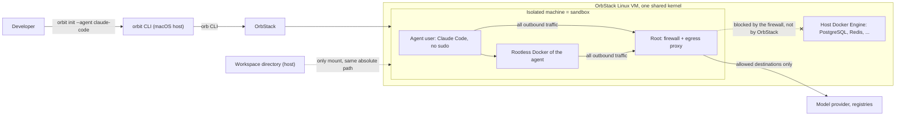

# Architecture — orbit

The code so far is the composition root in `cmd/orbit`, which registers `orbit init`; the OrbStack adapter in `internal/orbstack` (create, exists, delete, run a script as root or as the agent user); the sandbox module in `internal/sandbox` with the `init` slice that creates and provisions the machine, sets up the Docker client of the agent user, and installs the agent; the agent module in `internal/agent` with the Claude Code definition; and the pure modules `internal/policy`, `internal/proxy`, and `internal/provision`. The other modules under `internal/` do not exist yet. This file records the target structure, so that new code follows it. Rows marked **proposal** are not yet confirmed by the owner; they mirror the proposal rows in `.ai/specs/product-brief.md`. Keep this file current as the system changes. Agents read it (through `AGENTS.md`) before structural changes.

## Purpose and scope

Orbit is a Go CLI that runs coding agents in sandboxes on OrbStack. It is the OrbStack counterpart of local [Docker Sandboxes](https://docs.docker.com/ai/sandboxes/architecture/) (D13). The first version runs Claude Code on OrbStack on macOS, authenticated with the subscription of the user (D16). Other agents, Codex first, are added as agent definitions. A sandbox is one OrbStack isolated machine per project directory (D12, D18). Orbit supports no other engine (R07, N06).

Orbit deliberately does not provide cloud sandboxes, organization governance, kits, or an MCP gateway. It never gives an agent the engine socket of the host, and it builds no access to services on the host engine (D15). See the Non-goals in the product brief.

## System context



Docker Sandboxes have five isolation layers. This table maps each one to an OrbStack isolated machine.

| Layer in Docker Sandboxes | Orbit mechanism | Status | Known gap against `sbx` |
|---|---|---|---|
| Hypervisor: one microVM per sandbox | One isolated machine per sandbox: `orb create --isolated`. No macOS file system, no `mac` commands, no device passthrough. | active (D12) | All machines and containers share the kernel of the OrbStack VM. OrbStack does not recommend isolated machines against code that actively tries to exploit the kernel. The owner accepted this limit (A01). |
| Network: host proxy, deny by default | Inside the machine, root owns a firewall that sends all outbound traffic of every non-root uid, and so of the agent and its containers, to a root-owned egress proxy, which enforces the network policy (D14). The spike found that `--isolate-network` blocks only `host.orb.internal`; containers on the host engine and the Mac stay reachable for root in the machine, so the firewall is the only barrier for the agent. | active; held in the spike (A05) | The enforcement point is inside the sandbox, not on the host as in `sbx`. It holds only while the agent cannot become root in its machine. HTTPS is filtered by host name, without TLS interception. |
| Docker Engine: private engine per sandbox | The agent uses rootless Docker inside its machine. The host engine socket is never shared (R10). | active (D12, D14) | Rootless Docker has limits (ports below 1024; `io` and `cpuset` cgroup controllers are not delegated). `--privileged` supports the user namespace of the agent; it fails on OrbStack 2.2.5 for a reason of the platform, which an integration test pins, and Orbit cannot enforce it, because the agent owns its daemon. The agent has no sudo; `sbx` gives sudo. |
| Workspace: direct, clone, mountless | Direct mount first: `--mount SRC:SRC` for the project directory only, at the same absolute path (R08). Git worktrees live inside the project directory (D18). Clone and mountless later. | active | A direct mount is read-write. Files that run on the host later (Git hooks, build scripts, `.claude/` settings) need review after a session. |
| Credentials: host-side injection | Agent login: the user signs in with `/login` inside the sandbox. Orbit never stores or intermediates the credential (D08, R04). A token path is later scope (Q12). Host `~/.claude` is never mounted: on macOS it holds no login, and it holds the history of every project. Git: the host SSH agent is forwarded by default, as a socket; `orbit init --no-ssh-forwarding` leaves it out (R08). A06 is closed: an agent-run `ssh -T git@github.com` from inside a sandbox reaches GitHub through the forwarded agent (2026-11-11, OrbStack 2.2.5). The forwarded socket speaks the full ssh-agent protocol, so the agent can sign with every key in the Mac's agent: commits and tags as the owner, SSH login challenges that a party outside the sandbox relays through an allowed channel such as the GitHub push path, and probably manage the identities of the host agent. The owner accepted this risk (Q7 of `.ai/specs/2026-11-11-ssh-agent-forwarding.md`); on the host, use `ssh-add -c`, an agent that holds only a GitHub key, and keys restricted with `ssh-add -h`. Any other credential is opt-in, for example a short-lived token (D10). The login lives where the unmodified client puts it on Linux, `/home/agent/.claude/.credentials.json` (mode `0600`), on the disk of the machine; Orbit sets nothing and never reads that file (`TestNoGoFileOfTheModuleNamesTheCredential`). Readable by: `agent` and every process as `agent` (the client, its tools, other agents in the sandbox, later its rootless containers); root in the machine; any process of the Mac user through `orb -m <machine> -u agent` or `-u root`. Not readable by the default user in the machine (`/home/agent` is `0750`) or through `~/OrbStack/<machine>/home/agent` (`Permission denied`). Time Machine includes OrbStack's data directory (OrbStack 2.2.5), so a backup holds a copy of the login that outlives `orbit destroy`, unless the owner excludes the directory. A Mac process with Full Disk Access may read a copy of it (not verified). Host variables `ANTHROPIC_*` and `CLAUDE_*` do not reach the agent: the `orb` environment allowlist removes them (#76). | partly active | The agent can read its own login; `sbx` keeps it outside the sandbox. Orbit cannot do that: the provider terms forbid developers to intermediate the credential. A forwarded SSH agent lets the agent use every key in it; a token scoped to one repository, or a GitHub App, is narrower. |

## Components

The layout is a vertical slice architecture adjusted to Go. A **module** is a bounded context under `internal/`. A **slice** is one user-visible operation: one Go package that holds its contract, handler, CLI command, and tests.

```text
cmd/orbit/main.go          composition root: build adapters, wire slices, run
internal/
  sandbox/                 module
    sandbox.go             public API of the module: types and errors that other modules may use
    initialize/            slice of orbit init: contract.go, handler.go, command.go, handler_test.go
                           (Go refuses to import a package that is named init)
    stop/                  slice of orbit stop
    start/                 slice of orbit start: the only slice that starts a machine
    destroy/               slice of orbit destroy: deletes the sandbox of the current directory after a confirmation; runs no -m command
    shell/  list/
    internal/              private to the module (enforced by the Go compiler)
      hostcheck/           host-side checks before a machine is created or started, shared by init and start
      realpath/            canonical path of a directory; every slice resolves the project directory with it
  policy/                  module: policy.go (pure matching rules); allow/, deny/, list/ are later scope (D19)
  agent/                   module: agent definitions, one package per agent (claude/)
  credential/              module: which credentials a sandbox may get (R08)
  provision/               module: what root sets up in a machine: agent user, firewall, proxy, rootless Docker
  proxy/                   module: configuration of the egress proxy (tinyproxy) that root runs in the machine
  orbstack/                adapter: OrbStack isolated machines, through the orb CLI
    orbstacktest/          deterministic fake for handler tests
  kernel/                  shared kernel: only what three or more modules need
```

| Component | Location (planned) | Responsibility | Depends on |
|---|---|---|---|
| Composition root | `cmd/orbit` | Builds the adapters, adds the cobra command of every slice to the root command, prints errors, and sets the exit code. Contains no behavior. | every module |
| Sandbox | `internal/sandbox` | Lifecycle of the sandbox of a project directory: init, shell, stop, start, destroy, list (D19). Owns the sandbox spec and the mount rules. | `orbstack`, `provision`, `agent`, `policy`, `credential`, `kernel` |
| Policy | `internal/policy` | Network policy rules: the default rules, and matching a destination. Commands that list and change rules are later scope (D19). | `kernel` |
| Agent | `internal/agent` | What each agent needs: its install and its egress domains. See Agent definitions. Claude Code first. | `kernel` |
| Credential | `internal/credential` | Which host credentials a sandbox may get, and in which form. By default only the forwarded SSH agent socket, which `--no-ssh-forwarding` removes (R08). Until a second credential exists, the forwarding decision is the pure function `sandbox.CheckSSHForwarding` in `internal/sandbox`, and this module stays planned. | `kernel` |
| Provision | `internal/provision` | The root-owned setup of a machine: the agent user without sudo, the firewall, the proxy service, rootless Docker, the fixed toolchain. Owns the firewall rules as a pure function. | `policy`, `kernel` |
| Proxy | `internal/proxy` | The configuration of tinyproxy, the egress proxy that root runs in the machine (D22). The proxy enforces the policy. | `policy`, `kernel` |
| OrbStack adapter | `internal/orbstack` | The only package with OrbStack-specific code: create, start (`Start`), run a command in, stop (`Stop`), remove (`Delete`), list (`List`: names with the Orbit prefix, their state and stored mounts, read-only), and read the state (`State`) of isolated machines, and open the login shell of the agent user in one (`Shell`) (R07). `Start`, `Stop`, and `Delete` always name one machine: they refuse a name without the Orbit prefix or with white space before any command, because `orb delete` takes several names and `--all` deletes every machine. | — |
| Kernel | `internal/kernel` | Shared error and result types. Stays small. | nothing in this repository |

### Slice anatomy

- `contract.go` — the `Input` and `Output` structs and the sentinel errors of the operation. Write it first.
- `handler.go` — `Handler` with its dependencies as fields, and `Handle(ctx, Input) (Output, error)`. A handler declares the narrow interface it needs from OrbStack or a store; the adapter satisfies it. Do not create an interface for a helper that has one implementation and no test value.
- `command.go` — the CLI command: a constructor that takes the handler and returns a `*cobra.Command` (D23). The command binds flags to `Input`, calls the handler, and renders `Output` to the output stream of the command. No decisions here, no package-level state, and no `init()`.
- `handler_test.go` — table tests for the happy path, the invalid input, and the OrbStack failure.

### Agent definitions

An agent is data, not code paths. Each agent is one package under `internal/agent/` that exports one `agent.Definition`:

```text
internal/agent/
  agent.go        Definition type, Registry, Lookup(name)
  claude/         the Claude Code definition and its test
```

| Field of `Definition` | Meaning | Claude Code |
|---|---|---|
| `Name` | The value of `orbit init --agent` | `claude-code` |
| `Install` | The bash script that `init` runs as the agent user, after provisioning, to install the official client. The handler wraps it in one braced group with `set -euo pipefail` and the proxy settings of `/etc/environment`; a definition never repeats them. | `curl -fsSL https://claude.ai/install.sh \| bash` |
| `EgressDomains` | Destinations the client and its login need. They become default allow rules for a sandbox of this agent (D26). | the eight Claude Code hosts of D26 |

There is no `Start` and no `LoginHint`: Orbit does not start the agent (D19), and sign-in is `/login` in the client (D08). A field such as `StatePaths` comes when a slice reads it.

Rules:

- To add an agent, add one package with a `Definition` and its test, and register it in `cmd/orbit`. No slice changes.
- A slice gets an agent through the function `Agent func(name string) (sandbox.Agent, error)`, which `cmd/orbit` builds from the registry; the slice does not import `internal/agent`.
- No code outside `internal/agent/<name>` compares an agent name. A slice that needs agent-specific behavior gets a new field in `Definition`.
- A `Definition` holds no secret and no user-specific value.
- Each definition has a test that checks its fields against R04: an official install source, no change to the client, and no stored credential.

### Dependency rules

1. Nothing imports `cmd/orbit`. Only `cmd/orbit` imports the adapter `internal/orbstack`.
2. A slice imports the root package of its own module, the `internal/` of its own module, port packages, and `kernel`. A slice never imports another slice.
3. A module uses another module only through that module's root package. The Go `internal/` rule makes the private part unreachable.
4. `kernel` imports nothing from this repository.
5. A security decision is a pure function in a module, not logic in a handler or a command: the sandbox spec, mount validation, credential selection, firewall rules, and policy matching. Handlers load, call the function, and act on the result.

The compiler enforces rule 3. An import restriction in `golangci-lint` (depguard, in `.golangci.yml`) enforces the adapter part of rule 1. Restrictions for the rest of rule 1 and for rules 2 and 4 will follow once the packages that they name exist.

### Provisioning requirements

These come from the spike of 2026-11-10 on OrbStack 2.2.5 (`.ai/analysis/2026-11-10-orbstack-isolated-machine-spike.md`). Each one is covered by the escape suite (escape attempts) or by the integration test of its capability.

- Create the machine with `--isolated --isolate-network` and mount the workspace as `SRC:SRC`. A mount without a destination lands under `/mnt/mac`. The image is Ubuntu 26.04, the one the spike used.
- The machine name is the Orbit prefix, a slug of the directory name (at most 30 characters), and the first 16 hex characters of the SHA-256 of the canonical path of the project directory: `orbit-<slug>-<hash>`. Orbit finds the sandbox of a directory by computing this name.
- Remove the default user that OrbStack creates, or its sudo rule. It has passwordless sudo. Provisioning keeps the user, removes every file in `/etc/sudoers.d` (the image also ships `90-incus`, a passwordless rule for `ubuntu`), and locks its password. Its uid is the Mac uid, below 1000, so the firewall names it explicitly.
- systemd-resolved and its varlink sockets are masked, and `/etc/resolv.conf` names OrbStack DNS (`0.250.250.200`). Otherwise the agent can resolve any name through `resolvectl`, which no port 53 rule sees.
- The firewall rule matches every uid from 1000 up, not only the agent uid. Rootless container traffic leaves as the agent uid or as one of its sub-uids. IPv4, IPv6, DNS, UDP, and ICMP are covered.
- The proxy is tinyproxy (D22). A firewall rule for the uid of the proxy refuses private, link-local, and loopback destinations, except its DNS resolver, so that an allow rule cannot open the host engine or the Mac.
- The agent has no DNS. Its tools use the proxy: `HTTPS_PROXY`, the proxy settings in `~/.docker/config.json`, and the proxy environment of the root-owned user unit of the rootless Docker daemon.
- The firewall, the proxy, and the address that containers use to reach the proxy start as persistent units before any agent process. Without that, a restart leaves containers with no proxy (they fail closed).
- Allow rules are host names seen in `CONNECT`. This is not data-loss prevention: an allowed host can receive uploads, and a different TLS name behind an allowed host is not detected.
- The default allowlist is the base list of D26, plus the `EgressDomains` of the agent of the last `init`. Each `init` rebuilds it from its own `--agent`; Orbit stores no record of the installed agent. It is fixed in the first version.
- With SSH agent forwarding (R08), the host agent is the socket `/opt/orbstack-guest/run/host-ssh-agent.sock`, mode `660`, group `orbstack`. OrbStack fixes the setting when it creates the machine (`orb create --forward-ssh-agent`), so `init` refuses an existing machine whose setting differs from the request. The agent user joins `orbstack` only on a machine that forwards. OrbStack's own `/etc/ssh/ssh_config.d/10-orbstack.conf` sets `IdentityAgent /opt/orbstack-guest/run/ssh-agent-proxy.sock` for `Host *`, a socket with mode `600` that the agent user cannot open, and `ssh` takes the first value that it reads; root therefore writes `/etc/ssh/ssh_config.d/00-orbit.conf` in every sandbox: `Host github.com ssh.github.com` goes to `ssh.github.com:443` through the proxy (`ProxyCommand /usr/bin/nc.openbsd -X connect -x 127.0.0.1:3128 %h %p`) with `HostKeyAlias github.com` and `StrictHostKeyChecking yes`, and `Match localuser agent` sets `IdentityAgent SSH_AUTH_SOCK`. GitHub's published host keys (Ed25519, ECDSA, RSA) are pinned in the root-owned `/etc/ssh/ssh_known_hosts`; a rotation by GitHub needs an Orbit release. `netcat-openbsd` is an infrastructure package beside `nftables` and `tinyproxy` (`/usr/bin/nc` is an alternatives link that no package owns). Port 22 stays closed, and an explicit port 22 in a remote is refused by the proxy.
- Every sandbox gets a rootless Docker Engine of the agent (D12, D14; E01-S05, `.ai/specs/2026-11-11-rootless-docker.md`), from the Ubuntu archive: `docker.io`, `docker-buildx`, `docker-compose-v2`, `rootlesskit`, `uidmap`, `slirp4netns`, `dbus-user-session`. A temporary `policy-rc.d` keeps every package from starting a rootful daemon, and provisioning masks `docker.service`, `docker.socket`, and `containerd.service`; no rootful socket exists. The daemon is the root-owned user unit `/etc/systemd/user/docker.service` (`ConditionUser=agent`, enabled with `systemctl --global enable`, the proxy at `172.31.255.1:3128`, never loopback, because `slirp4netns` hides it), started by `loginctl enable-linger agent`. `orbit-boundary-gate.service` runs after the four boundary units, and a drop-in makes every `user@.service` require it, so the user manager of the agent, its daemon, and its restart-policy containers never start when a boundary unit failed at boot. The root script never restarts or stops the gate, because that would stop every container. The setup of the client runs as the agent after provisioning (`provision.DockerSetupScript`): it merges the proxy settings and the context `orbit-rootless` into `~/.docker/config.json`. Root never writes into the home of the agent; the shell proxy settings are in `/etc/environment`. The self-check requires the masked units, no rootful socket, linger, one sub-id range of the agent from 1000 up, the setuid helpers `newuidmap` and `newgidmap` owned by root with mode 4755, an active gate and daemon, and the `buildx` and `compose` plugins.
- Provisioning installs a fixed toolchain as root (D17): git, openssh-client, curl, ca-certificates, jq, ripgrep, unzip (D20), and the infrastructure packages nftables, tinyproxy, and netcat-openbsd (D22). The agent cannot install system packages: no `apt-get`, no system-wide `pip`. It uses user-space installs or a container. Docker in the sandbox pulls only from Docker Hub and GitHub Container Registry, and builds on Debian, Ubuntu, and Alpine can use their package mirrors (D26); containers reach the network only through the proxy, whatever their flags.

Measured footprint of one sandbox: 1.3 GB of disk when provisioned, 2.3 GB with Claude Code and a few images; about 400 MB of memory when idle; 12 s to create, under 2 s to start, stop, or delete. Images are stored per sandbox and are not shared with the host engine.

## Data

Orbit has no database.

- **Sandbox state:** OrbStack is the source of truth. Orbit names the machines it creates with a fixed prefix (see Provisioning requirements) and reads state back from OrbStack.
- **Agent state:** the disk of the machine holds the home directory of the agent (login, history, installed tools, images of the inner engine). `orbit destroy` deletes the machine and that state. `orbit stop`, `orbit start`, and a repeated `orbit init` keep the home: provisioning creates `agent` only when it is missing and never removes or recreates it or anything under `/home`. Removing the machine is the only thing that removes the login: `orbit destroy`, a recreation, or another distribution. The owner runs `/logout` in the sandbox before `orbit destroy`, and revokes sessions on claude.ai if a sandbox is suspected compromised (the revocation path is not verified).
- **Network policy and settings:** files in the user config directory (`$XDG_CONFIG_HOME/orbit`, default `~/.config/orbit`). The `policy` module owns the format. A format change needs a migration note in the PR. The first version has a fixed default allowlist; user rules are later scope (D19).
- **Workspace files:** live on the host. Orbit never copies or deletes them.

## Cross-cutting concerns

- **Authentication and authorization:** Orbit has no accounts. The agent authenticates to its provider with the official client, unmodified (R04). Orbit never mounts or reads host `~/.claude`, never reads the Keychain entry of the agent, and never stores a credential of the agent (D08). The host SSH agent is forwarded into a sandbox by default, as a socket, unless the user passes `--no-ssh-forwarding`; no key file enters. Any other Git credential enters only by opt-in (R08, D10); a GitHub App identity for the agent is later scope.
- **Configuration and secrets:** Orbit finds OrbStack through the `orb` command. No secret is written to the repository, to logs, to machine configuration, or to image layers.
- **Error handling and logging:** handlers return errors wrapped with `%w` and matched with `errors.Is`. Only `cmd/orbit` prints errors and sets the exit code: 0 on success and 1 for any error, with one exception: a slice that runs a command in the sandbox for the user (`orbit shell`) returns its non-zero exit status as `sandbox.ExitStatus`, and `orbit` exits with that status and prints nothing. The root command silences the error and usage output of cobra for that reason. Output goes to stdout; diagnostics go to stderr. No `panic` for expected failures.
- **Testing strategy:**
  - Unit tests for the pure security functions, with table tests that include hostile input (symlinks out of the workspace, `..` paths, wildcard domains).
  - Handler tests against `orbstacktest`, with no OrbStack running.
  - Integration tests behind the `integration` build tag, against a real OrbStack.
  - QA and integration runs from different worktrees or agent sessions are independent and run in parallel: no machine-wide lock serializes them, and each test takes its deadline from `t.Deadline()`. The only coordination is the init lock of `SDLC.md` (shared for tests that run `init`, exclusive only while a test's machine makes `init` refuse). Owner decision, 2026-11-11 10:21.
  - An escape suite (`TestEscape*` in `cmd/orbit/escape_*_integration_test.go`, spec `.ai/specs/2026-11-12-escape-suite.md`): tests that run inside real sandboxes, as the agent and from its rootless containers, one subtest per attempt, each with a positive control. They must fail to read a host path outside the workspace (E01), reach the host engine socket (E02), the macOS host (E03), a container of the host engine (E04), a destination with no allow rule from the agent user (E05), from a rootless container (E06), and over DNS (E07), become root (E08), disable the boundary (E09), reach the network as a uid without a session (E10), or reach another sandbox (E11). They also check that an allow rule does not open the Mac (E12), that the boundary holds after a restart (E13), that `orbit shell` refuses while a boundary unit has failed (E14), that a throwaway key of a test-owned SSH agent on the Mac is not visible in a sandbox created with `--no-ssh-forwarding` (E15), that a project path swapped for a symlink is not mounted (E16), and that no credential location is mounted (E17). A meta-test (M01) weakens the firewall and requires that the sub-uid detector reports it. E04 and E11 are inconclusive, not passed, when even root cannot reach their target, because OrbStack then blocks the path below the Orbit firewall. The container attempts cite R10: containers may have host namespaces of the machine, and the attempts check that the firewall and the proxy still hold. Every change to the sandbox boundary runs it (`go test -tags integration -p 1 -timeout 60m -run '^TestEscape' -v ./cmd/orbit/`, see `SDLC.md`).

## Key decisions

The product brief is the decision record; the ids below point to it.

| Date | Decision | Why | Consequences |
|---|---|---|---|
| 2026-11-10 | Go CLI (D02) | Owner's choice. One static binary, and the container ecosystem is written in Go. | The validation gate is the Go toolchain. |
| 2026-11-10 | Vertical slices adjusted to Go (D03) | Change locality: one operation is one package with its contract and tests. | Slices are packages, not folders of layers. `internal/` replaces the `index.ts` public API of the source guide. Some duplication between slices is accepted; shared invariants live in the module root. |
| 2026-11-10 | OrbStack isolated machine as the first backend (D12) | Owner's choice. The agent gets its own Docker Engine without the host socket. | Supersedes the hardened-container and proxy-container proposals (D06, D07). OrbStack cannot run a microVM per sandbox: one shared kernel, no nested KVM on Apple Silicon. Egress enforcement is open (Q08). |
| 2026-11-10 | OrbStack only (D13, R07, N06) | Docker's own setups already have `sbx`. | No backend abstraction. OrbStack-specific code sits in `internal/orbstack`; handlers use narrow interfaces only for tests. |
| 2026-11-10 | Root-owned firewall and proxy; agent without sudo, with rootless Docker (D14) | Deny-by-default egress must survive an agent that tries to remove it. | Tools the agent needs are installed by provisioning or in user space. Unproven until the A05 spike. |
| 2026-11-10 | No access to host-engine services (D15, N07) | Not needed. | OrbStack does not block this by itself (Q09). The in-machine firewall and a proxy that refuses private addresses do. |
| 2026-11-10 | Sign-in with `/login` inside the sandbox; no credential handling in Orbit (D08, R04) | The Claude Code legal page allows a user to sign in to the unmodified binary with their own subscription, and forbids developers to collect, store, or intermediate those credentials. `sbx` uses the same sign-in. | One `/login` per sandbox. A token path waits for Q12. A public release needs the check in Q11. |
| 2026-11-10 | Agents are declarative definitions (D16) | The owner wants new agents to be easy to add. Claude Code first, Codex next. | Slices never branch on an agent name. A new agent is one package plus one registration line. |
| 2026-11-10 | Isolation before reuse of the host engine (D09, proposal) | The earlier `orb-sbx` design offered a trusted mode with the host engine socket and SSH agent forwarding. The owner then allowed opt-in, minimized Git credentials (R06, D10). | No host engine socket, ever (D12). The mechanism for D10 needs a spec. Git worktrees per agent, a YAML project file, and structured JSON logs from that design stay as later scope. |
| 2026-11-10 | One sandbox per project directory; project-scoped commands (D18, D19) | Owner's choice: `n` worktrees run inside one sandbox. | `orbit init`, `shell`, `stop`, `start`, and `destroy` find the sandbox from the current directory. Agents in one sandbox are not isolated from each other. No `orbit run`: the user starts the client in `orbit shell`. |
| 2026-11-10 | Host SSH agent forwarded by default (R08) | Owner's choice; `--no-ssh-forwarding` turns it off. | The agent can use every key in the forwarded agent on every SSH host it can reach. Port 22 needs an allow path for Git hosts (Q15). Shown by an agent-run `ssh -T` in an isolated machine (A06, 2026-11-11). |
| 2026-11-10 | tinyproxy and nftables enforce egress; fixed default allowlist (D21, superseded by D24 on 2026-11-11 and by D26 on 2026-11-11; D22) | Both spikes proved the pair. The first version has no `orbit policy`. | `internal/proxy` and `internal/provision` generate configuration; they are pure functions with hostile-input tests. A new default destination needs the owner's yes. |
| 2026-11-10 | cobra for the CLI (D23) | Six commands need dispatch, help, and completion; cobra leaves error output and the exit code to the composition root with two settings. | The first third-party dependency (cobra and pflag are compiled in). Each slice exports a command constructor. `orbit completion` exists by default. |
| 2026-11-10 | `provision` imports `proxy`; `cmd/orbit` injects `provision.Script` into the `init` handler (spec `.ai/specs/2026-11-10-sandbox-provisioning.md`, Q5) | The root script writes the tinyproxy files and the firewall from one source of the proxy port, user, and addresses. A slice may not import another module (dependency rule 2). | `proxy` imports `policy`; `provision` imports both. The `init` slice depends on a function field, not on `provision`. |
| 2026-11-10 | OrbStack is the state store | No second source of truth to drift. | Every machine that Orbit creates carries the Orbit name prefix. |
| 2026-11-11 | `cmd/orbit` injects the agent lookup into the `init` handler as `Agent func(name string) (sandbox.Agent, error)` (spec `.ai/specs/2026-11-11-claude-code-agent-definition.md`) | A slice may not import another module (dependency rule 2), and no slice compares an agent name (D16). | `sandbox.Agent` holds `Install` and `EgressDomains`. The handler resolves the agent and builds the provisioning script, with `policy.Allowlist`, before its first OrbStack call, and installs as the agent user through `RunAsAgent` after provisioning. |
| 2026-11-11 | `orbit start` re-runs the host-side checks of `init` before every start, and `cmd/orbit` injects `provision.BootCheckScript` and `provision.MarkerCheckScript` into the `start` handler (spec `.ai/specs/2026-11-11-orbit-stop-start.md`, Q4, Q5, Q8) | OrbStack resolves the stored mount path again at every start and follows a symlink in it; the protected set can change after `init`. A slice may not import another slice or module (dependency rule 2). | The checks moved from `initialize` into `internal/sandbox/internal/hostcheck`, which both slices call. After the start, a failed boot check or kernel mount check stops the machine again; a failed marker check leaves it running and names `orbit init`. `start` does not probe egress (Q6). |
| 2026-11-11 | `orbit shell` exits with the exit status of the shell, and `cmd/orbit` injects `provision.ReadinessScript` into the `shell` handler (spec `.ai/specs/2026-11-11-orbit-shell.md`, Q3, Q5) | The shell is the command the user runs, as with `ssh` and `docker exec`; its status belongs to the user. `orb -u agent` sessions do not pass the login gate of `systemd-user-sessions.service` (#74), so the slice checks the marker and the boundary units itself. A slice may not import another module (dependency rule 2). | The rule "0 on success and 1 for any error" gets one exception, `sandbox.ExitStatus`, which `run` maps with `errors.As`. An `orb` failure after the shell started also arrives as a status. `shell` refuses a machine that is not running and names `orbit start`; it never starts, provisions, or repairs a machine. |
| 2026-11-12 | `orbit ls` reads the project directory from the mount that OrbStack stores in `orb list --format json`, through the read-only `orbstack.Client.List`, not from the kernel view (spec `.ai/specs/2026-11-12-orbit-ls.md`, Q1, Q4) | `ActiveMounts` starts a stopped machine (#75), covers only running machines, and fails closed on an empty read (#82); the name hash cannot be reversed, and OrbStack is the only state store. | The directory is the stored configuration checked against the machine name; it is not the identity of the directory, and no slice may use the output of `ls` as a check. An unreadable machine list fails closed with no retry; one unreadable machine is a `?` row. |
