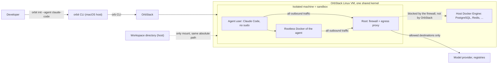

# Architecture — orbit

The code so far is the composition root in `cmd/orbit`; the modules under `internal/` do not exist yet. This file records the target structure, so that new code follows it. Rows marked **proposal** are not yet confirmed by the owner; they mirror the proposal rows in `.ai/specs/product-brief.md`. Keep this file current as the system changes. Agents read it (through `AGENTS.md`) before structural changes.

## Purpose and scope

Orbit is a Go CLI that runs coding agents in sandboxes on OrbStack. It is the OrbStack counterpart of local [Docker Sandboxes](https://docs.docker.com/ai/sandboxes/architecture/) (D13). The first version runs Claude Code on OrbStack on macOS, authenticated with the subscription of the user (D16). Other agents, Codex first, are added as agent definitions. A sandbox is one OrbStack isolated machine per project directory (D12, D18). Orbit supports no other engine (R07, N06).

Orbit deliberately does not provide cloud sandboxes, organization governance, kits, or an MCP gateway. It never gives an agent the engine socket of the host, and it builds no access to services on the host engine (D15). See the Non-goals in the product brief.

## System context



Docker Sandboxes have five isolation layers. This table maps each one to an OrbStack isolated machine.

| Layer in Docker Sandboxes | Orbit mechanism | Status | Known gap against `sbx` |
|---|---|---|---|
| Hypervisor: one microVM per sandbox | One isolated machine per sandbox: `orb create --isolated`. No macOS file system, no `mac` commands, no device passthrough. | active (D12) | All machines and containers share the kernel of the OrbStack VM. OrbStack does not recommend isolated machines against code that actively tries to exploit the kernel. The owner accepted this limit (A01). |
| Network: host proxy, deny by default | Inside the machine, root owns a firewall that sends all outbound traffic of every non-root uid, and so of the agent and its containers, to a root-owned egress proxy, which enforces the network policy (D14). The spike found that `--isolate-network` blocks only `host.orb.internal`; containers on the host engine and the Mac stay reachable for root in the machine, so the firewall is the only barrier for the agent. | active; held in the spike (A05) | The enforcement point is inside the sandbox, not on the host as in `sbx`. It holds only while the agent cannot become root in its machine. HTTPS is filtered by host name, without TLS interception. |
| Docker Engine: private engine per sandbox | The agent uses rootless Docker inside its machine. The host engine socket is never shared (R01). | active (D12, D14) | Rootless Docker has limits (no privileged containers, ports below 1024). The agent has no sudo; `sbx` gives sudo. |
| Workspace: direct, clone, mountless | Direct mount first: `--mount SRC:SRC` for the project directory only, at the same absolute path (R08). Git worktrees live inside the project directory (D18). Clone and mountless later. | active | A direct mount is read-write. Files that run on the host later (Git hooks, build scripts, `.claude/` settings) need review after a session. |
| Credentials: host-side injection | Agent login: the user signs in with `/login` inside the sandbox. Orbit never stores or intermediates the credential (D08, R04). A token path is later scope (Q12). Host `~/.claude` is never mounted: on macOS it holds no login, and it holds the history of every project. Git: the host SSH agent is forwarded by default, as a socket; `orbit init --no-ssh` leaves it out (R08). Forwarding into an isolated machine is untested (A06). Any other credential is opt-in, for example a short-lived token (D10). | partly active | The agent can read its own login; `sbx` keeps it outside the sandbox. Orbit cannot do that: the provider terms forbid developers to intermediate the credential. A forwarded SSH agent lets the agent use every key in it; a token scoped to one repository, or a GitHub App, is narrower. |

## Components

The layout is a vertical slice architecture adjusted to Go. A **module** is a bounded context under `internal/`. A **slice** is one user-visible operation: one Go package that holds its contract, handler, CLI command, and tests.

```text
cmd/orbit/main.go          composition root: build adapters, wire slices, run
internal/
  sandbox/                 module
    sandbox.go             public API of the module: types and errors that other modules may use
    init/                  slice: contract.go, handler.go, command.go, handler_test.go
    shell/  stop/  start/  destroy/  list/
    internal/              private to the module (enforced by the Go compiler)
  policy/                  module: policy.go (pure matching rules); allow/, deny/, list/ are later scope (D19)
  agent/                   module: agent definitions, one package per agent (claude/)
  credential/              module: which credentials a sandbox may get (R08)
  provision/               module: what root sets up in a machine: agent user, firewall, proxy, rootless Docker
  proxy/                   module: configuration of the egress proxy (tinyproxy) that root runs in the machine
  orbstack/                adapter: OrbStack isolated machines, through the orb CLI
    orbstacktest/          deterministic fake for handler tests
  kernel/                  shared kernel: only what three or more modules need
```

| Component | Location (planned) | Responsibility | Depends on |
|---|---|---|---|
| Composition root | `cmd/orbit` | Builds the adapters, registers every slice command, maps errors to exit codes. Contains no behavior. | every module |
| Sandbox | `internal/sandbox` | Lifecycle of the sandbox of a project directory: init, shell, stop, start, destroy, list (D19). Owns the sandbox spec and the mount rules. | `orbstack`, `provision`, `agent`, `policy`, `credential`, `kernel` |
| Policy | `internal/policy` | Network policy rules: the default rules, and matching a destination. Commands that list and change rules are later scope (D19). | `kernel` |
| Agent | `internal/agent` | What each agent needs: image, start command, start command, required domains, and state paths. See Agent definitions. Claude Code first. | `kernel` |
| Credential | `internal/credential` | Which host credentials a sandbox may get, and in which form. By default only the forwarded SSH agent socket, which `--no-ssh` removes (R08). | `kernel` |
| Provision | `internal/provision` | The root-owned setup of a machine: the agent user without sudo, the firewall, the proxy service, rootless Docker, the fixed toolchain. Owns the firewall rules as a pure function. | `policy`, `kernel` |
| Proxy | `internal/proxy` | The configuration of tinyproxy, the egress proxy that root runs in the machine (D22). The proxy enforces the policy. | `policy`, `kernel` |
| OrbStack adapter | `internal/orbstack` | The only package with OrbStack-specific code: create, start, run a command in, stop, remove, and list isolated machines (R07). | — |
| Kernel | `internal/kernel` | Shared error and result types. Stays small. | nothing in this repository |

### Slice anatomy

- `contract.go` — the `Input` and `Output` structs and the sentinel errors of the operation. Write it first.
- `handler.go` — `Handler` with its dependencies as fields, and `Handle(ctx, Input) (Output, error)`. A handler declares the narrow interface it needs from OrbStack or a store; the adapter satisfies it. Do not create an interface for a helper that has one implementation and no test value.
- `command.go` — the CLI command: parse flags into `Input`, call the handler, render `Output`. No decisions here.
- `handler_test.go` — table tests for the happy path, the invalid input, and the OrbStack failure.

### Agent definitions

An agent is data, not code paths. Each agent is one package under `internal/agent/` that exports one `agent.Definition`:

```text
internal/agent/
  agent.go        Definition type, Registry, Lookup(name)
  claude/         the Claude Code definition and its test
```

| Field of `Definition` | Meaning | Claude Code |
|---|---|---|
| `Name` | The value of `orbit init --agent` | `claude-code` |
| `Install` | Commands that provisioning runs as the agent user to install the official client | the published Claude Code installer |
| `EgressDomains` | Destinations the client and its login need. They become default allow rules for a sandbox of this agent. | recorded by the A02 spike |
| `StatePaths` | Paths in the home of the agent user that hold login and history | `~/.claude`, `~/.claude.json` |

Rules:

- To add an agent, add one package with a `Definition` and its test, and register it in `cmd/orbit`. No slice changes.
- No code outside `internal/agent/<name>` compares an agent name. A slice that needs agent-specific behavior gets a new field in `Definition`.
- A `Definition` holds no secret and no user-specific value.
- Each definition has a test that checks its fields against R04: an official install source, no change to the client, and no stored credential.

### Dependency rules

1. Nothing imports `cmd/orbit`. Only `cmd/orbit` imports the adapter `internal/orbstack`.
2. A slice imports the root package of its own module, the `internal/` of its own module, port packages, and `kernel`. A slice never imports another slice.
3. A module uses another module only through that module's root package. The Go `internal/` rule makes the private part unreachable.
4. `kernel` imports nothing from this repository.
5. A security decision is a pure function in a module, not logic in a handler or a command: the sandbox spec, mount validation, credential selection, firewall rules, and policy matching. Handlers load, call the function, and act on the result.

The compiler enforces rule 3. A lint rule (import restrictions in `golangci-lint`) will enforce rules 1, 2, and 4 once the packages that they name exist.

### Provisioning requirements

These come from the spike of 2026-11-10 on OrbStack 2.2.5 (`.ai/analysis/2026-11-10-orbstack-isolated-machine-spike.md`). Each one is a test in the escape suite.

- Create the machine with `--isolated --isolate-network` and mount the workspace as `SRC:SRC`. A mount without a destination lands under `/mnt/mac`. The image is Ubuntu 26.04, the one the spike used.
- The machine name is the Orbit prefix, a slug of the directory name, and a short hash of the resolved absolute path of the project directory: `orbit-<slug>-<hash>`. Orbit finds the sandbox of a directory by computing this name.
- Remove the default user that OrbStack creates, or its sudo rule. It has passwordless sudo.
- The firewall rule matches every uid from 1000 up, not only the agent uid. Rootless container traffic leaves as the agent uid or as one of its sub-uids. IPv4, IPv6, DNS, UDP, and ICMP are covered.
- The proxy is tinyproxy (D22). A firewall rule for the uid of the proxy refuses private, link-local, and loopback destinations, except its DNS resolver, so that an allow rule cannot open the host engine or the Mac.
- The agent has no DNS. Its tools use the proxy: `HTTPS_PROXY`, the proxy settings in `~/.docker/config.json`, and a proxy drop-in for the rootless Docker daemon.
- The firewall, the proxy, and the address that containers use to reach the proxy start as persistent units before any agent process. Without that, a restart leaves containers with no proxy (they fail closed).
- Allow rules are host names seen in `CONNECT`. This is not data-loss prevention: an allowed host can receive uploads, and a different TLS name behind an allowed host is not detected.
- The default allowlist is the list in D21, plus the `EgressDomains` of the installed agent. It is fixed in the first version.
- With SSH agent forwarding (R08), the host agent is the socket `/opt/orbstack-guest/run/host-ssh-agent.sock`, group `orbstack`. The agent user needs that group. Git reaches GitHub over `ssh.github.com:443` through the proxy; port 22 stays closed.
- Provisioning installs a fixed toolchain as root (D17): git, openssh-client, curl, ca-certificates, jq, ripgrep, unzip (D20). The agent cannot install system packages: no `apt-get`, no system-wide `pip`. It uses user-space installs or a container. No `--privileged` containers.

Measured footprint of one sandbox: 1.3 GB of disk when provisioned, 2.3 GB with Claude Code and a few images; about 400 MB of memory when idle; 12 s to create, under 2 s to start, stop, or delete. Images are stored per sandbox and are not shared with the host engine.

## Data

Orbit has no database.

- **Sandbox state:** OrbStack is the source of truth. Orbit names the machines it creates with a fixed prefix (see Provisioning requirements) and reads state back from OrbStack.
- **Agent state:** the disk of the machine holds the home directory of the agent (login, history, installed tools, images of the inner engine). `orbit destroy` deletes the machine and that state.
- **Network policy and settings:** files in the user config directory (`$XDG_CONFIG_HOME/orbit`, default `~/.config/orbit`). The `policy` module owns the format. A format change needs a migration note in the PR. The first version has a fixed default allowlist; user rules are later scope (D19).
- **Workspace files:** live on the host. Orbit never copies or deletes them.

## Cross-cutting concerns

- **Authentication and authorization:** Orbit has no accounts. The agent authenticates to its provider with the official client, unmodified (R04). Orbit never mounts or reads host `~/.claude`, never reads the Keychain entry of the agent, and never stores a credential of the agent (D08). The host SSH agent is forwarded into a sandbox by default, as a socket, unless the user passes `--no-ssh`; no key file enters. Any other Git credential enters only by opt-in (R08, D10); a GitHub App identity for the agent is later scope.
- **Configuration and secrets:** Orbit finds OrbStack through the `orb` command. No secret is written to the repository, to logs, to machine configuration, or to image layers.
- **Error handling and logging:** handlers return errors wrapped with `%w` and matched with `errors.Is`. Only `cmd/orbit` prints errors and sets the exit code. Output goes to stdout; diagnostics go to stderr. No `panic` for expected failures.
- **Testing strategy:**
  - Unit tests for the pure security functions, with table tests that include hostile input (symlinks out of the workspace, `..` paths, wildcard domains).
  - Handler tests against `orbstacktest`, with no OrbStack running.
  - Integration tests behind the `integration` build tag, against a real OrbStack.
  - An escape suite: tests that run inside a real sandbox and must fail to read a host path outside the workspace, reach the host engine socket, reach the macOS host, reach a destination with no allow rule (from the agent user, from a rootless container, and over DNS), become root, or reach another sandbox. Every change to the sandbox boundary runs it (see `SDLC.md`).

## Key decisions

The product brief is the decision record; the ids below point to it.

| Date | Decision | Why | Consequences |
|---|---|---|---|
| 2026-11-10 | Go CLI (D02) | Owner's choice. One static binary, and the container ecosystem is written in Go. | The validation gate is the Go toolchain. |
| 2026-11-10 | Vertical slices adjusted to Go (D03) | Change locality: one operation is one package with its contract and tests. | Slices are packages, not folders of layers. `internal/` replaces the `index.ts` public API of the source guide. Some duplication between slices is accepted; shared invariants live in the module root. |
| 2026-11-10 | OrbStack isolated machine as the first backend (D12) | Owner's choice. The agent gets its own Docker Engine without the host socket. | Supersedes the hardened-container and proxy-container proposals (D06, D07). OrbStack cannot run a microVM per sandbox: one shared kernel, no nested KVM on Apple Silicon. Egress enforcement is open (Q08). |
| 2026-11-10 | OrbStack only (D13, R07, N06) | Docker's own setups already have `sbx`. | No backend abstraction. OrbStack-specific code sits in `internal/orbstack`; handlers use narrow interfaces only for tests. |
| 2026-11-10 | Root-owned firewall and proxy; agent without sudo, with rootless Docker (D14) | Deny-by-default egress must survive an agent that tries to remove it. | Tools the agent needs are installed by provisioning or in user space. Unproven until the A05 spike. |
| 2026-11-10 | No access to host-engine services (D15, N07) | Not needed. | OrbStack does not block this by itself (Q09). The in-machine firewall and a proxy that refuses private addresses do. |
| 2026-11-10 | Sign-in with `/login` inside the sandbox; no credential handling in Orbit (D08, R04) | The Claude Code legal page allows a user to sign in to the unmodified binary with their own subscription, and forbids developers to collect, store, or intermediate those credentials. `sbx` uses the same sign-in. | One `/login` per sandbox. A token path waits for Q12. A public release needs the check in Q11. |
| 2026-11-10 | Agents are declarative definitions (D16) | The owner wants new agents to be easy to add. Claude Code first, Codex next. | Slices never branch on an agent name. A new agent is one package plus one registration line. |
| 2026-11-10 | Isolation before reuse of the host engine (D09, proposal) | The earlier `orb-sbx` design offered a trusted mode with the host engine socket and SSH agent forwarding. The owner then allowed opt-in, minimized Git credentials (R06, D10). | No host engine socket, ever (D12). The mechanism for D10 needs a spec. Git worktrees per agent, a YAML project file, and structured JSON logs from that design stay as later scope. |
| 2026-11-10 | One sandbox per project directory; project-scoped commands (D18, D19) | Owner's choice: `n` worktrees run inside one sandbox. | `orbit init`, `shell`, `stop`, `start`, and `destroy` find the sandbox from the current directory. Agents in one sandbox are not isolated from each other. No `orbit run`: the user starts the client in `orbit shell`. |
| 2026-11-10 | Host SSH agent forwarded by default (R08) | Owner's choice; `--no-ssh` turns it off. | The agent can use every key in the forwarded agent on every SSH host it can reach. Port 22 needs an allow path for Git hosts (Q15). Untested in an isolated machine (A06). |
| 2026-11-10 | tinyproxy and nftables enforce egress; fixed default allowlist (D21, D22) | Both spikes proved the pair. The first version has no `orbit policy`. | `internal/proxy` and `internal/provision` generate configuration; they are pure functions with hostile-input tests. A new default destination needs the owner's yes. |
| 2026-11-10 | OrbStack is the state store | No second source of truth to drift. | Every machine that Orbit creates carries the Orbit name prefix. |
